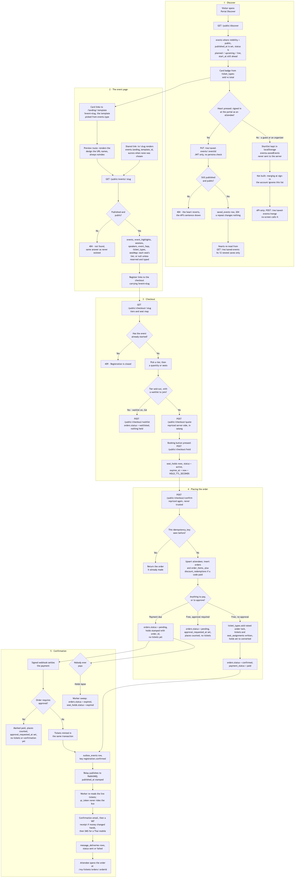

# Discover and register

**Screens:** Portal Discover, Event landing page, Checkout

The attendee's whole funnel, from browsing with no account to holding a ticket. It starts on the public Discover grid, goes through a landing page for the event into checkout, and ends with an order, its `tickets` rows and the confirmation eventa-worker posts. Nothing on this path needs an account, and nothing on it creates one — the attendee persona is separate from the organizer persona, even for the same email address.

1. **Discover.** `GET /public/discover` is anonymous and read-only. It returns `events` rows that pass every part of the public floor: `visibility = 'public'`, `deleted_at IS NULL`, `published_at IS NOT NULL`, `status` in `planned` / `upcoming` / `live`, and `start_at` still in the future — an event already under way is no longer worth discovering. Search matches the event's `name`, `city` or `venue_name` and its `categories.name`, accent- and tone-insensitively through `public.search_norm`, which strips Latin diacritics and Thai vowel and tone marks so "café" finds "cafe" and Thai text matches whether or not its marks were typed — it does not transliterate, so Thai titles still need Thai to find them. Each card's urgency badge is read across the whole event rather than one tier: **Waitlist** when every tier is exhausted (`ticket_types.sold >= total`, with `total = 0` meaning unlimited), and any tier at `status = 'paused'` keeps the event off it, because that is the organizer withholding stock rather than demand; the badge does not look at `events.waitlist_enabled`, so it says Waitlist even on an event with no line to join. **Selling fast** shows at 90% of the bounded allocation. The "from" price is the cheapest tier whose count is not used up — its `status` is not consulted, so a paused or still-`scheduled` tier can set it — formatted by the API from `price_satang`, or "Free"; when every tier is used up there is no price, and the card shows a dash rather than `฿0`. The heart saves an event for later, and *where* it is kept is decided by the persona the browser's session carries, not by asking the server. An attendee signed in at the portal gets `PUT /me/saved-events/:eventId`, which re-checks the event against the same published-and-public floor — minus the start-time cut, so a save outlives the browse — and refuses one that has gone with a 404 "This event isn't available."; otherwise it inserts a `saved_events` row keyed by `user_id` alone, with no `organization_id`, because one shortlist spans every organizer on the platform. The insert is `ON CONFLICT DO NOTHING` on `uq_saved_events_user_event`, so a double tap leaves one row and answers 204, and `DELETE /me/saved-events/:eventId` is a 204 even when nothing was saved. Both calls sit behind the global JWT guard alone — 401 without a token — and check no persona; it is the web that treats an organizer's console session as a guest here. Everybody else keeps the shortlist in `localStorage` under `eventa.savedEvents` and nothing reaches the server, because requiring an account to bookmark something would put a sign-in wall in front of the one page meant to be shareable. Each press posts the state it wants rather than "toggle", so two quick presses cannot land on the opposite; on a refusal the heart falls back to what the loader last read and the API's own sentence appears under the card. A signed-in attendee's filled hearts come from `GET /me/saved-events` called with no paging, which answers with the 12 most recently saved events less any no longer public — so an older save shows an empty heart, and pressing it changes nothing, because the idempotent insert does not move `saved_at`. **No screen lists saved events**; that call only colours the hearts. **Merging a guest's saves into the account at sign-in is not built.** `POST /me/saved-events/merge` exists — at most 100 event uuids, ids no longer public dropped rather than rejected, duplicates absorbed by the same unique pair, and the count of genuinely new rows returned as `merged` — but nothing in the web calls it: not portal sign-in, not sign-up, not the "Keep these tickets" offer on the guest order page, although comments in the web say they do. Once a guest signs in, Discover reads the account's list and ignores the browser's, which is neither sent nor cleared and comes back if they sign out. Nothing downstream reads `saved_events` either, so no reminder is ever sent for a saved event.
2. **The event page.** A Discover card does **not** open the event as its organizer designed it. Its link is `/landing/<template>?event=<slug>`, and the web picks the template from the event's `type` through a fixed table — Conference, Networking and Seminar open `aurora`, Workshop and Charity & Gala `minimal`, Sports & Wellness and Concert & Festival `atlas`, Exhibition `noir` — never from `events.landing_template_id`. `/landing/:template` is the template-preview route the landing-page switcher and the create-event wizard also open: it renders whichever design the URL names and always marks the page noindex. The canonical address is `/e/<slug>`, the one the API writes into the page's own share link and every share message, and it renders `events.landing_template_id`, or `aurora` when none was chosen. The two often disagree: a Conference whose organizer chose `minimal` opens from Discover as `aurora`, and a Sports & Wellness event with no choice opens there as `atlas` but as `aurora` at its own address. Either way it is one anonymous call, `GET /public/events/:slug`, which resolves the event only when it is published and public — a draft, unlisted or private event is simply "not found", indistinguishable from one that never existed, so the lookup *is* the authorization check. The payload is assembled from `events` plus `event_highlights`, `sessions`, `speakers`, `event_faqs` and `ticket_types`, with the section headings the organizer chose (`events.agenda_title`, `events.speakers_title`). `GET /public/events/:slug/calendar.ics` serves the same event as a calendar file. The **Register** call to action is a link to the checkout, `/portal/checkout?event=<slug>`.
3. **Checkout.** `GET /public/checkout/:slug` resolves the event the same way and returns its tiers and, for a `seating_mode = 'reserved'` event, its seat map with taken seats greyed out; registration is refused with a 409 "Registration is closed for this event." once `events.start_at` has passed. Every change of tier, quantity, seat or discount code re-posts to `/public/checkout/quote`, which writes nothing — the subtotal is `ticket_types.price_satang` times the quantity, the discount is what Discounts quotes for the code, the service fee is charged on the discounted amount and rounded down, and VAT is restated out of the resulting total. All of it is integer satang worked out by the API; the browser only formats. Pressing the booking button — "Confirm registration", or "Pay" / "Continue to pay" with the total — first calls `POST /public/checkout/hold`, which inserts `seat_holds` with `status = 'active'` and `expires_at = now + HOLD_TTL_SECONDS` (ten minutes by default): one row carrying `quantity` for general admission, where availability is `total − sold − active held` under a `FOR UPDATE` lock on the tier, and one row per `seat_id` for reserved seating, where the seat rows are locked `FOR UPDATE` and re-checked before the insert, with the partial unique index `uq_seat_hold_active` (one `active` hold per seat) as the backstop. A booking is 1–8 seats. A tier whose live status is sold out offers the line instead when `events.waitlist_enabled` is on and the event is general admission: no quote and no hold, but `POST /public/checkout/waitlist`, an order with `status = 'waitlisted'` that holds nothing (see [Waitlist](04-waitlist.md)).
4. **Placing the order.** In the same press the web calls `POST /public/checkout/confirm`, and gives the hold straight back with `DELETE /public/checkout/hold` if that call fails. Confirm re-prices the selection server-side rather than trusting the request, then writes everything in one transaction. An `orders` row already carrying this `idempotency_key` short-circuits the whole thing — that lookup, backed by the unique `uq_orders_org_idem` on (`organization_id`, `idempotency_key`), is why a double-tapped Confirm returns the first registration instead of placing a second — otherwise the holds are re-read as still `active` and unexpired (a 409 "Your seats were released while you were checking out. Please choose again." if not), `attendees` is upserted so a repeat buyer updates rather than duplicates, and `orders` is written with a random reference like `ORD-7K2M9QX4`, its satang columns, and `requires_approval` copied from the event as a snapshot so flipping the event's switch later cannot change the deal this buyer made. One `order_items` line follows, plus a `discount_redemptions` row when a code paid off. A free registration on an event needing no decision finishes here: `ticket_types.sold` raised under a `FOR UPDATE` lock, one `tickets` row per admission with its `qr_token`, `seat_assignments` bound to those tickets, holds moved to `'converted'`, the order at `status = 'confirmed'` / `payment_status = 'paid'`, and the `registration.confirmed` row written to `outbox_events` inside the same transaction (see [Free registration and confirmation](03-free-registration-and-confirmation.md)). Anything owed is placed as `status = 'pending'` / `payment_status = 'pending'` with its holds stamped with `order_id` and still running down, and deliberately **no `tickets` rows** — nobody holds a QR for something they have not paid for; the same press then starts the payment with `POST /public/payments`. On an event that requires approval, nothing is ticketed here either: a free registration waits with `approval_requested_at` set and its places already counted, and a paid one starts waiting when the money lands (see [Approval](05-approval.md)).
5. **Confirmation.** Money is only ever confirmed by a signature-verified provider webhook, `POST /public/payments/webhook/:token`, which settles the payment and mints the tickets in the same transaction that writes the `registration.confirmed` row to `outbox_events` — so "paid", "ticketed" and "told" cannot drift apart (see [Checkout and payment](02-checkout-and-payment.md)). A free order's row was already written by the confirm transaction in step 4. On an order whose `requires_approval` is set, the webhook mints nothing and queues nothing: it marks the order paid, counts its places and sets `approval_requested_at`, and the tickets and the confirmation wait for the organizer's decision (see [Approval](05-approval.md)). The relay publishes the `registration.confirmed` row to RabbitMQ and stamps `published_at`; eventa-worker's `RegistrationConfirmedHandler` consumes it, re-reads the live `tickets` from the database rather than the message — a `qr_token` is a bearer credential and never travels on the bus — and sends the confirmation email unless the workspace has switched it off (`message_templates.active` for `registration-confirmation`), then the itemised VAT receipt when money actually changed hands and both receipt switches are on, then an SMS if the buyer gave a Thai mobile, an SMS transport is configured and the confirmation's channels include `sms`. Each part is recorded as it is sent, so a redelivery sends only what is still owed, and every send lands a `message_deliveries` row with `status` `sent` or `failed`. The email links to `/my/tickets/orders/:orderId`, which anyone holding the uuid may open: registration never required an account, so reading what you bought must not either. If the buyer never pays, the worker's `order-expiry` cron, sweeping every minute, closes orders still `pending` / `pending` and not awaiting a decision whose last hold lapsed more than `ORDER_EXPIRY_GRACE_MS` ago (two minutes by default) — `orders.status = 'expired'`, `seat_holds.status = 'expired'` — which is how an abandoned checkout gives its seats back. All of these timestamps are UTC in the database and render in Asia/Bangkok on screen.

```mermaid
flowchart TD
  subgraph ONE["1 · Discover"]
    A["Visitor opens<br/>Portal Discover"] --> B["GET /public/discover"]
    B --> C["events where visibility = public,<br/>published_at is set, status is<br/>planned / upcoming / live,<br/>start_at still ahead"]
    C --> D["Card badge from ticket_types:<br/>sold vs total"]
    D --> E{"Heart pressed: signed in<br/>at the portal as an attendee?"}
    E -- "Yes" --> F["PUT /me/saved-events/:eventId<br/>JWT only, no persona check"]
    F --> F1{"Still published<br/>and public?"}
    F1 -- "No" --> F2["404 · the heart reverts,<br/>the API's sentence shown"]
    F1 -- "Yes" --> F3["saved_events row, 204<br/>a repeat changes nothing"]
    F3 --> F4["Hearts re-read from<br/>GET /me/saved-events<br/>its 12 newest saves only"]
    E -- "No · a guest or an organizer" --> G["Shortlist kept in localStorage<br/>eventa.savedEvents<br/>never sent to the server"]
    G --> G1["Not built: merging at sign-in<br/>the account ignores this list"]
    G1 --> G2["API-only: POST /me/saved-events/merge<br/>no screen calls it"]
  end

  subgraph TWO["2 · The event page"]
    H["Card links to /landing/:template<br/>?event=slug, the template<br/>picked from events.type"] --> H1["Preview route: renders the<br/>design the URL names,<br/>always noindex"]
    H2["Shared link /e/:slug renders<br/>events.landing_template_id,<br/>aurora when none was chosen"]
    H1 --> I["GET /public/events/:slug"]
    H2 --> I
    I --> J{"Published and<br/>public?"}
    J -- "No" --> K["404 · not found,<br/>same answer as never existed"]
    J -- "Yes" --> L["events, event_highlights, sessions,<br/>speakers, event_faqs, ticket_types"]
    L --> M["Register links to the checkout<br/>carrying ?event=slug"]
  end

  subgraph THREE["3 · Checkout"]
    N["GET /public/checkout/:slug<br/>tiers and seat map"] --> O{"Has the event<br/>already started?"}
    O -- "Yes" --> P["409 · Registration is closed"]
    O -- "No" --> Q["Pick a tier, then<br/>a quantity or seats"]
    Q --> S{"Tier sold out, with<br/>a waitlist to join?"}
    S -- "Yes · waitlist on, GA" --> T["POST /public/checkout/waitlist<br/>orders.status = waitlisted,<br/>nothing held"]
    S -- "No" --> R["POST /public/checkout/quote<br/>repriced server-side, in satang"]
    R --> U["Booking button pressed:<br/>POST /public/checkout/hold"]
    U --> V["seat_holds rows, status = active,<br/>expires_at = now + HOLD_TTL_SECONDS"]
  end

  subgraph FOUR["4 · Placing the order"]
    W["POST /public/checkout/confirm<br/>repriced again, never trusted"] --> X{"This idempotency_key<br/>seen before?"}
    X -- "Yes" --> Y["Return the order<br/>it already made"]
    X -- "No" --> Z["Upsert attendees; insert orders<br/>and order_items, plus<br/>discount_redemptions if a code paid"]
    Z --> AA{"Anything to pay,<br/>or to approve?"}
    AA -- "Free, no approval" --> AB["ticket_types.sold raised under lock,<br/>tickets and seat_assignments written,<br/>holds set to converted"]
    AB --> AC["orders.status = confirmed,<br/>payment_status = paid"]
    AA -- "Free, approval required" --> AN["orders.status = pending,<br/>approval_requested_at set,<br/>places counted, no tickets"]
    AA -- "Payment due" --> AD["orders.status = pending,<br/>holds stamped with order_id,<br/>no tickets yet"]
  end

  subgraph FIVE["5 · Confirmation"]
    AE["Signed webhook settles<br/>the payment"] --> AE1{"Order requires<br/>approval?"}
    AE1 -- "Yes" --> AE2["Marked paid, places counted,<br/>approval_requested_at set,<br/>no tickets or confirmation yet"]
    AE1 -- "No" --> AE3["Tickets minted in<br/>the same transaction"]
    AE3 --> AF["outbox_events row,<br/>key registration.confirmed"]
    AG{"Nobody ever<br/>pays"} -- "Holds lapse" --> AH["Worker sweep: orders.status = expired,<br/>seat_holds.status = expired"]
    AF --> AI["Relay publishes to RabbitMQ;<br/>published_at stamped"]
    AI --> AJ["Worker re-reads the live tickets;<br/>qr_token never rides the bus"]
    AJ --> AK["Confirmation email, then a VAT<br/>receipt if money changed hands,<br/>then SMS for a Thai mobile"]
    AK --> AL["message_deliveries rows,<br/>status sent or failed"]
    AL --> AM["Attendee opens the order<br/>at /my/tickets/orders/:orderId"]
  end

  D --> H
  M --> N
  V --> W
  AC --> AF
  AD --> AE
  AD --> AG
```

Mermaid source

[← All flows](README.md)
