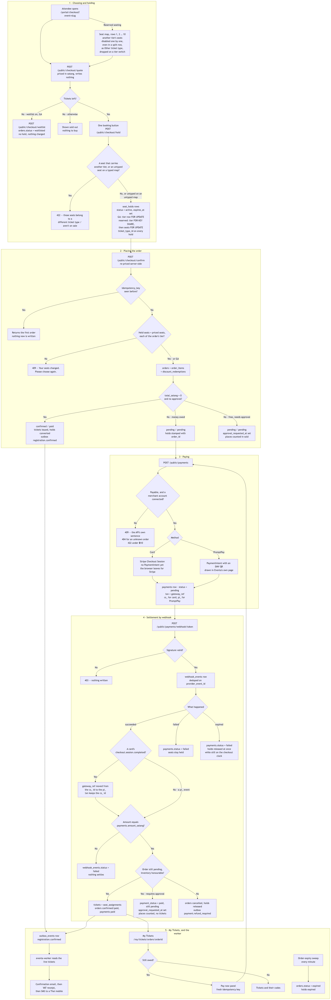

# Checkout and payment

**Screens:** Checkout, Stripe Checkout / PromptPay, My Tickets

How an attendee turns a chosen ticket into an admission they can show at the door. It starts on the public checkout page, where nobody needs an account, and ends when the money has settled, the `tickets` rows exist and eventa-worker has posted the confirmation. Free registrations take the same path and simply skip steps 3 and 4 (see [Free registration and confirmation](03-free-registration-and-confirmation.md)); joining a sold-out tier's line is [Waitlist](04-waitlist.md), and an order that waits for the organizer is [Approval](05-approval.md).

1. **Choosing and holding.** The attendee lands on `/portal/checkout?event=<slug>`; `GET /public/checkout/:slug` resolves a published, public event and its `ticket_types`. Every change of quantity, seat or discount code re-posts to `/public/checkout/quote`, which writes nothing — the tier's `price_satang` times the quantity is the VAT-inclusive subtotal, the discount is whatever Discounts quotes for the code, the service fee is `floor(discounted × service_fee_rate)`, and VAT is restated out of the resulting total. Every figure is integer satang worked out by the API; the browser only formats it. There is no separate Book step: the one booking button — "Continue to pay ฿…" for a card, "Pay ฿…" for PromptPay, "Confirm registration" when nothing is owed — runs a single form action that calls `POST /public/checkout/hold`, then confirm (step 2), then, when money is owed, pay (step 3). The hold inserts `seat_holds` with `status = 'active'` and `expires_at = now + HOLD_TTL_SECONDS`: one row carrying `quantity` for general admission, one row per `seat_id` for reserved seating, where the tier row is taken `FOR KEY SHARE` first (tier before seats, the order the seat-map save and settlement lock in) and the seat rows are then locked `FOR UPDATE` and re-checked before the insert, and the partial unique index `uq_seat_hold_active` (one `active` hold per seat) is the database's backstop against two buyers holding the same seat. On a reserved event the checkout view sends each seat with its `ticketTypeId`, and the seat map lists rows in number order (1, 2 … 10, never 1, 10, 2), disables every seat whose type is set and is not the tier chosen — styled, and named in the legend, as "Other ticket type" — and drops any picked seat of another type when the buyer switches tier. The API holds the same line rather than trusting the page: a seat that carries another tier is a 422 ("Those seats belong to a different ticket type. Please choose again.") at quote, hold and confirm alike, while a seat with no type — on a map laid out before rows carried types — still sells under whichever tier is chosen. A reserved seat's hold records the tier being bought in `seat_holds.ticket_type_id`, as a general-admission hold does. A booking is 1–8 seats (anything else is a 422), and a general-admission tier with too few left is refused with a 409 in words the buyer can act on ("Only 3 left — please reduce your quantity."). A sold-out tier offers the line instead — but only when the organizer switched the waitlist on and the event is general admission; otherwise it simply shows sold out. Joining is `POST /public/checkout/waitlist`, which writes an order with `status = 'waitlisted'` and its `order_items` line, holds nothing and charges nothing.
2. **Placing the order.** `POST /public/checkout/confirm` re-prices the selection server-side rather than trusting the request, then does everything in one transaction. An `orders` row already carrying this `idempotency_key` short-circuits the whole thing, so a confirm sent twice returns the first registration instead of placing a second; `uq_orders_org_idem` is the backstop for two that arrive at the same instant, where the loser's insert fails and its transaction rolls back rather than placing a duplicate. Otherwise the holds are re-read as still `active` and unexpired (a lapsed one is a 409, "Your seats were released while you were checking out. Please choose again.") and must cover exactly the seats that were priced, each one that carries a type being of the order's tier; anything else is a 409, "Your seats changed. Please choose again.", which is what stops a buyer holding a VIP seat and paying the Normal price for it. Then `attendees` is upserted, and `orders` is written with a random reference like `ORD-7K2M9QX4`, the satang columns `subtotal_satang` / `discount_amount_satang` / `vat_amount_satang` / `total_satang`, and `requires_approval` copied from the event as a snapshot so flipping the event's switch later cannot change the deal this buyer made. One `order_items` line is written, plus a `discount_redemptions` row when a code paid off. A free registration on an event that needs no decision is finished here: `status = 'confirmed'`, `payment_status = 'paid'`, `ticket_types.sold` raised under a `FOR UPDATE` lock, one `tickets` row per admission with its `qr_token`, `seat_assignments` bound to those tickets, the holds moved to `'converted'`, and the `registration.confirmed` outbox row written in the same transaction (step 5). A free registration on an event that requires approval is placed `pending` / `pending` with `approval_requested_at` set and its places counted in `ticket_types.sold` at once, waiting for the organizer. Anything owed is placed as `status = 'pending'`, `payment_status = 'pending'`, with its holds stamped with `order_id` and still running down — and deliberately **no `tickets` rows**, so nobody holds a QR for something they have not paid for. If confirming throws, the web action releases the holds (`DELETE /public/checkout/hold`, which frees only holds no order has taken over) rather than leaving seats locked away.
3. **Paying.** `POST /public/payments` names an order and a method, never an amount: the charge is `orders.total_satang`, read server-side. It is refused with a 409 and a sentence written for the buyer when the order is already paid, has `status = 'expired'`, is no longer `pending`, costs nothing, or belongs to a workspace whose `payment_settings` row is not `connected` with a real account id — collecting into the platform's own account would take money the organizer could never reach. An unknown order id is a 404, and the adapter refuses with a 422 a total under ฿10 or one not in THB before any money moves. **Card** opens a Stripe Checkout Session and the browser leaves for Stripe's own page; this app hosts no card field anywhere. Checkout does not mint the session's PaymentIntent until the buyer actually pays, so at creation the only reference that exists is the session's own `cs_…` id, and that is what the `payments` row records as `gateway_ref` — the adapter would take a `pi_…` if the session already carried one, but normally it does not, and step 4 moves the row onto the intent once it exists. **PromptPay** stays in Eventa's page: Stripe returns an EMV payload, which the browser draws as a QR, and the deadline on it is Eventa's own (`PROMPTPAY_EXPIRY_SECONDS`, anchored to the intent's creation) because Stripe publishes none. That deadline only goes back to the browser as `expiresAt`: the page does not show it and nothing cancels the intent when it passes, so what actually ends the buyer's window is the seat hold's own `expires_at` and the expiry sweep in step 5. Either way a `payments` row is written with `method`, `amount_satang`, `status = 'pending'` (or `failed` if the provider refused the attempt on the spot), `txn` and `gateway_ref` both set to that provider reference (the session's `cs_…` for card, the intent's `pi_…` for PromptPay), and `gateway_account_id` stamped with the connected account — meant to make a later refund reverse on the same account, but nothing reads it back yet: a refund is issued with whatever secret key the workspace's active mode holds at that moment. `uq_payments_org_idem` makes a replayed request find its own attempt.
4. **Settlement, which only the webhook decides.** Landing back on the return URL means the buyer finished at the provider, not that money moved. `POST /public/payments/webhook/:token` resolves the workspace from the token in the URL — a callback carries no session, and the signature cannot be checked until we know whose signing secret to check it against — verifies the signature over the raw bytes, and refuses anything unsigned. A `webhook_events` row deduplicated on `(provider, provider_event_id)` makes processing exactly-once across retries and replicas. A card payment settles on `checkout.session.completed`, and only once the session's `payment_status` is `paid`, since a completed session can still have money in flight; it finds the row by the `cs_…` id it was started under and first moves `gateway_ref` onto the `pi_…` the session has now created, because that is what a refund hands to Stripe — `txn` is not touched and keeps the session id. Stripe's own `payment_intent.succeeded` for the same charge matches no row until that move and finds one already `paid` after it, so it never settles a second time. On `succeeded` the reported amount is compared with `payments.amount_satang`, and a mismatch settles nothing and leaves `webhook_events.status = 'failed'` for a person to look at. Otherwise one transaction locks the `orders` row, raises `ticket_types.sold`, inserts the `tickets` and their `seat_assignments`, moves the holds to `'converted'`, sets `orders.status = 'confirmed'` with `payment_status = 'paid'` and `confirmed_at`, marks the `payments` row `paid` with `paid_at`, and writes the `registration.confirmed` outbox row — so "paid", "ticketed" and "told" cannot drift apart. If the order can no longer be honoured — it is no longer `pending`, typically because the expiry sweep closed it first (`order_closed`), or the tier was removed or sold out, or a seat went to someone else — the order is cancelled (with `payment_status = 'paid'`), its holds released, and a `payment.refund_required` outbox row queued instead: money wins over a mere hold, but never over an assigned seat. A second payment settling an already-confirmed order queues the same event with reason `duplicate_payment`. A `failed` callback marks the attempt `failed` and leaves the seats held so the buyer can retry or switch method; an `expired` one — Stripe reporting a PromptPay attempt lapsed (`payment_intent_payment_attempt_expired`), a cancelled intent, or a card Checkout Session that expired — also marks the attempt `failed` and releases the holds at once, but only while the order is still `pending`, unpaid and not awaiting a decision. On an event that requires approval (the order's own `requires_approval` snapshot) the money lands but no ticket is minted and no outbox row is written — the order stays `pending` with `payment_status = 'paid'` and `approval_requested_at` set, its places counted in `sold`; a reserved seat whose hold was lost while the buyer paid is refused with `seats_released` instead (see [Approval](05-approval.md)).
5. **My Tickets, and what happens afterwards.** The confirmation links to `/my/tickets/orders/:orderId`, which `GET /public/orders/:orderId` serves to whoever holds the id — registration never required an account, so reading what you bought must not either, and the uuid is the capability. The page shows the order's status, its satang figures formatted at the edge, and each ticket's code; an order still owed shows a countdown to its hold's `expires_at` and a **Pay now** panel that starts a fresh attempt with a new idempotency key, re-polling every five seconds while a PromptPay code is on screen, because a scanned code clears out of band. Meanwhile eventa-worker consumes the `registration.confirmed` outbox row: it reads the live `tickets` from the database rather than from the message — a `qr_token` is a bearer credential and never travels on the bus — and sends the confirmation email unless the workspace switched that message off, then the itemised VAT receipt when the order was paid and both the message template and the workspace's `email_receipts` preference are on, then an SMS if the buyer gave a Thai mobile, the deployment has an SMS transport and the confirmation's SMS channel is on. Each part is recorded as it goes, so a redelivery sends only what is still owed. `payment.refund_required` reaches its own handler, which emails the organizer and the buyer but moves no money — a refund needs a real user on `refunds.issued_by`. Finally, a cron in the worker sweeps every minute: orders still `pending` / `pending`, not awaiting a decision, whose last `seat_holds.expires_at` is older than `now − ORDER_EXPIRY_GRACE_MS` become `status = 'expired'` with their holds expired, which is how abandoned checkouts give their seats back. Times in all of these rows are UTC; the screens render them in Asia/Bangkok.

```mermaid
flowchart TD
  subgraph PICK["1 · Choosing and holding"]
    A["Attendee opens<br/>/portal/checkout?event=slug"] --> B["POST /public/checkout/quote<br/>priced in satang, writes nothing"]
    A -- "Reserved seating" --> SM["Seat map, rows 1, 2 … 10<br/>another tier's seats disabled<br/>as Other ticket type,<br/>dropped on a tier switch"]
    SM --> B
    B --> C{"Tickets left?"}
    C -- "No · waitlist on, GA" --> D["POST /public/checkout/waitlist<br/>orders.status = waitlisted<br/>no hold, nothing charged"]
    C -- "No · otherwise" --> D2["Shown sold out<br/>nothing to buy"]
    C -- "Yes" --> E["One booking button<br/>POST /public/checkout/hold"]
    E --> E1{"A seat that carries<br/>another tier?"}
    E1 -- "Yes" --> E2["422 — those seats belong<br/>to a different ticket type"]
    E1 -- "No, or untyped" --> F["seat_holds rows<br/>status = active, expires_at set<br/>GA: tier row FOR UPDATE<br/>reserved: tier FOR KEY SHARE,<br/>then seats FOR UPDATE<br/>ticket_type_id on every hold"]
  end

  subgraph PLACE["2 · Placing the order"]
    G["POST /public/checkout/confirm<br/>re-priced server-side"] --> H{"idempotency_key<br/>seen before?"}
    H -- "Yes" --> I["Returns the first order<br/>nothing new is written"]
    H -- "No" --> H1{"Held seats = priced seats,<br/>each of the order's tier?"}
    H1 -- "No" --> H2["409 — Your seats changed.<br/>Please choose again."]
    H1 -- "Yes · or GA" --> J["orders + order_items<br/>+ discount_redemptions"]
    J --> K{"total_satang = 0<br/>and no approval?"}
    K -- "Yes" --> L["confirmed / paid<br/>tickets issued, holds converted<br/>outbox registration.confirmed"]
    K -- "No · money owed" --> M["pending / pending<br/>holds stamped with order_id"]
    K -- "No · free, needs approval" --> M2["pending / pending<br/>approval_requested_at set<br/>places counted in sold"]
  end

  subgraph PAY["3 · Paying"]
    N["POST /public/payments"] --> O{"Payable, and a<br/>merchant account connected?"}
    O -- "No" --> P["409 — the API's own sentence<br/>404 for an unknown order<br/>422 under ฿10"]
    O -- "Yes" --> Q{"Method"}
    Q -- "Card" --> R["Stripe Checkout Session<br/>no PaymentIntent yet<br/>the browser leaves for Stripe"]
    Q -- "PromptPay" --> S["PaymentIntent with an EMV QR<br/>drawn in Eventa's own page"]
    R --> T["payments row · status = pending<br/>txn = gateway_ref<br/>cs_ for card, pi_ for PromptPay"]
    S --> T
  end

  subgraph SETTLE["4 · Settlement by webhook"]
    U["POST /public/payments/webhook/token"] --> V{"Signature valid?"}
    V -- "No" --> W["403 — nothing written"]
    V -- "Yes" --> X["webhook_events row<br/>deduped on provider_event_id"]
    X --> Y{"What happened"}
    Y -- "succeeded" --> AP{"A card's<br/>checkout.session.completed?"}
    AP -- "Yes" --> AQ["gateway_ref moved from<br/>the cs_ id to the pi_<br/>txn keeps the cs_ id"]
    AQ --> Z{"Amount equals<br/>payments.amount_satang?"}
    AP -- "No · a pi_ event" --> Z
    Z -- "No" --> AA["webhook_events.status = failed<br/>nothing settles"]
    Z -- "Yes" --> AB{"Order still pending,<br/>inventory honourable?"}
    AB -- "Yes" --> AC["tickets + seat_assignments<br/>orders confirmed/paid, payments paid"]
    AB -- "Yes · requires approval" --> AR["payment_status = paid, still pending<br/>approval_requested_at set<br/>places counted, no tickets"]
    AB -- "No" --> AD["orders cancelled, holds released<br/>outbox payment.refund_required"]
    Y -- "failed" --> AE["payments.status = failed<br/>seats stay held"]
    Y -- "expired" --> AF["payments.status = failed<br/>holds released at once<br/>while still on the checkout clock"]
  end

  subgraph AFTER["5 · My Tickets, and the worker"]
    AG["outbox_events row<br/>registration.confirmed"] --> AH["eventa-worker reads the live tickets"]
    AH --> AI["Confirmation email, then VAT receipt,<br/>then SMS to a Thai mobile"]
    AJ["My Tickets<br/>/my/tickets/orders/orderId"] --> AK{"Still owed?"}
    AK -- "Yes" --> AL["Pay now panel<br/>fresh idempotency key"]
    AK -- "No" --> AM["Tickets and their codes"]
    AN["Order-expiry sweep<br/>every minute"] --> AO["orders.status = expired<br/>holds expired"]
  end

  F --> G
  M --> N
  T --> U
  L --> AG
  AC --> AG
  AC --> AJ
  AL --> N
```

Mermaid source

[← All flows](README.md)
