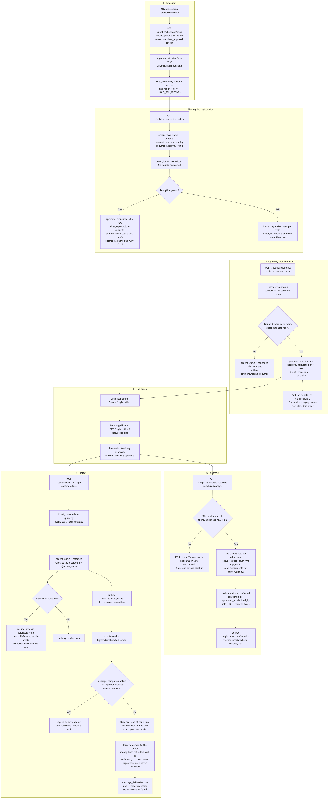
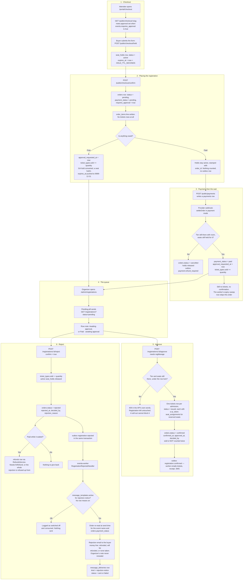

# Approval on a require-approval event

**Screens:** Checkout, Admin Registrations

What happens when an event has `events.requires_approval` set: the attendee pays first and the registration then waits for the organizer. It starts at checkout and ends either with tickets issued on approval, or with the sign-up rejected and any money given back. The ordinary path, where checkout confirms outright, is [Checkout and payment](02-checkout-and-payment.md).

1. **Checkout.** `GET /public/checkout/{slug}` returns the tiers plus a `notes.approval` line — the buyer is told, before they pay, that the organizer reviews each registration and that an unapproved one is refunded in full. Choosing a tier and quantity only re-prices the selection through `POST /public/checkout/quote`, which writes nothing. The hold is taken when the buyer submits the filled-in form: the page's one booking action calls `POST /public/checkout/hold`, then `POST /public/checkout/confirm` (step 2), then — when anything is owed — `POST /public/payments` (step 3), back to back. The hold writes a `seat_holds` row with `status = active` and `expires_at` set `HOLD_TTL_SECONDS` ahead (600 by default), so the places cannot be sold to anyone else while the order is placed and paid for; if confirming fails, the page gives them straight back with `DELETE /public/checkout/hold`.
2. **Placing the registration.** `POST /public/checkout/confirm` re-prices the selection server-side and writes, in one transaction, an `orders` row with `status = pending`, `payment_status = pending` and `requires_approval = true` — a snapshot of the event's rule at that instant, so flipping the event's switch later never changes the deal this buyer made — plus its `order_items` line. No `tickets` row is written on either branch. A **free** registration has nothing left but the decision, so `approval_requested_at` is stamped now, `ticket_types.sold` is raised by the line quantity under a `FOR UPDATE` lock on the tier (the public count and the sold-out badge therefore tell the truth while it waits), a general-admission hold becomes `status = converted`, and a reserved seat's hold has its `expires_at` pushed to the sentinel `9999-12-31` — a decision, not a clock, ends that hold. A **paid** registration counts nothing yet: its holds stay `active` and are merely stamped with `order_id`.
3. **Payment, then the wait.** `POST /public/payments` writes a `payments` row, and the provider's webhook runs the settlement transaction. Because `orders.requires_approval` is true, the money buys places rather than tickets: `payment_status` becomes `paid`, `approval_requested_at` is stamped, and `ticket_types.sold` is raised — the same bookkeeping the free branch did at placement. Nothing is issued and no confirmation is queued; both belong to the approval. Because nothing was counted before the money arrived, the settlement first re-checks the places under the tier's and the seats' row locks: if the tier is gone or has sold out (a lapsed hold puts places back on sale), a held seat has been assigned to someone else, or one of the order's seats lost its hold while the money was in flight — the seat may already be someone else's — the order is `cancelled`, its `active` holds are `released`, and an `outbox_events` row with `routing_key = payment.refund_required` is written instead. From this point the eventa-worker order-expiry sweep leaves the order alone: it only closes orders with `approval_requested_at IS NULL`, because a registration on the organizer's clock is on nobody's checkout clock.
4. **The queue.** The organizer opens **Admin Registrations** (`/admin/registrations`) and the Pending pill sends `GET /registrations?status=pending`, which needs `regView`. The row's note distinguishes the two waits — "Awaiting approval" for a free one, "Paid · awaiting approval" once money has landed — because "Pending" on its own reads as "not paid yet". Amounts come from `total_satang`; a caller without `finView` sees `null`, which renders as "—" and never as `฿0`. Deciding needs `regManage`, which Staff working the door (`regCheckin`) do not have.
5. **Approve.** `POST /registrations/{id}/approve` runs the *same* settlement transaction a card payment runs, in approval mode, so a hand-approved and a bought registration are issued by identical code. A paid registration cannot be approved until `payment_status = paid` — a 409 saying payment isn't complete yet. Under the order's row lock the tier and seats are re-checked, because a seat can be taken or the ticket type removed between the organizer reading the list and clicking; if the tier no longer exists, a held seat has been assigned to someone else, or the held seats no longer match the quantity, nothing is written and the API answers 409 with its own sentence (for example "The seat on this registration has been taken by someone else."). A sell-out cannot block it: a waiting registration's places are already in `sold`, so the capacity check is skipped and approving the last place succeeds. The sold-out sentence ("offer the attendee the waitlist instead") is reached only when approving a registration whose places were never counted, such as one approved straight off the waitlist (see [Waitlist](04-waitlist.md)). A registration someone else has already decided is a 409 too. Otherwise one `tickets` row per admission is minted with `status = issued` and a fresh `qr_token`, reserved seats get their `seat_assignments`, holds are `converted`, and the order becomes `status = confirmed` with `confirmed_at`, `approved_at` and `decided_by` stamped. `sold` is **not** raised again — these places were counted when the registration started waiting. An `outbox_events` row with `routing_key = registration.confirmed` is written in the same transaction, so the ticket and the email promising it commit together; eventa-worker consumes that row and sends the confirmation email, the VAT receipt when the order was paid for, and a text when the buyer gave a Thai mobile — each subject to its own switches (see [Free registration and confirmation](03-free-registration-and-confirmation.md)). The QR tokens are read live from the database and never travel on the bus or into the email body — the email links to the tickets page instead.
6. **Reject.** `POST /registrations/{id}/reject` requires `confirm = true`, since a rejection is terminal and `rejected` can never be re-approved. The counted places go back to `ticket_types.sold`, any `active` hold on the order becomes `released`, and the order takes `status = rejected` with `rejected_at`, `decided_by` and the organizer's `rejection_reason`. An `outbox_events` row with `routing_key = registration.rejected` is written in the same transaction, so a freed place and the message telling its owner commit together; a retried reject of an order that is already `rejected` — which is how an interrupted refund is finished — returns before that write, so nobody is told twice. If money was taken while the registration waited — `payment_status = paid` with `approval_requested_at` set — the rejection commits first, so an approval racing it cannot issue tickets after the money has gone, and the refund is then issued through the ordinary refund path, writing a `refunds` row for each of the order's `paid` `payments` rows — a duplicate payment that landed while it waited included. That makes this rejection a refund, so it needs `finRefund` as well as `regManage`; without it the API refuses with a 403 before anything is written. `payment_status` stays `paid` until the refund lands, and the queue row says "Payment not yet refunded" meanwhile. **The attendee is then told by email.** eventa-relay publishes the row and eventa-worker's `RegistrationRejectedHandler` consumes it. It first checks `message_templates.active` for the slug `rejection-notice`: an absent row means on, the catalog's `defaultActive`, because somebody who signed up — and may have paid — is owed the news. A workspace that switched it off on `/admin/messaging-templates` has the trigger logged as switched off and consumed, and switching it back on never sends what was skipped (see [Automated messages](22-automated-messages.md)). The switch is read before the order, so a notice that will not go pulls nobody's name or money out of the database. The order is then re-read at send time — one that is no longer there sends nothing — because the rejection commits *before* the refund is attempted and the message cannot know which side of it it will be read on. The money line therefore comes from `orders.payment_status` as it stands then: "has been refunded" once it is `refunded`, "will be refunded" while it is still `paid`, "No payment was taken" for `pending` or `failed`, and no line at all on a free order. The refund path writes no outbox row of its own, so this notice is the only message that tells a paid attendee about their money. The organizer's `rejection_reason` rides on the payload but is never read: it is the organizer's own note, and a line like 'suspected duplicate card' must not reach the person it is about, so every notice closes instead by telling them to contact the organizer and quote their booking reference. Language follows the person exactly as the confirmation's does — their attendee account's `users.locale`, then `events.locale`, then `organizations.locale`, then English — and an organizer's own subject and opening in that language replace Eventa's, but the reference, the money line and the closing are always Eventa's. Each attempt writes a `message_deliveries` row with `kind = 'rejection-notice'`, `channel = 'email'` and `status` of `sent` or `failed`. A failed send is rethrown, so a transient failure is retried after a delay and a permanent one is parked on the dead-letter queue; the message id is marked done only after the send, so a redelivery after a crash re-sends rather than silently skipping.

Mermaid source

[← All flows](README.md)
