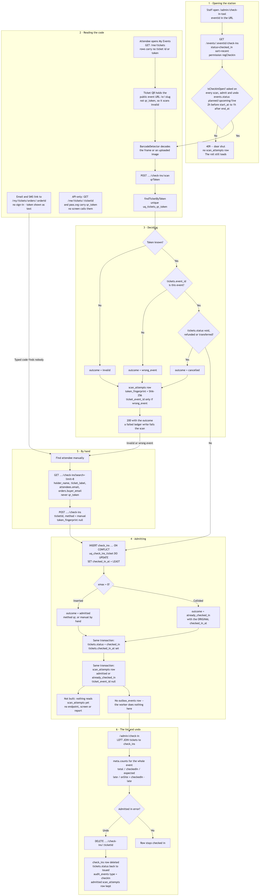

# Check-in by QR and by hand

**Screens:** Check-in tool, Check-in list

Admitting one person per ticket at the door, however the code reaches the station. It starts when staff read a code or search a name — though, as step 2 explains, no built screen yet hands an attendee a QR that holds their ticket — and ends with an admission recorded in `check_ins`, every decided scan appended to `scan_attempts`, and the organizer's attendance list agreeing with the room. The tickets being scanned were issued earlier, by [Checkout and payment](02-checkout-and-payment.md), [Free registration and confirmation](03-free-registration-and-confirmation.md) or an organizer's [approval](05-approval.md).

1. **Opening the station.** Staff open **Check-in tool** (`/admin/check-in-tool`), whose loader reads `GET /events/{eventId}/check-ins?page=1&limit=8&status=checked_in&sort=recent` — the last eight arrivals, newest first. The event being worked lives in the URL as `?eventId=`, defaulting to the most recently created event, because a station is bound to one door. Every route under `/events/:eventId/check-ins` requires the `regCheckin` permission: watching the door and working it are different privileges, and the seeded Staff role holds `regView` and `regCheckin` but deliberately not `regManage`, so somebody on the door cannot approve or reject a registration. Whether the door is open at all is derived rather than stored — `isCheckInOpen` admits only an event whose `events.status` is `planned`, `upcoming` or `live`, from two hours before `events.start_at` until one hour after `events.end_at`, or after `start_at` when the event has no end time, so a single-session event does not become un-checkinable the moment it begins. A shut door answers **409** with the API's own sentence, "Check-in is not open for this event yet — or has already closed." Reading the roll is not gated on that window: an organizer checks the list before the doors open and reconciles it afterwards, which is exactly when the window is shut.
2. **Reading the code.** What the door reads is `tickets.qr_token`, minted at issue and unique across every workspace through `uq_tickets_qr_token`, a unique on `qr_token` alone — and what an attendee can show it today is something else. The API can hand out the real thing: `GET /me/tickets/{ticketId}` returns the token and `GET /me/tickets/{ticketId}/pass.svg` draws it into a printable pass (refused with a 409 once the ticket is no longer valid), both signed-in only and resolving only a ticket the caller owns. Both are **API-only — no screen calls either.** The portal's **My Events** (`/portal/my-events`) reads only `GET /me/tickets`, whose rows carry neither a ticket id nor a token, and its **Ticket** button draws a QR, and a downloadable PNG flyer, whose payload is the public event URL `${origin}/e/${slug}`: shown at the door it decodes cleanly, matches no ticket and comes back `invalid`. The token itself appears in one place. Because it is a bearer credential it never travels in the confirmation email or SMS; the worker names the ticket and links to `/my/tickets/orders/{orderId}` (built by the API's `ticketsUrlFor` from `PUBLIC_WEB_URL`, and the same page checkout's **View my tickets** opens). That page is **not** authenticated — the order's uuid is the capability, so a guest who never made an account can still see what they bought — and it reads the `@Public` `GET /public/orders/{orderId}` and prints each ticket's `qrToken` as **text** under "Code", not as a QR. The station cannot take that text either: the manual search in step 5 matches names, labels and email addresses, never `qr_token`, so a token read aloud admits nobody and the person is found by name instead. US-DISC-07's scannable, downloadable pass is therefore only partly built. At the station the browser's own `BarcodeDetector` decodes the frame and submits `POST /events/{eventId}/check-ins/scan` with `qrToken`; a badge that will not present — a cracked screen, a printout photographed earlier — can be decoded from a still image through the same endpoint. Where the platform has no detector, Safari and Firefox today, the station says so and falls back to the manual search in step 5. The API resolves the token with `findTicketByToken`, scoped to the caller's `organization_id`.
3. **Deciding.** Four refusals and one admission, settled in the order the door needs them, and all of them returned as **200** with an `outcome` rather than as an HTTP error — an unknown code, a ticket for next week and a refunded one are three different things for the person on the door to do, and an exception would collapse all three into "no". No ticket behind the token gives `outcome = invalid`; a ticket whose `tickets.event_id` is not the station's event gives `wrong_event`; a `tickets.status` of `void`, `refunded` or `transferred` gives `cancelled`, because a refunded ticket no longer entitles anyone to walk in (see [Refund and cancellation](07-refund-and-cancellation.md)). Anything else is admitted. A refusal is not silent: `refuse` awaits `recordScanAttempt`, which appends one `scan_attempts` row in a statement of its own — `outcome`, `method`, `ticket_id` (null for `invalid`, which has no ticket to point at), `ticket_event_id`, `token_fingerprint`, `station_id`, `scanned_by` and `scanned_at`. `ticket_event_id` is set **only** for `wrong_event`, to the event the pass really belongs to, so `ticket_event_id IS NOT NULL` reads as "a pass for somewhere else turned up here". `token_fingerprint` is the SHA-256 hex digest of the code presented, never the code: the token is a bearer credential and this table is append-only and outlives the event, so raw tokens would turn a door log into a list of working passes, while the digest still tells one damaged pass presented forty times from forty different bad codes. The write is awaited and not swallowed — a refusal that cannot be logged fails the request, because a ledger with holes in it reads as a quiet night, which is the very thing it exists to tell apart from a broken scanner. Only what stops the station working at all is thrown before the decision and writes no row: the shut door's 409, and an event from another workspace, which 404s. The `scan_outcome` enum spells all five: `admitted`, `already_checked_in`, `invalid`, `wrong_event`, `cancelled` — and since migration `0068` it has a column, `scan_attempts.outcome`, because `check_ins` cannot hold a refusal: one row per ticket is its whole guarantee, and an unknown code has no ticket at all.
4. **Admitting.** The admission is one statement, not a read followed by a write: `INSERT INTO check_ins … ON CONFLICT ON CONSTRAINT uq_check_ins_ticket DO UPDATE SET checked_in_at = LEAST(check_ins.checked_in_at, EXCLUDED.checked_in_at) RETURNING checked_in_at, (xmax = 0) AS inserted`. The row carries `organization_id`, `event_id`, `ticket_id`, `attendee_id`, `checked_in_at`, `method`, `checked_in_by` and the optional `station_id` for reconciling a busy entrance — which the API accepts but neither screen sends, so it is null today; `method` comes from the `check_in_method` enum, `qr` for a scan. `uq_check_ins_ticket` is a unique on `ticket_id` alone and is the whole correctness story — two staff scanning the same badge at the same instant both attempt the insert, exactly one wins, and the loser reads back the winner's row. `DO UPDATE` rather than `DO NOTHING` so `RETURNING` always yields a row, `LEAST` so a replayed or out-of-order admission never rewrites the time somebody actually walked in, and `xmax = 0` is how the caller learns whether it admitted someone. A collision therefore reports `already_checked_in` with the **original** arrival time, which the station shows as "Arrived at 14:32" — stored UTC, rendered on the Asia/Bangkok clock. In the same transaction `tickets.status` becomes `checked_in` and `tickets.checked_in_at` is set — My Events marks an order `attended` from exactly that status — and a `scan_attempts` row is appended with `outcome` `admitted` or `already_checked_in`, named by the one `admissionOutcome` helper from the same `xmax = 0` flag the station is told, and with `ticket_event_id` null, since a pass only gets this far once it is for this event. `check_ins` is the state of the room and the `tickets` pair is its projection; `scan_attempts` is the history of the door, written inside the admission's own transaction so the station, the room and the ledger cannot disagree, and it counts admissions as well as refusals because a refusal *rate* needs a denominator — it is what tells a busy door from a broken one. **Nothing reads it yet:** no endpoint, screen, report or worker job queries `scan_attempts`, so the door-incident view its indexes are shaped for is not built. Nothing is queued: check-in writes **no** `outbox_events` row, so unlike a registration this flow sends no mail and eventa-worker has nothing to consume.
5. **By hand.** When the code will not read at all, the station's collapsed "Can't scan? Find attendee manually" panel searches the same roll through `GET /events/{eventId}/check-ins?search=…` with `limit=8`, so only the first eight matches come back, matching case-insensitively on `tickets.holder_name`, `tickets.ticket_label`, `attendees.email` and `orders.buyer_email` — the buyer's address because somebody who bought four tickets stays the contact for all four until they are handed on. Admitting the row found calls `POST /events/{eventId}/check-ins` with its `ticketId` and `method = manual`, which is also the API's default when `method` is omitted. The enum also allows `upload`, but no screen sends it: the station's still-image decode goes through `/scan`, which always records `qr`. A manual admission's `scan_attempts` row carries `method = manual` and a null `token_fingerprint`, which is the record that no code was presented. From there it is step 4 unchanged — the same `admit` path, so a hand-admission cannot become a second, subtly different way of letting somebody in, and a manual admit after a scan still collides on `uq_check_ins_ticket` rather than admitting twice.
6. **The list and undo.** **Check-in list** (`/admin/check-in`) reads the same endpoint sorted by name and paged server-side, with the tab, the search and the page number in the URL so the counts and the rows cannot disagree. It is a LEFT JOIN from `tickets` to `check_ins`, not a filter, so somebody still expected appears with no admission row and `status = expected`; tickets that deny entry are excluded, since a refunded ticket is not somebody the door is waiting for. The figures ride on `meta.counts` and are counted across the whole event rather than the page on screen: `total`, `checkedIn`, `expected`, `late` (admitted after `events.start_at`) and `onSite`, derived as `checkedIn − late` so the two can never disagree. Each expected row also carries its own **Check in** button, the same manual `POST` as step 5. An admission made in error is reversed with `DELETE /events/{eventId}/check-ins/{ticketId}`, which deletes the `check_ins` row outright rather than flagging it — an admission that was reversed did not happen, and a tombstone would force every count and the unique constraint itself to reason about it — then puts `tickets.status` back to `issued` with `checked_in_at` cleared, and writes an `audit_events` row with `type = 'checkin'` naming the actor. It does **not** touch `scan_attempts`: that table is append-only — `CheckInRepository` has no update or delete path to it — so the `admitted` row stands beside the audit entry, because the admission was reversed but the scan still happened. Nothing to undo answers **404**, "That ticket has not been checked in." Undo gates on the same open door as an admission, so a mistake is corrected at the event rather than weeks later.

```mermaid
flowchart TD
  subgraph ONE["1 · Opening the station"]
    A["Staff open /admin/check-in-tool<br/>eventId in the URL"] --> B["GET /events/:eventId/check-ins<br/>status=checked_in sort=recent<br/>permission regCheckin"]
    B --> C{"isCheckInOpen? asked on<br/>every scan, admit and undo<br/>events.status planned/upcoming/live<br/>2h before start_at to 1h after end_at"}
    C -- "No" --> D["409 — door shut<br/>no scan_attempts row<br/>The roll still loads"]
  end

  subgraph TWO["2 · Reading the code"]
    E["Attendee opens My Events<br/>GET /me/tickets<br/>rows carry no ticket id or token"] --> E1["Ticket QR holds the<br/>public event URL /e/:slug<br/>not qr_token, so it scans invalid"]
    E2["Email and SMS link to<br/>/my/tickets/orders/:orderId<br/>no sign-in · token shown as text"]
    E3["API-only: GET /me/tickets/:ticketId<br/>and pass.svg carry qr_token<br/>no screen calls them"]
    F["BarcodeDetector decodes<br/>the frame or an uploaded image"] --> G["POST .../check-ins/scan<br/>qrToken"]
    G --> H["findTicketByToken<br/>unique uq_tickets_qr_token"]
    E1 --> F
  end

  subgraph THREE["3 · Deciding"]
    I{"Token known?"} -- "No" --> J["outcome = invalid"]
    I -- "Yes" --> K{"tickets.event_id<br/>is this event?"}
    K -- "No" --> L["outcome = wrong_event"]
    K -- "Yes" --> M{"tickets.status void,<br/>refunded or transferred?"}
    M -- "Yes" --> N["outcome = cancelled"]
    J --> RA["scan_attempts row<br/>token_fingerprint = SHA-256<br/>ticket_event_id only if wrong_event"]
    L --> RA
    N --> RA
    RA --> RB["200 with the outcome<br/>a failed ledger write fails the scan"]
  end

  subgraph FOUR["4 · Admitting"]
    O["INSERT check_ins ... ON CONFLICT<br/>uq_check_ins_ticket DO UPDATE<br/>SET checked_in_at = LEAST"] --> P{"xmax = 0?"}
    P -- "Inserted" --> Q["outcome = admitted<br/>method qr, or manual by hand"]
    P -- "Collided" --> R["outcome = already_checked_in<br/>with the ORIGINAL checked_in_at"]
    Q --> S["Same transaction:<br/>tickets.status = checked_in<br/>tickets.checked_in_at set"]
    R --> S
    S --> S2["Same transaction:<br/>scan_attempts row<br/>admitted or already_checked_in<br/>ticket_event_id null"]
    S2 --> S3["Not built: nothing reads<br/>scan_attempts yet<br/>no endpoint, screen or report"]
    S2 --> T["No outbox_events row —<br/>the worker does nothing here"]
  end

  subgraph FIVE["5 · By hand"]
    U["Find attendee manually"] --> V["GET .../check-ins?search= limit=8<br/>holder_name, ticket_label,<br/>attendees.email, orders.buyer_email<br/>never qr_token"]
    V --> W["POST .../check-ins<br/>ticketId, method = manual<br/>token_fingerprint null"]
  end

  subgraph SIX["6 · The list and undo"]
    X["/admin/check-in<br/>LEFT JOIN tickets to check_ins"] --> Y["meta.counts for the whole event<br/>total / checkedIn / expected<br/>late / onSite = checkedIn - late"]
    Y --> Z{"Admitted in error?"}
    Z -- "Undo" --> AA["DELETE .../check-ins/:ticketId"]
    AA --> AB["check_ins row deleted<br/>tickets.status back to issued<br/>audit_events type = checkin<br/>admitted scan_attempts row kept"]
    Z -- "No" --> AC["Row stays checked in"]
  end

  C -- "Yes" --> F
  H --> I
  M -- "No" --> O
  RB -- "Invalid or wrong event" --> U
  E2 -- "Typed code finds nobody" --> U
  W --> O
  T --> X
```

Mermaid source

[← All flows](README.md)
