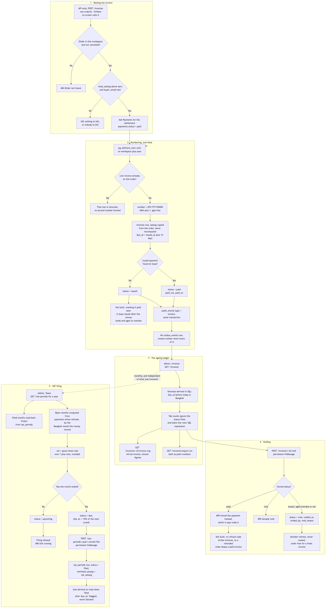
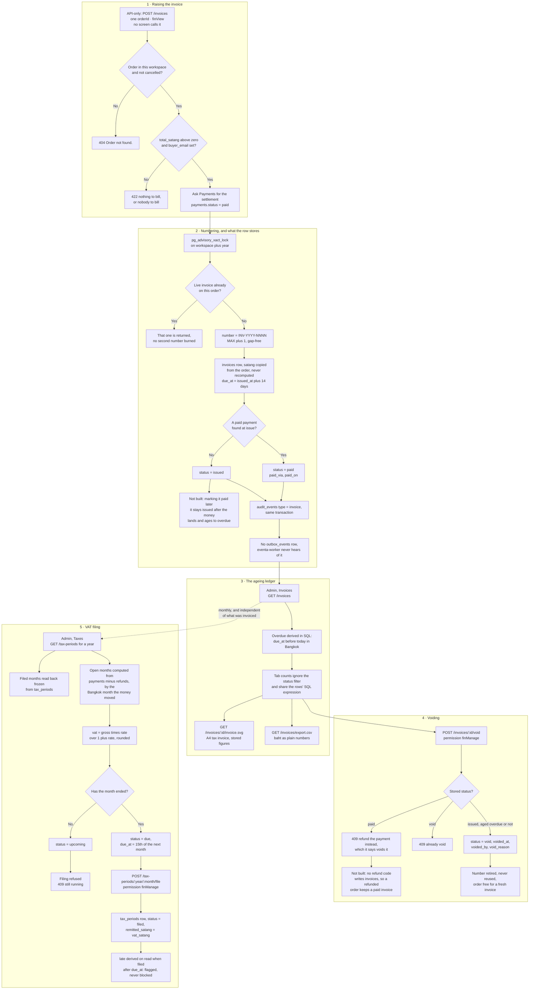

# Invoice, ageing and VAT filing

**Screens:** Admin Invoices, Taxes

How an order — paid for or not yet — becomes a numbered Thai tax invoice, how the ledger ages it towards Overdue, and how a month's takings end up as a filed PP30 return. It is an organizer-only flow from start to finish — no attendee ever sees an `invoices` row — and, unlike almost everything else in Eventa, nothing in it is queued: the whole path is synchronous HTTP, and eventa-worker plays no part at any point.

1. **Raising the invoice.** Nothing issues an invoice by itself. `POST /invoices` takes one `orderId` and is the only thing that ever creates an `invoices` row — no webhook, no outbox consumer and no cron calls it — so a tax invoice is raised deliberately, against an order somebody chose. It is also **API-only — no screen calls it**: the Invoices page lists, downloads and voids, and its empty state says only that selling a ticket does not issue one by itself, so today an invoice exists only if somebody calls the endpoint directly. Both controllers in this flow sit behind `AdminGuard` (an attendee token is a 403) and `PermissionsGuard`. The permission is `finView`, the same one that reads the ledger, so an Organizer may invoice their own buyers; voiding and VAT filing need `finManage`, which of the built-in roles only Admin is granted. Checkout owns the `orders` table, so Invoices asks for the order through `InvoiceOrderPort` rather than joining across the boundary: it must belong to the caller's workspace and have a `status` other than `cancelled`, or the answer is a 404. Two further refusals, both 422, are written for the person reading them — an `orders.total_satang` of zero or less is "This order has nothing to bill", and an empty `orders.buyer_email` (the column is `NOT NULL`, so only an empty string trips it) is "this order has no buyer email, so the invoice has nobody to bill". Any other order status passes, so a `pending`, `waitlisted` or `rejected` order can be invoiced as readily as a `confirmed` one. Payments then answers `InvoicePaymentPort` with the newest `payments` row for the order whose `status = 'paid'`, giving its `method` and the Bangkok calendar date of its `paid_at`; that is what decides whether the invoice is born already settled (see [Checkout and payment](02-checkout-and-payment.md) for how `payments` gets there).
2. **Numbering, and what the row stores.** Thai invoice numbering may not have holes, which rules out a Postgres sequence — a rolled-back transaction would leave one. Instead the whole issue runs in one transaction that first takes `pg_advisory_xact_lock(hashtext('invoice:<org>:<year>')::bigint)`, so concurrent issuers queue rather than collide and a rollback hands the number back. Inside the lock it looks for a live invoice on the same order (`status <> 'void'`) and returns that one if it finds it — without a second audit row — so a double-submitted request yields one invoice and burns no second number. The partial unique index `uq_invoices_live_order` on `order_id WHERE status <> 'void'` (migration 0033) is the database's backstop should two issues ever get past the lock: the losing insert is refused and rolls back, though the API does not translate that refusal, so it would reach the caller as a 500. When there is no live invoice, `number` is `INV-<year>-<MAX + 1>` padded to four digits, unique per workspace by `uq_invoices_org_number`. The figures are **copied, never recomputed**: `amount_satang` is `orders.total_satang`, `vat_amount_satang` is the VAT recorded at checkout, and `subtotal_satang` is the difference — recomputing VAT here would let a later edit of `organizations.vat_rate` restate tax already collected at the old rate. `buyer_name` and `buyer_email` are snapshotted for the same reason: the document must still show who it was billed to after the buyer edits their account. `issued_at` is today's Bangkok date and `due_at` is fourteen days later (`INVOICE_TERM_DAYS`), both plain `date` columns. `status` is `paid` with `paid_via` and `paid_on` filled when a settlement was found, otherwise `issued`. That is decided once, at issue: **nothing later marks an `issued` invoice `paid`** — the only writes `invoices` ever receives are this insert and the void in step 4 — so an invoice raised before its order's money landed stays `issued` after it lands and ages to Overdue regardless. Settling an invoice after issue is not built. An `audit_events` row with `type = 'invoice'` and the title "Issued invoice INV-2026-0001" commits in the same transaction, and **no `outbox_events` row is written at all** — issuing an invoice emails nobody and eventa-worker never learns of it, which is the thing readers arriving from the registration flows expect to work the other way.
3. **The ageing ledger.** `/admin/invoices` loads from `GET /invoices`. The console keeps the tab, the search (`q`), the event and the page in its own URL and sends them as `status`, `search`, `eventId`, `page` and `limit` (the console's page size starts at 10; the API's own default is 20 and its cap 100), so the API does the paging and the back button works. `search` matches the invoice number or the buyer name — not the order reference, although the console's search box says it does. Rows come back newest `issued_at` first. The important part is that **`overdue` is never written to the column**: although it is a legal `invoice_status` value, the stored status is only ever `issued`, `paid` or `void`, and the ledger ages it in SQL — `paid` and `void` are terminal, anything else whose `due_at` is before today reads `overdue`. A stored flag would be wrong for the hours between midnight and whenever a nightly job ran. "Today" is the Bangkok calendar date, taken once per request, so the rows and the tab counts of one load share it, and the status filter and the counts use one SQL expression, so a tab can never contradict the list under it; the CSV, a request of its own, ages its rows by the same rule. The four tab counts are deliberately computed **without** the status filter, so page 2 of Overdue still shows how many are Paid. The API also returns `canVoid` and `voidBlockedReason` per row, so a disabled control explains itself rather than the console guessing. Money crosses the wire as integer satang (`amountSatang`, `vatAmountSatang`) with a formatted `amountLabel` beside it. `paidVia` and `paidOn` are null on an invoice issued unpaid, and stay null (step 2): the console's table shows neither, the CSV leaves both blank and the printed invoice reads "Unpaid". **Export** fetches `GET /invoices/export.csv` with the same filters and no paging, up to 10,000 rows, and writes baht as plain numbers an accountant can sum — an empty result is a 409 with the API's own sentence rather than an empty file. **Invoice** fetches `GET /invoices/:id/invoice.svg`: a self-contained A4 page carrying `organizations.name`, `address`, `tax_id` and `vat_rate`, the buyer, the order reference, the event as the service line, and a VAT breakdown that reconciles to the amount — again from the stored figures (only the "VAT n%" label is read live from `organizations.vat_rate`, so a later rate change would relabel an older document), with a diagonal VOID watermark when the invoice is void. Both are fetched with the caller's bearer token rather than linked to, since a plain `<a href>` would arrive at a 401. The attendee's own portal is unaffected by any of this and never reads the `invoices` table: its payment history shows the **order reference**, and the API's VAT receipt, `GET /me/payments/:paymentId/receipt.svg`, prints that order reference as "Invoice no." — API-only, since the portal's Download receipt button has no handler.
4. **Voiding.** A correction is a void plus a brand-new invoice, never an edit — so `POST /invoices/:id/void` is the only mutation an existing invoice has, it is `finManage`, and it deletes nothing. An unknown id is a 404; otherwise it is refused with a 409 on an invoice whose stored `status` is `paid`, and on one that is already `void`. `canVoid` reads only the invoice's status, not the caller's permissions, so an Organizer holding `finView` alone sees an enabled Void control and gets the guard's 403. The `paid` refusal — and the disabled Void control's tooltip, which is the row's `voidBlockedReason` — tells the organizer to refund the payment instead, "which voids it", but **nothing does**: the only writes `invoices` ever receives are the insert in step 2 and this endpoint's own update. Settling a refund, whether on the request or later by Stripe's callback (see [Refund and cancellation](07-refund-and-cancellation.md)), moves `refunds.status` to `succeeded` and `payments.status` to `refunded` and, for the order's last paid payment, its live `tickets` to `refunded` and `orders.status` to `cancelled` (a `rejected` one stays `rejected`) with `payment_status = 'refunded'` — and never reads or writes the invoice; no eventa-worker consumer and no database trigger makes up the difference. A refunded order therefore keeps a `paid` invoice for money that has gone back, which this endpoint will not void and `POST /invoices` cannot replace: a `cancelled` order is a 404 there, and wherever the order survives the refund the paid invoice is still its live one, so issuing again would only return it. Voiding or crediting a paid invoice is not built. On any other invoice it sets `status = 'void'` with `voided_at`, `voided_by` and the optional `void_reason` (500 characters, recorded on the `audit_events` row's `meta`), and writes a second audit row titled "Voided invoice INV-2026-0001". The number stays in the sequence marked void, because a tax invoice that simply vanished is exactly the hole the Revenue Department expects not to find; `uq_invoices_org_number` keeps it from being reused. Because the live-order index ignores voided rows, the order is now free for a corrected invoice, which takes the next number rather than the old one.
5. **VAT filing.** `/admin/taxes` loads `GET /tax-periods?year=<year>` — the year is required, defaults to the current **Bangkok** year, and the picker goes five years back. Without a `status` filter — the API accepts one, the console never sends it — the response is twelve rows plus the year's headlines, so it is a fixed list rather than a page, and the screen has no empty state to show. Only **filed** months are stored: a `tax_periods` row exists solely once a return has been recorded, and it is read back frozen at the figures that were filed. Every other month is **computed on the spot** from what the payment ledger actually moved, via `TaxableSalesPort`: `payments` rows with `status IN ('paid', 'refunded')` and a non-null `paid_at` count positive, `refunds` rows with `status = 'succeeded'` count negative, and each is assigned to the Bangkok month of the date the **money moved** — `paid_at` for a payment, `coalesce(settled_at, issued_at)` for a refund. That is why "an adjustment to a period already filed carries into the next open one" needs no carry-forward ledger: a June ticket refunded in July simply reduces July. The gross is VAT-inclusive, so `vat_satang` is `round(gross × rate / (1 + rate))` at `organizations.vat_rate` and `sales_satang` is the remainder; a month whose refunds outweigh its sales goes negative and is carried rather than floored, because the period genuinely owes less. A period is `upcoming` until the month ends, then `due` from the 1st of the next month — filing *opens* when the month closes and `due_at`, the 15th, is only the deadline — and stays `due` however late it gets. The Record filing button appears wherever the row's `canFile` is true, which is simply `status = 'due'` rather than a permission check, so an Organizer holding `finView` alone is offered it and gets the guard's 403. `POST /tax-periods/:year/:month/file` is `finManage`; it refuses a period that is still running or already filed (a 409 each; a month outside 1–12 is a 422), and otherwise inserts one `tax_periods` row with `period` (`Jun`), `year`, `due_at`, the computed `sales_satang` and `vat_satang`, the optional `wht_satang` for Thai withholding (0 when none is sent), `remitted_satang` set to `vat_satang` — recording the filing *is* remitting it, so the figure is never keyed by hand and cannot disagree with the return — `status = 'filed'` and `filed_at`. `onConflictDoNothing` on `(organization_id, period, year)` makes a double-submitted filing a no-op. `late` is not a column: it is derived on every read by comparing the Bangkok date of `filed_at` with `due_at` and shown as "Filed late", and a late filing is accepted rather than blocked, because the Revenue Department's surcharge depends on it and the organizer is the one who will be asked. The four headlines (collected, remitted, payable = collected − remitted, withholding) are summed over all twelve rows *before* any status filter, so narrowing to `status=due` cannot make the year look like it owes less than it does. Eventa files nothing with anybody: the row records that a human did. `filed_at` and `voided_at` are UTC `timestamptz` columns and neither is shown on screen — the Taxes table carries only the "Filed late" note, its CSV (`GET /tax-periods/export.csv`) writes `filed_at` as a UTC ISO timestamp, and the invoice API does not return `voided_at` at all; `issued_at`, `due_at` and `paid_on` are date-only columns already in Bangkok terms.

Mermaid source

[← All flows](README.md)
