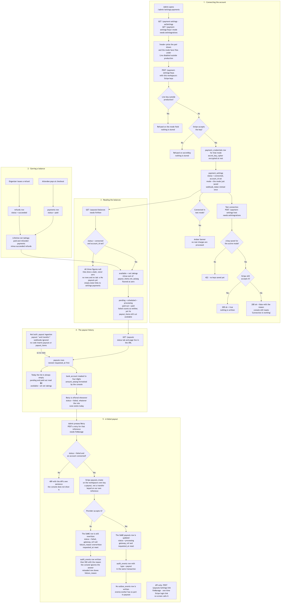
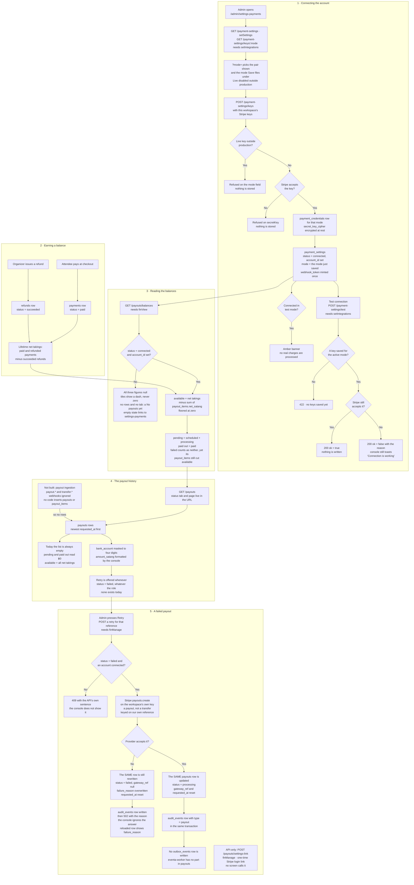

# Payouts and balances

**Screens:** Admin Payouts, Payment settings

How ticket money gets from Eventa to the organizer's bank. It starts in Settings → Payments, where an Admin connects the workspace's own Stripe account, and ends on `/admin/payouts`, which shows the three headline balances and is built to list every payout and re-submit a rejected one — though nothing yet records a payout for it to list (step 4). The organizer is the only persona here; an attendee never sees any of it. Which payment methods checkout offers and whether receipts are emailed share the Settings → Payments screen but are drawn in [Set up the workspace](17-workspace-setup.md).

1. **Connecting the account.** `/admin/settings-payments` reads `GET /payment-settings`, which finds or creates this workspace's single `payment_settings` row and needs `setSettings`, and in the same loader `GET /payment-settings/keys/:mode` for the pair on screen, which needs `setIntegrations` — so the page needs both, and a caller holding only `setSettings` gets a 403 rather than the page. An Admin pastes the workspace's own Stripe keys and `POST /payment-settings/keys`, also `setIntegrations`, validates them in a deliberate order: the key prefixes must match the chosen `mode` (`test` or `live`), a `live` key is refused outright on any server whose `NODE_ENV` is not `production` — otherwise a seed script or a click around staging charges a real card — and only then is the key proved against Stripe with a read-only `accounts.retrieveCurrent()`. **Nothing is stored until Stripe agrees the key works**, because a workspace marked ready to take money on a key that never worked would discover it at a buyer's failed checkout. On success a `payment_credentials` row is written for that `mode` with `secret_key_cipher` — and `webhook_secret_cipher` when a signing secret was supplied; left blank, the stored one is kept — encrypted at rest (AES-256-GCM; the plaintext is never read back to a caller), and `payment_settings` is updated to `status = 'connected'` with `account_id`, `publishable_key`, `disconnected_at` cleared, `connected_at` set only if it was never set (a later save, even after a disconnect, keeps the first date) and — on the first save only — a minted `webhook_token`, which is the unguessable segment of this workspace's own callback URL. Test and live keys are separate rows, so holding both is normal and neither erases the other. **Test or live is not a switch of its own.** The Test/Live control on the keys card writes `?mode=` into the URL, defaulting to the active mode, so flipping it re-runs the loader and the boxes show *that* mode's stored pair — the publishable key in full, the secret only as a masked tail — and decides which mode the next save is filed under. The Live half is disabled wherever the response's `liveKeysAccepted` is false, the same `NODE_ENV` test the save enforces; `?mode=live` typed by hand still opens the boxes, and a save there is the refusal above. What changes the active mode is a successful save, which also writes `payment_settings.mode`, and that mode's key is the one every charge is made with. `PATCH /payment-settings` takes no `mode` — the global validation pipe refuses one with a 400 — so going live means saving the live pair, and going back means pasting the test secret again, because a saved secret never returns to the browser to be re-sent. The one webhook URL accepts either mode's signing secret, since Stripe's test and live dashboards each issue their own. While the workspace is connected in test mode an amber banner heads the page saying no real charges are processed; unconnected, it is not shown, because the default `mode = 'test'` then says nothing about money. **Test connection** is `POST /payment-settings/test` (`setIntegrations`): it re-proves the *saved* key of the **active** mode — not necessarily the one `?mode=` is showing — with the same read-only `accounts.retrieveCurrent()`, which for a live key also requires Stripe to have enabled charges on the account. Nothing is written and no money moves. No saved key for that mode is a 422 ("No test keys are saved yet. …"), which the page shows. A key Stripe now rejects is **not** an error response: the API answers 200 with `ok: false` and Stripe's reason, and the console's action wrapper forces every successful response to `ok: true`, so the page toasts "Connection is working." for a key that does not work — US-SET-08's clear reason for a failure stops at the API. **Disconnect** is `POST /payment-settings/disconnect` (`setIntegrations`): it deletes every `payment_credentials` row for the workspace, both modes, and sets `status = 'disconnected'` with `disconnected_at`, clearing `account_id` and `publishable_key`; past `payouts` rows are untouched. The button acts on a single click, without the confirmation US-SET-08 describes. No card or bank detail enters this app at any point (see [Checkout and payment](02-checkout-and-payment.md)). The lower half of the same screen — which payment methods are offered and whether receipts are emailed — is [Set up the workspace](17-workspace-setup.md) steps 5 and 6: the receipts switch is honoured by eventa-worker, while the method switches are stored and never read at checkout.

2. **Earning a balance.** Nothing in Eventa adds up a running total. The available figure is derived every time it is asked for, from the ledgers Payments owns: `payments` rows with `status` in (`paid`, `refunded`) counted as positive, minus `refunds` rows with `status = 'succeeded'`. A refunded payment therefore stays in the sum and its reversal is subtracted separately, so a refund backdated after the fact corrects itself rather than needing a compensating entry (see [Refund and cancellation](07-refund-and-cancellation.md)). Every figure is integer satang. The payouts API sends a formatted label beside each one (`amountLabel`, `availableLabel` and so on), but the console ignores those and formats the satang itself, rounded to whole baht.

3. **Reading the balances.** `GET /payouts/balances` sits behind `AdminGuard` (the `admin` persona only, so no attendee token reaches it) and needs the `finView` permission, and the first thing it asks is whether the workspace can be paid at all — `payment_settings.status = 'connected'` **and** a non-null `account_id`, both required, because a row saying yes with no account reference names nobody to pay. An unconnected workspace gets `availableSatang`, `pendingSatang` and `paidOutSatang` all `null` with `payoutsConnected: false`, and the page renders each tile as "—" above an amber strip whose "Connect account" links to `/admin/settings-payments`. With no payouts and no status tab chosen — every unconnected workspace today — the page drops the tiles altogether for a "No payouts yet" empty state whose "Connect a payout account" goes to the same place. That is not pedantry: `฿0` would tell an organizer they have earned nothing, when the truth is that nobody has asked the provider yet. Connected, the three figures are **available** = lifetime net takings minus `sum(payout_items.net_satang)`, floored at zero (refunds can outrun the unallocated balance, and the shortfall belongs in the next payout rather than in a negative headline); **pending** = `sum(payouts.amount_satang)` where `status` is `'scheduled'` or `'processing'`; **paid out** = the same sum where `status = 'paid'`. A `failed` payout counts towards neither. The repository's comment says that money is therefore still available, but the query does not make it so: the subtraction for **available** sums every `payout_items` row whatever its payout's status, so money allocated to a failed payout would show in none of the three figures.

4. **The payout history.** `GET /payouts` pages server-side, newest `requested_at` first, and the status tab (All, `scheduled`, `processing`, `paid`, `failed`), page number and page size live in the URL rather than in component state, so the back button works and the paginator's total comes from the same response as the rows; the tabs carry no counts. Each row carries `reference` (unique per workspace), `period_covered` as a plain label, `amount_satang`, `status`, `requested_at`, `completed_at` and `failure_reason`. The `bank_account` column is only ever a masked descriptor — Eventa never stores an account number — and the API masks it again on the way out, failing closed: a value too short to mask is hidden entirely rather than printed whole. `canRetry` is decided server-side as `status === 'failed'` and nothing else, and it is the console's only test: it looks at neither the connection nor the caller's permissions, so an Organizer — who holds `finView` but not `finManage` — would be shown a Retry button the API refuses with a 403. A `null` `completed_at` renders as "—", not as a date. **Payout ingestion is not built: nothing records a payout at all.** No code in eventa-api, eventa-worker or eventa-relay inserts a `payouts` or `payout_items` row — the only `INSERT INTO payouts` in any repository is in the API's e2e test fixtures — and the provider's own settlements are not picked up either: the workspace webhook, `POST /public/payments/webhook/:token`, maps only `checkout.session.completed` and `.expired`, `payment_intent.succeeded`, `.payment_failed` and `.canceled`, `refund.updated` and `refund.failed`, and every `payout.*` and `transfer.*` event is acknowledged and dropped as ignored, without even a `webhook_events` row. The only write to `payouts` anywhere is the retry's UPDATE in step 5. So today a connected workspace's history is always empty, **pending** and **paid out** always read ฿0, and **available** is the whole of its lifetime net takings, with no allocations to subtract; the Payouts report (US-RPT-07) reads the same empty tables. The unique constraint on `payout_items.payment_id` *alone* is what would make the available balance trustworthy once rows exist — a payment can be allocated to at most one payout, so the same money can never go out twice — but nothing yet fills the table.

5. **A failed payout, and recovering it.** This path is built end to end — the Retry button, the endpoint and the Stripe call — but with nothing recording payouts (step 4) there is never a `failed` row to press it on, so today it runs only against rows inserted by hand or by the test fixtures. `POST /payouts/:reference/retry` needs `finManage`, the Admin-only tier, and refuses with a 409 and the API's own wording when the payout has not failed or when no account is connected. Stripe has no retry verb, so the adapter creates a fresh Stripe **payout** — `payouts.create` on the workspace's own secret key, moving the amount from its Stripe balance to its bank, not a Transfer between Stripe accounts — with `payout-retry:<reference>` as the idempotency key, so a double-tapped Retry produces exactly one. Whatever Stripe answers, the **existing** `payouts` row is then rewritten rather than a second one inserted, so the organizer never sees two payouts for money that only moved once, and an `audit_events` row with `type = 'payout'`, the title "Retried payout &lt;reference&gt;", the acting user and the failure reason as `meta` is written in the same transaction — every attempt that reaches the provider, a refused one included, is traceable (a 409 refusal writes nothing). Accepted, `status` becomes `processing`, `gateway_ref` is replaced by the new provider reference, `failure_reason` is overwritten with whatever the provider now reports (null when it accepted), and `requested_at` is reset to now. If the provider refuses — a closed account, an insufficient balance — the row is **not** left as it was, because the update runs before the outcome is looked at: `status` stays `failed`, `gateway_ref` is cleared to null (or set to the new payout's id in the rare case Stripe created one already marked failed), `failure_reason` is overwritten with Stripe's new message (null when the error was not Stripe's own), and `requested_at` is reset to now, so the refused payout moves to the top of the history as though newly requested. Only after that write does the API answer 502 with "The provider refused the payout: &lt;reason&gt;.", because a rejected payout is something to act on rather than a 500 to swallow. The console shows neither that sentence nor a 409's: the Retry form never reads its own answer, so the organizer learns of a refusal only from the reloaded row — still Failed, with the new `failure_reason` under its badge, or nothing there when the reason was null. **No `outbox_events` row is written anywhere in this flow and eventa-worker has no payout consumer**: nothing is emailed. The notifications feed is written to list a payout once it reaches `status = 'paid'` with `completed_at` stamped, but no code sets either — a retry goes no further than `processing` — so that item never appears. All these timestamps are UTC in the database and rendered in Asia/Bangkok on screen. Where to change the bank account, the payout schedule or tax forms is not in Eventa at all — `POST /payouts/settings-link` (`finManage`) asks Stripe for a one-time login link (`accounts.createLoginLink`) onto the provider's own dashboard, which is what keeps bank data out of this service entirely, and answers `connected: false` with a null `url` for an unconnected workspace. It is **API-only — no screen calls it**: the Payouts page's connect buttons are plain links to `/admin/settings-payments`, and the `connect` branch left in that page's action is submitted by nothing.

Mermaid source

[← All flows](README.md)
