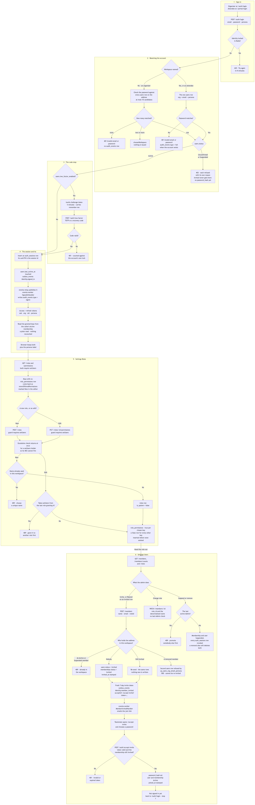

# Sign-in, roles and permissions

**Screens:** Sign-in, Settings Roles, Settings Users, Accept invitation, email

How somebody gets into the organizer console and what they are allowed to do once they are there. It starts at a sign-in form — one for organizers, a separate one for attendees — and ends on the two settings screens where a workspace decides what each role may reach and who holds it, and, for a teammate invited from there, on the emailed join link that sets their password and sends them back to the sign-in form. Everything downstream depends on this: the permission keys minted here are what [Approval](05-approval.md) and [Refund and cancellation](07-refund-and-cancellation.md) check before anybody can decide a registration or give money back.

1. **Sign-in.** Two doors, never one. An organizer signs in at `/auth/login` and an attendee at `/portal/login`, and those are separate accounts even on the same address: `users` carries a `persona` of `admin` or `attendee` and is unique on `(organization_id, email, persona)`. Both pages post to `POST /auth/login` through the same hook, and the one function that builds the body drops `orgSlug` for an attendee — attendee sign-in *refuses* a named workspace rather than ignoring it, because every attendee account lives in the single seeded platform organization (slug `eventa`) so that one person's tickets can span every organizer on the platform. Before any password is read, the attempt is checked against a Redis lock keyed on workspace + persona + email; `LOGIN_MAX_ATTEMPTS` consecutive misses set it for `LOGIN_LOCK_SECONDS`, and a locked attempt is a 429 that says how many minutes are left rather than "try again later". The counter is kept for an address that has no account at all, so the refusal never reveals whether one exists, and the whole throttle fails open — if Redis is unreachable, sign-in still works.
2. **Resolving the account.** The organizer's form no longer asks which workspace, because nobody knows the slug the product generated for them at sign-up. With no `orgSlug`, the API loads every `users` row on that address with `persona = 'admin'` — at most ten, since each one costs an argon2 verification — and checks the password against each. No match is a 401 "Invalid email or password", the same refusal an unknown address gets, and nothing else: this path counts the miss on the Redis lock but writes no `audit_events` row, even when the address does belong to an account. The `type = 'fail'` row is written only where a workspace *is* named — the attendee door, the picker's second post, or an organizer arriving from their confirmation email with the slug already in a hidden field — and only when the address matches an account there, so a wrong password on the default organizer door leaves nothing in any workspace's audit trail, although NFR-SUP-02 asks for every failed sign-in to be recorded. Exactly one match signs in. Two or more — the same address *and* the same password in two workspaces — comes back as `chooseWorkspace` with each workspace's `slug` and `name` and no token at all; the form grows a picker and posts again naming one. That branch is only ever reached after the password has been proven, so it cannot be used to ask which workspaces an address belongs to. What follows is eligibility rather than credentials, read off `users.status`: `Active` continues; `Unconfirmed` is refused with a 403 and a fresh confirmation email; `Suspended` is refused outright with a 403. `Invited` has a 403 of its own in the same check, telling them to open the invitation instead, since that email holds the token that actually works and a confirmation link would point at the wrong thing — but password sign-in never reaches it: an invited `users` row has no `password_hash` until `POST /auth/accept-invite` sets one and flips the row to `Active` in the same transaction (step 6), so an invitee who tries to sign in first fails the password check and gets the 401 above, counted on the lock (and, where a workspace is named, recorded as a `fail` audit row). The two 403s that can fire do not count towards the lockout — they are not password guessing.
3. **The code step.** When `users.two_factor_enabled` is set, a correct password buys a challenge and nothing else: no `auth_sessions` row and no tokens exist yet. The challenge is a five-minute `twofa` token carrying the user, the organization, the persona and the remember-me choice made on the password step. `POST /auth/two-factor` trades it, plus a TOTP code checked against `two_factors.secret_encrypted` or an unused `recovery_codes.code_hash`, for the session. Guesses are throttled per **account** with the same limit and cool-off the password has, but in a lock of their own keyed `twofa|<user id>` rather than on the address, because a six-digit code without a throttle is a keyspace rather than a secret. The account is re-read before the session opens, so somebody suspended between the password and the code gets no session.
4. **The session and its permissions.** Opening a session inserts an `auth_sessions` row whose uuid primary key *is* the session id — there is no separate refresh-token table. `device` is the User-Agent, `ip_address` the caller's IP, and `expires_at` is now plus `JWT_REFRESH_TTL`, or `JWT_REFRESH_TTL_SHORT` when remember-me was left unticked. `users.last_active_at` is touched and an `outbox_events` row with `routing_key = 'identity.signed_in'` is written; once **eventa-relay** publishes that row, **eventa-worker**'s `SignedInHandler` writes the `audit_events` entry with `type = 'signin'` and the title "Signed in from &lt;device&gt;". The audit trail is therefore populated a moment *after* the sign-in, by another process — it is not written on the request. Two JWTs are signed over `sub`, `org`, `sid` and `persona` — the permission keys are not in them — and only then are the caller's keys read, as a plain read: their `memberships` row joined to `role_permissions`, counting only a membership with `status = 'Active'` and only rows with `granted = true`. Nothing is reconciled or granted on the way. A workspace is handed `DEFAULT_ROLES` once, the day it is created, so a key added to `permission_key` later reaches an older workspace only when somebody switches it on in step 5 — until then even an Admin described as "Full access" does not hold it. A runtime reconcile on every organizer sign-in used to fill that gap, with migration `0067_backfill_system_role_grants` doing the same once, and both were withdrawn (0067 is now a `SELECT 1`): an absent `role_permissions` row cannot prove a key was never offered, because a revoke under the old delete-on-revoke behaviour left no row either, and the backfill handed such keys straight back — silently reversing a decision somebody had made. The browser keeps both tokens in `localStorage` alongside the persona the *server* returned, and holds exactly one session, so signing into the portal signs you out of the console. `me.permissions` only tidies the console — it hides a button somebody cannot use — and decides nothing: `PermissionsGuard` re-reads the same keys on every guarded route and answers 403. What a key actually does is best seen in the money ones: a caller without `finView` gets `totalSatang` back as `null` on the registrations list, which renders as "—" and never as `฿0`, because amounts travel as integer satang and are formatted only at the edge, and "you may not see this" is a different fact from "it was free".
5. **Settings → Roles.** `/admin/roles` loads `GET /roles` and `GET /permissions` together, both behind `setUsers`. `permissions` is a global, non-tenant lookup of the fifteen keys in the `permission_key` enum, grouped as `Events`, `Registrations`, `Finance` and `Settings`; `roles` is per workspace, and a new one starts with `Admin` (every key), `Organizer` and `Staff`, each flagged `is_system` and each carrying its member count. The split between neighbouring keys is deliberate — `regCheckin` works the door while `regManage` decides a registration, so Staff can admit people without being able to approve them. Each role also comes back with `neverOfferedPermissions`: the catalog keys it has no `role_permissions` row for at all. Provisioning writes rows only for the keys a default role is granted, so a fresh `Organizer` has five such keys and `Staff` twelve, and the editor marks each one **New** — "no answer on record" — instead of drawing it as a plain off switch, because with the backfill gone (step 4) an open question has to reach a person. A refusal is in neither list; it is reported by its absence from both. A custom role such as "Volunteer" is `POST /roles` and is written with `is_system = false`; a duplicate name is a 409 ("A role called … already exists — choose a unique name") from a lookup made before the insert, with `uq_roles_org_name` behind it in the database. Saving the switches is `PUT /roles/:id/permissions`, which replaces the role's grants wholesale and — beyond a 404 for a role outside the workspace — is refused only when the edit would take `setUsers` away from the last role that grants it (409), because nobody would then be able to grant it back. Both writes also run an escalation check — nobody may grant a key they do not hold themselves — but it returns at once for any caller holding `setUsers`, and both routes have already demanded `setUsers` at the guard, so its 403 cannot fire today: the only 403 on this screen is the guard's own "Missing required permission", which is also what stops an Organizer promoting themselves. The write is a decision about the whole catalog, because that is what the editor shows: the chosen keys are upserted with `granted = true`, and every other key in `permissions` gets a `granted = false` row — *inserted* where the role had none, updated where it had one — so a removal is a recorded fact rather than an absence, and after one save the role carries no New marks. `POST /roles` writes its grants the same way, so a custom role starts with an answer for every key. A change binds immediately on the API, which re-reads the keys per request; the console's own copy refreshes the next time the shell calls `/auth/me`. Nothing here writes an `audit_events` row — the `perm` audit type exists in the enum but no code path uses it.
6. **Settings → Users.** `/admin/users` loads `GET /members`, which is paged server-side with its filters in the URL, plus `GET /members/counts` for the status tabs and `GET /roles` for the invite form and each row's role switcher — all behind `setUsers`. The tab counts deliberately ignore the status filter, so a tab still shows its own total while a different one is selected; search and role do narrow them. Inviting is `POST /members` with `name`, `email` and `roleId`, and what it does depends on who already holds that address in the workspace. Nobody: one transaction writes a `users` row with `persona = 'admin'` and `status = 'Invited'` and a `memberships` row with the chosen `role_id`, the role's name denormalised into `memberships.role`, `status = 'Invited'` and `invited_at` — the invite lifecycle *is* the membership, and there is no separate table for teammate invitations. An `Active` or `Suspended` member: a 409, already in the workspace. Somebody still `Invited`: nothing new is written and the same user and membership are reused, so a second invite re-sends rather than duplicates — and the **Resend** button on an `Invited` row is exactly this call with the row's own name, email and role; there is no separate resend endpoint (the role sent with a re-send is checked but not applied, so changing an invitee's role is the role switcher's job). Either way the API signs a fresh seven-day invite token and writes an `outbox_events` row with `routing_key = 'identity.member_invited'` carrying the invitee's name, the workspace's name and an `acceptUrl` of `${PUBLIC_WEB_URL}/accept-invite?token=…` — a link rather than the bare token, so the only thing the worker can do with it is put it in a mail. That outbox write follows the invite's transaction rather than sharing it, so a lost write leaves an `Invited` row with no email, which Resend recovers. **eventa-worker**'s `MemberInvitedHandler` consumes it and emails the link, in English only because the invitee has no account and so no locale yet, naming the workspace in the subject and the body because an invitation to "a workspace" is one nobody can safely accept; it carries no delivery context, so no `message_deliveries` row files somebody's own invitation where colleagues can read it. The token also still comes back in the response body as `inviteToken`, which the screen ignores. A re-send does not revoke an earlier link: each one works until the membership leaves `Invited` or its seven days run out. The link lands on `/accept-invite`, a public page whose loader fetches nothing — there is no endpoint to check an invite before spending it — where the teammate chooses a password under the same policy sign-up and reset enforce. `POST /auth/accept-invite` verifies the token and finds the membership still `Invited` — anything else is a 401 "Invalid or expired token" — then, in one transaction, sets `users.password_hash` and flips both the user and the membership to `Active` with `joined_at`. It does not sign them in; the page offers a **Go to sign in** link to `/auth/login` and step 1. Re-assigning somebody is `PATCH /members/:id`, updating `role_id` and the denormalised name together — and nothing stops it demoting the workspace's last Admin, although US-SET-11 asks for that to be blocked. Suspending (`POST /members/:id/suspend`) sets both the membership and the user to `Suspended` and revokes every unrevoked `auth_sessions` row for them, so access ends in flight rather than whenever their access token happens to expire; reactivating (`POST /members/:id/reactivate`) puts both back to `Active` with the role untouched. Removing (`DELETE /members/:id`) does the same and additionally stamps `deleted_at` on both rows, keeping their past work. US-SET-11 says a removed teammate can be re-invited later, but the code cannot do it: the invite's lookup skips soft-deleted users, so it inserts a second `users` row on the same address, `uq_users_org_email_persona` — which has no `deleted_at` predicate — refuses it, and the admin gets a 500. Suspend and remove each refuse with a 409 when the member is the workspace's last `Active` Admin.

```mermaid
flowchart TD
  subgraph ONE["1 · Sign-in"]
    A1["Organizer at /auth/login<br/>Attendee at /portal/login"] --> A2["POST /auth/login<br/>email · password · persona"]
    A2 --> A3{"Identity locked<br/>in Redis?"}
    A3 -- "Yes" --> A4["429 · Try again<br/>in N minutes"]
  end

  subgraph TWO["2 · Resolving the account"]
    B1{"Workspace named?"}
    B1 -- "No · an organizer" --> B2["Check the password against<br/>every users row on the address<br/>at most 10 candidates"]
    B1 -- "Yes, or an attendee" --> B3["The one users row<br/>org + email + persona"]
    B2 --> B4{"How many matched?"}
    B4 -- "none" --> B5["401 Invalid email or password<br/>no audit_events row"]
    B4 -- "two or more" --> B6["chooseWorkspace<br/>nothing is issued"]
    B3 --> B9{"Password matches?"}
    B9 -- "No" --> B10["401 Invalid email or password<br/>audit_events type = fail<br/>when the account exists"]
    B7{"users.status"}
    B4 -- "one" --> B7
    B9 -- "Yes" --> B7
    B7 -- "Unconfirmed<br/>or Suspended" --> B8["403 · each refused<br/>with its own reason<br/>Invited never gets here:<br/>no password_hash yet"]
  end

  subgraph THREE["3 · The code step"]
    C1{"users.two_factor_enabled?"}
    C1 -- "Yes" --> C2["twofa challenge token<br/>5 minutes · carries remember-me"]
    C2 --> C3["POST /auth/two-factor<br/>TOTP or a recovery code"]
    C3 --> C4{"Code valid?"}
    C4 -- "No" --> C5["401 · counted against<br/>the account's own lock"]
  end

  subgraph FOUR["4 · The session and its permissions"]
    D1["Insert an auth_sessions row<br/>its uuid PK is the session id"] --> D2["users.last_active_at touched<br/>outbox_events identity.signed_in"]
    D2 --> D3["eventa-relay publishes it<br/>eventa-worker SignedInHandler<br/>writes audit_events type = signin"]
    D3 --> D4["Access + refresh tokens<br/>sub · org · sid · persona"]
    D4 --> D5["Read the granted keys from<br/>the caller's Active membership<br/>a plain read · nothing reconciled"]
    D5 --> D6["Browser keeps both<br/>plus the persona label"]
  end

  subgraph FIVE["5 · Settings Roles"]
    E1["GET /roles and /permissions<br/>both require setUsers"] --> E12["Keys with no role_permissions row<br/>come back as neverOfferedPermissions<br/>marked New in the editor"]
    E12 --> E2{"A new role, or an edit?"}
    E2 -- "New" --> E3["POST /roles<br/>guard requires setUsers"]
    E2 -- "Edit" --> E4["PUT /roles/:id/permissions<br/>guard requires setUsers"]
    E5["Escalation check returns at once<br/>for a setUsers holder<br/>so its 403 cannot fire"]
    E3 --> E5
    E4 --> E5
    E5 -- "New" --> E6{"Name already used<br/>in this workspace?"}
    E6 -- "Yes" --> E10["409 · choose<br/>a unique name"]
    E6 -- "No" --> E11["roles row<br/>is_system = false"]
    E5 -- "Edit" --> E7{"Takes setUsers from<br/>the last role granting it?"}
    E7 -- "Yes" --> E8["409 · grant it to<br/>another role first"]
    E7 -- "No" --> E9["role_permissions · true per chosen key<br/>a false row for every other key<br/>inserted where none existed"]
    E11 --> E9
  end

  subgraph SIX["6 · Settings Users"]
    F1["GET /members, /members/counts<br/>and /roles"] --> F2{"What the admin does"}
    F2 -- "Invite, or Resend<br/>on an Invited row" --> F3["POST /members<br/>name · email · roleId"]
    F3 --> F10{"Who holds the address<br/>in this workspace?"}
    F10 -- "An Active or<br/>Suspended member" --> F11["409 · already in<br/>the workspace"]
    F10 -- "Nobody" --> F12["users status = Invited<br/>memberships status = Invited<br/>invited_at stamped"]
    F10 -- "Still Invited" --> F13["Re-send · the same rows<br/>nothing new is written"]
    F10 -- "A removed member" --> F17["Second users row refused by<br/>uq_users_org_email_persona<br/>500 · cannot be re-invited"]
    F12 --> F4["Fresh 7-day invite token<br/>outbox_events identity.member_invited<br/>acceptUrl /accept-invite?token=…"]
    F13 --> F4
    F4 --> F14["eventa-worker MemberInvitedHandler<br/>emails the join link"]
    F14 --> F15["Teammate opens /accept-invite<br/>and chooses a password"]
    F15 --> F18{"POST /auth/accept-invite<br/>token valid and the<br/>membership still Invited?"}
    F18 -- "No" --> F19["401 · Invalid or<br/>expired token"]
    F18 -- "Yes" --> F5["password_hash set<br/>user and membership Active<br/>joined_at stamped"]
    F5 --> F16["Not signed in yet<br/>back to /auth/login · step 1"]
    F2 -- "Change role" --> F6["PATCH /members/:id<br/>role_id and the denormalised name<br/>no last-Admin check"]
    F2 -- "Suspend or remove" --> F7{"The last<br/>active Admin?"}
    F7 -- "Yes" --> F8["409 · promote<br/>somebody else first"]
    F7 -- "No" --> F9["Membership and user Suspended,<br/>every auth_sessions row revoked<br/>a removal also soft-deletes both"]
  end

  A3 -- "No" --> B1
  B7 -- "Active" --> C1
  C1 -- "No" --> D1
  C4 -- "Yes" --> D1
  D6 --> E1
  E9 -- "Hand the role out" --> F1
```

Mermaid source

[← All flows](README.md)
