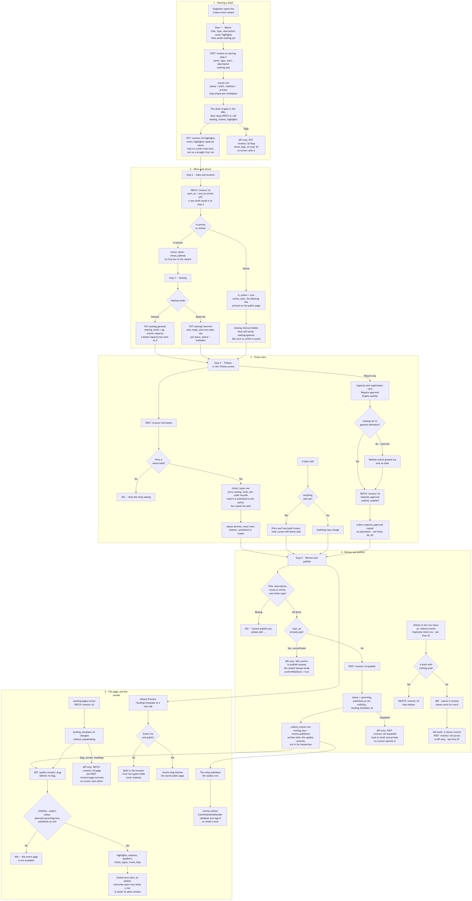
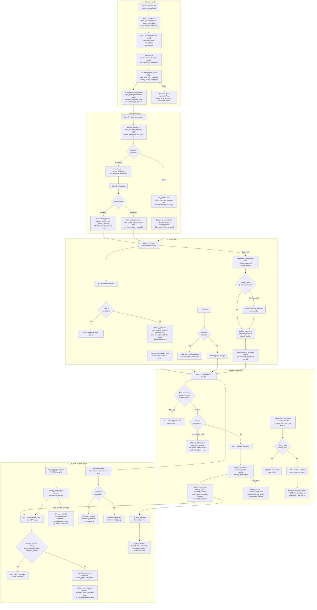

# Create and publish an event

**Screens:** Create event wizard, Landing pages, Tickets

How an organizer turns an idea into a public page an attendee can register on. It starts in the admin console's five-step wizard, which creates a draft on the first save and edits it from then on, and ends when the event is live at its own public address and eventa-worker has consumed the publish notice. Nothing here is attendee-facing: the organizer persona signs in at `/auth/login` for `/admin/*`, and the page it produces needs no account at all to read. Copying an event into a new draft and deleting one are not part of the wizard: both live in the row menu on `/admin/events` and are drawn in [Categories, duplicating and deleting events](25-manage-events.md).

1. **Starting a draft.** The wizard at `/admin/event-form` opens blank and makes no calls at all until something is saved — on the API this is not one submit but a create followed by a long run of patches. `POST /events` needs a start and the start is asked for on step 2, so Next on Basics sends nothing and step 2's Next stays disabled until a title and a start date are filled; leaving step 2 is the create. That first save posts to `/events` (permission `evCreate`) with only a name, a type from the `event_type` enum, a start instant and an optional description — nothing else the first two steps hold, so the venue, end, online flag and cover typed there are first written by a later `PATCH` (on a straight run, step 4's) — and inserts an `events` row with `status = 'draft'`, `bucket = 'active'`, `visibility = 'private'` and `published_at` still null. The slug is derived from the name (latin `a-z0-9` and hyphens, at most 80 characters), falls back to `event` when that leaves fewer than three characters (a Thai-only title, for instance), and is tried as `-2`, `-3`… until it is free, because `uq_events_org_slug` makes it unique per workspace rather than globally; `organizer_name` falls back to the workspace's own name and `created_by` records who did it. The description is rich text the organizer authors in Quill and an anonymous reader later loads, so it is sanitised on the way **in** and capped at 10,000 characters of markup. The new id goes straight into the URL — from then on a refresh or a closed tab cannot strand a draft nobody can find. The cover image is a separate two-step upload (`POST /events/cover/upload-url`, then `PUT` straight to storage, then `POST /events/cover`); it writes to no table, is staged per **organization** rather than per event because step 1 runs before a draft exists to key it to, and only the confirmed URL is saved, in `events.cover_image`. The Basics step's highlights are a `PUT /events/:id/highlights` that replaces `event_highlights` as a whole — at most 12 — so what the organizer sees is exactly what the page renders. That call goes out only with the wizard's plain step save — Next on Basics or Date & location once the draft exists, or the header's Save on those steps or on Review — never with the create, seating, tickets or publish calls; so on a straight first run through a new event the highlights typed on Basics are never sent, unless the organizer goes back and saves one of those steps. FAQs have the same shape on the API — `PUT /events/:id/faqs` (`evCreate`) replaces `event_faqs` whole, at most 30 — but that endpoint is **API-only: no screen calls it**. The wizard has no FAQ field and no other console screen authors FAQs, so `event_faqs` stays empty unless something calls the API directly, and every template simply leaves the FAQ section out when there are none.
2. **When and where.** Step 2's fields reach `events` through `PATCH /events/:id` — on an existing draft when step 2 is left, on a new one only with step 4's save, because leaving step 2 was the create. `start_at` and `end_at` are `timestamptz` — stored UTC, typed and displayed in Asia/Bangkok, with `events.timezone` defaulting to `'Asia/Bangkok'`. An end before or equal to the start is refused. An in-person event fills `venue_name` and `venue_address` — the wizard has no City box and re-sends whatever `city` is already stored, blank for a new event; an online one sets `is_online = true` with an `online_note`, and the public page then never publishes a physical location even if one is stored. It does publish `online_note` itself: the wizard labels that box **Meeting link** with a hint that it is emailed after registration, yet `GET /public/events/:slug` returns it and every template prints it in place of "Join link sent after you register". Step 3 is the room. General admission is a headcount: `PUT /events/:eventId/seating/general` sets `seating_mode = 'ga'` and writes the number into `events.capacity`. Reserved seating is a grid: `PUT /events/:eventId/seating/reserved` writes one `seat_maps` row per event (`uq_seat_maps_event`) carrying `layout` as `{ rows, seatsPerRow }` and `total_seats`, plus one `seats` row per position with `status = 'available'` — the `seat_status` enum is `available`, `held`, `reserved`, `sold`, `blocked`. Switching a reserved event back to general admission drops the map. Either way an **online** event is refused outright with a 422 ("Online events have no seating — …"), and on an event that is no longer a draft a layout change that would remove a seat already `sold` is refused too. The wizard hides the seating choices for an online event, but its Next still sends `PUT …/seating/general`: on a first run that succeeds, because `is_online` has not been saved yet, and once it has, the refusal shows as the wizard's error banner while it moves on to Tickets. The wizard has no headcount box on this step either: the number it sends is the **Capacity** box on step 4's card, and a blank box is sent as `0`. So a first run, which leaves Seating before that box is reached, stores `events.capacity = 0` until step 4's `PATCH` carries a number; left blank there, the nought stays — that `PATCH` omits a blank capacity, and `UpdateEventDto.capacity` must be positive — and a reload shows `0`. The summary rail still renders `—` for a blank or zero capacity, because "as many as the tiers allow" and "nobody may come" are different facts, but the stored value says nought.
3. **Ticket tiers.** Step 4, and the standalone Tickets screen at `/admin/tickets`, both write `ticket_types` through `POST /events/:eventId/tickets` and `PATCH /events/:eventId/tickets/:ticketId`. `price_satang` is integer satang and VAT-inclusive; prices are set in whole baht, so a stray satang is refused, and the browser converts what was typed with `Math.round(baht × 100)` rather than sending a float. A free tier sets `is_free` and is held to a zero price by `ck_ticket_types_free_price`. `total` is the allocation, and the ticketing policy reads `0` as unlimited — never derived `soldout`, no per-order ceiling — but nothing downstream agrees: `ck_ticket_types_sold` keeps `sold` between 0 and `total`, the seat-hold engine counts free places as `total - sold - held`, and the public page counts `total - sold` remaining, so a tier left at `0` — which is what a blank Quantity box in the wizard creates — is shown sold out and cannot actually be sold. `min_per_order` and `max_per_order` sit inside the platform's eight-seat booking cap and inside the allocation itself. What the tier is **not** given is its own availability: `status` is always derived server-side by the ticketing policy — `soldout` when the allocation is exhausted, `scheduled` while `sales_start_at` is still ahead, otherwise `onsale` — so the only value a human owns is `paused`, which survives until Resume and is refused a resume once `sales_end_at` has passed. Two rules protect sales already made: once `sold > 0` the price and the paid/free setting are frozen (a new tier is the answer), and `total` can never be set below `sold`. Raising `total` is the one edit with a side effect — the new places are offered to anyone waiting (see [Waitlist](04-waitlist.md)), and a failure there is reported as the offers being cut short rather than undoing the organizer's capacity change. Deleting a tier that never sold erases the row; one with sales is soft-deleted via `deleted_at`, so it leaves the list and stops selling while every issued ticket still resolves to it. The last remaining tier cannot go, and neither can one somebody is checking out with — an active `seat_holds` row refuses the delete with a sentence saying to pause it and try again. The same wizard step also carries the event's two registration rules, on a **Capacity & registration** card under the tier table — the only place in the console that sets them; the standalone Tickets screen does not. Saving the step sends both in the `PATCH /events/:id` (`evCreate`) that goes out before any tier is written, into `events.requires_approval` and `events.waitlist_enabled`, each `false` until switched on. **Require approval** holds every registration placed from then on for the organizer's decision (see [Approval](05-approval.md)). It is copied onto each `orders` row as `orders.requires_approval` at placement, so flipping the switch later never changes the deal a buyer was shown; and while it is on, a raised `total` no longer offers its new places to the line by itself — the organizer offers them by hand, because handing out a place on such an event is itself the decision. **Enable waitlist** only means something on general admission. When step 3 chose reserved seating the switch is greyed out, with a hint that a freed seat cannot be offered without somebody choosing it, and the wizard sends `false` whatever it was left at. The API does not refuse the combination at write time — `PATCH /events/:id` accepts `waitlistEnabled = true` on a reserved event — but the rule holds where it matters: checkout refuses to join a reserved event's line ("The waitlist is for general-admission tickets; this event seats people by seat."), and a raised allocation never offers places to one (see [Waitlist](04-waitlist.md)).
4. **Review and publish.** `POST /events/:id/publish` needs the stronger `evPublish` permission, and refuses a draft that is not ready. The readiness gate asks for four things — a title, a description, a venue or an online link (checked as a `venue_name` or `is_online = true`), and at least one ticket type — and answers a 422 naming the ones still missing ("Cannot publish yet — please add …"); the wizard's checklist applies the same four rules locally so the button and the server agree before it is pressed, and counts only tiers the API has actually stored. A start date already in the past is refused with a 422 unless the request carries `confirmPastStart` — but the wizard always sends `confirmPastStart: true`, without asking, so from the console a past start publishes with no prompt and that refusal is **API-only**. A `version` that no longer matches is a 409 asking for a reload, which is what stops two people publishing different drafts of the same event. On success the row moves to `status = 'upcoming'` with `bucket = 'active'` and `published_at` stamped, and the request's optional `visibility` and `landing_template_id` are applied in the same write. Worth knowing: `planned` and `live` exist in the `event_status` enum and are accepted as live by the public-page, discover and checkout queries, but nothing ever writes them — publishing always lands on `upcoming`. Once that write has committed, the service enqueues an `outbox_events` row with `aggregate_type = 'event'` and `routing_key = 'events.published'` — through `OutboxPort.enqueue` on its own connection, not `enqueueIn` inside the update's transaction, so the state change and the message about it do **not** commit together: a failure between the two leaves a published event with no `events.published` row, and the organizer an error for a publish that stood. Unpublishing, `POST /events/:id/unpublish` (`evPublish`), is the exact reverse and loses nothing: `status` back to `draft`, `visibility` back to `private`, `published_at` cleared, every tier, seat and highlight preserved — but it is **API-only: no screen calls it**; the wizard's route action keeps an `unpublish` branch that no control submits. Deleting and duplicating happen in the row menu on `/admin/events`, not here (see [Categories, duplicating and deleting events](25-manage-events.md) steps 5 and 6). `DELETE /events/:id` (`evPublish`) hard-deletes only a draft with nothing sold; a published event, or a draft with registrations, is refused with a 409 whose sentence tells the organizer to cancel it instead — but **the console has no Cancel control**. The row menu shows that sentence word for word and offers nothing more, and `POST /events/:id/cancel` is **API-only: no screen calls it** (see [Refund and cancellation](07-refund-and-cancellation.md) step 1).
5. **The page, and the worker.** The public page lives at `/e/<slug>` and is served by `GET /public/events/:slug`, which returns a row only when `visibility = 'public'`, `status` is one of `planned`/`upcoming`/`live`, `published_at` is not null and `deleted_at` is null — anything else is a plain "This event page isn't available." `unlisted` is in the `visibility` enum but is not treated as reachable by that query, so today only `public` has a page. The payload is assembled read-only from `event_highlights`, `sessions`, `speakers`, `ticket_types` and `event_faqs`, with the accent colour falling back to `#2563EB` when none is stored or the stored one is not `#rrggbb`, and the template falling back to `aurora`. Registration is reported closed once `start_at` has passed and "not open yet" while every tier sits outside its sales window — a tier whose stored `status` still reads `onsale` is refused at checkout outside its sales window, because registration's own eligibility rules check the window rather than trusting that badge, which is deliberate (see [Checkout and payment](02-checkout-and-payment.md)); an event with `requires_approval` set confirms nothing at checkout either (see [Approval](05-approval.md)). The **Landing pages** screen offers the four designs — `aurora` (Classic), `noir` (Spotlight), `minimal` (Minimal), `atlas` (Vibrant), seeded into the global `landing_templates` lookup — and "Use template" is a plain `PATCH /events/:id` setting `landing_template_id` on the event chosen in the screen's switcher (with no event yet it is only a link to the wizard), deliberately so: it used to be settable only while publishing, which meant wanting a new look required taking a live event down. Everything else about the page is **API-only: no screen calls it**. `PATCH /events/:id/page` (`evPublish`) can move the slug (409 when it is taken in the workspace), the accent colour and the agenda/speakers headings, and `POST /events/page/preview` (`evCreate`) renders a page from values that have never been saved — it writes nothing and is flagged `noIndex` so a preview can never leak into search. No console screen lets an organizer change the address, the accent colour or those headings, and the wizard's own update leaves `accentColor` out, so a value set through the API survives a save. The wizard's **Preview** button — in its header on every step, and again on the review step — does not use that endpoint either. On an event that is not yet served publicly it opens `/landing/<template>` in a new tab with the typed title, venue, online flag and highlights packed into the query string, and the page is built in the browser from those alone, with no agenda, speakers, tickets or FAQs: no API call, never indexed. Once the event is live and `public` it opens `/landing/<template>?event=<slug>` instead, which fetches the real public page and therefore shows what is saved, not what is on screen. Finally, the asynchronous part, which is the piece readers most often get wrong: **publishing sends no email.** The API only wrote the `outbox_events` row; the relay publishes it to RabbitMQ, and eventa-worker's `EventPublishedHandler` consumes `events.published`, validates the payload and writes it to the structured log, nothing more — delivering the team's "Event published" notification is deferred, because the message carries a slug, a name and who published it, and no recipient addresses at all.

Mermaid source

[← All flows](README.md)
