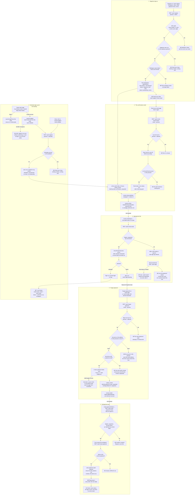

# Sign-up, confirmation and password reset

**Screens:** Organizer sign-up, Portal sign-up, Check your email, Verify email, Guest order page, Forgot password, Reset password

How somebody gets an account, proves the address is theirs, and gets back in after forgetting the password. It starts at one of two sign-up forms — `/auth/register` for an organizer, which creates a whole workspace, and `/portal/register` for an attendee, which a guest also reaches through a link emailed from their own order page — runs through an emailed confirmation link, and ends at the matching sign-in described in [Sign-in, roles and permissions](12-sign-in-roles-and-permissions.md). The second half starts at "Forgot password?" on either sign-in and ends with a new password and every session revoked. Changing a password while signed in, two-factor and the sessions list are [Account security](15-account-security.md); the booking whose order page offers the attendee account is [Free registration and confirmation](03-free-registration-and-confirmation.md). Organizer and attendee accounts are separate even on the same address — `users` is unique on `(organization_id, email, persona)` — so every step below is asked of one persona at a time.

1. **Organizer sign-up.** `/auth/register` is `guestOnly('admin')`, so a visitor already holding an organizer session is sent to `/admin/home` instead. The form asks for a workspace name (required in the browser, because the API's fallback is a name and a slug nobody chose), a full name, the email, the password twice with a strength meter, and the Terms & Privacy box; the "Sign up with Google" button only says that Google sign-up isn't connected yet. `useSignUp('admin')` posts `POST /auth/register` with `persona = 'admin'` stated rather than defaulted, and `acceptTerms` passed through as ticked or not — asserting somebody's consent is not the page's to do. The DTO trims the name (1–120), trims and lower-cases the email (at most 255), demands `acceptTerms = true`, and holds the one password rule used for sign-up, reset and change alike: 6–128 characters with at least one letter and one digit. A miss is a 400 "Validation failed." whose field messages the page shows verbatim; the browser itself enforces only the length and the ticked box, so the letter-and-digit rule is the API's. Then, **before anything else, the address: if any non-deleted `users` row with `persona = 'admin'` exists on it — in any workspace, even as an unaccepted invitee somewhere else — the answer is a 202 "Check your inbox to confirm your email and finish signing up." and nothing is created and nothing is sent**, not even a fresh link to an owner who never confirmed. That sentence is word for word what a new account gets, so the endpoint cannot be used to list who has one, and it is asked before the workspace name so a taken address never reaches the one refusal that is allowed. The name is then compared the way `uq_organizations_name` compares it — `lower(btrim(name))` among live workspaces — and a clash is a 409 "That workspace name is already taken. Try another."; the same 409 comes back if somebody else takes the name between that check and the insert, because the index is the guarantee and the check only exists to turn it into a sentence rather than a 500. (An API caller that omits `organizationName` gets "&lt;name&gt;’s Workspace"; the code skips the name check for it but does not make it unique, so a second person of the same name gets that 409 too. No screen sends the request without a name.) The slug is slugified — lower-case `a–z0–9` and hyphens, 3–80 characters — so a workspace named only in Thai script has nothing to keep and falls back to `workspace`, and the first free of `base`, `base-2`, `base-3`… is taken. Nobody is told it, which is why sign-in no longer asks for it. The password is hashed with argon2id and **one transaction** writes the `organizations` row, scopes itself to it through `app.current_org` so row-level security accepts the rest, inserts the owner's `users` row with `persona = 'admin'`, `status = 'Unconfirmed'` and `password_hash`, refreshes the global `permissions` catalog (all fifteen keys, `group` and `label` brought up to date on every sign-up), creates the three `roles` — Admin "Full access" with every key, Organizer with ten, Staff with `regView`, `regCheckin` and `evProgramView`, each `is_system` by the column default — with their `role_permissions` rows at `granted = true`, and finally a `memberships` row on the Admin role with `role = 'Admin'`, `status = 'Active'` and `joined_at`. The membership is active from the first second; **what keeps the owner out is `users.status` alone**. The answer is the same 202, and the page replaces itself with `/auth/register/check-email`, carrying the address in history state rather than the query string so it never reaches a log or a `Referer` header.

2. **The confirmation email, and asking for it again.** Straight after that transaction commits, the API signs a `verify_email` JWT over the user and organization, valid for 24 hours, and inserts an `outbox_events` row with `aggregate_type = 'user'`, `routing_key = 'identity.email_verification_requested'` and a payload carrying the name, the address and `verifyUrl` = `PUBLIC_WEB_URL/verify-email?token=…`. That insert is a second write, not part of the bootstrap transaction, so if it fails the account stands `Unconfirmed` with no mail and the caller sees a 500 — and signing up again gets the neutral 202 and sends nothing, so the ways back are "Send it again" and a password sign-in, both of which mint a fresh link. `eventa-relay` publishes the row with the outbox id as the message id, and **eventa-worker**'s `EmailVerificationHandler` validates the payload and sends "Confirm your email to finish signing up" through whichever transport `EMAIL_PROVIDER` names (`log`, the default, records the send and drops it; `smtp` delivers). It is plain English text; the greeting runs the account's name through `safeDisplayName`, because that name is free text, and the body says the link expires in 24 hours — and asks the reader to "activate your Eventa workspace" even when the reader is an attendee, who has none. It writes no `message_deliveries` row, since account mail is not the organizer's message log; a failed send is retried after 5 s, 30 s, 2 min and 10 min before it is dead-lettered (a permanent SMTP refusal, or a payload that fails validation, goes there at once), and a redelivery after success sends nothing because completed message ids are remembered. The check-email pages — `/auth/register/check-email` and `/portal/register/check-email`, both unguarded — name the address only when history state carries one; opened cold they say "the address you signed up with" and offer no resend, because there is nothing to send to. "Send it again" posts `POST /auth/verify-email/resend` with the email and the persona, since one address can hold both accounts and they confirm separately. The API keys a Redis cool-off on persona + lower-cased address, and inside it the answer is a 429 "A confirmation link was just sent. Give it a minute before asking for another." Otherwise it **starts the cool-off (`VERIFY_RESEND_COOLDOWN_SECONDS`, 60) before looking anything up, and whether or not an account exists**, because a wait that applied only to real accounts would answer the question the response refuses to. Only a non-deleted account in that persona with `status = 'Unconfirmed'` is sent a fresh token and a new outbox row; an active, invited or unknown address gets nothing, and every branch answers the same 202 sentence. The cool-off fails open when Redis is unreachable — an extra email is a smaller harm than a person shut out of their own confirmation — and links, unlike SMS codes, have no daily budget. The page keeps its own 60-second countdown in `localStorage` so a reload cannot skip it, started only once a resend has been accepted; the sign-up itself starts neither wait, so the first "Send it again" is live at once. A resend revokes nothing: every link already sent stays good for its own 24 hours.

3. **Opening the link, and what an unconfirmed account cannot do.** `/verify-email` sits outside `/auth` because the API builds the URL; it serves both personas and is not `guestOnly`. Its loader posts the token to `POST /auth/verify-email` the moment the page opens — clicking the link *is* the request, so a "confirm" button would confirm nothing — and a link with no token is refused by the page itself as incomplete. A mangled token fails the DTO's `@IsJWT` with a 400 "Validation failed." whose field message is deliberately the expired one, "This confirmation link is invalid or has expired. Request a new one."; a bad signature, an expired token or a user deleted since is that sentence as a 422. Otherwise, inside the account's tenant, a `users` row at `Unconfirmed` becomes `Active` with `updated_at`, any other status is left as it is, and the slug and persona come back. Nothing else is written — no `audit_events` row, no outbox event — and the call is idempotent: **opening the same link again within its 24 hours answers "Email confirmed" again**, although the check-email page says the link "works once" and the failure page says each one "can only be opened once". (The token's `typ` claim is not checked either, unlike the two-factor challenge's, so any token the API signs over the same user and organization would do; the only other token an unconfirmed user can come to hold is from the API-only social sign-in below.) An organizer is sent to `/auth/login?org=<slug>`, where the slug rides as a hidden `orgSlug` and skips the workspace picker; an attendee goes to bare `/portal/login`, because attendee sign-in refuses an `orgSlug` with a 422 and the platform organization is never named. A failed link offers both sign-ups by name, since a token that does not decode cannot say whose it was, and no resend, since the page has no address. Until the link is opened the account is inert. `POST /auth/login` checks the password first and only then refuses with a 403 `EMAIL_NOT_CONFIRMED`, "Please confirm your email — we’ve sent you a fresh link.", writing a new outbox row on the spot; that send bypasses the resend cool-off, being behind a proven password, and none of it counts towards the sign-in lock. The forgot-password form refuses the account with a 422 (step 5), and without a session no guarded route answers at all — even though the owner's Admin membership is already active. The one way round it is **API-only**: `POST /auth/social/organizer` and `POST /auth/social/attendee` link a provider-verified address to an existing account and refuse only `Suspended`, so a social sign-in would open a session for an account that stays `Unconfirmed`. No screen calls them — the Google button on the organizer forms says it isn't connected, and the portal has none.

4. **Attendee sign-up, and the account offered from a booking.** `/portal/register`, opened directly, is `guestOnly('attendee')` and has no workspace field and no social buttons. `useSignUp('attendee')` posts the same `POST /auth/register` with `persona = 'attendee'`, and the shared input builder drops any workspace name, because the API refuses one for an attendee with a 422 "An attendee account doesn't have a workspace — leave organizationName out." rather than ignoring it. The duplicate check is persona-scoped: a non-deleted attendee row on the address gets the same neutral 202 with nothing created or sent, while an organizer account on the same address does not count, so one person may run events and buy tickets without either blocking the other. A new account is **one `users` row in the platform organization** (slug `eventa`, seeded by migration 0026) with `persona = 'attendee'` and `status = 'Unconfirmed'` — no workspace, no roles, no membership, because an attendee's tickets span every organizer and scoping the login to one would give them an account per organizer. A deployment missing that organization answers a 500 "Attendee accounts are unavailable right now. Please try again later." rather than a cheerful "check your inbox" for an account that was never made. From there it is steps 2 and 3 exactly, through `/portal/register/check-email` to `/portal/login`, which lands on `/portal/my-events`. `/portal/login` itself links only to Discover and to the attendee's forgot form — **not built: a "create an account" link on the attendee sign-in**, which US-DISC-08 asks for. The way in that is built is the guest's own order page, `/my/tickets/orders/:orderId`, whose last card, "Keep these tickets", offers the account from the booking (US-DISC-15). **Its rule is that the booking's inbox is proven before the account exists, and no password is chosen before that proof.** The page is shown to whoever made the booking, before anyone has read the buyer's mail, and anybody can book — a free RSVP is enough — under somebody else's address; an account made from the page itself would let that booker set the password for the owner's account and then read on My Events every order ever placed with the address, across every organizer and with the ticket codes. So the card first asks `GET /auth/register/from-booking/:orderId` — public, keyed by the order's uuid and never its reference, a 404 for an order that does not exist — whether a live attendee account already uses the buyer's address. If one does, the card offers only **Sign in**, `/portal/login?from=` the order, which returns there afterwards, since only same-site paths are honoured. Otherwise it offers **Create account** beside "Not now — your ticket is already in your email", and dismissing or ignoring it changes nothing. **Create account asks for no password and creates nothing.** It posts `POST /auth/register/from-booking/:orderId/link` with no body. A live attendee account on the address is a 409 "An account already uses this email. Sign in instead."; a second request inside the cool-off is `ResendThrottleService`'s own 429 "A confirmation link was just sent. Give it a minute before asking for another." — the cool-off is claimed as a `link` under an identity of its own, `booking-claim:` and the lower-cased address, so it shares no key with sign-up's resend and, like every link cool-off, fails open when Redis is unreachable. Otherwise the API signs a `booking_claim` JWT — `sub` the order's id, `email` the buyer's address, valid for 7 days — and inserts one `outbox_events` row with `aggregate_type = 'order'`, the order as `aggregate_id`, the platform organization as `organization_id` and `routing_key = 'identity.booking_account_link_requested'`, whose payload carries the buyer's name and address, the event's name, `claimUrl` = `PUBLIC_WEB_URL/portal/register?claim=…`, `expiresAt` and `locale` — the language the booking's own confirmation email was written in. The answer is a 202 with `sentTo`, the buyer's address, and the card replaces itself with "We've sent a link to &lt;address&gt;. Open it to choose a password — it proves the address is yours."; a refusal is shown in the API's own words. **eventa-worker**'s `BookingAccountLinkHandler` sends "Keep your tickets for &lt;event&gt; in an Eventa account" through the same `EMAIL_PROVIDER` transport as the confirmation email, in English or Thai by `locale`. It is plain text: what the link does — choose a password, then see every booking made with this address in one place — the link on a line of its own, when it expires in Asia/Bangkok time, that the tickets need no account, and that nothing is created until the link is opened and a password chosen, for a reader who never booked. Like the confirmation email it writes no `message_deliveries` row and rides the same retry ladder. Neither service logs the token, the URL or the address.

   The emailed link opens `/portal/register?claim=<token>` in booking-claim mode, which is not guest-only: like the reset link, it has to work on whatever device it is opened on, signed in or not. A link that arrives with an empty `claim` is refused by the page itself as incomplete, without calling the API. Otherwise its loader posts the token in the body — never in a URL the API would log — to `POST /auth/register/from-booking/claim/inspect`, which accepts it only as a `booking_claim` (an access, refresh, invitation, reset or confirmation token is refused by its `typ`), re-reads the order its `sub` names, and checks that the order's `buyer_email` still equals the token's address, ignoring case. Anything else — mangled, forged, expired, the wrong type, the order gone or its address changed since — is one 400 "This link has expired or is no longer valid. Ask for a new one from your booking confirmation.", and the page offers `/portal/login`. A good link returns the name from the order, the address and `accountExists`; if the address has meanwhile gained an account, the page offers "Sign in instead" and no password field. Otherwise it shows the name and the address read-only and asks only for the password twice and the Terms & Privacy box. Submit posts `POST /auth/register/from-booking/claim` with `token`, `password` and `acceptTerms` and nothing else: the whitelist pipe refuses an `email` or a `name` with a 400, because the address comes only from the verified token and the name only from the order. The password is held to the one rule every sign-up, reset and change uses, and `acceptTerms` must be true. The token is checked again exactly as above, and a live attendee account on the address is the same 409 — which is also what makes the link work once. Two claims racing on one link can both pass that check, and the unique index on `(organization_id, email, persona)` refuses the loser with the same 409. The account is one `users` row in the platform organization with `persona = 'attendee'` and **`status = 'Active'` from the first second: opening the link was the confirmation**, so there is no check-email page and no `identity.email_verification_requested`. The 201 is the body a sign-in returns, from `AuthService.startSession`, so the browser starts the session exactly as after a sign-in, hands any guest saves to the account and lands on `/portal/my-events`.

   Orders attach by matching, never by being written to the account — nothing touches `orders` at sign-up, at confirmation or when a booking's link is used. `GET /me/tickets` resolves the caller's `users.email` server-side from the token and lists the `orders` whose `buyer_email` equals it (both `citext`, so case does not matter), with `status = 'confirmed'` and no `deleted_at`, across every workspace — deliberately cross-tenant — up to 200. Bookings made before the account existed and after it appear the same way, an order still awaiting payment or approval appears once it is confirmed, and a booking made under a different address never will.

5. **Forgot password.** "Forgot password?" on `/auth/login` opens `/auth/forgot-password`, and on `/portal/login` opens the same page with `?persona=attendee`; anything else in that parameter is read as organizer, because the address bar is not a trusted input. The subtitle names the realm and the page always offers the other one's form. `POST /auth/forgot-password` takes the email (trimmed and lower-cased) and the persona, and **before the account is looked up** asks the sign-in lockout service whether persona + address is locked — but under its own `reset:` keys, a prefix the service owns, so failed sign-ins never lock this form and probing this form never locks anybody's sign-in, whatever workspace slug a sign-in attempt types. A lock is a 429 "Too many password-reset attempts. Try again in N minutes.", rounded up, and while it holds the form says nothing about whether an account exists. The lookup takes every non-deleted `users` row on the address in that persona whose workspace is not deleted, oldest first and at most ten, since each usable one gets an email and an anonymous form must not be able to send more. **None is a 404 that says so — "No organizer account uses that email address. Check the spelling, try your attendee account, or create one." (the attendee form's names the two audiences the other way round) — a deliberate departure from the neutral answers of sign-up and sign-in** (US-ACC-04), because silence looks exactly like a lost mail and the commonest cause is the other audience. What bounds that oracle is that each miss counts: `LOGIN_MAX_ATTEMPTS` (5) misses within `LOGIN_LOCK_SECONDS` (900) lock the address for 900 seconds, and with Redis unreachable the form keeps working. Every account that is `Active` and has a `password_hash` gets a link. When none can, the answer is a single 422 — the refusal that gets the person in soonest, in this order: an account that signs in only socially (naming the providers actually linked in `social_identities`, Google, Apple or LinkedIn), then `Unconfirmed` (open the confirmation link; signing in sends a fresh one, and this form never does, as it asks for no password), then `Invited` (open the invitation), then `Suspended` (ask a workspace admin). These are the accounts' own state rather than guessing, so they never count towards the lock. Each link is a `reset_password` JWT over the user and organization, valid for one hour and carrying `pv` — the first 16 hex characters of a SHA-256 of the current `password_hash` — and goes out as an `outbox_events` row with `routing_key = 'identity.password_reset_requested'`, `resetUrl` = `PUBLIC_WEB_URL/reset-password?token=…` and, for an organizer only, `workspaceName`. **eventa-worker**'s `PasswordResetHandler` sends "Reset your Eventa password", naming the workspace where there is one so somebody with accounts in two can tell the emails apart, and saying the link expires in one hour and works once. The answer is the same 200 "A password-reset link is on its way." however many went out, so the screen never says how many workspaces an address belongs to. The page then shows "Link sent" and a "Send it again" behind a 60-second countdown kept in `localStorage`. **Not built: any server-side limit on successful requests** — only misses are counted, so that countdown is the only brake, and each accepted request queues up to ten more emails.

6. **Setting the new password.** `/reset-password` is outside `/auth` because the API builds the URL; it serves both personas and is not `guestOnly`, since somebody still signed in on this device may be the one who forgot. Its loader posts the token to `POST /auth/reset-password/check` — in the body, never a query string the API would log — which answers without spending it and sits deliberately outside the reset lock, since checking a link reveals nothing about an address. A link is good when it is signed by the API and unexpired, the `users` row it names still exists in the organization it names, and its `pv` still matches that row's current hash. A good link returns the `persona` and, for an organizer, `workspaceName`, so the form reads "Set a new password for" that workspace; a dead one is a 422 "This reset link is invalid or has expired. Request a new one." — the same for a mangled, forged, expired or used token — and the page offers the organizer form with the attendee form named underneath, since a dead token cannot say whose it was. On submit the route action compares the two fields itself ("Those passwords do not match.") so the secret is sent once, to `POST /auth/reset-password`, which applies the password policy (400), re-runs the same link check so the page can never call a link good that the reset then refuses, and refuses the current password with a 422 "Please choose a password different from your current one." Then, in one tenant transaction, `users.password_hash` is replaced and **every `auth_sessions` row for that user in that organization with `revoked_at` null and `expires_at` still ahead gets `revoked_at` = now — this device included**. The answer is 200 "Your password has been reset. Please sign in.", and the page offers that persona's own sign-in. Single use falls out of the fingerprint with no token table: the new hash changes `pv`, so this link and every other one still outstanding for the account stop matching. A revoked session can no longer refresh, but an access token already issued is verified statelessly and keeps working until `JWT_ACCESS_TTL` (15 minutes by default) runs out. The reset deliberately leaves alone what it does not own: `users.status` is weighed only when the link is requested, so a link sent to an active account still works if the account is suspended within the hour, and sign-in then refuses it; the sign-in lock is not lifted, since it is checked before any credential is read; `two_factor_enabled` is untouched, so the next sign-in still asks for the code; and nothing is written to `audit_events` or the outbox, so no "your password was changed" mail follows — the link just used was that flow's notice. Changing a password while signed in, which keeps the current session and does send one, is in [Account security](15-account-security.md).

```mermaid
flowchart TD
  subgraph ONE["1 · Organizer sign-up"]
    A1["Organizer at /auth/register<br/>workspace, name, email<br/>password twice, terms"] --> A2["POST /auth/register<br/>persona = admin"]
    A2 --> A3{"DTO valid?<br/>terms ticked, 6+ chars<br/>a letter and a digit"}
    A3 -- "No" --> A4["400 Validation failed<br/>with the rule's own words"]
    A3 -- "Yes" --> A5{"Organizer users row<br/>on this address anywhere?"}
    A5 -- "Yes" --> A6["202 Check your inbox<br/>nothing created, nothing sent"]
    A5 -- "No" --> A7{"Workspace name taken?<br/>lower and trimmed"}
    A7 -- "Yes" --> A8["409 That workspace name<br/>is already taken"]
    A7 -- "No" --> A9["One transaction: organizations<br/>users status = Unconfirmed<br/>Admin, Organizer, Staff roles<br/>Admin membership, Active"]
    A9 --> A10["202 Check your inbox<br/>/auth/register/check-email"]
  end

  subgraph TWO["2 · The confirmation email"]
    B1["verify_email token, 24 hours<br/>outbox_events<br/>identity.email_verification_requested"] --> B2["eventa-relay publishes<br/>message id = outbox id"]
    B2 --> B3["eventa-worker EmailVerificationHandler<br/>sends the link<br/>no message_deliveries row"]
    B4["Check your email page<br/>Send it again"] --> B5["POST /auth/verify-email/resend<br/>email + persona"]
    B5 --> B6{"Cool-off set for<br/>persona + address?"}
    B6 -- "Yes" --> B7["429 Give it a minute"]
    B6 -- "No" --> B8["Start the 60 s cool-off<br/>before any lookup"]
    B8 --> B9{"An Unconfirmed account<br/>in this persona?"}
    B9 -- "No" --> B10["202 the same sentence<br/>nothing sent"]
    B9 -- "Yes" --> B11["Fresh token, new outbox row<br/>older links stay good"]
    B11 --> B2
  end

  subgraph THREE["3 · Opening the link"]
    C1["/verify-email?token=...<br/>the loader posts it on open"] --> C2["POST /auth/verify-email"]
    C2 --> C3{"Signed, unexpired,<br/>user still there?"}
    C3 -- "No" --> C4["400 or 422 invalid or expired<br/>both sign-ups offered"]
    C3 -- "Yes" --> C5["Unconfirmed becomes Active<br/>other statuses untouched<br/>a second open succeeds too"]
    C5 --> C6{"persona?"}
    C6 -- "admin" --> C7["Sign in at<br/>/auth/login?org=slug"]
    C6 -- "attendee" --> C8["Sign in at /portal/login<br/>no slug"]
    C9["Still Unconfirmed<br/>POST /auth/login"] --> C10["403 once the password checks<br/>a fresh link is sent<br/>not counted toward the lock"]
    C9 -- "Social sign-in instead" --> C11["API-only: /auth/social/*<br/>refuses only Suspended<br/>no screen calls it"]
  end

  subgraph FOUR["4 · Attendee accounts"]
    D4["Direct visit to /portal/register<br/>email editable"] --> D5["POST /auth/register<br/>persona = attendee"]
    D5 --> D6{"Attendee account<br/>on this address?"}
    D6 -- "Yes" --> D7["202 Check your inbox<br/>nothing created, nothing sent"]
    D6 -- "No" --> D8["users row in platform org eventa<br/>attendee, Unconfirmed<br/>no roles, no membership"]
    D1["Guest order page, Keep these tickets<br/>GET /auth/register/from-booking/:orderId<br/>the uuid, never the reference"] --> D2{"Live attendee account<br/>on the buyer's address?"}
    D2 -- "Yes" --> D3["Sign in only<br/>/portal/login?from=the order"]
    D2 -- "No" --> D9["Create account, or<br/>Not now — your ticket is<br/>already in your email"]
    D9 -- "Create account" --> D11["POST .../:orderId/link<br/>no password asked<br/>nothing created"]
    D11 --> D12{"Account on the address,<br/>or inside the cool-off<br/>booking-claim:address?"}
    D12 -- "Yes" --> D13["409 Sign in instead<br/>or 429 Give it a minute"]
    D12 -- "No" --> D14["booking_claim token, 7 days<br/>outbox_events<br/>identity.booking_account_link_requested"]
    D14 --> D15["202 sentTo<br/>We've sent a link to the address"]
    D14 --> D16["eventa-relay publishes<br/>BookingAccountLinkHandler<br/>emails the buyer, EN or TH"]
    D16 -- "Only that inbox gets the link" --> D17["/portal/register?claim=token<br/>POST .../claim/inspect<br/>token in the body"]
    D17 --> D18{"booking_claim, unexpired,<br/>order there, same address?"}
    D18 -- "No" --> D19["400 expired or no longer valid<br/>ask for a new link, or sign in"]
    D18 -- "Yes, account exists" --> D20["Sign in instead<br/>no password field"]
    D18 -- "Yes" --> D21["Name and email read-only<br/>password twice, terms"]
    D21 --> D22["POST .../claim<br/>token, password, acceptTerms<br/>an email or name is a 400"]
    D22 --> D23{"Token still good<br/>and no account yet?"}
    D23 -- "No" --> D24["400 invalid link, or<br/>409 Sign in instead<br/>so the link works once"]
    D23 -- "Yes" --> D25["users row in platform org eventa<br/>attendee, Active at once<br/>the link was the proof"]
    D25 --> D26["201 the sign-in session<br/>guest saves handed over<br/>/portal/my-events"]
    D10["GET /me/tickets<br/>orders.buyer_email = users.email<br/>status = confirmed, any workspace"]
  end

  subgraph FIVE["5 · Forgot password"]
    E1["Forgot password? on /auth/login<br/>or /portal/login with persona=attendee"] --> E2["POST /auth/forgot-password<br/>email + persona"]
    E2 --> E3{"Reset lock set for<br/>persona + address?"}
    E3 -- "Yes" --> E4["429 Too many password-reset<br/>attempts, N minutes left"]
    E3 -- "No" --> E5{"Accounts on the address<br/>in this persona? at most 10"}
    E5 -- "None" --> E6["404 No account in this persona<br/>uses that email address<br/>the miss counts toward the lock"]
    E5 -- "Some" --> E7{"Any Active with<br/>a password_hash?"}
    E7 -- "No" --> E8["422 the most useful refusal<br/>social-only, Unconfirmed,<br/>Invited, Suspended"]
    E7 -- "Yes" --> E9["A reset_password token each<br/>1 hour, pv = hash fingerprint"]
    E9 --> E10["outbox_events<br/>identity.password_reset_requested<br/>workspaceName for organizers"]
    E10 --> E11["eventa-worker PasswordResetHandler<br/>one email per account"]
    E9 -- "Asked again at once" --> E12["Not built: a server limit<br/>on successful sends<br/>only the page's 60 s countdown"]
  end

  subgraph SIX["6 · Setting the new password"]
    F1["/reset-password?token=...<br/>POST /auth/reset-password/check<br/>does not spend it"] --> F2{"Signed, unexpired, account there,<br/>pv matches the current hash?"}
    F2 -- "No" --> F3["422 invalid or expired<br/>Request a new link"]
    F2 -- "Yes" --> F4["Form names the workspace<br/>POST /auth/reset-password"]
    F4 --> F5{"Same as the<br/>current password?"}
    F5 -- "Yes" --> F6["422 choose a different one"]
    F5 -- "No" --> F7["users.password_hash replaced<br/>every live auth_sessions row<br/>revoked, this device too"]
    F7 --> F8["200 Please sign in<br/>every other link now dead"]
    F8 --> F9["Left alone: users.status,<br/>the sign-in lock, two-factor<br/>no notice email"]
  end

  A9 --> B1
  A10 --> B4
  B3 -- "Link opened" --> C1
  D8 --> B1
  C8 --> D10
  D26 --> D10
  C7 -- "Password forgotten later" --> E1
  E11 -- "Link opened" --> F1
```

Mermaid source

[← All flows](README.md)
