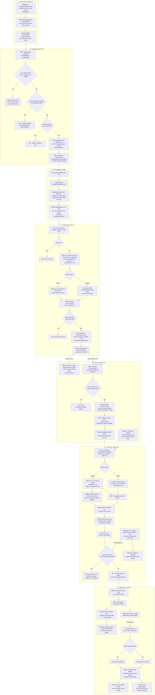

# Account security: password, two-factor and sessions

**Screens:** Settings Security, Portal My events · Settings tab, email

How a signed-in person looks after their own account. It starts on one of two screens — `/admin/settings-security` in the organizer console, or the Settings tab of `/portal/my-events` for an attendee — and ends with a password changed, a second factor turned on or off, other devices signed out and, for the two changes an intruder would most want to hide, an email from eventa-worker. Getting in is drawn in [Sign-in, roles and permissions](12-sign-in-roles-and-permissions.md): the code step that two-factor adds to sign-in is its step 3, the `auth_sessions` row that every revocation below acts on is opened in its step 4, and an Admin suspending a teammate — which revokes that person's sessions for them — is its step 6.

1. **Two screens, one set of routes.** An organizer reaches **Settings → Security** at `/admin/settings-security`; an attendee reaches the Security card on the Settings tab of `/portal/my-events` (the tab is page state, not part of the URL). Behind both sit the same endpoints — `POST /auth/change-password`, `/me/two-factor/*` and `/me/sessions/*` — and none of them carries a permission key or the `AdminGuard`: the global `JwtAuthGuard` is the only gate, and every query takes the user and the organization from the access token, never from the path, so one person can neither read nor revoke anybody else's. It is also why the two personas never see each other's devices on the same address: an organizer and an attendee are separate `users` rows, told apart by `persona`, each with its own sessions and its own enrolment. The two screens load differently on purpose. The console page reads `GET /me/sessions`, `GET /me/two-factor` and `GET /audit?limit=20` together and fails as a whole unless all three answer, because security is that page's whole subject. The portal reads `GET /me/two-factor` and `GET /me/sessions` as separate panels, so one unavailable endpoint costs one row of the card rather than somebody's tickets, and it reduces the session list to a single number. On both, the password and two-factor forms open in a slide-over rather than sitting inline, so a password form never stands open on a settings page for a browser to autofill; only the session controls sit on the card itself.

2. **Changing the password.** Both screens ask for the current password, a new one and the new one again; the confirmation is compared in the browser and never sent, because it is a typo guard rather than a security rule. `POST /auth/change-password` takes `currentPassword` and `newPassword`, and the DTO holds the new one to the single rule sign-up and reset also use: 8 to 128 characters with at least one number and one symbol (`PASSWORD_MIN_LENGTH`, `PASSWORD_MAX_LENGTH`, `PASSWORD_PATTERN`), where a symbol is anything that is not a letter, a combining mark or a number and no letter is required, refused with a 400 whose field message is "Password must be at least 8 characters and include a number and a symbol." Both screens' hint, "At least 8 characters, with a number and a symbol.", is US-SET-02's wording and states exactly that rule. The service then loads the caller's row (by user and organization, not soft-deleted) and verifies `currentPassword` against `users.password_hash` with argon2. A mismatch is a **403**, "Your current password is incorrect.", with nothing changed, nothing signed out and nothing queued — a 403 rather than a 401 because the web client reads any 401 as an access token that has aged out, tries `POST /auth/refresh` and then sends the person to sign-in, which is the wrong answer to a typo. An account that has only ever signed in through a social provider has no `password_hash` and gets the same 403, so this endpoint cannot set a first password. Wrong guesses here are not counted against the sign-in lockout; the route is reachable only with a live access token. A new password equal to the current one is a 422. Then, in **one** tenant transaction: `users.password_hash` becomes the new argon2id hash; every `auth_sessions` row for the user with `revoked_at IS NULL` **and** `expires_at` still in the future, other than the caller's own `sid`, gets `revoked_at`; and an `outbox_events` row with `routing_key = 'identity.password_changed'` is written carrying how many rows that revoke touched. The notice shares the transaction because a committed change whose notice was lost is exactly the silent takeover it exists to announce. The expiry filter is there because nothing purges lapsed rows — somebody who signs in monthly and never signs out accumulates a dozen — and counting them once told a person on their only device that twelve others had been signed out. The device that made the change stays signed in on the tokens it already holds, and any reset link already emailed stops working too, since a reset token carries a fingerprint of the old hash. No `audit_events` row is written: the `pwd` audit type exists and nothing uses it. The portal says before the submit that every other device will be signed out and confirms "Password changed. Your other devices have been signed out."; the console says "Password changed."

3. **The password-changed notice.** eventa-relay publishes the row to RabbitMQ and stamps its `published_at`; the API never publishes. eventa-worker's `PasswordChangedHandler` consumes `identity.password_changed` and emails the address on the message. It is **unconditional** — no template behind it and no switch an organizer can turn off — because a workspace may silence its attendee mail but not somebody's security correspondence. Its one database read chooses a language — `users.locale`, then the workspace's `organizations.locale`, then English — and cannot stop the send: any failure writes English, logs a warning by user id only and counts a degraded send, because an English notice that arrives beats a localised one that does not. The mail, in English or Thai, stamps the change in Asia/Bangkok time so the reader can match it against what they remember doing, says how many other **sign-ins** were ended (an `auth_sessions` row is one sign-in, not one device, and the sentence is dropped when the count is zero), and tells somebody who did not do this to use "Forgot your password?", because a reset signs out every session including the one the change came from (see [Sign-up, confirmation and password reset](14-sign-up-confirm-and-reset-password.md)). It carries no link — a security notice that trains people to click links is the lure it warns about — no device or IP address, which this request does not reliably know, and no workspace name, which the event does not carry, so an organizer with accounts in two workspaces cannot tell which one changed. It is not filed in `message_deliveries`, the organizer's delivery log, where colleagues could read a member's personal mail. A redelivered message sends nothing twice: the consumer dedupes on the message id before dispatch.

4. **Turning two-factor on.** `GET /me/two-factor` answers `enabled`, `pending` and `recoveryCodesRemaining` from the caller's `two_factors` row — at most one per user, unique on `user_id`: `enabled` means `confirmed_at` is set, `pending` means a row without it, and the count is of `recovery_codes` with `used_at IS NULL`. `POST /me/two-factor/start` refuses with a 409 when two-factor is already on ("Turn it off first to re-enrol"); otherwise it mints a fresh 160-bit base32 seed and the `otpauth://totp/…` URI an authenticator scans, labelled `Eventa:<email>` (SHA-1, 6 digits, 30 seconds), upserts the row with `secret_encrypted`, `otpauth_uri` and `confirmed_at = null`, and returns both — starting again simply replaces a pending seed. The seed is **encrypted, not hashed** (AES-256-GCM, the cipher that protects payment keys), because checking a code needs the seed back, whereas recovery codes are only ever compared and so are kept as hashes. **But `otpauth_uri` is stored as well, and that URI carries the seed as its `secret` parameter, so the seed also sits in the row in clear text.** Here the two screens diverge. The portal calls the API straight from the panel rather than through the route action, since the answer is the whole point and no later read can fetch it back; it draws the QR in the browser beside the key, and mints a fresh seed every time setup starts. The console posts through its route action, which carries the answer back, and shows **the key only — no QR is drawn** — so US-SET-03's "scan the code" holds only in the portal; and if the console is reloaded while an enrolment is `pending`, it shows neither the key nor a Start button, only the code box, and offers no way to restart. `POST /me/two-factor/confirm` with the 6-digit code answers 404 "Start two-factor setup first." when there is no row and 409 when two-factor is already on, then checks the code against the decrypted seed for the current 30-second step and one either side, in constant time; a wrong or expired code is a 422 and two-factor stays off. A right one sets, in one transaction, `two_factors.confirmed_at` and `users.two_factor_enabled = true` (the flag sign-in reads), deletes any older codes and inserts eight `recovery_codes` rows holding only a SHA-256 `code_hash` of codes shaped `XXXXX-XXXXX`. The eight plaintext codes are in that response and nowhere else. Both screens put them ahead of everything else on the panel, with copy and a download (`eventa-recovery-codes.txt`, labelled with the account's address so it is usable a year later) and no toast over the one sentence that matters; the portal adds "I have saved my recovery codes". In the console they stay in the closed panel until the page is left, so opening it again — even to turn two-factor off — shows the codes rather than the turn-off form. From the next sign-in a code is required (step 3 of [Sign-in, roles and permissions](12-sign-in-roles-and-permissions.md)). Turning it on writes no audit row — the `twofa` type is unused — and sends no email.

5. **Recovery codes, and turning it off.** The count of unused codes is shown — "N recovery codes left" on the console's turn-off form, in the row's description on the portal card. `POST /me/two-factor/recovery-codes` exists: with two-factor on (a pending enrolment is a 422, "Turn two-factor on first.", and none at all a 404) and a current authenticator code — a recovery code is not accepted for this one — it replaces the whole set with eight new hashes in one transaction, so every old code stops working at once, and returns the new plaintext once. **It is API-only: no screen calls it**, and somebody whose codes run low can get a fresh set on screen only by turning two-factor off and on again. Turning it off is `POST /me/two-factor/disable` with a code: 404 when there is no enrolment, 422 "Two-factor is not on." for a pending one, and then the re-verification is either a current authenticator code **or** an unused recovery code, which is spent on the way; the password is not asked for. A wrong code is a 422 and nothing changes. The portal's field takes up to sixteen characters and says a recovery code works there too; **the console's field stops at six characters** (`maxLength` 6), so an eleven-character `XXXXX-XXXXX` recovery code cannot be typed into it although the API would take one. In one transaction the `recovery_codes` and the `two_factors` row are deleted and `users.two_factor_enabled` goes back to false. Only after that commits is an `outbox_events` row with `routing_key = 'identity.two_factor_disabled'` written — a second write, unlike step 2, so a failure between the two leaves two-factor off and nobody told. eventa-worker's `TwoFactorDisabledHandler` sends it under the same rules as the password notice — unconditional, the same language fallback, Bangkok time, no link — and tells somebody who did not do this to change their password and turn two-factor back on. None of the three settings endpoints is throttled: the per-account lock on code guessing guards only the sign-in step. Two things the stories describe are **not built**: a workspace requiring two-factor of every member (US-SET-03's note), and "trust this device" for 30 days (US-ACC-07).

6. **Devices, refresh and remember-me.** `GET /me/sessions` lists the caller's `auth_sessions` rows with `revoked_at IS NULL` and `expires_at` in the future, newest `created_at` first, as `device` (the User-Agent captured at sign-in), `ipAddress`, `signedInAt`, `expiresAt` and `isCurrent`. "Current" is computed per request as the row whose `id` is the asking token's `sid`; the stored `is_current` column means nothing, because every row is inserted with it true. US-ACC-09's "rough location" is only the IP address, and its "how recently it was active" is not recorded at all: `signedInAt` is the sign-in time and `auth_sessions.meta` is never written. The console draws the list — the User-Agent turned into a label, "—" for a missing address, Bangkok time — with a **This device** badge and no control on the current row, **Revoke** on every other row with no confirm step, and **Sign out everywhere else** once there is more than one. The portal draws no list: its row says "Signed in on N other devices" with a single **Sign out**, or "This device only". `DELETE /me/sessions/:id` refuses the caller's own session with a 422 ("sign out instead") and answers 404 when the row is not this user's or is already revoked; `POST /me/sessions/revoke-others` revokes every unrevoked row but the caller's and returns `{ revoked }`, which — lacking step 2's expiry filter — counts lapsed rows too; neither screen shows it. Neither route writes an audit row or sends an email. **Revoking only sets `revoked_at`.** Access tokens are stateless JWTs checked for signature and expiry alone, so a revoked device keeps working until its access token runs out — `JWT_ACCESS_TTL`, fifteen minutes by default. Its next 401 sends the web client to `POST /auth/refresh`, one refresh in flight however many requests failed; the API verifies the refresh JWT and that its `auth_sessions` row is still unrevoked and unexpired, and otherwise answers 401 "Session expired or revoked". The client then clears its stored tokens and the page's guard sends the person to `/auth/login` or `/portal/login`. A refresh that succeeds returns a new access token only: the refresh token is not rotated and `expires_at` never moves, so a session lasts a fixed term from sign-in, not from last use. That term is remember-me. Both sign-in forms carry the box; ticked, the row and its refresh token get `JWT_REFRESH_TTL` (7 days by default), unticked `JWT_REFRESH_TTL_SHORT` (1 day), and the choice survives the two-factor step inside the challenge token. Either way the tokens live in `localStorage`, because the API returns them in the response body rather than as an httpOnly cookie — so **closing the browser signs nobody out**, and US-ACC-08's first criterion is met only in the sense that an unticked session ends after a day.

7. **Signing out, and the security log.** Sign out — the user chip in the console, the sign-out button in the portal's My events header — is `POST /auth/logout` with the bearer token. It revokes that one `auth_sessions` row by `sid` and writes, on the request itself, an `audit_events` row with `type = 'revoke'` and the title "Signed out" (no IP). The browser clears its token slot whether or not the call landed and goes to `/auth/login` or `/portal/login`; if the call failed, the error still propagates and the redirect is skipped, and the next guarded page load sends the person to sign-in instead. There is **one** slot per browser (step 4 of [Sign-in, roles and permissions](12-sign-in-roles-and-permissions.md)): signing into the other persona overwrites it without revoking the session it replaces, which stays live — and listed as another device — until it expires. US-ACC-10's "sign out of one, the other stays signed in" therefore cannot happen, because the browser never holds both. The log is console-only. **View log** opens the twenty newest entries the page loaded from `GET /audit?limit=20`, newest `occurred_at` first, with no paging, filter or export on screen. The route has `PermissionsGuard` but no required key, so the narrowing *is* the authorization: a caller holding `setUsers` sees the whole workspace, anybody else only rows whose `actor_user_id` is their own. Titles and `meta` are masked on the way out — an `sk_`/`pk_`/`rk_` key, or any run of 24 or more letters and digits, shows only its last four characters — and nothing in the product edits or deletes an entry. From this flow only sign-ins (`signin`, written by eventa-worker), failed sign-ins (`fail`) and sign-outs (`revoke`) ever reach the log; a password change, two-factor on or off and a device revoked from the list write nothing, and `pwd`, `twofa`, `newdev` and `perm` are never used — so the panel's own subtitle, "Sign-ins, permission changes and exports", promises entries that do not exist, and US-SET-05's role-change entry is **not built**. `GET /audit/export` returns the same scope as a CSV for a `from`/`to` range and records itself as an `xport` row ("Exported N audit entries"), but it is **API-only — no screen calls it** — and the CSV writes titles unmasked, because the masking lives only in the JSON list. No portal screen reads `/audit`.

```mermaid
flowchart TD
  subgraph ONE["1 · Two screens, one set of routes"]
    A1["Organizer at /admin/settings-security<br/>Attendee at /portal/my-events<br/>Settings tab"] --> A2["/auth/change-password, /me/two-factor<br/>and /me/sessions serve both personas"]
    A2 --> A3["Only the global JwtAuthGuard<br/>no permission key<br/>user and org from the token"]
  end

  subgraph TWO["2 · Changing the password"]
    B1["POST /auth/change-password<br/>currentPassword · newPassword"] --> B2{"8 to 128 characters<br/>with a number and a symbol?"}
    B2 -- "No" --> B3["400 with field errors<br/>the rule the screens'<br/>hint already states"]
    B2 -- "Yes" --> B4{"Current password matches<br/>users.password_hash?"}
    B4 -- "No" --> B5["403 · nothing changed<br/>nothing signed out, nothing queued"]
    B4 -- "Yes" --> B6{"New one equals<br/>the current one?"}
    B6 -- "Yes" --> B7["422 · choose a different one"]
    B6 -- "No" --> B8["One transaction: new argon2id hash<br/>other live auth_sessions revoked<br/>this device kept"]
    B8 --> B9["Same transaction: outbox_events<br/>identity.password_changed<br/>with the number revoked"]
  end

  subgraph THREE["3 · The password-changed notice"]
    C1["eventa-relay publishes the row"] --> C2["eventa-worker<br/>PasswordChangedHandler"]
    C2 --> C3["Language: users.locale, then the<br/>workspace's, then English<br/>a failed read never stops the mail"]
    C3 --> C4["Email in Bangkok time · no link<br/>how many sign-ins were ended<br/>not filed in message_deliveries"]
  end

  subgraph FOUR["4 · Turning two-factor on"]
    D1["GET /me/two-factor<br/>enabled · pending · codes left"] --> D2{"Already on?"}
    D2 -- "Yes" --> D3["409 · turn it off first"]
    D2 -- "No" --> D4["POST /me/two-factor/start<br/>two_factors row upserted<br/>secret_encrypted and otpauth_uri<br/>confirmed_at = null"]
    D4 --> D5{"Which screen?"}
    D5 -- "Portal" --> D6["QR drawn in the browser<br/>plus the key<br/>a fresh seed every start"]
    D5 -- "Console" --> D7["Key only, no QR<br/>a reload while pending leaves<br/>no key and no restart"]
    D6 --> D8["POST /me/two-factor/confirm<br/>with a 6-digit code"]
    D7 --> D8
    D8 --> D9{"Valid within one<br/>30-second step?"}
    D9 -- "No" --> D10["422 · two-factor stays off"]
    D9 -- "Yes" --> D11["One transaction: confirmed_at set<br/>users.two_factor_enabled = true<br/>8 recovery_codes hashes"]
    D11 --> D12["8 codes returned once<br/>copy or download<br/>no audit row, no email"]
  end

  subgraph FIVE["5 · Recovery codes, and turning it off"]
    E1["API-only: POST /me/two-factor/recovery-codes<br/>a fresh 8, every old one dead<br/>no screen calls it"]
    E2["POST /me/two-factor/disable<br/>console field stops at 6 characters"] --> E3{"Current TOTP or an<br/>unused recovery code?"}
    E3 -- "No" --> E4["422 · still on<br/>no throttle on these guesses"]
    E3 -- "Yes" --> E5["One transaction: recovery_codes<br/>and two_factors deleted<br/>two_factor_enabled = false"]
    E5 --> E6["After commit, a second write:<br/>outbox_events<br/>identity.two_factor_disabled"]
    E6 --> E7["TwoFactorDisabledHandler emails<br/>change your password if not you"]
    E8["Not built: two-factor required<br/>by the workspace, and<br/>trust this device for 30 days"]
  end

  subgraph SIX["6 · Devices, refresh and remember-me"]
    F1["GET /me/sessions<br/>unrevoked and unexpired<br/>newest first, current = token sid"] --> F2{"Which screen?"}
    F2 -- "Console" --> F3["Device list · This device badge<br/>Revoke per row<br/>Sign out everywhere else"]
    F2 -- "Portal" --> F4["A count of other devices<br/>one Sign out for all of them<br/>no per-device list"]
    F3 --> F5["DELETE /me/sessions/:id<br/>422 for this device<br/>404 if not theirs or already revoked"]
    F3 --> F6["POST /me/sessions/revoke-others"]
    F4 --> F6
    F5 --> F7["auth_sessions.revoked_at set<br/>no audit row, no email"]
    F6 --> F7
    F7 --> F8["That device's access token<br/>still works until it expires<br/>15 minutes by default"]
    F8 --> F9["Next 401, then<br/>POST /auth/refresh"]
    F9 --> F10{"auth_sessions row<br/>unrevoked and unexpired?"}
    F10 -- "Yes" --> F11["New access token only<br/>refresh token and<br/>expires_at unchanged"]
    F10 -- "No" --> F12["401 · browser clears its tokens<br/>back to that persona's sign-in"]
    F13["Remember me at sign-in:<br/>ticked 7 days, unticked 1 day<br/>tokens in localStorage either way"] -- "fixes expires_at" --> F10
    F13 --> F14["Not built: ending an unticked<br/>session when the browser closes"]
  end

  subgraph SEVEN["7 · Signing out, and the security log"]
    G1["Sign out from the console chip<br/>or the portal header"] --> G2["POST /auth/logout<br/>revokes this sid only"]
    G2 --> G3["audit_events type = revoke<br/>Signed out, on the request"]
    G2 --> G4["The browser's one token slot<br/>cleared, then /auth/login<br/>or /portal/login"]
    G4 --> G5["Not built: staying signed in<br/>as the other persona<br/>the browser holds one session"]
    G6["Console View log<br/>GET /audit · 20 newest"] --> G7{"Caller holds setUsers?"}
    G7 -- "Yes" --> G8["The whole workspace"]
    G7 -- "No" --> G9["Only their own entries"]
    G8 --> G10["signin, fail and revoke appear<br/>password, two-factor and device<br/>revokes write nothing"]
    G9 --> G10
    G10 --> G11["Not built: role-change entries<br/>the perm type is never written"]
    G10 --> G12["API-only: GET /audit/export<br/>CSV plus an xport row<br/>titles not masked"]
    G3 -- "read back by" --> G6
  end

  A3 --> B1
  B9 --> C1
  C4 --> D1
  D12 -- "Codes run low" --> E1
  D12 -- "Later, to turn it off" --> E2
  E7 --> F1
  F12 --> G1
```

Mermaid source

[← All flows](README.md)
