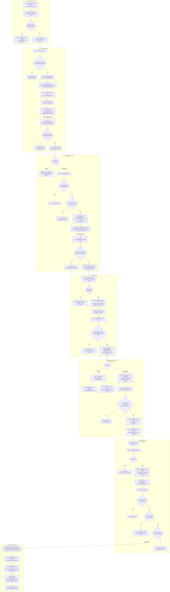

# Profile, preferences and deleting an account

**Screens:** Settings Profile, Settings Notifications, Portal My events · Profile and Settings tabs, email

How a signed-in person keeps their own record in order, and how an attendee leaves for good. It starts on either persona's account screens — `/admin/settings-profile` and `/admin/settings-notifications` in the organizer console, the **Profile** and **Settings** tabs of `/portal/my-events` in the portal — and ends, for an attendee who chooses it, with a soft-deleted `users` row, every session revoked and a closure email. Every endpoint here sits under `/me/*` and acts on whoever holds the token: the user id comes from the JWT, never from the path, so there is nothing to pass, nothing to get wrong and no permission key to check — a member edits only themselves, and changing anybody else is Settings → Users in [Sign-in, roles and permissions](12-sign-in-roles-and-permissions.md), and password, two-factor enrolment and sessions are [Account security](15-account-security.md). Three legs of this journey are wired on one side only, and the chart marks each where it falls: the email-change link has nowhere to land, the phone code is never texted, and the notification switches are stored but read by nothing. The text a buyer receives after booking goes to the number typed at checkout, not the one proved here — see [Free registration and confirmation](03-free-registration-and-confirmation.md).

1. **Editing my details.** Both personas read `GET /me/profile` and write `PATCH /me/profile`, guarded by nothing but a valid access token. The console form sends `name`, `city`, `timezone`, `locale` and `bio`; the portal's Profile tab sends `name`, `city`, `dateOfBirth` and `bio`. The save is a partial patch — an omitted key is left alone and `null` clears a nullable one — and the API takes exactly seven fields: `name` (1–200 characters), `city` (≤120), `bio` (≤500), `dateOfBirth` (an ISO date, carried as a plain `YYYY-MM-DD` and never turned into an instant), `timezone`, `locale` (`en` or `th`) and `displayCurrency` (three capitals). A timezone is accepted only if the runtime can actually format in it, so a misspelt zone is a 422 "Unknown timezone" rather than a value that breaks every date rendered later. The validation pipe runs `forbidNonWhitelisted`, so a body that names `email`, `phone` or `avatarUrl` is a 400 for the **whole** save: each of those has its own guarded route below, because Eventa must prove a contact detail before it sends to it, and a photo URL typed by hand could point at anything on the internet. **There is no optimistic version on this save.** `users.version` exists, but this path neither checks nor bumps it, so two tabs saving at once is last-write-wins; it is the workspace's own form, `PATCH /organization`, that sends `version` and refuses a stale edit. The answer is the profile again with two derived flags: `emailVerified` is `pending_email IS NULL`, and `phoneVerified` is `phone_verified_at IS NOT NULL` — a separate column for the phone because numbers typed before confirmation existed still sit in `phone`, never proven.

2. **Moving the sign-in address.** `POST /me/profile/email` (202) refuses the address already on the account with a 422, and refuses with a 409 an address that any other live `users` row in the same organization holds as `email` or `pending_email`, whatever its persona — for an attendee that is the single platform organization, so every attendee account on Eventa. Otherwise it writes `users.pending_email` and nothing else: `email` is untouched, so the member goes on signing in with the old address, the console badges it **Unverified**, and both screens show "Waiting for … to be confirmed". It then signs a `change_email` JWT (24 hours, carrying `sub`, `org` and the requested address) and enqueues an `outbox_events` row with `routing_key = 'identity.email_change_requested'` whose `confirmUrl` is `${PUBLIC_WEB_URL}/confirm-email?token=…`. That enqueue is a second statement after the update rather than the same transaction — unlike the phone flow below, a failure between the two leaves a pending address with no mail behind it — and the endpoint has no resend throttle. Asking again simply overwrites `pending_email`, which kills any earlier link to a different address. **eventa-worker**'s `EmailChangeHandler` then owes two messages. The link goes to the **new** address and to no other, in the account's language (`users.locale`, then `organizations.locale`, then English): it is a bearer credential whose whole job is to prove the requester can receive mail there, and copying it to the old address would hand the person resisting a hijack a one-click way to complete it. The **old** address — read from `users`, where it is still the old one — gets a link-free heads-up naming the requested address and carrying no text the requester wrote, not even their name; it is skipped when both are the same mailbox. Each part is recorded in a per-message ledger after it is sent, so a redelivery sends only what is still owed, and a failed read of the old address is re-thrown *after* the link has gone, so the warning stays owed rather than abandoned. Neither message honours an organizer template or appears in the workspace's message log. **Then the journey stops.** eventa-web has no `/confirm-email` route — the link falls through to the catch-all NotFound page — and nothing in the web app calls `POST /me/profile/email/confirm`. That endpoint exists and is `@Public()`, since a mail client carries no session and the signed token is the whole authority: it verifies the token, then promotes `pending_email` to `email` and clears `pending_email` in one update guarded on `pending_email` still equalling the token's address, so a superseded or already-used link is a 422 "invalid or has already been used" and an expired or forged one a 422 "invalid or has expired". Today it is reachable only by calling the API directly — an email change can be requested from either screen but never completed from a browser.

3. **Confirming a phone by code.** The number left the details form when confirm-by-code landed, so both screens submit three intents against the same routes. `POST /me/profile/phone` (202) normalises what was typed to a Thai mobile in E.164 and refuses anything else with a 422 on `phone` — Eventa can only text Thai mobiles — and refuses, also 422, the number that is already *confirmed* (an unconfirmed number already in `phone` may be requested, so older accounts can prove what they have). It then claims a send from the resend throttle, keyed on the **account** rather than the number so one session cannot text a fresh stranger every minute: one send per `VERIFY_RESEND_COOLDOWN_SECONDS` (60 s) and at most `VERIFY_CODE_MAX_PER_WINDOW` (5) per `VERIFY_CODE_WINDOW_SECONDS` (a day), each refusal a 429 saying how long to wait. Unlike sign-in, this throttle **fails closed** — with Redis unreachable it answers 429 — because what it rations is paid texts and a fresh guess budget, neither of which waiting gives back. The six digits come from a CSPRNG and are zero-padded; in **one transaction** the row gets `pending_phone`, `phone_code_hash` (SHA-256 — the code itself is never stored), `phone_code_expires_at` (now + `PHONE_VERIFY_CODE_TTL_SECONDS`, 10 minutes) and `phone_code_attempts = 0`, and an `outbox_events` row `identity.phone_verification_requested` is written carrying the code in the clear, because a digest cannot be texted. `phone` is untouched, so the old number stays the one on file until the new one is proved. **Not built: nothing ever sends that text.** eventa-worker has no handler for `identity.phone_verification_requested`, and its queue binds only the routing keys it has handlers for, so the relay publishes the message, stamps `published_at`, and the broker drops it — no code reaches any phone. The confirm leg is built: `POST /me/profile/phone/confirm` takes exactly six digits (anything else is a 400 that spends no attempt) and spends a guess *before* comparing, in one `UPDATE … SET phone_code_attempts = phone_code_attempts + 1 WHERE phone_code_hash IS NOT NULL AND phone_code_attempts < 5 … RETURNING` — `LOGIN_MAX_ATTEMPTS` reused, and counted in the row because a fail-open Redis counter would mean no cap at all. Reading first and incrementing afterwards let concurrent guesses all compare against the same unspent budget; making the increment the claim is what makes five mean five. No row back, an expired code, or a miss on the last guess is a 422 `PHONE_CODE_EXPIRED` telling them to ask for a new one; an earlier miss is a 422 on `code`; a match promotes `pending_phone` to `phone`, stamps `phone_verified_at` and clears the challenge, guarded on `pending_phone` so a number changed in another tab meanwhile is refused rather than promoted. `DELETE /me/profile/phone` clears `phone`, `phone_verified_at` and anything in flight with no code, because proving a number in order to remove it makes no sense.

4. **The photo.** Only the portal can upload one: the console's Settings → Profile shows the photo or the member's initials but has no upload control, although the `/me/photo` routes are the same for both. The Profile tab first checks the file in the browser — JPG or PNG, 5 MB at most — and a refusal sends no request at all, so the current avatar is untouched. Then three calls, because the bytes never pass through eventa-web or eventa-api. `POST /me/photo/upload-url` with `contentType` and the exact `byteSize` re-checks both (the API also takes WebP, which the card's "JPG or PNG" copy deliberately does not offer; any other type, or a `byteSize` below 1, is a 400 from the DTO, and one over `UPLOAD_MAX_BYTES` = 5 MiB a 422) and issues a key it chose itself, `uploads/<user id>/<uuid>.<ext>`, with a presigned PUT valid for `UPLOAD_URL_TTL_SECONDS` (5 minutes) and the size signed into it. The browser PUTs the file straight to object storage. `POST /me/photo` with that key is where the security sits: a key outside the caller's own staging prefix, or containing `..`, is a 403 — keys are issued, never accepted, so nobody can claim somebody else's upload; a missing object is a 422; the stored size is re-checked; and the first 12 bytes must match the declared type's signature, because storage records whatever type the PUT declared and only the bytes tell a JPEG from an HTML page wearing `image/jpeg` — a failure deletes the staging object and is a 422. A verified file is copied to `avatars/<user id>/…`, a key that was never presigned, and the staging object is deleted, so the still-valid upload URL cannot swap the bytes after inspection. Only then is the public URL written to `users.avatar_url`, through the one writer that column has. Replacing a photo leaves the previous `avatars/` object in the bucket. `DELETE /me/photo` (204) takes the key from the saved URL rather than from the caller, so a stale key cannot unset a newer photo, nulls `avatar_url`, then removes that object.

5. **Display and notification preferences.** The portal's Settings tab has a Preferences card whose three selects each save themselves through `PATCH /me/profile` carrying only the field that changed, so choosing a timezone cannot clear a bio the Profile tab just wrote: **Language** (`en`/`th`), **Timezone** (Bangkok, London, Tokyo) and **Currency** (THB or USD), each plus whatever is already stored. The console sets `timezone` and `locale` on its profile form; the portal's Dark mode switch is browser-only and never reaches the API. What honours them: `users.locale` is read by eventa-worker to choose the language of the mail it sends this person — the account notices in this flow, and booking confirmations and the other event mail sent to an address that holds an attendee account. **Not built: the interface following any of the three.** Nothing outside the profile module reads `users.timezone` or `users.display_currency`, eventa-web has no translation layer and renders from none of them, and the card admits as much — "Event times still show in each event's own timezone", "Prices are charged in Thai Baht whichever you pick". Notifications are `GET /me/notification-preferences`, which lists the caller's persona's topics from the `notification_kind` enum — `reminder` and `marketing` for an attendee, the other seven (`registration`, `payment`, `sales`, `feedback`, `payout`, `alert`, `task`) for an organizer — filling in email on and SMS off where no row exists, and deriving `smsAvailable` on every read from a `phone` **with** a `phone_verified_at`, so there is no stored "SMS is usable" to go stale. `PATCH /me/notification-preferences/:category` takes `emailEnabled` and/or `smsEnabled`: an unknown topic is a 404, the other persona's topic a 422, and switching SMS on is a 422 with no phone or with an unconfirmed one — two different sentences, because the remedies differ. A save upserts one `notification_preferences` row per user and category (`uq_notif_prefs_user_category`). The portal draws three switches over two topics — Event reminders is `reminder` email, SMS alerts is `reminder` SMS, and Marketing closes both channels of `marketing` when switched off but reopens email only when switched on; the console sends one channel per switch. **Not built: any send that honours a switch.** Nothing in eventa-worker, eventa-relay or the rest of eventa-api reads `notification_preferences`: event reminders from the worker's scheduled-messages job go out on the organizer's template alone, the booking text goes to `orders.buyer_phone` on the organizer's channel setting, and there is no promotion sender to exclude anybody from. And because no phone code is ever texted (step 3), a newly entered number can never become confirmed, so its SMS switches stay unavailable.

6. **Preflight and re-verification.** Deletion exists for the attendee persona only: the console has no such control, and the API answers an organizer with a 403 saying workspace members are managed by their organization. The Settings tab's Danger zone loads `GET /me/account/deletion` with the page, as a panel of its own; if it fails, the card shows the API's sentence and **no button**, because the warning is the point and an irreversible button over an unknown consequence is worse than none. The preflight returns `requiresTwoFactorCode` — true when an authenticator is enrolled, `two_factors.confirmed_at` set — and every upcoming order the person would forfeit: `orders` rows whose `buyer_email` is the account's address, across every organizer, with `status = 'confirmed'`, `payment_status = 'paid'`, `total_satang > 0` and no `deleted_at`, for an event whose `end_at` (or, failing that, `start_at`) is still ahead, plus `totalAtRiskSatang`. The dialog lists them in Bangkok time under a "not refunded" warning and draws nothing at all when the list is empty — `totalAtRisk` is null there, never ฿0. It asks for three things: the word `DELETE` typed by hand (the button stays disabled until it matches), the password again, and an authenticator or recovery code only when the preflight said so. `DELETE /me/account` carries them in the body, never a query string, and the DTO refuses a `confirm` that is not exactly `DELETE` with a 400. The service re-reads the live account (401 if already gone, 403 if not an attendee), then checks a lock under its **own** throttle identity, `delete|<user id>`, so deletion misses never lock sign-in and sign-in misses never lock deletion: `LOGIN_MAX_ATTEMPTS` (5) misses lock it for `LOGIN_LOCK_SECONDS` (15 minutes), a locked attempt is a 429 with the minutes left, and like sign-in the lock fails open if Redis is down. An account with no `password_hash` — one that only ever signed in through a social provider — is a 403 telling them to set a password through password reset first. A wrong password is a 403 and counts a miss. With two-factor on, a missing code is a 422 and a wrong one a 403 that counts a miss; a TOTP code or an unused recovery code is accepted, and a recovery code is spent doing so. Every refusal changes nothing, and the dialog stays open with the API's own words.

7. **Closing the account.** On success the miss counter is cleared and one transaction does three things or none: stamps `users.deleted_at` (guarded on it still being null, so a racing second request finds nothing and is a 401), sets `revoked_at` on every unrevoked `auth_sessions` row for the user including the current one, and enqueues `identity.account_deletion_requested` with the name and **email copied onto the event**, because the row they came from is the one meant to be scrubbed. The answer is a 200 "Your account is scheduled for deletion and you have been signed out everywhere. A confirmation email is on its way." The browser does not call logout — every session is already revoked, so it could only 401 — it drops its own tokens, shows the API's sentence as a toast and replaces the page with `/portal/login`. From then on sign-in finds no candidate (`deleted_at` is filtered), a refresh is refused because the session row is revoked, and profile reads are a 404; an access token already issued stays valid for the rest of its `JWT_ACCESS_TTL` (15 minutes), since access tokens are checked without a database read. **eventa-worker**'s `AccountDeletionRequestedHandler` sends the closure email to the address on the event, unconditionally — no organizer template, no message-log row, and no database failure can stop it: its one read only picks the language (`users.locale`, then the workspace's, then English, deliberately without a `deleted_at` filter since this recipient is always deleted), and a failed read sends the notice in English with a warning and a metric. The copy says what actually happened — deleted at this Bangkok time, signed out on every device, no waiting period, no undo and no link — and greets nobody by name, because the name is free text that whoever held the session could have rewritten. **Not built: the PDPA anonymisation.** The API's event comment says the worker "then anonymizes the personal data"; the worker's own module says only the email half is there, and nothing else does it either. The `users` row keeps its name, email, phone, city, date of birth, bio and photo URL; `orders` and `invoices` keep `buyer_email` and `buyer_name`; `saved_events`, `notification_preferences` and `survey_responses` rows stay; the avatar stays in the bucket. So the dialog's "your profile, your saved events and your registration history are scheduled for removal" and the email's "no longer linked to your profile" both describe work no code performs. One knock-on: `uq_users_org_email_persona` carries no `deleted_at` condition, so the soft-deleted row still holds the address — signing up again on it passes the existence check, which ignores deleted rows, and then fails the insert as a 500 rather than giving the fresh start the closure email offers.

```mermaid
flowchart TD
  subgraph ONE["1 · Editing my details"]
    A1["Console /admin/settings-profile<br/>or the portal Profile tab"] --> A2["PATCH /me/profile<br/>any persona · id from the token"]
    A2 --> A3{"Whitelisted fields<br/>with valid values?"}
    A3 -- "No" --> A4["400 for email, phone or avatarUrl<br/>422 for an unknown timezone"]
    A3 -- "Yes" --> A5["users row updated<br/>no version check · last write wins"]
  end

  subgraph TWO["2 · Moving the sign-in address"]
    B1["POST /me/profile/email"] --> B2{"Same address, or held<br/>by another account here?"}
    B2 -- "Yes" --> B3["422 same address<br/>409 already used"]
    B2 -- "No" --> B4["users.pending_email set<br/>the old email still signs in"]
    B4 --> B5["outbox_events<br/>identity.email_change_requested<br/>24 h change_email token"]
    B5 --> B6["eventa-worker sends the link<br/>to the NEW address only"]
    B6 --> B7["Link-free heads-up<br/>to the current address"]
    B7 --> B8["Not built: no /confirm-email route<br/>the link lands on NotFound<br/>pending_email stays set"]
    B8 -- "only by calling the API" --> B9["API-only: POST<br/>/me/profile/email/confirm<br/>public · no screen calls it"]
    B9 --> B10{"Token valid and still<br/>the pending address?"}
    B10 -- "No" --> B11["422 invalid, expired<br/>or already used"]
    B10 -- "Yes" --> B12["email = pending_email<br/>pending_email cleared"]
  end

  subgraph THREE["3 · Confirming a phone by code"]
    C1{"New number,<br/>or remove it?"}
    C1 -- "Remove" --> C2["DELETE /me/profile/phone<br/>number and challenge cleared"]
    C1 -- "New number" --> C3["POST /me/profile/phone"]
    C3 --> C4{"A Thai mobile, not<br/>the confirmed one?"}
    C4 -- "No" --> C5["422 on the phone field"]
    C4 -- "Yes" --> C6{"60 s cool-off and<br/>5 a day allow a send?"}
    C6 -- "No" --> C7["429 · also when<br/>Redis is unreachable"]
    C6 -- "Yes" --> C8["One transaction: pending_phone,<br/>phone_code_hash, 10 min expiry<br/>plus the outbox row"]
    C8 --> C9["Not built: no worker handler for<br/>identity.phone_verification_requested<br/>no text is ever sent"]
    C9 -- "no code ever arrives" --> C10["POST /me/profile/phone/confirm<br/>six digits"]
    C10 --> C11{"Guess claimed under 5,<br/>code live and matching?"}
    C11 -- "No" --> C12["422 retype, or<br/>422 PHONE_CODE_EXPIRED"]
    C11 -- "Yes" --> C13["phone = pending_phone<br/>phone_verified_at stamped<br/>challenge cleared"]
  end

  subgraph FOUR["4 · The photo"]
    D1["Portal Profile tab only<br/>the console has no upload control"] --> D2{"JPG or PNG,<br/>5 MB or less?"}
    D2 -- "No" --> D3["Refused in the browser<br/>no request · photo unchanged"]
    D2 -- "Yes" --> D4["POST /me/photo/upload-url<br/>key issued under uploads/<br/>presigned PUT for 5 min"]
    D4 --> D5["Browser PUTs the bytes<br/>straight to storage"]
    D5 --> D6["POST /me/photo with the key"]
    D6 --> D7{"Own staging key, object<br/>present, bytes really an image?"}
    D7 -- "No" --> D8["403 if not yours<br/>422 otherwise · bad file deleted"]
    D7 -- "Yes" --> D9["Copied to avatars/, staging deleted<br/>users.avatar_url set<br/>the old photo stays in the bucket"]
  end

  subgraph FIVE["5 · Display and notification preferences"]
    E1{"Which card?"}
    E1 -- "Display" --> E2["PATCH /me/profile<br/>locale · timezone · displayCurrency"]
    E2 --> E3["users.locale picks the language<br/>of eventa-worker emails"]
    E2 --> E4["Not built: the interface does not<br/>follow timezone, language or currency"]
    E1 -- "Notifications" --> E5["GET /me/notification-preferences<br/>topics for this persona<br/>email on, SMS off by default"]
    E5 --> E6["PATCH /me/notification-preferences/:category"]
    E6 --> E7{"Own topic, and a confirmed<br/>phone if SMS goes on?"}
    E7 -- "No" --> E8["404 unknown topic<br/>422 otherwise"]
    E7 -- "Yes" --> E9["notification_preferences upsert<br/>one row per user and category"]
    E9 --> E10["Not built: nothing reads the row<br/>reminders and texts send regardless"]
  end

  subgraph SIX["6 · Preflight and re-verification"]
    F1["Portal Settings tab<br/>Danger zone"] --> F2["GET /me/account/deletion"]
    F2 --> F3{"An attendee?"}
    F3 -- "No" --> F4["403 · no button,<br/>the API's sentence instead"]
    F3 -- "Yes" --> F5["Upcoming confirmed, paid orders<br/>on this email, not refunded<br/>and whether a code is needed"]
    F5 --> F6["Type DELETE, the password,<br/>and a code when 2FA is on"]
    F6 --> F7["DELETE /me/account"]
    F7 --> F8{"Five misses locked<br/>this account?"}
    F8 -- "Yes" --> F9["429 · minutes left"]
    F8 -- "No" --> F10{"Has a password,<br/>and it matches?"}
    F10 -- "No" --> F11["403 · nothing changes<br/>a wrong password counts a miss"]
    F10 -- "Yes" --> F12{"2FA on: TOTP or<br/>recovery code valid?"}
    F12 -- "No" --> F13["422 missing · 403 wrong<br/>nothing changes"]
  end

  subgraph SEVEN["7 · Closing the account"]
    G1["One transaction: users.deleted_at,<br/>every auth_sessions row revoked,<br/>identity.account_deletion_requested"] --> G2["200 · the browser drops its tokens<br/>and goes to /portal/login"]
    G2 --> G3["eventa-worker closure email<br/>to the address on the event<br/>no name, no link"]
    G3 --> G4["Not built: PDPA anonymisation<br/>profile, orders and invoices<br/>keep the personal data"]
    G4 --> G5["The address stays taken<br/>signing up again is a 500"]
  end

  A5 --> B1
  B12 --> C1
  C13 --> D1
  D9 --> E1
  E10 --> F1
  F12 -- "Yes, or 2FA off" --> G1
```

Mermaid source

[← All flows](README.md)
