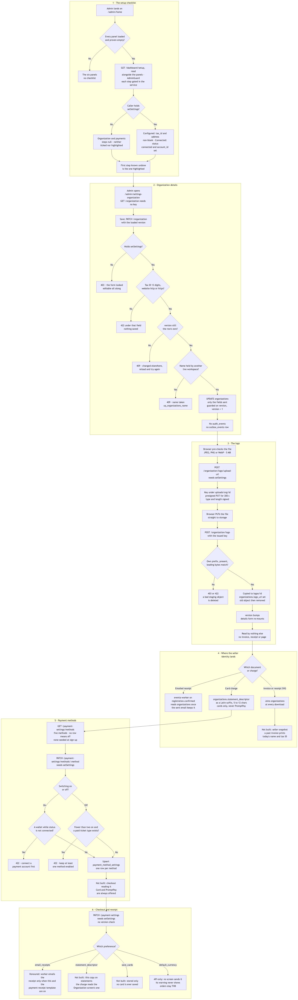

# Set up the workspace

**Screens:** Home, Settings Organization, Settings Payments

How a new workspace gets what it needs to sell: the legal identity every invoice and receipt names, its logo, which ways attendees may pay, and the receipt and card-statement preferences. It starts on `/admin/home`, whose first-run checklist points at each piece, and ends on the Checkout preferences card of `/admin/settings-payments`. The workspace itself is created at [sign-up](14-sign-up-confirm-and-reset-password.md); pasting its own Stripe keys sits between these two screens and is drawn in [Payouts and balances](09-payouts.md) step 1 rather than here; how the seller identity prints on a tax invoice is [Invoice, ageing and VAT filing](08-invoice-and-vat.md), and the receipt email is [Checkout and payment](02-checkout-and-payment.md) step 5. Nearly everything below needs `setSettings`, and who holds it is decided in [Sign-in, roles and permissions](12-sign-in-roles-and-permissions.md).

1. **The setup checklist.** Sign-up writes only `organizations.name` and `slug` — no address, no tax ID, and no `payment_settings` row, which is created with its defaults the first time the payments module reads it. `/admin/home` asks `GET /dashboard/setup` alongside its panels. The route sits behind `AdminGuard` only, and each of its five facts is gated inside the service by the same key that guards the page the step links to: `organizationConfigured` and `paymentsConnected` need `setSettings`; `eventCreated`, `ticketTypeAdded` and `eventPublished` need `evCreate`. A fact the caller may not be told comes back `null` and is never queried at all, and `null` is not `false`: it is drawn neither ticked nor highlighted, because telling a Staff member to "connect payments" on a workspace that already takes money would be worse than saying nothing. Each fact is defined by the module that owns it, not by the checklist. The organization is configured when `tax_id` **and** `address` are both non-blank after trimming — what a Thai tax invoice needs beyond the name given at sign-up; a logo is deliberately not required. Payments are connected when `payment_settings.status = 'connected'` **and** `account_id` is non-null, the same two-part test the charge path uses. An event counts as created even as a draft, a ticket type counts in any status, and published means some `events.published_at` is set, soft-deleted rows excluded throughout. At most one step is highlighted — the first one *known* not to be done, so none when every step is ticked or withheld — and a failed read sets all five to `null` rather than taking Home down. The checklist only replaces the six panels while Home can **prove** the workspace is empty: today's registrations visible and zero, no alerts, and the meetings, upcoming-events and activity panels all loaded and empty. A caller without `regView` has the registrations panel withheld, which proves nothing, so they never see the checklist at all. Nothing on Home writes a record; every step is a link — `/admin/settings-organization`, `/admin/settings-payments`, `/admin/event-form`, `/admin/tickets`, `/admin/landing-pages`.

2. **Organization details.** `/admin/settings-organization` loads `GET /organization` and `GET /organization/summary` (events hosted and team members, counted per request with soft-deleted rows excluded, never stored). Reading needs no permission key — any signed-in member may see the workspace identity — but every write needs `setSettings`, and **the console does not gate this screen at all**: Settings → Organization sits in every member's sidebar, an Organizer or Staff member gets the same editable form and logo button as an Admin, and finds out only on Save, as a 403 "Missing required permission: setSettings.". US-SET-07 asks for the page to be read-only or hidden for them; today it is neither. Currency (a disabled, unnamed select inside the form), country and VAT rate (a Billing basis card beside it) are shown as fixed facts and are not fields the save sends: `PATCH /organization` does not accept them — the global validation pipe refuses an unknown field with a 400 — because every invoice and receipt already issued was calculated with them. Save sends `name`, `address`, `website`, `taxId`, `timezone`, `statementDescriptor` and the `version` the form was loaded with, an emptied box going as `null` to mean "clear it". Shape is checked first (name 1–200 characters; descriptor at most 22 of letters, digits, spaces and `. , ' -`; a 400), then the rules that matter: `taxId` must be exactly 13 digits, the Thai VAT registration number, and `website` must be an `http://` or `https://` address, so a `javascript:` or `data:` URL never reaches a branded surface. Each is a 422 pinned to its field, so the form puts the sentence under the input it is about, and nothing is saved. Next the row is read, and a `version` that no longer matches it is a 409 "This workspace changed elsewhere. Reload and try again." — a form opened before somebody else's edit is refused rather than allowed to overwrite it. A name another live workspace already holds is a 409 as well, matched case-insensitively and ignoring leading and trailing spaces, exactly as the partial unique index `uq_organizations_name` on `lower(btrim(name))` is, so a deleted workspace does not hold its name for ever; the index is the real guarantee, and losing the race to it is the same 409 rather than a 500. The write sets only the fields sent, plus `version = version + 1` and `updated_at`, and is guarded by `WHERE version =` the value just read, so an edit that lands between the read and the write also comes back as the stale 409. No `audit_events` or `outbox_events` row is written. Two of the fields go no further than this screen — nothing else reads `website`, and `timezone` is only echoed back in `GET /auth/me`, where the console never uses it; reports, invoices and receipts date everything in Asia/Bangkok regardless. The DTO also takes a bare `logoUrl` string with no URL check; no screen sends one, and the logo is meant to arrive only by step 3.

3. **The logo.** The logo uploads the moment a file is chosen, outside the details form, and its bytes never pass through the API. The card first checks type and size in the browser — JPEG, PNG or WebP, at most 5 MB, mirroring the API's `UPLOAD_MAX_BYTES` of 5,242,880 — as a courtesy rather than the guard. `POST /organization/logo/upload-url` (`setSettings`) takes `contentType` and the exact `byteSize`, refuses any other type or a size outside 1 byte–`UPLOAD_MAX_BYTES` with a 400 or 422, and issues a key under this workspace's own staging prefix `uploads/org/<organization id>/` with a presigned PUT URL that lives `UPLOAD_URL_TTL_SECONDS` (300) and signs both the content type and the exact length. The browser PUTs the file straight to storage, then sends the key to `POST /organization/logo`, which is where the security lives. A key outside the caller's own prefix, or containing `..`, is a 403 "That upload does not belong to you." — keys are issued, never accepted. A missing object is a 422. The stored size must still sit within 1 byte–`UPLOAD_MAX_BYTES`, and the stored type and the **leading bytes** must match an allowed image type, because storage records whatever type the PUT declared and only the magic bytes tell an image from an HTML file wearing `image/png`; any of those failures deletes the staging object and answers 422. A passing object is copied to `logos/<organization id>/`, a prefix no presigned URL ever points at, so the still-valid upload URL cannot replace the bytes after inspection, and the staging copy is deleted. Only then is `organizations.logo_url` written, through the same guarded update as step 2 but without a caller version, so an open details form never makes it stale; it still bumps `version`, and the details form, keyed on it, re-mounts with the fresh row and drops anything typed there but not yet saved. The previous logo object is removed only after the new URL is saved, so a failure leaves the old logo rather than none. **Remove** is `DELETE /organization/logo`, a 204 that reads the stored URL first, sets `logo_url` to null and deletes exactly that object — never a key a caller hands in. For all that care, **nothing else reads `logo_url`**: no invoice, receipt, email or public event page shows it, and today the logo appears only on this card.

4. **Where the seller identity lands.** US-SET-07 promises that an edit reaches documents issued from then on and leaves past ones unchanged, and the organization service's own comments assume it. The schema keeps half of that promise. `invoices` snapshots the **buyer** (`buyer_name`, `buyer_email`) and every figure, but has no seller columns: `GET /invoices/:id/invoice.svg` (`finView`) joins `organizations` at download time for `name`, `address`, `tax_id` and `vat_rate`, and the attendee's own `GET /me/payments/:paymentId/receipt.svg` does the same. **A past invoice re-downloaded after the organization is renamed or its tax ID corrected prints the new identity** — the seller snapshot is not built. Only the emailed receipt is genuinely fixed: eventa-worker composes it when it consumes a paid order's `registration.confirmed` outbox row, reads `organizations` once at that moment, and the sent email keeps what it said. On receipt and invoice alike the tax ID line is printed only when `tax_id` is set, while the receipt's VAT lines depend on the order, not the tax ID — they appear whenever `orders.vat_amount_satang` is above zero, so a workspace with no tax ID on file still sends receipts itemizing VAT, where US-SET-07 ties the itemizing to a valid tax ID. The card-statement label comes from this screen too: `POST /public/payments` reads `organizations.statement_descriptor` for every charge and hands Stripe a `statement_descriptor_suffix` on cards only. Anything but Latin letters, digits and spaces is turned into a space and runs of spaces collapsed, the result is cut to 12 characters and dropped entirely below 5 — a mangled suffix is worse than the account's own prefix — PromptPay takes no descriptor at all, and `payments.statement_descriptor` is written as null.

5. **Payment methods.** The top half of `/admin/settings-payments` — keys, test or live, Test connection, Disconnect — is drawn in [Payouts and balances](09-payouts.md) step 1. Its loader needs `setSettings` for `GET /payment-settings` and `setIntegrations` for the stored-keys read, so an Organizer arriving from the sidebar is refused with a 403 rather than shown the page. The Methods card reads `GET /payment-settings/methods` (`setSettings`), which lists every value of the `payment_method` enum — `Card`, `PromptPay`, `Bank transfer`, `Apple Pay`, `Google Pay` — with `enabled` taken from `payment_method_settings`, an absent row meaning off. Sign-up seeds no rows, so a brand-new workspace sees all five switched off. Flipping one is `PATCH /payment-settings/methods/:method` with `enabled` (`setSettings`; an unknown method is a 404), and its two guards point in opposite directions. Switching **on** a wallet, `Apple Pay` or `Google Pay`, needs `payment_settings.status = 'connected'`, because a wallet charge rides on the provider account; otherwise it is a 422 "Connect a payment account before enabling Apple Pay." and the switch stays off. This test reads only `status`, not `account_id` as step 1's does, and `Card`, `PromptPay` and `Bank transfer` have no prerequisite at all. Switching **off** is a 422 "Keep at least one payment method enabled while you sell paid tickets." when fewer than two methods are enabled and the workspace has any non-deleted `ticket_types` row with `is_free = false` and `price_satang > 0` — on any event, in any status. Otherwise the row is upserted on `uq_payment_method_settings_org_method` and the whole list comes back. **Checkout never reads any of it.** `payment_method_settings` is touched only by this module: the portal checkout offers Card and PromptPay from a constant in the page, and `POST /public/payments` accepts exactly those two. Switching PromptPay off does not take it off checkout, switching Apple Pay, Google Pay or Bank transfer on adds nothing, and US-SET-09's "a disabled method no longer appears at checkout" is not met. Disconnecting the account leaves these rows as they were, so a wallet switched on while connected stays on after its prerequisite is gone.

6. **Checkout and receipt preferences.** The Checkout preferences card saves through `PATCH /payment-settings` (`setSettings`), which finds or creates the workspace's single `payment_settings` row and writes only the keys sent; the row has a `version` column but this route never checks it, so the last save wins. Each switch saves the moment it is flipped, re-sending the stored descriptor with it; **Save changes** sends what is in the descriptor box. Of the four preferences, one is honoured. **`email_receipts`** — on by default, and treated as on when no row exists — is read by eventa-worker's receipt sender each time it handles a paid `registration.confirmed`: the itemized VAT receipt goes out only when it **and** the organizer's `payment-receipt` message template (`message_templates.active`, see [Automated messages](22-automated-messages.md)) are both on, and Stripe is never asked for its own `receipt_email`, which would be a second receipt ignoring both switches. **`statement_descriptor`** here is validated (more than 22 characters is a 400; anything but letters, digits, spaces and `. , ' -` a 422) and stored on `payment_settings`, and nothing but this card reads it back — the charge uses the separate `organizations.statement_descriptor` from step 2, so two boxes on two screens both claim the card-statement label and only the Organization one sets it. **`save_cards`** is stored and read back only to draw its own switch: no Stripe customer is created and no card is ever saved. **`default_currency`** is API-only. The card shows a one-option select that its action never sends; the API checks for three capital letters and, when the value differs from `organizations.currency`, adds a non-blocking warning to `warnings` — but only on the PATCH response, while the page renders `warnings` from `GET /payment-settings`, which always returns an empty list, so US-SET-10's "warned but not blocked" never reaches a screen. Nothing acts on the column either way (the page only shows it back, in the select and as the account card's 'Settles in'): orders take THB from their column default, and the Stripe adapter refuses any other currency with a 422. No write anywhere on this page produces an `audit_events` or `outbox_events` row.

```mermaid
flowchart TD
  subgraph ONE["1 · The setup checklist"]
    A1["Admin lands on /admin/home"] --> A2{"Every panel loaded<br/>and proven empty?"}
    A2 -- "No" --> A3["The six panels<br/>no checklist"]
    A2 -- "Yes" --> A4["GET /dashboard/setup, read<br/>alongside the panels · AdminGuard<br/>each step gated in the service"]
    A4 --> A5{"Caller holds<br/>setSettings?"}
    A5 -- "No" --> A6["Organization and payments<br/>steps null · neither<br/>ticked nor highlighted"]
    A5 -- "Yes" --> A7["Configured: tax_id and address<br/>non-blank · Connected: status<br/>connected and account_id set"]
    A6 --> A8["First step known undone<br/>is the one highlighted"]
    A7 --> A8
  end

  subgraph TWO["2 · Organization details"]
    B1["Admin opens<br/>/admin/settings-organization<br/>GET /organization needs no key"] --> B2["Save: PATCH /organization<br/>with the loaded version"]
    B2 --> B3{"Holds setSettings?"}
    B3 -- "No" --> B4["403 · the form looked<br/>editable all along"]
    B3 -- "Yes" --> B5{"Tax ID 13 digits,<br/>website http or https?"}
    B5 -- "No" --> B6["422 under that field<br/>nothing saved"]
    B5 -- "Yes" --> B7{"version still<br/>the row's own?"}
    B7 -- "No" --> B8["409 · changed elsewhere,<br/>reload and try again"]
    B7 -- "Yes" --> B9{"Name held by another<br/>live workspace?"}
    B9 -- "Yes" --> B10["409 · name taken<br/>uq_organizations_name"]
    B9 -- "No" --> B11["UPDATE organizations<br/>only the fields sent<br/>guarded on version, version + 1"]
    B11 --> B12["No audit_events<br/>no outbox_events row"]
  end

  subgraph THREE["3 · The logo"]
    C1["Browser pre-checks the file<br/>JPEG, PNG or WebP · 5 MB"] --> C2["POST /organization/logo/upload-url<br/>needs setSettings"]
    C2 --> C3["Key under uploads/org/id<br/>presigned PUT for 300 s<br/>type and length signed"]
    C3 --> C4["Browser PUTs the file<br/>straight to storage"]
    C4 --> C5["POST /organization/logo<br/>with the issued key"]
    C5 --> C6{"Own prefix, present,<br/>leading bytes match?"}
    C6 -- "No" --> C7["403 or 422<br/>a bad staging object<br/>is deleted"]
    C6 -- "Yes" --> C8["Copied to logos/id<br/>organizations.logo_url set<br/>old object then removed"]
    C8 --> C9["version bumps<br/>details form re-mounts"]
    C9 --> C10["Read by nothing else<br/>no invoice, receipt or page"]
  end

  subgraph FOUR["4 · Where the seller identity lands"]
    D1{"Which document<br/>or charge?"}
    D1 -- "Emailed receipt" --> D2["eventa-worker on registration.confirmed<br/>reads organizations once<br/>the sent email keeps it"]
    D1 -- "Invoice or receipt SVG" --> D3["Joins organizations<br/>at every download"]
    D3 --> D4["Not built: seller snapshot<br/>a past invoice prints<br/>today's name and tax ID"]
    D1 -- "Card charge" --> D5["organizations.statement_descriptor<br/>as a Latin suffix, 5 to 12 chars<br/>cards only, never PromptPay"]
  end

  subgraph FIVE["5 · Payment methods"]
    E1["GET /payment-settings/methods<br/>five methods · no row means off<br/>none seeded at sign-up"] --> E2["PATCH /payment-settings/methods/:method<br/>needs setSettings"]
    E2 --> E3{"Switching on<br/>or off?"}
    E3 -- "On" --> E4{"A wallet while status<br/>is not connected?"}
    E4 -- "Yes" --> E5["422 · connect a<br/>payment account first"]
    E3 -- "Off" --> E6{"Fewer than two on and<br/>a paid ticket type exists?"}
    E6 -- "Yes" --> E7["422 · keep at least<br/>one method enabled"]
    E4 -- "No" --> E8["Upsert payment_method_settings<br/>one row per method"]
    E6 -- "No" --> E8
    E8 --> E9["Not built: checkout reading it<br/>Card and PromptPay<br/>are always offered"]
  end

  subgraph SIX["6 · Checkout and receipt preferences"]
    F1["PATCH /payment-settings<br/>needs setSettings<br/>no version check"] --> F2{"Which preference?"}
    F2 -- "email_receipts" --> F3["Honoured: worker emails the<br/>receipt only when this and the<br/>payment-receipt template are on"]
    F2 -- "statement_descriptor" --> F4["Not built: this copy on statements<br/>the charge reads the<br/>Organization screen's one"]
    F2 -- "save_cards" --> F5["Not built: stored only<br/>no card is ever saved"]
    F2 -- "default_currency" --> F6["API-only: no screen sends it<br/>its warning never shows<br/>orders stay THB"]
  end

  A8 --> B1
  B12 --> C1
  C10 --> D1
  D5 --> E1
  E9 --> F1
```

Mermaid source

[← All flows](README.md)
