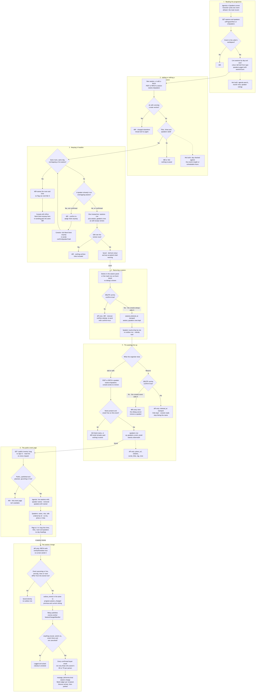

# Agenda, speakers and session changes

**Screens:** Admin Agenda, Admin Speakers, Event detail, Public event page, email

How an event's programme is put together and kept true. It starts on the two **Program** screens of the organizer console — `/admin/agenda` for sessions and `/admin/speakers` for the line-up — and ends in the two places an attendee sees it: the agenda and speakers sections of the public event page, and, when an API caller announces that a session moved (no screen does), an email saying from where to where. There is no room entity: a room is the free text in `sessions.room`, and every room rule below compares that string. The public page itself is drawn in [Create and publish an event](13-create-and-publish-an-event.md) and [Discover and register](01-discover-and-register.md), the permission keys come from [Sign-in, roles and permissions](12-sign-in-roles-and-permissions.md), and the change notice reaches the same people as [Announcements](10-announcements.md).

1. **Reading the programme.** A session belongs to a day of one event and a speaker is booked for one event, so both screens open on an event picker whose choice lives in the URL as `?eventId=`, defaulting to the most recent of the workspace's 100 most recent events. The agenda loader reads `GET /events/:eventId/sessions`, plus the first 100 speakers by name for the session form's picker. The directory reads `GET /events/:eventId/speakers`, paged server-side (`limit` 24 by default, at most 100), with a `search` of up to 120 characters matched by `ilike` against `name`, `role` and `email` — not `talk_title`, although the search box's placeholder promises "topic". Both reads accept **either** `evProgramView` or `evSpeakers`, and every write needs `evSpeakers`. Of the two programme keys the default `Staff` role holds only `evProgramView`, so door staff can look a session up for an attendee without being able to move it, while `Organizer` and `Admin` hold both. The console does not hide the write buttons from a read-only role; `PermissionsGuard` answers 403. Every call is scoped to the caller's workspace, so an event or session belonging to another is a 404. Sessions come back live only (`deleted_at IS NULL`) in agenda order — `day`, `start_time`, `sort_order`, `id` — each with its speakers in `session_speakers.sort_order`, removed speakers left out, and a `color` that is **derived** from `type` on the way out (Keynote blue, Panel green, Workshop amber, Talk rose, Break slate) rather than read from `sessions.color`, which is kept for old rows and no longer set by the session endpoints (duplicating an event only copies the old value across): while the colour was a free field, two Keynotes could come back in different colours. Each speaker carries `sessionCount`, counted in one grouped query over **live** sessions only. The week strip has one column per calendar day between the event's `start_at` and `end_at` on the Bangkok calendar — the same 1-based count the API's `day` uses — and the grid is drawn from 09:00 to 17:00, a session starting earlier being clipped to the top edge. The same reads feed the **Agenda** and **Speakers** tabs of the event workspace at `/admin/event-detail?id=…`. Not built: keyword search over the agenda (US-PROG-06), the month view (US-PROG-07) and speaker ratings (US-PROG-13) — nothing ever writes `speakers.rating`, so every card shows "—", never `0.0`.

2. **Adding or editing a session.** **New session** on `/admin/agenda` opens a slide-over that posts `POST /events/:eventId/sessions`; clicking a block opens the same form for `PATCH /events/:eventId/sessions/:id`, carrying the block's `version`. The DTO bounds what can arrive — `day` 1 to 60, `startTime` and an optional `endTime` as 24-hour `HH:MM` or `HH:MM:SS`, a `title` of 1–160 characters, a `type` from the five `session_type` values, a `room` of up to 80 characters, a `description` of up to 2,000, `speakerIds` as uuids, and the `confirmSpeakerClash` flag of step 3 — and anything outside it, or any property it does not name, is a 400 with field errors. The service then answers 422 for a title that is only spaces, for an end time not after the start (the `ck_sessions_time` CHECK enforces the same underneath), and for any speaker id that is not a live speaker **of this event**, naming the ids — which is how a speaker from another event is kept off a session. An edit is checked against the stored `version` first: a stale one is a 409 "This session changed elsewhere. Reload and try again.", shown in the panel, so a colleague's change is never silently overwritten. The `day` is **not** checked against how long the event actually runs, and there is no notion of schedulable hours — US-PROG-02 asks for a time outside the day's schedulable hours to be refused, and neither check is built; the agenda form offers only days within the event's span. The form always sends the ticked speakers, so every save rewrites the links, and because the picker lists only the first 100 speakers, a session linked to one beyond them loses that link on its next save. The form also turns an emptied field into an omitted one, and PATCH reads omitted as "leave it as it is", so once a room, end time or description is set the console cannot clear it. Emptying **Ends** on a new session stores `end_time` NULL — a legal, open-ended session — which the agenda loader then cannot draw: the console types `endTime` as never null and the block mapper throws on it. The event workspace's **Add session** slide-over posts the same endpoint with no speakers (its free-text Speaker box is never sent) and no description, and offers a fixed Day 1–4 whatever the event's length, so a shorter event can get a session its agenda strip has no column for.

3. **Keeping it feasible.** Both checks run **before** the write, so a refusal leaves nothing behind, and both exclude the session's own id, so an edited session never clashes with itself. They differ on purpose. **A room is physics**: when the session has a `room` and an `end_time`, it is compared with the live sessions of the same event, the same `day` and the same `room` string using a half-open overlap — one ending at 10:00 and one starting at 10:00 are back-to-back, not a clash — and an overlap is a 409 naming the room, the other session and its times, ending "Choose another room or time.", which no flag can override. US-EVT-09 still says a room overlap should only warn; the code follows US-PROG-05 and blocks. Because the room is free text the comparison is exact, so `Hall A` and `hall a` are two rooms, and parallel tracks in different rooms never meet. **A speaker is a judgement call** — somebody may genuinely do a fly-by across two tracks — so a speaker already linked to an overlapping live session that day is a 409 naming them and that session and ending "Confirm to assign them anyway."; sent again with `confirmSpeakerClash: true` it saves, and the response's `warning` repeats the note. A session with no `end_time` takes part in neither check. The console's panel spots the refusal it can wave through by matching *clash* or *already* in the message and offers a **Book them anyway** checkbox — but the room message says "already booked" too, so the checkbox also appears for a room clash, where sending again can only earn the same 409; and the accepted `warning` is never shown, only a "Session saved." toast. Once both checks pass, a create inserts the `sessions` row (with `sort_order` 0, which the console never sets) and its `session_speakers` rows, `sort_order` being each speaker's position in the list, in **one transaction**. An edit runs `UPDATE … WHERE id, organization_id, version AND deleted_at IS NULL`, setting `version + 1` and `updated_at`, and replaces the links in the same transaction, so a write that lost the race to a colleague updates nothing at all, links included, and is the same 409. API-only: a PATCH that omits `speakerIds` keeps the current links, which still include speakers removed in step 5, and the clash query does not filter `speakers.deleted_at`, so a removed speaker can still raise a double-booking; the console always sends the ticked speakers and never takes that path.

4. **Removing a session.** `DELETE /events/:eventId/sessions/:id` needs `evSpeakers` and, without `?confirm=true`, refuses with a 409 saying the removal will **not** notify attendees who bookmarked the session and cannot be undone — the server will not assume the warning was shown unless the client says so. With it, the row gets `deleted_at` stamped and nothing else: the `session_speakers` rows stay, every later read filters on `sessions.deleted_at`, and that alone drops each linked speaker's `sessionCount` by one while keeping them in the directory. There is no version check on removal and no `outbox_events` row, and nothing in eventa-worker consumes a removal, so nobody is told — by design (US-PROG-04). In the console, though, nobody sees the warning either: **Delete** in the session panel on `/admin/agenda`, and the trash icon beside each session on the event workspace's Agenda tab, submit at once with no dialog, and `programApi.removeSession` adds `confirm=true` to every call — so the confirmation US-PROG-04 asks for is given by the client on the organizer's behalf. The public agenda drops the session on its next load (step 6).

5. **The speaker line-up.** **Add speaker** on `/admin/speakers` posts `POST /events/:eventId/speakers` and **Edit speaker** on a card posts `PATCH /events/:eventId/speakers/:id`, both behind `evSpeakers`. The API takes a `name` of 1–120 characters (a 422 when it is only spaces), `role`, `email`, `phone`, `talkTitle`, `tag`, `initials`, `tone`, a `bio` of up to 2,000 characters, and `photoUrl`, `website` and `socialLinks`, each validated as a URL, so a bad link is a 400 rather than silently dropped. `email` is **optional** — US-PROG-09 wants it required, and the code does not require it — and there is no photo upload anywhere: `photo_url` is a link the caller already has. The console's form offers only name, title and company, email, phone, talk title and bio; tag, tone, initials, photo, website and social links are API-only, and a card with no stored tone or initials derives initials from the name and picks a colour by hashing the id. When an email is given, the service looks for another **live** speaker on the same event with it — case-insensitively, since `speakers.email` is `citext` — and refuses with a 409 "Another speaker on this event already uses that email address."; the partial unique index `uq_speakers_event_email` on (`event_id`, `email`) WHERE `email IS NOT NULL AND deleted_at IS NULL` stands underneath, so speakers with no email never collide and a removed speaker's address is free again, though the loser of a genuine race gets a 500 rather than the 409, because nothing maps that violation. Edits use the same optimistic `version` as sessions, but the speaker form carries no version field, so from the console the stale-version 409 ("This speaker changed elsewhere…") only fires in the instant between the API's own read and its write — two organizers editing one speaker means the last save wins, contrary to US-PROG-10. The talk title and bio fields are not pre-filled on edit, and an emptied field is omitted, so neither can be seen nor cleared there. **Removing** is `DELETE …/speakers/:id?confirm=true`; without the flag the API answers 409 that removal takes the speaker off **all** their sessions and cannot be undone. With it, `speakers.deleted_at` is stamped, the `session_speakers` rows are kept and the sessions survive, and because the console's reads join live speakers only, its screens simply stop listing the name. The console's **Remove speaker?** dialog, however, sends the DELETE **without** `confirm`, gets that 409, shows its sentence in place of its own, and on a second press sends the same request again: a speaker cannot be removed from the console today, only through the API. Duplicating an event (`POST /events/:id/duplicate`, `evCreate`) copies the live speakers and sessions, re-linked through a map from old ids to new, but not bio, photo, website, social links or session descriptions.

6. **The public event page.** Nothing is copied or snapshotted at publish time: `GET /public/events/:slug` is anonymous and builds the page from the live tables on **every** request, so a saved session or speaker shows on the next page load and nobody has to re-publish. The event must be `visibility = 'public'`, not deleted, with a `status` of `planned`, `upcoming` or `live` and `published_at` set; anything else is a 404 "This event page isn't available." The agenda is the event's live sessions LEFT JOINed through `session_speakers` to `speakers`, ordered by `day`, `sort_order`, `start_time` and folded into one entry per session with `speakerNames`. That join does **not** filter `speakers.deleted_at`, so a speaker removed through the API is still named on the public agenda — US-PROG-11 says they should disappear — and the names within a session come in no defined order. The speakers section is the live speakers' `name`, `role`, `talk_title`, `initials` and `tone`, ordered by `id`, a random uuid: speakers have no ordering column, so US-PAGE-04's "in the order the organizer arranged them" has nothing to read. `bio`, `photo_url`, `website`, `social_links` and the session `description` are not in the payload at all, so the profile US-PROG-09/10 say the public page reflects stops at name, role and talk. Section headings come from `events.agenda_title` and `events.speakers_title`, defaulting to "Agenda" and "Speakers". On `/e/:slug` each session becomes its time range — trimmed to `HH:MM` and never converted, because it is already the event's wall clock — its title, and "room · speakers"; `day` and `type` are dropped, so a multi-day agenda reads as one list with no day headings. A speaker card shows the talk title in preference to the role, and every template leaves out a section whose list is empty rather than showing a blank heading.

7. **The session-change notice.** `PATCH …/sessions/:id` takes an opt-in `notifyAttendees` flag, off by default, because US-PROG-03 says no message goes out unless the organizer chooses one. **It is API-only — no screen sends it**: neither the agenda panel nor the event workspace offers the choice, so a session moved from the console is always saved silently. When an API caller does send `true`, the service decides **before** the write, from the stored row, and needs all three of: the flag; an event `status` of `upcoming` or `live` (a draft has nobody to tell and a completed or cancelled event nobody who needs to know — and a `planned` event is skipped too, although its page is public); and a **material** change, meaning `day`, `start_time`, `end_time` or `room` differs — a new title, type, description or speaker never mails anyone. The comparison is between the request's values and the stored ones, so sending an unchanged `09:00` against a stored `09:00:00` counts as material. The `outbox_events` row — `routing_key = 'program.session_changed'`, `aggregate_type = 'session'`, the session id — is written in the **same transaction** as the update and built from the row that won the version race, so attendees are never told of a change that rolled back. Its payload carries the `title` and both the `previous` and the `current` day, times and room, because "Hall A → Hall B" is news and "this session changed" is not, and only the producer still knows the before. The relay publishes it, and eventa-worker's `SessionChangedHandler` validates the payload and then stops quietly — logged and acknowledged, nothing sent — when the before and after it received are equal (which absorbs the `09:00` false positive), when the workspace has switched **Session change** off (`message_templates.active` for slug `session-change`, where no row means on, toggled on `/admin/messaging-templates` under `setSettings`), when the event is gone or soft-deleted, or when it is `cancelled`. Only then are recipients read. The story says "attendees who added it to their schedule", but nothing records a session on anybody's schedule — `saved_events` bookmarks whole events and there is no per-session table — so the notice goes to every distinct `orders.buyer_email` on the event with `orders.status = 'confirmed'` and `deleted_at IS NULL`, the same audience as an announcement. Each person gets one email in their own language — their attendee account's `locale`, else the event's, else the workspace's, else English — in built-in English or Thai copy: the subject "Session moved: &lt;title&gt;"; a **When** line, before → after, only when the day or times moved, the day number turned into a date counted from the event's first day in its own timezone and the times printed as the wall clock that was typed; a **Where** line only when the room moved, with "Not announced yet" for a room never named; and a closing line that the ticket is unaffected, so a rescheduled session never reads like a cancellation. No organizer wording is read for this slug, although the API's wording endpoint will save some. Every send lands a `message_deliveries` row with `kind = 'session-change'`, `channel = 'email'` and `status` `sent` or `failed`; a Redis ledger keyed per message and recipient means a redelivery sends only the unsent tail; a partial failure is rethrown, so the message is retried and then parked; and a time that cannot be rendered is parked at once rather than mailed as "Invalid Date".

```mermaid
flowchart TD
  subgraph READ["1 · Reading the programme"]
    A1["Agenda or Speakers screen<br/>?eventId= picks one event<br/>default: the most recent"] --> A2["GET sessions and speakers<br/>evProgramView or evSpeakers"]
    A2 --> A3{"Event in the caller's<br/>workspace?"}
    A3 -- "No" --> A4["404"]
    A3 -- "Yes" --> A5["Live sessions by day and start<br/>colour derived from type<br/>speakers paged with sessionCount"]
    A5 -.-> A6["Not built: agenda search,<br/>month view, speaker ratings"]
  end

  subgraph SAVE["2 · Adding or editing a session"]
    B1["New session, or edit a block<br/>POST or PATCH a session<br/>needs evSpeakers"] --> B2{"An edit carrying<br/>a stale version?"}
    B2 -- "Yes" --> B3["409 · changed elsewhere<br/>reload and try again"]
    B2 -- "No" --> B4{"Title, times and<br/>speakers valid?"}
    B4 -- "No" --> B5["400 or 422<br/>nothing is saved"]
    B4 -.-> B6["Not built: day checked against<br/>the event's length or<br/>schedulable hours"]
  end

  subgraph FEAS["3 · Keeping it feasible"]
    C1{"Same room, same day,<br/>overlapping a live session?"}
    C1 -- "Yes" --> C2["409 names the room and time<br/>no flag can override it"]
    C2 --> C10["Console still offers<br/>Book them anyway here<br/>re-sending gets the same 409"]
    C1 -- "No" --> C3{"A speaker already in an<br/>overlapping session?"}
    C3 -- "Yes, not confirmed" --> C4["409 · confirm to<br/>assign them anyway"]
    C4 --> C5["Console: tick Book them anyway<br/>re-sends confirmSpeakerClash"]
    C5 --> C1
    C3 -- "No, or confirmed" --> C6["One transaction: sessions row<br/>plus session_speakers rows<br/>an edit bumps version"]
    C6 --> C7{"Edit lost the<br/>version race?"}
    C7 -- "Yes" --> C8["409 · nothing written<br/>links included"]
    C7 -- "No" --> C9["Saved · derived colour<br/>and any accepted-clash warning"]
  end

  subgraph DEL["4 · Removing a session"]
    D1["Delete in the session panel<br/>or the trash icon on Event detail<br/>no dialog is shown"] --> D2{"DELETE carries<br/>confirm=true?"}
    D2 -- "No" --> D3["API-only: 409 · removal<br/>notifies nobody, re-send<br/>with confirm=true"]
    D2 -- "Yes · the console always adds it" --> D4["sessions.deleted_at stamped<br/>session_speakers rows kept"]
    D4 --> D5["Speaker counts drop by one<br/>no outbox row · nobody told"]
  end

  subgraph SPK["5 · The speaker line-up"]
    E1{"What the organizer does"}
    E1 -- "Add or edit" --> E2["POST or PATCH a speaker<br/>needs evSpeakers<br/>console sends no version"]
    E2 --> E3{"Name present and<br/>email free on this event?"}
    E3 -- "No" --> E4["422 blank name, or<br/>409 email already used<br/>nothing is saved"]
    E3 -- "Yes" --> E5["speakers row<br/>uq_speakers_event_email<br/>stands underneath"]
    E5 -.-> E6["API-only: photo_url, website,<br/>social_links, tag, tone"]
    E1 -- "Remove" --> E7{"DELETE carries<br/>confirm=true?"}
    E7 -- "No · the console never adds it" --> E8["409 every time<br/>the dialog cannot<br/>remove a speaker"]
    E7 -- "Yes" --> E9["API-only: deleted_at stamped<br/>links kept · console reads<br/>stop listing the name"]
  end

  subgraph PUB["6 · The public event page"]
    F1["GET /public/events/:slug<br/>no sign-in · read live<br/>on every request"] --> F2{"Public, published and<br/>planned, upcoming or live?"}
    F2 -- "No" --> F3["404 · this event page<br/>isn't available"]
    F2 -- "Yes" --> F4["Agenda: live sessions with<br/>speaker names · removed<br/>speakers still named"]
    F4 --> F5["Speakers: name, role, talk<br/>ordered by id · no bio,<br/>photo or links"]
    F5 --> F6["Page at /e/:slug lists time,<br/>title, room and speakers<br/>no day headings"]
  end

  subgraph NOTE["7 · The session-change notice"]
    G1["API-only: PATCH with<br/>notifyAttendees true<br/>no screen sends it"] --> G2{"Event upcoming or live,<br/>and day, time or room<br/>differ from the stored row?"}
    G2 -- "No" --> G3["Saved silently<br/>no outbox row"]
    G2 -- "Yes" --> G4["outbox_events in the same tx<br/>program.session_changed<br/>previous and current sitting"]
    G4 --> G5["Relay publishes<br/>eventa-worker<br/>SessionChangedHandler"]
    G5 --> G6{"Anything moved, switch on,<br/>event there and<br/>not cancelled?"}
    G6 -- "No" --> G7["Logged and acked<br/>nobody is emailed"]
    G6 -- "Yes" --> G8["Every confirmed buyer email<br/>not only those who saved it<br/>EN or TH per person"]
    G8 --> G9["message_deliveries kind session-change<br/>Redis ledger per recipient<br/>failures retried, then parked"]
  end

  A5 --> B1
  B4 -- "Yes" --> C1
  C9 -- "Later" --> D1
  D5 --> E1
  E5 -- "Saved" --> F1
  F6 -- "A session moves" --> G1
```

Mermaid source

[← All flows](README.md)
