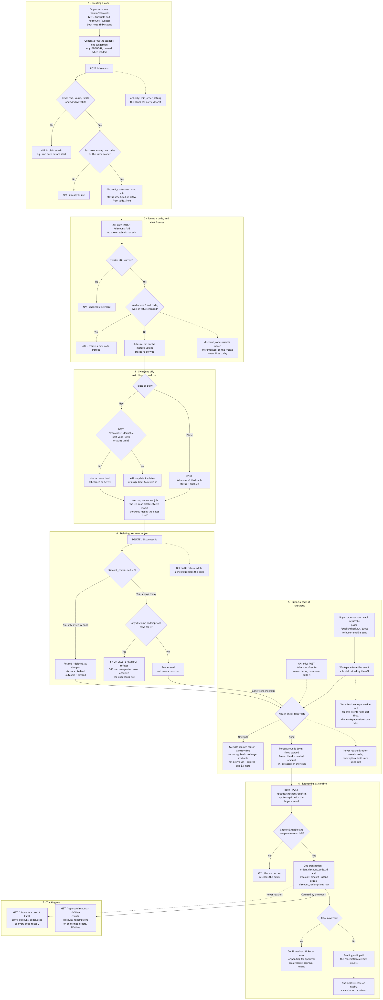

# Discount codes: create, stop and redeem

**Screens:** Admin Discounts, Checkout, Discounts report

How an organizer runs a promotion and how a buyer cashes it in. It starts on `/admin/discounts`, where somebody holding `finDiscount` creates a code, crosses to the attendee's checkout, where the code is quoted on every keystroke and redeemed when the order is placed, and ends back with the organizer on the list and the payback report, only the second of which actually counts its use. The checkout around the code is drawn in [Discover and register](01-discover-and-register.md) and [Checkout and payment](02-checkout-and-payment.md); the permission key itself comes from [Sign-in, roles and permissions](12-sign-in-roles-and-permissions.md). Several of the rules the API carries never take effect today, because the counter they read is never incremented. Each step says what the code actually does.

1. **Creating a code.** `/admin/discounts` (Events → Ticketing → Discounts) loads `GET /discounts` and `GET /discounts/suggest` together. Both, and every other organizer route in steps 1–4, sit behind `PermissionsGuard` with `finDiscount`, which the default Admin and Organizer roles hold and Staff does not. **New code** opens a panel that can only create. **Generate** fills in the one suggestion the loader fetched: a promotional word and two digits, like `PROMO42`, because a code is meant to be read off a poster or over the phone. It is picked against every code text the workspace still stores, retired codes and other events' codes included, and after 40 collisions the number widens to up to five digits instead of giving up. The suggestion is not reserved, and pressing Generate again offers the same code until the page's loader runs again, after any save, switch, delete or filter change. Saving posts `POST /discounts`, and the rules run in this order. The code is trimmed and uppercased and must be 3–24 characters of `A–Z`, `0–9` and hyphens, so Thai letters are refused; uppercase storage is what makes matching case-insensitive without a functional index. A `percent` value must be 1–100 and a `fixed` one at least one satang; the form takes whole baht and sends satang, and `ck_discount_codes_value` repeats the rule in the database. `per_person_limit` may not exceed `redemption_limit` unless either is `0`, which means unlimited, because giving one person more uses than the whole promotion has makes no sense. `valid_until` must come after `valid_from` and must not already have passed. Each of these is a 422 in plain words. The request DTO refuses the crudest cases first, with a 400 "Validation failed." and a field error: a code under 3 or over 24 characters before trimming, a value below 1, a negative limit or a malformed date. Last, the text must be free among this workspace's **live** codes **in the same scope**, either workspace-wide ("All events", `event_id` null) or that one event; otherwise the answer is a 409 "The code … is already in use." The service makes this check because `uq_discount_codes_org_event_code` cannot: nulls are distinct, so two workspace-wide duplicates would never collide in the index. The same text may still exist once workspace-wide and once per event. The `discount_codes` row is inserted with `used = 0`, `version = 1` and a status derived at birth: `scheduled` when `valid_from` is in the future, otherwise `active`. Two details of the form matter. Its date fields hold dates, which it converts to midnight at the **start** of that day in Asia/Bangkok, so the end date is exclusive: picking today as the end date is refused as already expired, and a one-day code needs tomorrow as its end. And the panel has no minimum-order field, so `min_order_satang` is **API-only**: every code made on the screen has a minimum of 0.

2. **Tuning a code, and what freezes.** `PATCH /discounts/:id` accepts any create field plus the `version` the caller last read. A mismatch, or a change that lands between the read and the write, is a 409 "This code changed elsewhere. Reload and try again." **No screen calls it.** The panel only creates, and the route's `update` intent is never submitted, so editing a code is API-only today. The rules are written as a promise to past buyers. The usage limit may not drop below `used` (422). Once `used` is above zero, the code text, `type` and `value` are frozen with a 409 that says to create a new code instead, so everyone who redeemed the code keeps exactly the deal they were given. Limits, scope, dates and the minimum stay open, because narrowing them never reaches backwards: each order carries its own `discount_amount_satang`. After that, the step 1 value, limit and window rules re-run on the merged result, a new code text is checked for collisions again, and `status` is re-derived, so extending an expired window revives the code. **In practice the freeze never fires.** No code path in eventa-api or eventa-worker, and no database trigger, ever increments `discount_codes.used`. It stays `0` however often a code is redeemed, and both rules above read it.

3. **Switching off, switching on, and the schedule.** Each row's pause or play button posts `POST /discounts/:id/disable` or `POST /discounts/:id/enable`. Disable sets `status = 'disabled'` unconditionally. That value is the organizer's own switch, and nothing derives it away. Every quote re-reads the row, so the next attempt at checkout is refused, including a buyer who quoted the code a minute ago and presses Book now, because confirming quotes again (step 6). Redemptions already made are untouched. Enable first asks whether the code still has room and time: past `valid_until`, or at its limit, is a 409 "This code has expired — update its dates or usage limit to revive it." Only the date half can trigger today, for the reason in step 2. Otherwise `status` is re-derived as `scheduled` or `active`. Neither button sends a version. The API writes against the `version` it read a moment earlier, so a change that lands in between is a 409. **There is no cron and no eventa-worker job for codes.** The stored `status` is a cached label. The checkout ignores it, except for `disabled`, and judges `valid_from` and `valid_until` against the clock on every quote, so a scheduled code works the moment its start passes and stops at its end whether or not anyone has looked. The stored column is settled only as a side effect of `GET /discounts`, which re-derives each listed row's status and writes any drift back. The status tabs filter on the stored value **before** that settling, so a code that has just reached its start date appears once under Scheduled with an Active badge, and has moved by the next load. "Expired because the usage ran out" (US-TKT-10) never happens, because `used` never moves.

4. **Deleting: retire or erase.** The bin icon opens a dialog that says the code will be permanently removed, then posts `DELETE /discounts/:id`. The API decides by `used`. At `0`, the row is deleted outright (`outcome = 'removed'`). Above `0`, the code is retired: `deleted_at` is stamped and `status = 'disabled'` (`outcome = 'retired'`), so past orders keep their discount while the code leaves the list, the checkout and the payback report. The screen ignores the outcome and always reports "Discount code deleted." Because `used` is always `0`, **every delete takes the erase branch**. A code that has been applied to any order has `discount_redemptions` rows, whose foreign key is `ON DELETE RESTRICT`, so Postgres refuses the delete. Nothing maps that refusal, and the organizer reads a 500 "An unexpected error occurred." in the dialog while the code stays live. In practice, then, a code nobody used is erased, a code anybody used cannot be deleted at all, and disabling it is the only way to stop it. The retire branch is reached only when `used` has been set by hand. Even then it would leave an event-scoped code's text held by `uq_discount_codes_org_event_code`, which the live-only collision check in step 1 does not see. The story's refusal while a code is in use in an active checkout is **not built**. Nothing asks the question, and since a quote stores nothing, there is nothing to ask. A buyer whose code is erased between their quote and Book is refused at confirm as not recognised, and their holds are released. Nothing in steps 1–4 writes an `audit_events` or `outbox_events` row.

5. **Trying a code at checkout.** On `/portal/checkout?event=<slug>`, the Discount code field sits inside the Payment section. It appears only when the event has something to pay for and the chosen tier is not a waitlist, and it uppercases as the buyer types. Every keystroke re-posts `POST /public/checkout/quote` with `discountCode`. It never sends `buyerEmail`, so the per-person limit cannot apply on the screen until step 6. The API prices the subtotal itself, `ticket_types.price_satang` times the quantity, then asks Discounts what the code is worth. The workspace comes from the event and never from the caller, so another workspace's code is unreachable. The checks run in a fixed order, and each refusal is a 422 with its own sentence, because "invalid code" does not tell a buyer whether to wait, spend more or give up:

   - a zero subtotal: "There's nothing to discount — this order is already free."
   - the wrong length or characters, so the first two keystrokes show "A code must be 3–24 characters."
   - no live code with that text, workspace-wide or for this event: "isn't a code we recognise for this event"
   - `disabled`: "is no longer available"
   - before `valid_from`: "isn't active yet"
   - past `valid_until`: "has expired"
   - at the limit: "has reached its redemption limit"
   - below `min_order_satang`: "Add ฿500 more to use …"
   - past `per_person_limit`, when an email is known: "You've already used …"

   Two of these never reach a buyer. A code scoped to a different event is filtered out by the lookup itself, so the buyer is told it is not recognised for this event. The service's own "can't be used for this event" sentence, written for US-TKT-11's different-event case, is never reached. The limit refusal reads `used`, which is always `0`, so **`redemption_limit` is never enforced**. When the same text exists both workspace-wide and for this event, the lookup's `ORDER BY event_id DESC` is meant to prefer the event's own code. Postgres sorts nulls first under `DESC`, so the workspace-wide code wins. A refused quote fails as a whole: the summary empties and the sentence shows in the red alert. A code that passes is worth `floor(subtotal × value / 100)` for a percentage, rounded down so rounding can only favour the organizer, or its fixed amount capped at the subtotal, so ฿300 off a ฿250 order takes ฿250 and never goes below zero. The service fee is then charged on the discounted amount, rounded down, and VAT is restated out of what is actually charged. The field holds one code, so one code applies per order. `POST /discounts/quote` runs the same checks but takes the subtotal from the caller and accepts any event that is not deleted, published or not. It is **API-only: no screen calls it**.

6. **Redeeming at confirm.** Book calls `POST /public/checkout/hold`, then `POST /public/checkout/confirm`, which quotes the code again with the buyer's typed email. On the screen, this is the first point where the per-person limit can apply. A code switched off, expired or erased since the last quote is refused here with the same sentence as step 5, and the web action releases the holds. The per-person count is of `discount_redemptions` rows for that code and `buyer_email`, a `citext` column so case does not matter, whatever became of their orders. It runs just before the order transaction opens, not inside it, so two simultaneous confirms by one buyer can both pass. The new quote also runs before the idempotency key is looked up, so a retried confirm for a single-use code is refused with "You've already used …" instead of returning the order it already placed. Inside `placeOrder`'s one transaction, `orders` is written with `discount_code_id` and `discount_amount_satang`. When the discount is above zero, it is joined by one `discount_redemptions` row carrying `buyer_email`, `amount_satang` and `redeemed_at`. That row is inserted `ON CONFLICT DO NOTHING` against `uq_discount_redemptions_code_order`, so one order can never redeem a code twice. It is written at **placement**, not at payment, so a paid order is still `pending` and unpaid when its redemption lands. A code that takes the total to zero turns the order into a free one, confirmed and ticketed on the spot (see [Free registration and confirmation](03-free-registration-and-confirmation.md)), unless the event requires approval, in which case it is placed `pending` with `approval_requested_at` set to wait for the organizer (see [Approval](05-approval.md)). A registration an organizer enters by hand never carries a code. Nothing else moves. `discount_codes.used` is not incremented, and no outbox row of its own is written: on a paid order, the `registration.confirmed` handler's receipt simply prints `orders.discount_amount_satang` as its own line ("Discount" / "ส่วนลด") and leaves the line out when nothing came off. Nothing ever deletes the redemption row: not eventa-worker's `order-expiry` job, which marks a lapsed unpaid order `expired`, and not a refund or a cancellation. A buyer who abandons payment has therefore still spent their per-person allowance, and the story's note that a cancelled or refunded order releases its redemption is **not built**.

7. **Tracking use.** The Discounts table is `GET /discounts`, paged server-side (the screen asks for 10 a page by default and offers 10, 20, 30 or 50; the API's own default is 20 and its cap 100), with the status tab, search, event filter and page held in the URL. Filtering by an event keeps workspace-wide codes, because they apply there too, and search matches the code text or an event's name. Each row shows the code with a copy button, the offer (`25% off`, or `฿200 off` with the fixed amount converted from satang), its scope ("All events" or the event's name), Used / Limit, the validity on the Bangkok calendar, and the status. The Used column prints `discount_codes.used`, so **every code reads `0 / 500` or `0 used`** however often it has been redeemed. The live redemption count US-TKT-12 asks for is not what this screen shows. The Valid column also treats a missing start as the epoch, so a code with no dates reads "Jan 1 – —". The real count is on `/admin/reports-discounts` (Insights → Marketing → Discounts), from `GET /reports/discounts` and its `GET /reports/discounts.:format` export, which need `finView` rather than `finDiscount`. That report is driven **from** `discount_codes`, so an unused code still gets a row of zeros. For each code it counts `discount_redemptions` joined to `orders` with `status = 'confirmed'`: redemptions, satang given away, and the discounted order totals the code influenced. The figures cover the code's whole life rather than the report's date window, which only decides which codes are listed, because a March campaign has a March payback. The report reads neither `used` nor `revenue_attributed_satang`, which nothing in the product has ever written, and it derives each code's standing from the clock in SQL rather than trusting `status`. Retired codes drop out of the list and the report alike.

```mermaid
flowchart TD
  subgraph CREATE["1 · Creating a code"]
    A1["Organizer opens /admin/discounts<br/>GET /discounts and /discounts/suggest<br/>both need finDiscount"] --> A2["Generate fills the loader's one suggestion<br/>e.g. PROMO42, unused when loaded"]
    A2 --> A3["POST /discounts"]
    A3 --> A4{"Code text, value, limits<br/>and window valid?"}
    A4 -- "No" --> A5["422 in plain words<br/>e.g. end date before start"]
    A4 -- "Yes" --> A6{"Text free among live codes<br/>in the same scope?"}
    A6 -- "No" --> A7["409 · already in use"]
    A6 -- "Yes" --> A8["discount_codes row · used = 0<br/>status scheduled or active<br/>from valid_from"]
    A3 -.-> A9["API-only: min_order_satang<br/>the panel has no field for it"]
  end

  subgraph TUNE["2 · Tuning a code, and what freezes"]
    B1["API-only: PATCH /discounts/:id<br/>no screen submits an edit"] --> B2{"version still current?"}
    B2 -- "No" --> B3["409 · changed elsewhere"]
    B2 -- "Yes" --> B4{"used above 0 and code,<br/>type or value changed?"}
    B4 -- "Yes" --> B5["409 · create a new code instead"]
    B4 -- "No" --> B6["Rules re-run on the merged values<br/>status re-derived"]
    B4 -.-> B7["discount_codes.used is never<br/>incremented, so the freeze<br/>never fires today"]
  end

  subgraph SWITCH["3 · Switching off, switching on, and the schedule"]
    C1{"Pause or play?"}
    C1 -- "Pause" --> C2["POST /discounts/:id/disable<br/>status = disabled"]
    C1 -- "Play" --> C3{"POST /discounts/:id/enable<br/>past valid_until<br/>or at its limit?"}
    C3 -- "Yes" --> C4["409 · update its dates<br/>or usage limit to revive it"]
    C3 -- "No" --> C5["status re-derived<br/>scheduled or active"]
    C2 --> C6["No cron, no worker job<br/>the list read settles stored status<br/>checkout judges the dates itself"]
    C5 --> C6
  end

  subgraph DELETE["4 · Deleting: retire or erase"]
    D1["DELETE /discounts/:id"] --> D2{"discount_codes.used = 0?"}
    D2 -- "Yes, always today" --> D3{"Any discount_redemptions<br/>rows for it?"}
    D3 -- "No" --> D4["Row erased<br/>outcome = removed"]
    D3 -- "Yes" --> D5["FK ON DELETE RESTRICT refuses<br/>500 · An unexpected error occurred<br/>the code stays live"]
    D2 -- "No, only if set by hand" --> D6["Retired · deleted_at stamped<br/>status = disabled<br/>outcome = retired"]
    D1 -.-> D7["Not built: refusal while<br/>a checkout holds the code"]
  end

  subgraph QUOTE["5 · Trying a code at checkout"]
    E1["Buyer types a code · each keystroke<br/>posts /public/checkout/quote<br/>no buyer email is sent"] --> E2["Workspace from the event<br/>subtotal priced by the API"]
    E2 --> E3{"Which check fails first?"}
    E3 -- "One fails" --> E4["422 with its own reason · already free<br/>not recognised · no longer available<br/>not active yet · expired · add ฿X more"]
    E3 -- "None" --> E5["Percent rounds down, fixed capped<br/>fee on the discounted amount<br/>VAT restated on the total"]
    E3 -.-> E6["Never reached: other event's code,<br/>redemption limit since used is 0"]
    E2 -.-> E7["Same text workspace-wide and<br/>for this event: nulls sort first,<br/>the workspace-wide code wins"]
    E8["API-only: POST /discounts/quote<br/>same checks, no screen calls it"] -.-> E3
  end

  subgraph REDEEM["6 · Redeeming at confirm"]
    F1["Book · POST /public/checkout/confirm<br/>quotes again with the buyer's email"] --> F2{"Code still usable and<br/>per-person room left?"}
    F2 -- "No" --> F3["422 · the web action<br/>releases the holds"]
    F2 -- "Yes" --> F4["One transaction · orders.discount_code_id<br/>and discount_amount_satang<br/>plus a discount_redemptions row"]
    F4 --> F5{"Total now zero?"}
    F5 -- "Yes" --> F6["Confirmed and ticketed now<br/>or pending for approval<br/>on a require-approval event"]
    F5 -- "No" --> F7["Pending until paid<br/>the redemption already counts"]
    F7 -.-> F8["Not built: release on expiry,<br/>cancellation or refund"]
  end

  subgraph TRACK["7 · Tracking use"]
    G1["GET /discounts · Used / Limit<br/>prints discount_codes.used<br/>so every code reads 0"]
    G2["GET /reports/discounts · finView<br/>counts discount_redemptions<br/>on confirmed orders, lifetime"]
  end

  A8 --> B1
  B6 --> C1
  C6 --> D1
  D4 -- "Gone from checkout" --> E3
  D6 --> E3
  E5 --> F1
  F4 -- "Counted by the report" --> G2
  F4 -. "Never reaches" .-> G1
```

Mermaid source

[← All flows](README.md)
