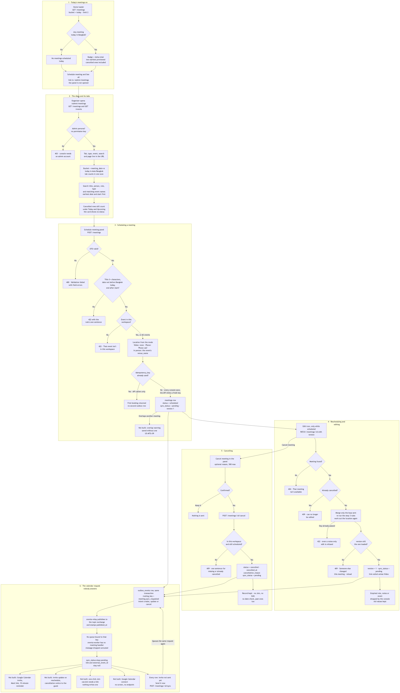
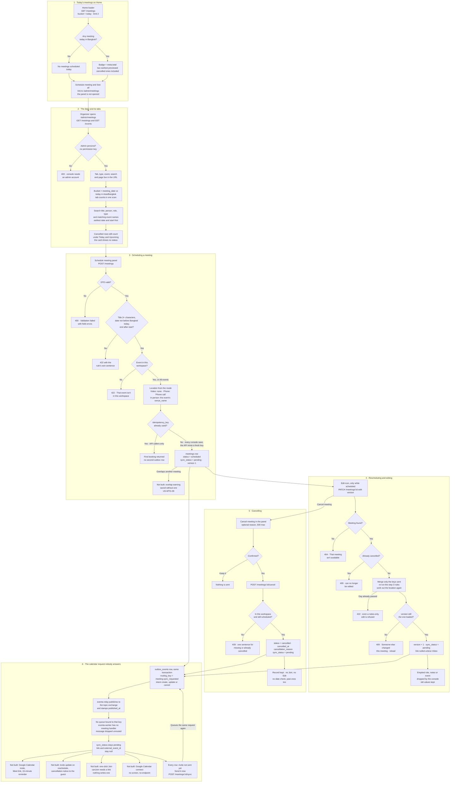

# Meetings with speakers, sponsors, venues and vendors

**Screens:** Admin Meetings, Home

How an organizer keeps the calls and site visits around an event — a venue walkthrough, a sponsor call, a speaker briefing — in one diary. It starts on Home's Today's Meetings panel or at `/admin/meetings`, and ends back on that list once a meeting has been scheduled, moved or called off. The bookkeeping is built; what the stories call the core value — a Google Calendar invite, a Meet link and a reminder sent on the organizer's behalf — is not: every write queues a calendar request on the outbox and nothing consumes it, so today the diary is a record the organizer keeps rather than something that reaches the guest. Who may use it is the admin persona from [Sign-in, roles and permissions](12-sign-in-roles-and-permissions.md), and the venue an in-person meeting shows is the one entered in [Create and publish an event](13-create-and-publish-an-event.md).

1. **Today's meetings on Home.** The Home loader reads `GET /meetings?bucket=today&limit=2` beside its other panels, each wrapped so that a failure shows its error and a Try again in that panel alone rather than taking the page down. The badge is the response's `meta.total`, and the two earliest meetings of the Bangkok day are previewed with their title, the time span — the API's "Today · " prefix stripped, since this panel shows nothing else — and the counterpart as role · person, the meeting type standing in when no role was given. An empty day reads "No meetings scheduled today." **Schedule meeting** and **See all** are plain links to `/admin/meetings`: they land on the list, and the schedule panel is not opened. The panel inherits every rule of step 2, including that a cancelled meeting is counted.

2. **The diary and its tabs.** `/admin/meetings` — the "Meetings" rail entry, shown to every organizer — loads `GET /meetings` and the event picker's options (`GET /events`, up to 100, most recent first) in parallel. The controller sits behind the global `JwtAuthGuard` and `AdminGuard` **only**: there is no `mtg*` key in the `permission_key` enum, so any member with the `admin` persona, Staff included, can read and change every meeting in the workspace, and an attendee token is a 403 "Organizer console access requires an admin account." Every query filters on `organization_id` and runs inside `withTenant`, which sets `app.current_org` for the `tenant_isolation` RLS policy on `meetings` as a second line. The tab (`tab`), `type`, `eventId`, the search (`q`, at most 120 characters), `page` and `limit` (10, 20, 30 or 50 rows, default 10 — any other value in the address bar falls back to 10) live in the URL; the loader sends the tab and the search to the API as `bucket` and `search`, and the API on its own defaults `limit` to 20 and caps it at 100. Changing any filter drops `page`, so the list returns to page one. **There is no bucket column**: Today, Upcoming and Past are worked out in SQL on every request by comparing `meeting_date` with `(now() AT TIME ZONE 'Asia/Bangkok')::date`, because a stored bucket is wrong the moment the Bangkok day turns. The four tab counts come from one scan with `count(*) FILTER (...)` and honour type, event and search but not the tab, so page 2 of Upcoming still says how many are in Past. Search is an `ILIKE` over `title`, `person`, `role` and `type::text`, plus the ids of this workspace's events whose `name` matches — resolved by Events through `MeetingEventPort`, so Meetings never joins `events`, and an empty id list narrows the search rather than widening it. Rows are ordered by `meeting_date`, then `start_time`, earliest first; nothing matching returns `meta.emptyMessage` "No meetings match your filters.", which the console does not render — it shows its own "No meetings match" with a Clear filters button — and a page past the end redirects to the last page. Each row is derived on the way out: `timeLabel` ("Today · 09:00 – 10:00" on the day itself), `place` (the `link` for Video, otherwise `location`, falling back to "Phone call"), `canEdit` (`status = 'scheduled'`) and `canJoin`. **No query filters out cancelled meetings**: the bucket is purely the date, so a meeting called off for tomorrow still sits in Upcoming and counts there, where US-MTG-06 expects it to drop out. The console's card carries no `status` either, so a meeting cancelled with a reason reads "Cancelled — &lt;reason&gt;", while one cancelled without a reason looks like a scheduled meeting that has lost its Edit button.

3. **Scheduling a meeting.** **Schedule meeting** opens the panel — title, date (a Bangkok calendar day), start and end (defaulting to 10:00–10:30), type (`Venue`, `Sponsor`, `Vendor`, `Speaker`, `Internal`; default `Internal`), mode (`Video`, `In person`, `Phone`; default `Video`), the person, their role, the guest's email, the event and notes — and saving it is `POST /meetings`. The DTO refuses malformed input with a 400 and field errors: a title outside 3–200 characters, a date that is not strict ISO, a time that is not 24-hour `HH:MM`, an unknown type or mode, a missing person (at most 120), an invalid `guestEmail` (at most 254), notes over 2,000. The service then applies the rules that need judgement, each a 422 with its own sentence: a trimmed title shorter than three characters; a date before **today in Bangkok**, compared as calendar days and never in UTC — for seven hours of every UTC day it is already tomorrow in Bangkok, and a UTC comparison would tell an organizer their own working day had passed — which also means a start time earlier the same day is accepted; and an end that is not after the start ("The end time must be after the start time."), which `ck_meetings_times` also enforces in the database. A chosen event is looked up through `MeetingEventPort.findForMeeting`, scoped to this workspace, and an id from another workspace is a 422 "That event isn't in this workspace." rather than being quietly saved as a general meeting; "All events" omits `eventId` and stores `event_id` null. **Where the meeting happens is never taken from the request** — the mode decides: Video stores no `location` and flags that a link is needed, Phone stores "Phone call", and In person copies the event's `venue_name` — null for a general meeting or an event with no venue, and because the list falls back to "Phone call" whenever `location` is null, such an in-person meeting is then shown as a phone call. The row is inserted with `status = 'scheduled'`, `sync_status = 'pending'`, `version = 1`, `created_by` and an `idempotency_key`, and `ON CONFLICT (organization_id, idempotency_key) DO NOTHING` makes a repeated key return the first booking *without* a second outbox row. The console never exercises that guard: the panel sends no key and the API mints a fresh `randomUUID()` per request, so two requests never collide, and the only thing between a double-tap and two meetings is the Save button disabling while the request is in flight. US-MTG-03's "only one meeting is created" holds for an API caller that sends its own key. The answer is a 201 echoing the row with `eventName` null, since the list resolves names in one query. **Not built:** there is no overlap check, so US-MTG-09's "this overlaps another meeting" warning never appears.

4. **Rescheduling and editing.** The Edit icon, offered only while `canEdit`, reopens the panel filled from the row with `version` in a hidden field, and saving is `PATCH /meetings/:id`; a malformed id is a 400 from `ParseUUIDPipe`. A missing meeting is a 404 "That meeting isn't available."; a cancelled one a 409 "This meeting was cancelled and can no longer be edited." The service merges **only the keys actually sent** onto the stored row — a validated DTO materialises every untouched field as `undefined`, and spreading that would blank the title and times of any partial edit — then runs the step 3 rules again on the merged values and works out the location from the mode again. Because the rules run on the merged values — the stored date included, whether or not the request sends one — a meeting whose day has passed but is still `scheduled` fails the past-date rule and cannot be saved at all, from the console or the API, not even to change a note. A meeting that stops being Video has its `link` set to null, so a guest is never sent to an empty call instead of the venue (US-MTG-05). The `UPDATE` matches only the `version` the organizer loaded, `status = 'scheduled'` and `deleted_at IS NULL`; if somebody saved first it matches nothing and the organizer gets a 409 "Someone else changed this meeting — reload it and try again." rather than silently flattening the other edit. A successful save increments `version`, puts `sync_status` back to `pending` and clears `sync_error`, because any invite would now describe the old time. One gap in the console: the form turns an emptied role, emptied notes and "All events" into `undefined`, which JSON drops, so the API keeps the old value — clearing the role, the notes or the event of an existing meeting is silently ignored. The API would clear them on an explicit `null`, but no screen sends one.

5. **Cancelling.** **Cancel meeting** sits in the edit panel's footer and opens a confirmation with an optional reason ("Told to the guest", at most 500 characters); **Keep it** sends nothing. Confirming is `POST /meetings/:id/cancel`, a single `UPDATE` that matches only a row still `scheduled` and not deleted, setting `status = 'cancelled'`, `cancellation_reason`, `cancelled_at`, `sync_status = 'pending'` and `updated_at`. It checks neither `version` nor the date, so a meeting whose day has already passed can still be cancelled, where the story's note expects cancel only for meetings not yet held. A miss is a 409 with the same sentence whether the meeting belongs to another workspace, does not exist or is already cancelled, so the answer never says which. The record is kept — no endpoint deletes a meeting and nothing ever sets `meetings.deleted_at` — and from then on it offers neither Join nor Edit.

6. **The calendar request nobody answers.** Each fresh booking, each successful reschedule and cancel, and each retry below writes one `outbox_events` row in the same transaction as the `meetings` change: `aggregate_type = 'meeting'`, the meeting's id as `aggregate_id`, and `routing_key = 'meeting.sync_requested'`. The payload (version 1) carries `intent` (`create`, `update` or `cancel`), the title, `startsAt` and `endsAt` as UTC instants resolved from the Bangkok wall clock, `guestEmail`, `person`, `mode`, `needsLink`, `location`, `notes`, `externalEventId` and `cancellationReason`; one routing key serves all three intents so a cancel cannot overtake the update it supersedes. Committing the request beside the booking is what keeps a meeting saved when the calendar is unreachable. **What follows is not built.** eventa-relay publishes the row to the topic exchange and stamps `published_at`, but it publishes without the mandatory flag and the exchange has no alternate exchange; eventa-worker binds its queue only to the routing keys it has handlers for, and it has no meeting handler and no clock-driven meeting job; and no repository contains a Google client. The broker therefore discards the message while the outbox row reads as delivered. Nothing ever sets `sync_status` to `synced`, `failed` or `not_connected`, or writes `link` or `external_event_id`, so no Google Calendar invite is sent, no Meet link is minted and no 15-minute reminder is set (US-MTG-04); a reschedule updates no invite and re-notifies nobody (US-MTG-05); a cancellation removes nothing from a calendar and sends the guest no notice (US-MTG-06) — `guest_email` is stored and never used; and because `canJoin` needs a link, the Join button (US-MTG-07), though wired, never appears. There is no screen or endpoint to connect a workspace Google Calendar (US-MTG-08), and no sweep reads `ix_meetings_sync`. On screen, every row — past and cancelled ones included — carries "The calendar invite has not been sent yet." with **Send it now**, which is `POST /meetings/:id/sync`: a 404 for a missing meeting, otherwise `sync_status` back to `pending`, `sync_error` cleared and another `meeting.sync_requested` queued — intent `cancel` for a cancelled meeting, otherwise `update` or `create` depending on whether `external_event_id` is set — to the same key nothing is bound to. The console's own copy promises otherwise: the empty state says every guest gets a Google Calendar invite with a Meet link, the mode field's hint says a Meet link is generated automatically, and the schedule panel says a Meet link and invite are emailed with a reminder 15 minutes before. Meeting times are stored as Bangkok wall clock (`date` and `time`, no `timestamptz`) and shown exactly as typed.

Mermaid source

[← All flows](README.md)
