# Meetings with speakers, sponsors, venues and vendors

**Screens:** Admin Meetings, Home, Settings Integrations

How an organizer keeps the calls and site visits around an event — a venue walkthrough, a sponsor call, a speaker briefing — in one diary. It starts on Home's Today's Meetings panel or at `/admin/meetings`, and ends back on that list once a meeting has been scheduled, moved or called off. The bookkeeping is built, and so is what the stories call the core value — a Google Calendar invite, a Meet link and a reminder sent on the organizer's behalf: every write queues a calendar request on the outbox, and eventa-worker answers it from the row, through the workspace's Google Calendar, which an Admin connects on Settings → Integrations. Until that connection exists the diary is a record the organizer keeps, and each meeting says so rather than pretending its invite went out. Who may use it is the admin persona from [Sign-in, roles and permissions](12-sign-in-roles-and-permissions.md), and the venue an in-person meeting shows is the one entered in [Create and publish an event](13-create-and-publish-an-event.md).

1. **Today's meetings on Home.** The Home loader reads `GET /meetings?bucket=today&limit=2` beside its other panels, each wrapped so that a failure shows its error and a Try again in that panel alone rather than taking the page down. The badge is the response's `meta.total`, and the two earliest meetings of the Bangkok day are previewed with their title, the time span — the API's "Today · " prefix stripped, since this panel shows nothing else — and the counterpart as role · person, the meeting type standing in when no role was given. An empty day reads "No meetings scheduled today." **Schedule meeting** and **See all** are plain links to `/admin/meetings`: they land on the list, and the schedule panel is not opened. The panel inherits every rule of step 2, including that a cancelled meeting is counted.

2. **The diary and its tabs.** `/admin/meetings` — the "Meetings" rail entry, shown to every organizer — loads `GET /meetings`, the event picker's options (`GET /events`, up to 100, most recent first) and the workspace's calendar status (`GET /calendar-connection`, step 7) in parallel. The controller sits behind the global `JwtAuthGuard` and `AdminGuard` **only**: there is no `mtg*` key in the `permission_key` enum, so any member with the `admin` persona, Staff included, can read and change every meeting in the workspace, and an attendee token is a 403 "Organizer console access requires an admin account." Every query filters on `organization_id` and runs inside `withTenant`, which sets `app.current_org` for the `tenant_isolation` RLS policy on `meetings` as a second line. The tab (`tab`), `type`, `eventId`, the search (`q`, at most 120 characters), `page` and `limit` (10, 20, 30 or 50 rows, default 10 — any other value in the address bar falls back to 10) live in the URL; the loader sends the tab and the search to the API as `bucket` and `search`, and the API on its own defaults `limit` to 20 and caps it at 100. Changing any filter drops `page`, so the list returns to page one. **There is no bucket column**: Today, Upcoming and Past are worked out in SQL on every request by comparing `meeting_date` with `(now() AT TIME ZONE 'Asia/Bangkok')::date`, because a stored bucket is wrong the moment the Bangkok day turns. The four tab counts come from one scan with `count(*) FILTER (...)` and honour type, event and search but not the tab, so page 2 of Upcoming still says how many are in Past. Search is an `ILIKE` over `title`, `person`, `role` and `type::text`, plus the ids of this workspace's events whose `name` matches — resolved by Events through `MeetingEventPort`, so Meetings never joins `events`, and an empty id list narrows the search rather than widening it. Rows are ordered by `meeting_date`, then `start_time`, earliest first; nothing matching returns `meta.emptyMessage` "No meetings match your filters.", which the console does not render — it shows its own "No meetings match" with a Clear filters button — and a page past the end redirects to the last page. Each row is derived on the way out: `timeLabel` ("Today · 09:00 – 10:00" on the day itself), `place` (the `link` for Video, otherwise `location`, falling back to "Phone call"), `canEdit` (`status = 'scheduled'`) and `canJoin`. **No query filters out cancelled meetings**: the bucket is purely the date, so a meeting called off for tomorrow still sits in Upcoming and counts there, where US-MTG-06 expects it to drop out. The console's card carries no `status` either, so a meeting cancelled with a reason reads "Cancelled — &lt;reason&gt;", while one cancelled without a reason looks like a scheduled meeting that has lost its Edit button.

3. **Scheduling a meeting.** **Schedule meeting** opens the panel — title, date (a Bangkok calendar day), start and end (defaulting to 10:00–10:30), type (`Venue`, `Sponsor`, `Vendor`, `Speaker`, `Internal`; default `Internal`), mode (no default: "Choose how you'll meet" until the organizer picks Video call (Google Meet), In person or Phone call — the words the card's badge shows — sent as `Video`, `In person` or `Phone`; the browser will not submit the panel without one, and the Meet-link hint shows only while Video call is chosen and the workspace's Google Calendar is connected), the person, their role, the guest's email, the event and notes — and saving it is `POST /meetings`. The DTO refuses malformed input with a 400 and field errors: a title outside 3–200 characters, a date that is not strict ISO, a time that is not 24-hour `HH:MM`, a missing or unknown type or mode, a missing person (at most 120), an invalid `guestEmail` (at most 254), notes over 2,000. The service then applies the rules that need judgement, each a 422 with its own sentence: a trimmed title shorter than three characters; a date before **today in Bangkok**, compared as calendar days and never in UTC — for seven hours of every UTC day it is already tomorrow in Bangkok, and a UTC comparison would tell an organizer their own working day had passed — which also means a start time earlier the same day is accepted; and an end that is not after the start ("The end time must be after the start time."), which `ck_meetings_times` also enforces in the database. A chosen event is looked up through `MeetingEventPort.findForMeeting`, scoped to this workspace, and an id from another workspace is a 422 "That event isn't in this workspace." rather than being quietly saved as a general meeting; "All events" omits `eventId` and stores `event_id` null. **Where the meeting happens is never taken from the request** — the mode decides: Video stores no `location` and flags that a link is needed, Phone stores "Phone call", and In person copies the event's `venue_name` — null for a general meeting or an event with no venue, and because the list falls back to "Phone call" whenever `location` is null, such an in-person meeting is then shown as a phone call. The row is inserted with `status = 'scheduled'`, `sync_status = 'pending'`, `version = 1`, `created_by` and an `idempotency_key`, and `ON CONFLICT (organization_id, idempotency_key) DO NOTHING` makes a repeated key return the first booking *without* a second outbox row. The console never exercises that guard: the panel sends no key and the API mints a fresh `randomUUID()` per request, so two requests never collide, and the only thing between a double-tap and two meetings is the Save button disabling while the request is in flight. US-MTG-03's "only one meeting is created" holds for an API caller that sends its own key. The answer is a 201 echoing the row with `eventName` null, since the list resolves names in one query. **Not built:** there is no overlap check, so US-MTG-09's "this overlaps another meeting" warning never appears.

4. **Rescheduling and editing.** The Edit icon, offered only while `canEdit`, reopens the panel filled from the row with `version` in a hidden field, and saving is `PATCH /meetings/:id`; a malformed id is a 400 from `ParseUUIDPipe`. A missing meeting is a 404 "That meeting isn't available."; a cancelled one a 409 "This meeting was cancelled and can no longer be edited." The service merges **only the keys actually sent** onto the stored row — a validated DTO materialises every untouched field as `undefined`, and spreading that would blank the title and times of any partial edit — then runs the step 3 rules again on the merged values and works out the location from the mode again. Because the rules run on the merged values — the stored date included, whether or not the request sends one — a meeting whose day has passed but is still `scheduled` fails the past-date rule and cannot be saved at all, from the console or the API, not even to change a note. A meeting that stops being Video has its `link` set to null, so a guest is never sent to an empty call instead of the venue (US-MTG-05); one that stays Video leaves `link` out of the update altogether, so a Meet link eventa-worker wrote after the panel was opened is never overwritten with the value read before the transaction. The `UPDATE` matches only the `version` the organizer loaded, `status = 'scheduled'` and `deleted_at IS NULL`; if somebody saved first it matches nothing and the organizer gets a 409 "Someone else changed this meeting — reload it and try again." rather than silently flattening the other edit. A successful save increments `version`, puts `sync_status` back to `pending` and clears `sync_error`, because any invite would now describe the old time. One gap in the console: the form turns an emptied role, emptied notes and "All events" into `undefined`, which JSON drops, so the API keeps the old value — clearing the role, the notes or the event of an existing meeting is silently ignored. The API would clear them on an explicit `null`, but no screen sends one.

5. **Cancelling.** **Cancel meeting** sits in the edit panel's footer and opens a confirmation with an optional reason ("Told to the guest", at most 500 characters); **Keep it** sends nothing. Confirming is `POST /meetings/:id/cancel`, a single `UPDATE` that matches only a row still `scheduled` and not deleted, setting `status = 'cancelled'`, `cancellation_reason`, `cancelled_at`, `sync_status = 'pending'` and `updated_at`. It checks neither `version` nor the date, so a meeting whose day has already passed can still be cancelled, where the story's note expects cancel only for meetings not yet held. A miss is a 409 with the same sentence whether the meeting belongs to another workspace, does not exist or is already cancelled, so the answer never says which. The record is kept — no endpoint deletes a meeting and nothing ever sets `meetings.deleted_at` — and from then on it offers neither Join nor Edit.

```mermaid
flowchart TD
  subgraph HOME["1 · Today's meetings on Home"]
    A1["Home loader<br/>GET /meetings<br/>bucket = today · limit 2"] --> A2{"Any meeting<br/>today in Bangkok?"}
    A2 -- "No" --> A3["No meetings scheduled today"]
    A2 -- "Yes" --> A4["Badge = meta.total<br/>two earliest previewed<br/>cancelled ones included"]
    A3 --> A5["Schedule meeting and See all<br/>link to /admin/meetings<br/>the panel is not opened"]
    A4 --> A5
  end

  subgraph LIST["2 · The diary and its tabs"]
    B1["Organizer opens /admin/meetings<br/>GET /meetings, GET /events<br/>GET /calendar-connection"] --> B2{"Admin persona?<br/>no permission key"}
    B2 -- "No" --> B3["403 · console needs<br/>an admin account"]
    B2 -- "Yes" --> B4["Tab, type, event, search<br/>and page live in the URL"]
    B4 --> B5["Bucket = meeting_date vs<br/>today in Asia/Bangkok<br/>tab counts in one scan"]
    B5 --> B6["Search title, person, role, type<br/>and matching event names<br/>earliest date and start first"]
    B6 --> B7["Cancelled rows still count<br/>under Today and Upcoming<br/>the card shows no status"]
  end

  subgraph SCHED["3 · Scheduling a meeting"]
    C1["Schedule meeting panel<br/>POST /meetings"] --> C2{"DTO valid?"}
    C2 -- "No" --> C3["400 · Validation failed<br/>with field errors"]
    C2 -- "Yes" --> C4{"Title 3+ characters,<br/>date not before Bangkok today,<br/>end after start?"}
    C4 -- "No" --> C5["422 with the<br/>rule's own sentence"]
    C4 -- "Yes" --> C6{"Event in this<br/>workspace?"}
    C6 -- "No" --> C7["422 · That event isn't<br/>in this workspace"]
    C6 -- "Yes, or All events" --> C8["Location from the mode<br/>Video: none · Phone: 'Phone call'<br/>In person: the event's venue_name"]
    C8 --> C9{"idempotency_key<br/>already used?"}
    C9 -- "Yes · API callers only" --> C10["First booking returned<br/>no second outbox row"]
    C9 -- "No · every console save,<br/>the API mints a fresh key" --> C11["meetings row<br/>status = scheduled<br/>sync_status = pending · version 1"]
    C11 -- "Overlaps another meeting" --> C12["Not built: overlap warning<br/>saved without one<br/>US-MTG-09"]
  end

  subgraph EDIT["4 · Rescheduling and editing"]
    D1["Edit icon, only while scheduled<br/>PATCH /meetings/:id with version"] --> D2{"Meeting found?"}
    D2 -- "No" --> D3["404 · That meeting<br/>isn't available"]
    D2 -- "Yes" --> D4{"Already cancelled?"}
    D4 -- "Yes" --> D5["409 · can no longer<br/>be edited"]
    D4 -- "No" --> D6["Merge only the keys sent<br/>re-run the step 3 rules<br/>work out the location again"]
    D6 -- "Day already passed" --> D7["422 · even a notes-only<br/>edit is refused"]
    D6 --> D8{"version still<br/>the one loaded?"}
    D8 -- "No" --> D9["409 · Someone else changed<br/>this meeting · reload"]
    D8 -- "Yes" --> D10["version + 1 · sync_status = pending<br/>link nulled unless Video"]
    D10 --> D11["Emptied role, notes or event<br/>dropped by the console<br/>old values kept"]
  end

  subgraph CANCEL["5 · Cancelling"]
    E1["Cancel meeting in the panel<br/>optional reason, 500 max"] --> E2{"Confirmed?"}
    E2 -- "Keep it" --> E3["Nothing is sent"]
    E2 -- "Yes" --> E4["POST /meetings/:id/cancel"]
    E4 --> E5{"In this workspace<br/>and still scheduled?"}
    E5 -- "No" --> E6["409 · one sentence for<br/>missing or already cancelled"]
    E5 -- "Yes" --> E7["status = cancelled · cancelled_at<br/>cancellation_reason<br/>sync_status = pending"]
    E7 --> E8["Record kept · no Join, no Edit<br/>no date check, past ones too"]
  end

  subgraph SYNC["6 · Sending the calendar invite"]
    F1["outbox_events row, same transaction<br/>routing_key = meeting.sync_requested<br/>intent create, update or cancel"] --> F2["eventa-relay publishes<br/>eventa-worker consumes<br/>lock per meeting"]
    F2 --> F3{"Meeting gone<br/>or already synced?"}
    F3 -- "Yes" --> F4["Nothing written<br/>no Google call"]
    F3 -- "No · read the current row" --> F5{"Workspace calendar<br/>connected?"}
    F5 -- "No" --> F6["not_connected<br/>expired sentence if expired<br/>a cancel never sent: synced"]
    F5 -- "Yes · refresh token<br/>decrypted, access token" --> F7{"Cancelled?"}
    F7 -- "Yes" --> F8["Reason into the description<br/>delete the event<br/>Google notifies the guest"]
    F7 -- "No" --> F9["Insert or patch the event<br/>id = meeting id without hyphens<br/>guest invited · 15-min reminder<br/>Meet link for Video only"]
    F8 --> F10{"Google's answer"}
    F9 --> F10
    F10 -- "OK" --> F11["synced · external_event_id kept<br/>link written for Video<br/>only if updated_at unchanged"]
    F10 -- "invalid_grant or<br/>insufficientPermissions" --> F12["Connection expired<br/>meeting not_connected<br/>acked, not retried"]
    F10 -- "Unavailable or refused" --> F13["failed · couldn't be sent<br/>429, 5xx, quota, timeout: retried<br/>5s, 30s, 2m, 10m, then dead-lettered<br/>other 4xx: dead-lettered at once"]
    F6 --> F15["Card note by sync status<br/>Send it now · Connect link<br/>or Ask an Admin"]
    F11 --> F15
    F12 --> F15
    F13 --> F15
    F15 -- "Send it now<br/>POST /meetings/:id/sync" --> F1
  end

  subgraph CONNECT["7 · Connecting the workspace Google Calendar"]
    G1["Meetings header status<br/>Admin: Connect or Reconnect link<br/>others: status only"] --> G2["Settings → Integrations<br/>GET /calendar-connection"]
    G2 --> G3{"Holds<br/>setIntegrations?"}
    G3 -- "No" --> G4["Status only<br/>no buttons, no account"]
    G3 -- "Yes" --> G5["Connect Google Calendar<br/>POST /calendar-connection/connect"]
    G5 -- "No Google client" --> G6["409 · isn't set up<br/>on this server yet"]
    G5 -- "Configured" --> G7["Store sha256 of the nonce,<br/>who started, PKCE verifier encrypted<br/>10 minutes · state = org.nonce"]
    G7 --> G8["Google consent<br/>openid, email, calendar.events"]
    G8 --> G9{"Callback: state matches,<br/>still live, starter<br/>still allowed?"}
    G9 -- "No · a mismatch<br/>clears nothing" --> G10["302 · calendar=failed"]
    G9 -- "Yes · state consumed" --> G11{"Access granted and<br/>code exchanged<br/>with the verifier?"}
    G11 -- "Denied, or no<br/>calendar scope" --> G12["302 · calendar=denied"]
    G11 -- "Exchange failed or<br/>no refresh token" --> G10
    G11 -- "Yes" --> G13["status = connected<br/>refresh token encrypted<br/>unsynced meetings re-queued"]
    G13 --> G14["302 · calendar=connected<br/>toast · Google Calendar connected."]
    G2 -- "Disconnect, confirmed" --> G15["POST /calendar-connection/disconnect<br/>token revoked best-effort<br/>token and account cleared"]
  end

  A5 --> B1
  B7 --> C1
  C11 --> D1
  D1 -- "Cancel meeting" --> E1
  C11 --> F1
  D10 --> F1
  E7 --> F1
  B1 -- "Header status" --> G1
  G13 -- "One request per<br/>unsynced meeting" --> F1
  F12 -- "Admin prompted<br/>to reconnect" --> G1
```

6. **Sending the calendar invite.** Each fresh booking, each successful reschedule and cancel, each retry below and each meeting step 7 re-queues writes one `outbox_events` row in the same transaction as the `meetings` change: `aggregate_type = 'meeting'`, the meeting's id as `aggregate_id`, and `routing_key = 'meeting.sync_requested'`. The payload (version 1) carries `intent` (`create`, `update` or `cancel`), the title, `startsAt` and `endsAt` as UTC instants resolved from the Bangkok wall clock, `guestEmail`, `person`, `mode`, `needsLink`, `location`, `notes`, `externalEventId` and `cancellationReason`; one routing key serves all three intents so a cancel cannot overtake the update it supersedes. Committing the request beside the booking is what keeps a meeting saved when the calendar is unreachable. eventa-relay publishes the row to the topic exchange and stamps `published_at`, and eventa-worker's single `eventa.worker` queue is bound to `meeting.sync_requested` because the worker has a handler for it. The relay publishes without the mandatory flag, so a request published before a worker carrying that handler first booted was discarded while its outbox row reads as delivered; such a meeting stays `pending` until **Send it now** or step 7's resync sends it again. **The worker works from the row, not the message.** It takes a per-meeting Redis lock (`lock:meeting-sync:<id>`, 60 seconds; a held lock means the message is retried), reads the meeting — deleted ones too — and uses nothing from the payload but the workspace and meeting ids: `intent` is only logged, and the guest's address comes from the row. A missing or deleted meeting ends there, and so does one already `synced`, without calling Google. When the workspace has no usable connection — the worker's calendar provider is off, there is no `calendar_connections` row, or it is not `connected` — the meeting becomes `not_connected`, with `sync_error` "The Google Calendar connection has expired." when the row says `expired`; a cancelled meeting that never reached Google becomes `synced` instead, as there is no invite to withdraw. Otherwise the worker decrypts the stored refresh token — a failure, the mark of a `SECRET_ENCRYPTION_KEY` that differs from eventa-api's, is `failed` with "The Google Calendar connection could not be read." and goes to the dead-letter queue — and trades it for an access token, which is never stored. **A cancelled meeting** has "Cancelled: " and the reason, then the notes, patched into the event's description without notifying anyone, and the event is then deleted with `sendUpdates=all`, so Google takes it off the guest's calendar and sends the cancellation notice (US-MTG-06); a 404 or 410 counts as done. It deletes `external_event_id`, or the meeting's own id without hyphens when none was recorded, because a create the cancel overtook may already have made that event. **A scheduled meeting** is written to the connected account's primary calendar under a deterministic event id — the meeting's `id` without its hyphens, so a retry or a reschedule always addresses the same event and never makes a second one (US-MTG-05) — with the title, the notes as its description, the location, start and end as Bangkok wall clock in `Asia/Bangkok`, the guest as the one attendee, a 15-minute popup reminder in place of the calendar's defaults, and `sendUpdates=all`, so Google emails the guest the invite, and re-notifies them of a change. A Video meeting asks Google for a Meet conference (request id `<meeting id>-v<version>`), keeps the one it has when it already has both an event and a link, and a meeting that is not Video sends `conferenceData: null`, removing any it had. A meeting with an event id is patched first, falling back once to an insert on a 404 or 410 — a patch also sets the event back to `confirmed`, restoring one deleted earlier — and one without is inserted first, falling back once to a patch on a 409. The worker then records `external_event_id`, unconditionally because eventa-api never writes it, and writes `synced` with the Meet link — null for a meeting that is not Video — so the card shows the link and Join appears (US-MTG-04, US-MTG-07); a Video meeting whose link Google has not finished making stays `pending` and is retried with the same request id. **Every outcome is written only while `updated_at` is still the one the worker read**: if the organizer saved again meanwhile nothing is written, because that save queued its own request (ADR-15). **When Google says no.** `invalid_grant` on the token refresh, or `insufficientPermissions` from Calendar, means the grant was revoked or has lapsed — a consent screen still in Google's Testing status expires it after seven days. The connection is marked `expired`, but only while it still holds the token the worker used, so a reconnect that landed meanwhile is never undone; the meeting becomes `not_connected` with the expired sentence, and the message is acknowledged rather than retried (US-MTG-08). A 401 from the Calendar API (the next attempt refreshes a new access token), a 429, a 5xx, a quota 403, a network error or a timeout is `failed` with "Google Calendar is unavailable right now." and retried after 5 seconds, 30 seconds, 2 minutes and 10 minutes, then dead-lettered (US-MTG-04). Any other 4xx, a non-quota 403 included, is `failed` with "Google Calendar refused the request (HTTP n)." and dead-lettered at once, as reconnecting cannot fix it; that includes any 400 or 401 from the token endpoint other than `invalid_grant`, such as `invalid_client` when the client secret it was sent has been disabled, so a 401 from the token refresh is never retried. `sync_error` is only ever one of these fixed sentences — never Google's own text, an address or a token — and the worker logs ids and the outcome, never the guest, the title or the notes. No clock-driven sweep reads `ix_meetings_sync`: recovery is the retry ladder, **Send it now**, and step 7's resync, so a Google outage longer than the ladder leaves meetings `failed` until someone clicks. **On screen**, a scheduled meeting's card reads "The calendar invite has not been sent yet." while `pending` and "The calendar invite couldn't be sent." when `failed`, each with **Send it now**; "No calendar is connected, so no invite was sent." when `not_connected`, followed by **Send it now** if the workspace has connected since, otherwise by a **Connect Google Calendar** link — **Reconnect Google Calendar** when the connection has expired — to Settings → Integrations for a holder of `setIntegrations`, and "Ask an Admin to connect Google Calendar." for anyone else (US-MTG-04); and nothing once `synced`. A cancelled meeting's card says nothing about the calendar unless sending the cancellation failed: "The cancellation couldn't be sent to the guest's calendar." with **Send it now**. **Send it now** is `POST /meetings/:id/sync`: a 404 for a missing meeting, otherwise `sync_status` back to `pending`, `sync_error` cleared and another `meeting.sync_requested` queued — intent `cancel` for a cancelled meeting, otherwise `update` or `create` depending on whether `external_event_id` is set; a refused retry is shown as a toast. While any meeting on the page is `pending`, the page re-runs its loader every 3 seconds, at most ten times for one set of pending meetings, so a new booking turns into its Meet link without a reload and a worker that never answers costs ten requests. On a new meeting the note above Schedule says a Google Calendar invite is emailed with a reminder 15 minutes before — and names a Meet link once Video call is chosen — only while the calendar is connected; otherwise it reads "Google Calendar isn't connected, so this meeting will be saved without an invite or Meet link." The empty diary still says every guest gets a Google Calendar invite with a Meet link, which holds only for a video meeting on a connected workspace. The reminder is set on the workspace calendar the invite is sent from; a guest's own reminder follows the guest's calendar settings. Meeting times are stored as Bangkok wall clock (`date` and `time`, no `timestamptz`) and shown exactly as typed.

7. **Connecting the workspace Google Calendar.** The calendar is the workspace's, not each organizer's (US-MTG-08), and it is connected on **Settings → Integrations** (`/admin/settings-integrations`), an entry in the Workspace group after Payments that the console lists only for holders of `setIntegrations` ("Manage integrations", which only the Admin preset grants). The Meetings header shows the status before **Schedule meeting**, on screens `lg` and wider: "Google Calendar" with a check mark when connected; when not, a **Connect Google Calendar** link to Settings → Integrations for a holder of `setIntegrations` and a plain "Calendar not connected" for anyone else; when expired, **Reconnect Google Calendar** or "Calendar needs reconnecting". On a narrower screen step 6's card prompts are the only prompt. Both read `GET /calendar-connection`, behind `AdminGuard` and with no permission key, so every admin-persona member can read the status and an attendee token cannot. It answers `provider`, `status` — `not_configured` whenever the server has no Google client, whatever is stored, otherwise `disconnected` (also when there is no row), `connected` or `expired` — `connectedAt`, and `accountEmail` only to a caller holding `setIntegrations`, so Staff and Organizers never receive the address (NFR-PDPA-04); no token, state or user id ever leaves the API. The page's Google Calendar card reads "Not set up" with "Google Calendar isn't set up on this server yet." and no button; "Not connected" with **Connect Google Calendar**; "Connected" with the account and the day it was connected, and **Disconnect**; or "Reconnect needed" with "Google stopped accepting this connection. Reconnect to keep sending invites.", the same facts, **Reconnect** and **Disconnect**. Someone without `setIntegrations` who opens the page by its address sees the status with no button, no account and "Only an Admin can connect or disconnect Google Calendar.", and the API would refuse them anyway (NFR-SEC-02). **Connecting** is `POST /calendar-connection/connect` (`setIntegrations`; a 409 "Google Calendar isn't set up on this server yet." without a client), allowed in every status, so it also reconnects or switches account. The API makes a random 43-character nonce and a PKCE verifier, and stores on the workspace's `calendar_connections` row — creating it if need be — only the nonce's SHA-256, the user who started, the verifier encrypted and an expiry ten minutes ahead on the database clock; a second start replaces the first. It answers with Google's consent address, carrying `state` = `<workspace id>.<nonce>`, which is opaque and holds no user id, email or token; the verifier's S256 challenge; the scopes `openid`, `email` and `calendar.events`; offline access and a forced consent prompt; and no `login_hint`. The browser goes there ("Opening Google…"). **The callback**, `GET /api/v1/public/calendar-connection/google/callback`, is public and left out of the published API contract, and whatever happens it answers with a 302 to `/admin/settings-integrations?calendar=` `connected`, `denied` or `failed` — built from the configured web address and that word alone, never from the request — with `Cache-Control: no-store` and `Referrer-Policy: no-referrer`; an unexpected error is `failed`, never a JSON error in the browser. It takes the workspace from the state and proves it against the hash stored under that workspace, compared in constant time. A state that does not match is `failed` and **clears nothing**, so nobody who guesses a workspace id can cancel an Admin's connect in progress; a matching one is consumed in the same transaction, so the address cannot be replayed, and is still `failed` if it has lapsed or if the user who started no longer holds `setIntegrations`. Google's `access_denied` is `denied`; any other error, or no code, is `failed`. The code is exchanged together with the decrypted verifier, so a leaked state cannot be paired with someone else's code; a failed exchange or a grant without a refresh token is `failed`, one without the `calendar.events` scope is `denied`, and none of them revokes anything at Google. Success marks the row `connected` with the refresh token encrypted, the Google account's address, `connected_by` and `connected_at`, and then **re-queues every meeting that is not synced**, dated today or later, and either scheduled or cancelled with a Google event — `sync_status` back to `pending` and one `meeting.sync_requested` each — so meetings booked while disconnected, cancellations that never reached Google and requests lost before the worker was bound go out now (US-MTG-08, US-MTG-06); if that fails it is logged and the answer is still `connected`. Back on the page the `calendar` value is read once into a toast — "Google Calendar connected.", "Google Calendar wasn't connected — calendar access wasn't granted." or "Google Calendar couldn't be connected. Try again." — and dropped from the address. **Disconnecting** asks first — "Disconnect Google Calendar?", saying new and changed meetings won't be sent to Google Calendar until it's connected again and meetings already on people's calendars stay there, with **Keep it connected** and **Disconnect** — then is `POST /calendar-connection/disconnect` (`setIntegrations`), which sets `status = 'disconnected'` and `disconnected_at` and clears the token, the account and any pending connect, revoking the token at Google on a best-effort basis that never fails the disconnect. It is idempotent and toasts "Google Calendar disconnected." Events already on calendars stay where they are, and from then on new and changed meetings end `not_connected`; a workspace that reconnects with a different Google account leaves the old account's events behind. eventa-api and eventa-worker must resolve the same calendar provider: with a Google client in eventa-api and none in eventa-worker the card says connected while every meeting ends "not connected". No audit row records a connect or a disconnect. **Unproven:** the Google adapters in both services have run only against the fake provider (`CALENDAR_PROVIDER=fake`, refused in production), never a real Google account.

Mermaid source

[← All flows](README.md)
