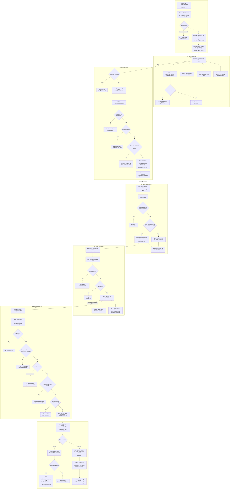

# Attendees, invitations and manual registration

**Screens:** Admin Attendees, Attendee profile panel, Admin Registrations, email

How an organizer works with the people behind the registrations. It starts on `/admin/attendees`, the workspace-wide directory, runs through one attendee's profile, a correction to their contact details and an invitation to an event, and ends on `/admin/registrations`, where a walk-up or phone booking is entered by hand and either ticketed on the spot or left owing. The attendee-facing ends are the invitation email and, for a free hand-entered booking, the confirmation drawn in [Free registration and confirmation](03-free-registration-and-confirmation.md); a paid one would continue into [Checkout and payment](02-checkout-and-payment.md), but today nothing takes it there. The keys come from [Sign-in, roles and permissions](12-sign-in-roles-and-permissions.md): reading is `regView`, and every change on these screens is `regManage`.

1. **The attendee directory.** `/admin/attendees` reads everything in one loader: `GET /attendees`, `GET /events?limit=100&sort=recent` for the invite picker, and — only when `?profile=` names somebody — that attendee's timeline (step 2). `GET /attendees` sits behind `AdminGuard` and `PermissionsGuard` and needs only `regView`, because Staff hold `regView` so the door can look people up. Its filters — `segment` (`all`, `new`, `checked_in`, `vip`), `tag` (the `attendee_tag` values `VIP`, `Speaker`, `Sponsor`, `Student`), `search` (at most 120 characters, matched `ILIKE` against name or email; the URL calls it `q`), `sort` (`recent`, `name`, `events`, `tickets`), `page` and `limit` (default 25, at most 100) — are all URL parameters applied server-side across the whole directory, because sorting the one page that arrived would put the wrong name at the top. Each row is one `attendees` row with `deleted_at` null plus three aggregates built once in a lateral subquery over that attendee's `orders` (every status except `cancelled`) and their `tickets`: distinct events, tickets held, and tickets with `status = 'checked_in'`. `last_activity_at` is the latest `orders.registered_at`, and every sort breaks ties on it and then on `id`, so the order is never arbitrary. `new` is `first_seen_at` within 30 days; `vip` is `tag = 'VIP'`. The segment counts (`meta.counts`) come from the same expression **without** the segment filter but with tag and search, so a tab keeps its own total while another is selected and can never disagree with the list. Every row also carries `attendees.version`, the token step 3 depends on, and a page number past the end redirects to the last page. One gap: unlike the Registrations loader, this one does not absorb a 403 from `GET /events`, which needs `evCreate` — so a Staff member, who holds `regView` but not `evCreate` by default, gets the page's error screen instead of the directory the API would have given them.

2. **The profile and its timeline.** **View profile** on a row sets `?profile=<id>` — URL state, so the back button closes it and the link can be shared — and the panel draws the identity, the tag badge and the contact card from the row already on the page; a `?profile=` naming somebody on another page opens nothing, because no endpoint answers for one attendee. The loader reads the timeline from `GET /audit?subjectType=attendee&subjectId=<id>&limit=20`. That route carries no `@RequirePermissions`: the subject pair resolves to `audit_events.type = 'attendee'` plus a `meta` prefix match on `attendee #<id> ·`, ANDed onto the caller's own scope — a holder of `setUsers` sees the workspace, anyone else only their own acts. So an Organizer sees their own corrections and not a colleague's, which is why the empty state says the trail lists "only what your account may see" rather than claiming nothing happened. The only writer of such rows is step 3: an invitation, a hand-entered booking, a ticket or a check-in never appears on this timeline. A failed read shows the API's sentence and a retry inside the panel instead of taking the panel down. **Three things the stories describe are not built.** The kit's "Registered events" and "Tickets" lists are left out because no endpoint answers them for one attendee. Tagging (US-REG-07) is read-only: `attendees.tag` is shown as a badge and offered as a filter, but nothing writes it — `UpdateAttendeeContactDto` carries only `name`, `email`, `phone` and `version`, and under `forbidNonWhitelisted` a `tag` field is a 400. And **Send email** (US-REG-09) is a `mailto:` link to the organizer's own mail client: no endpoint, no queued email, no timeline entry.

3. **Correcting a contact.** The **Edit** button in the profile footer shows only when `me.permissions` includes `regManage`, and the API checks it again on `PATCH /attendees/:attendeeId`: it is `regManage` rather than `regView` because an edit changes where somebody's ticket and every future reminder are sent. The panel posts what was typed beside hidden `stored-*` copies of what the row said and `stored-version`, and only the difference is sent, with `version` — so an untouched box is never written back over a colleague's correction, and a form saved untouched sends no request at all. The DTO refuses an invalid email, an empty or over-120-character name and a phone over 24 characters with a 400 whose messages land under the boxes (the phone is only length-checked, because Thai mobiles, landlines and foreign numbers are all worth storing; an empty one clears it). The service then trims, refuses an empty body or a name that trims to nothing with a 422, loads the row — 404 "That attendee is not in this workspace." for another workspace's id or a removed record — and compares `version`: a mismatch is a 409 "This attendee changed while you had the form open. Reload and try again." The email rule is the story's third criterion. An address already held by another attendee is a **conflict, not a validation error**: 409 `ATTENDEE_EMAIL_IN_USE` with the merge prompt, shown verbatim as a banner above the form, and nothing at all applied, not even a name or phone sent alongside. The lookup counts soft-deleted attendees on purpose — `uq_attendees_org_email` has no `deleted_at` predicate, so a removed record still owns its address, and that case gets its own sentence — and compares as `citext`, so `Rio@x.co` collides with `rio@x.co`. The prompt names neither the other person nor their address, because every 4xx message is logged by the global filter. **No merge is performed**: moving orders, tickets, invoices and payments between people is its own story, and a merge that stopped halfway would detach registrations through `orders.attendee_id ON DELETE SET NULL`. A valid save is one `withTenant` transaction. `UPDATE attendees` sets `version = expected + 1` `WHERE version = expected AND deleted_at IS NULL` (no row is the same 409; a race that trips `uq_attendees_org_email` is the merge prompt, never a 500). Every non-deleted `orders` row of that attendee, cancelled ones included, then has whichever of `buyer_name`, `buyer_email` and `buyer_phone` match the changed fields rewritten, because messaging resolves its recipients from the order and not from `attendees` — this is what makes "future confirmations go to the new number" true; `invoices` keep their issued snapshot, and `tickets.holder_name` and `discount_redemptions.buyer_email` are left alone. Last comes one `audit_events` row with `type = 'attendee'`, the title "Updated contact details", the acting user and `meta` = `attendee #<id> · changed: email, phone` — the fields, never the values, since an audit row outlives a person's right to have them erased. No `outbox_events` row is written. The console toasts "Contact details updated." and revalidates, re-reading the row and the counts.

4. **Inviting someone to an event.** **Invite** in the Attendees header — disabled until the workspace has an event, and not permission-gated in the console — opens a panel for one named person and one event: a picker over the workspace's 100 most recent events (drafts and past ones included), a recipient name (1–120), an email and an optional note (up to 250). The action trims, leaves out an empty note and calls `POST /invitations` — `AdminGuard`, `PermissionsGuard` and `regManage`, because the story says Staff cannot invite. The DTO refuses a non-uuid `eventId`, an empty or overlong name, an invalid email or a note over 250 characters with a 400, shown as one sentence above the form, and nothing is written. `InvitationsService` resolves the event through `EventsService.getEvent`, which is the tenancy check — another workspace's id or a deleted event is a 404 before anything is written — but it never looks at `events.status`, so a draft, completed or cancelled event can be invited to. The address is trimmed and lower-cased, and then one statement runs in one `withTenant` transaction: `INSERT INTO event_invitations … ON CONFLICT ON CONSTRAINT uq_event_invitations_recipient DO UPDATE SET sent_at, recipient_name, message WHERE event_invitations.sent_at < now − 24h RETURNING sent_at`. The constraint is (`organization_id`, `event_id`, `recipient_email`) with `recipient_email` as `citext`, so `Ada@x.com` and `ada@x.com` are one invitation. **The dedupe is that statement**: a repeat inside `INVITE_DEDUPE_WINDOW_MS` (24 hours) returns no row, and no row means no outbox write — a read-then-write would let two quick submissions both decide they were first. A new or stale-enough invite writes, in the same transaction, an `outbox_events` row with `routing_key = 'invitation.sent'`, `aggregate_type = 'invitation'` and `aggregate_id` = the event id; the payload carries the recipient, the note, the event name and an absolute `registerUrl` built from `PUBLIC_WEB_URL`, since the worker has no idea which host serves the public site, and the tenant goes on the row only. A suppressed repeat is answered like a sent one apart from `sent: false` — 200 "Invitation sent." with `{ sent, recipientEmail, sentAt }` — because the organizer's intent was "make sure they were asked" and an error would be the worse answer. The console posts with `api.post<void>` and drops that flag, so it toasts "Invitation sent." either way; the panel's hint that the same invitation twice in a day sends no second email is the only place the suppression is said. An invite reserves nothing: it touches no capacity, hold or ticket, and `event_invitations` has no link to orders.

5. **The invitation email.** eventa-relay publishes the row's payload alone, with `messageId` = `outbox_events.id`. `InvitationSentHandler` in eventa-worker consumes `invitation.sent` and skips a message id it has already completed — the message, not `invitationId`, which is `<eventId>:<email>` and stable forever, because a re-invite after the 24 hours is a new outbox row that must send. `invitation.sent` is the one API event without `organizationId` on its payload, so the handler finds the tenant by re-reading `events` by id, which it needs anyway: a deleted event sends nothing (`no-event`); a `cancelled` one sends nothing (`event-cancelled`), because the outbox can run behind and an invitation to a cancelled event is worse than none; every other status, draft included, is sent. The workspace can switch the mail off with `message_templates.active` for `event-invitation` — an absent row means on — and then nothing is sent (`switched-off`). Every one of these outcomes is still a success, and the log line carries only the event id and the outcome, never the address, the name or the link. The email is composed in the reader's language (their own account's, else the event's, the workspace's, then English) from the event's **current** name and start, formatted in its timezone: the organizer's personal note at the very top, printed as written; then the greeting — the workspace's own wording if it set one, else "Hi" and the name, with the name dropped for "Hello," when the name rule will not trust it, since it was typed by an organizer about a stranger; then a fixed line naming the event, which the workspace's wording cannot replace; then the start time, "Register here:" with the link, and a line saying no place is held until they register. `RecordingEmailProvider` writes a `message_deliveries` row (`kind = 'event-invitation'`, `status` `sent` or `failed`); a failed send is recorded and rethrown, so it is retried. **The register link is broken today**: the API builds it as `PUBLIC_WEB_URL/events/<slug>`, while eventa-web serves a public event at `/e/:slug` — the shape every share link uses — so the link opens the web's Not Found page. Even at `/e/`, only a published, `public` event resolves.

6. **Adding a registration by hand.** On `/admin/registrations` the **Add registration** button shows only with `regManage` and stays disabled until there is an event. The panel takes name, email and optional phone, an event (the same 100-event picker, drafts included), a ticket type from that event's tiers (from `GET /tickets`, labelled with the price), a quantity (the input has a minimum of 1 and no maximum) and a **Send confirmation email** box, ticked by default; both option lists need `evCreate`, and this loader turns that 403 into empty lists. There is no amount field anywhere. The action calls `POST /registrations` with `eventId`, `ticketTypeId`, `quantity`, `name`, `email`, `phone` and `sendConfirmation` always stated, since an unticked box is absent from form data and the API defaults to sending. The route is `AdminGuard`, `PermissionsGuard` and `regManage`. `AddRegistrationDto` refuses a quantity outside 1–8 (`MAX_SEATS_PER_BOOKING`) with a 400 before anything is reserved — class-validator's wording, not the service's own "Choose between 1 and 8 tickets per booking." — and the same for a bad uuid, email, name or phone. `RegistrationEntryService` sets the organizer's framing: the tenant is the caller's workspace and never one named in the request, the caller is credited as `created_by`, `sendConfirmation` defaults on, and an `idempotencyKey` is minted per request — which makes the placement exactly-once within the request but cannot fold two clicks into one; Save being disabled while it saves is the only double-tap guard. Checkout's `RegistrationEntryAdapter` then runs the attendee's own code. `CheckoutService.hold` resolves the event through `findOwnedForCheckout`: this workspace, `status` in `planned`, `upcoming`, `live`, not deleted, and **ignoring visibility and `published_at`**, so a walk-up can be seated at an invite-only event; a draft, completed, cancelled or foreign event is a 404 "That event isn't open for new registrations." Unlike the public checkout it does not close at `start_at`, so a `live` event still takes walk-ups at the door. The tier must belong to the event (404). A reserved-seating event is refused with a 422 "This event has reserved seating — please pick your seats.", because neither the panel nor the DTO has a seat field — **hand-entered bookings work for general admission only**. The tier's own `min_per_order` and `max_per_order` apply (422), and `SeatHoldService.holdQuantity` holds the organizer to the public rules too: the tier must be `onsale` and inside its sales window, or it is a 409 ("This ticket type is sold out.", "Sales for this ticket type are paused.", "Ticket sales have ended.") — so a sold-out tier offers no waitlist here, and a walk-up after `sales_end_at` is refused. Finally, under a `FOR UPDATE` lock on the `ticket_types` row, lapsed holds are expired and `available = total − sold − active holds`; asking for more is a 409 "Only N left — please reduce your quantity." carrying `available`, and nothing partial is held. Otherwise a `seat_holds` row is inserted, `active`, expiring after `HOLD_TTL_SECONDS` (600). The hold is real rather than a shortcut, because it is what serialises a walk-up against somebody buying the last seat online at the same moment.

7. **Free or paid, and the confirmation.** `CheckoutOrderService.confirm` re-prices rather than trusting anything typed — `ticket_types.price_satang` times the quantity, the workspace's `service_fee_rate`, and the VAT-inclusive breakdown at its `vat_rate`, all integer satang — and `placementFor` is told this is an organizer entry, so on an event with `requires_approval` the order is placed **without** approval: asking the organizer to approve their own entry would be a form with one possible answer. `CheckoutRepository.placeOrder` does the rest in one transaction. The attendee is matched on (`organization_id`, `email`) or inserted; on a match only `name` is overwritten with what the organizer typed, the stored phone is kept and `attendees.version` is not bumped. The `orders` row is written with `created_by` = the organizer and the `buyer_*` copies, with one `order_items` row, and then it branches on the total. **Free** (total 0): `status = 'confirmed'`, `payment_status = 'paid'`, `ticket_types.sold` raised under the tier lock (409 if that would pass `total`), one `tickets` row per admission with a fresh `qr_token` and the `holder_name`, and the hold `converted`. With Send confirmation ticked, an `outbox_events` row `registration.confirmed` is written in the same transaction — a ticket and its email cannot disagree — and `RegistrationConfirmedHandler` sends the confirmation when the workspace's `registration-confirmation` template is on: an email that names the tickets and links to the page that renders the QR (the token never travels in mail), and a text to a Thai mobile when an SMS transport exists and the template lists `sms`. Unticked writes **no outbox row at all**, rather than one the worker is told to ignore, and the organizer hands the ticket over. **Paid** (total above 0): `status = 'pending'`, `payment_status = 'pending'`, no tickets, the hold stamped with the order and keeping its 10-minute expiry, and no outbox row whatever the box says — nobody is ticketed for money not received. **What should come next is not built.** The only way to pay is `POST /public/payments` with the order's uuid — the guest order page `/my/tickets/orders/:orderId` would offer it as **Pay now** while the hold lasts — and nothing hands that link over: the 201 "Registration added." carries `orderId`, `reference`, `amountLabel` ("Free" or the baht total), `ticketCount` and `paymentRequired`, but the console's action discards it and simply closes the panel, and no email goes to the attendee. eventa-worker's `order-expiry` job runs every minute and closes any order whose `status` and `payment_status` are both `pending`, that is not awaiting approval, and whose latest `seat_holds.expires_at` is more than `ORDER_EXPIRY_GRACE_MS` (2 minutes) in the past. A hand-entered paid booking therefore becomes `expired`, its hold `expired`, about twelve minutes after it was saved, with nobody told — the job's own comment assumes a hand-entered order has no hold, and this one has. Nothing on this path writes `audit_events`; `orders.created_by` is the record of who entered it.

```mermaid
flowchart TD
  subgraph DIR["1 · The attendee directory"]
    A1["Organizer opens /admin/attendees<br/>segment · tag · sort · q · page in the URL"] --> A2["Loader: GET /attendees needs regView<br/>GET /events for the picker needs evCreate"]
    A2 --> A3{"Both answered?"}
    A3 -- "403 on /events · Staff" --> A4["Error screen instead<br/>of the directory"]
    A3 -- "Yes" --> A5["attendees with deleted_at null<br/>events · tickets · checked in<br/>from orders not cancelled"]
    A5 --> A6["Counts ignore the segment<br/>All · New 30 days · Checked in · VIP<br/>each row carries version"]
  end

  subgraph PROF["2 · The profile and its timeline"]
    B1["View profile sets ?profile=id<br/>panel reads the row on the page"] --> B2["GET /audit<br/>subjectType=attendee · subjectId · limit 20"]
    B2 --> B3{"Caller holds setUsers?"}
    B3 -- "Yes" --> B4["Every Updated contact details<br/>entry for this attendee"]
    B3 -- "No" --> B5["Only the caller's own<br/>corrections"]
    B1 --> B6["Not built: registered events<br/>and tickets lists"]
    B1 --> B7["Not built: setting a tag<br/>tag is a badge and a filter only"]
    B1 --> B8["Not built: Send email<br/>a mailto link, nothing queued or logged"]
  end

  subgraph EDIT["3 · Correcting a contact"]
    C1{"Caller holds regManage?"}
    C1 -- "No" --> C2["No Edit button<br/>the API answers 403"]
    C1 -- "Yes" --> C3["Edit panel sends only changed<br/>fields plus the stored version"]
    C3 --> C4["PATCH /attendees/:attendeeId"]
    C4 --> C5{"Name, email and<br/>phone valid?"}
    C5 -- "No" --> C6["400 or 422 under the box<br/>nothing applied"]
    C5 -- "Yes" --> C7{"version unchanged?"}
    C7 -- "No" --> C8["409 · changed while<br/>you had the form open"]
    C7 -- "Yes" --> C9{"Email held by another<br/>attendee, removed included?"}
    C9 -- "Yes" --> C10["409 ATTENDEE_EMAIL_IN_USE<br/>merge prompt · no merge is done"]
    C9 -- "No" --> C11["attendees updated · version + 1<br/>the matching orders buyer_name,<br/>buyer_email or buyer_phone rewritten"]
    C11 --> C12["audit_events type = attendee<br/>Updated contact details<br/>fields named, never values"]
  end

  subgraph INV["4 · Inviting someone to an event"]
    D1["Invite panel: one event, name,<br/>email, optional note up to 250"] --> D2["POST /invitations<br/>needs regManage"]
    D2 --> D3{"Fields valid and event<br/>in this workspace?"}
    D3 -- "No" --> D4["400 or 404<br/>nothing written"]
    D3 -- "Yes" --> D5{"Same event and address<br/>invited in the last 24 h?"}
    D5 -- "Yes" --> D6["Upsert changes nothing<br/>sent = false · no outbox row"]
    D5 -- "No" --> D7["event_invitations upserted<br/>outbox_events invitation.sent<br/>in one transaction"]
    D6 --> D8["Console drops the sent flag<br/>toast reads Invitation sent either way"]
    D7 --> D8
  end

  subgraph MAIL["5 · The invitation email"]
    E1["eventa-relay publishes the payload<br/>messageId = outbox id"] --> E2["InvitationSentHandler<br/>skips a message id already done"]
    E2 --> E3{"Event still there<br/>and not cancelled?"}
    E3 -- "No" --> E4["Nothing sent<br/>no-event or event-cancelled"]
    E3 -- "Yes" --> E5{"event-invitation<br/>switched on?"}
    E5 -- "No" --> E6["Nothing sent<br/>switched-off"]
    E5 -- "Yes" --> E7["Email: the note first, greeting,<br/>when, register link"]
    E7 --> E8["message_deliveries row<br/>kind event-invitation · sent or failed"]
    E7 --> E9["Link is /events/slug but the web<br/>serves events at /e/slug<br/>so it opens Not Found"]
  end

  subgraph ADD["6 · Adding a registration by hand"]
    F1["Add registration on /admin/registrations<br/>shown only with regManage"] --> F2["POST /registrations<br/>event · tier · quantity · contact<br/>sendConfirmation · no amount"]
    F2 --> F3{"Quantity 1 to 8<br/>and fields valid?"}
    F3 -- "No" --> F4["400 · nothing reserved"]
    F3 -- "Yes" --> F5{"Event planned, upcoming<br/>or live in this workspace?"}
    F5 -- "No" --> F6["404 · That event isn't open<br/>for new registrations"]
    F5 -- "Yes" --> F7{"General admission?"}
    F7 -- "No · reserved seating" --> F8["422 · pick your seats<br/>the panel has no seat field"]
    F7 -- "Yes" --> F9{"Tier on sale, in its window<br/>and within per-order bounds?"}
    F9 -- "No" --> F10["409 or 422 with the reason<br/>sold out gets no waitlist"]
    F9 -- "Yes" --> F11{"Enough left under<br/>the tier row lock?"}
    F11 -- "No" --> F12["409 · Only N left<br/>no partial booking"]
    F11 -- "Yes" --> F13["seat_holds row · active<br/>expires after HOLD_TTL_SECONDS"]
  end

  subgraph PLACE["7 · Free or paid, and the confirmation"]
    G1["Re-priced, approval skipped<br/>attendee matched on email or added<br/>orders.created_by = organizer"] --> G2{"Total above zero?"}
    G2 -- "No · free" --> G3["orders confirmed · paid<br/>tickets minted · sold raised<br/>hold converted"]
    G3 --> G4{"Send confirmation on?"}
    G4 -- "Yes" --> G5["outbox registration.confirmed<br/>worker emails the tickets link<br/>if the template is on, and texts<br/>a Thai mobile if SMS is set up"]
    G4 -- "No" --> G6["No outbox row<br/>the organizer hands it over"]
    G2 -- "Yes · paid" --> G7["orders pending · pending<br/>no tickets · hold kept 10 minutes<br/>no outbox row, whatever the toggle"]
    G7 --> G8["Not built: handing over payment<br/>no pay link is sent and the<br/>console discards the orderId"]
    G8 --> G9["order-expiry job, every minute<br/>marks it expired about<br/>12 minutes after saving"]
  end

  A6 --> B1
  B1 -- "Edit" --> C1
  C12 -- "Back on the directory" --> D1
  D7 --> E1
  E7 -- "The invitee phones in to book" --> F1
  F13 --> G1
```

Mermaid source

[← All flows](README.md)
