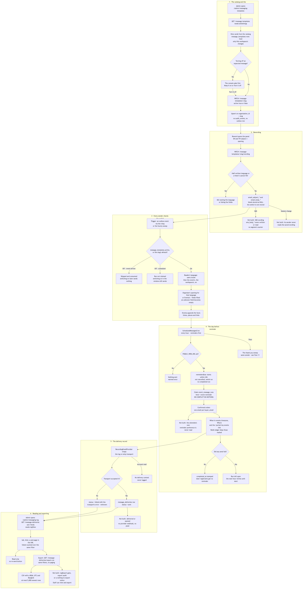
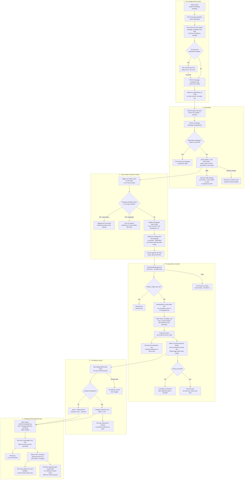

# Automated messages: templates, reminders and the delivery log

**Screens:** Message templates, Delivery log, email

How the messages Eventa sends without anybody pressing Send are controlled and accounted for. It starts on `/admin/messaging-templates`, where an Admin sees the nine automated messages, switches one off or rewrites its opening. It follows those decisions into eventa-worker, where every sender reads them before it mails anybody, and draws the one automated message no other flow covers: the reminder sent the day before an event. It ends on `/admin/messaging-log`, the per-recipient record of what went and what failed, and the CSV export of it. The most important triggered message, the registration confirmation, is drawn in [Free registration and confirmation](03-free-registration-and-confirmation.md). Organizer broadcasts have no switch and are drawn in [Announcements, now and scheduled](10-announcements.md), although they land in the same log. The post-event thank-you shares the reminder's hourly job and is drawn in [Surveys, feedback and NPS](11-surveys-and-feedback.md).

1. **The catalog and the switch.** **Engagement → Messaging → Templates** opens `/admin/messaging-templates`, headed "Message templates". The loader calls `GET /message-templates`, which sits behind `AdminGuard` and `PermissionsGuard` with `setSettings`. In the default role matrix only Admin holds that key; Organizer and Staff get a 403. The sidebar does not hide the page from them, so the API is the only gate. The cards come from `MESSAGE_TEMPLATE_CATALOG` in eventa-api, **not from the table**. The catalog has nine slugs: `registration-confirmation`, `rejection-notice`, `cancellation-notice`, `payment-receipt`, `event-invitation`, `event-reminder`, `session-change`, `waitlist-offer` and `post-event-thankyou`. A template is a trigger the platform owns, so there is no "New template": a message with nothing to fire it would never be sent. `message_templates` holds only a workspace's *deviations*. It is unique on `(organization_id, slug)` (`uq_message_templates_org_slug`) and has deliberately no `event_id`, so a message is on or off for the whole workspace, never per event. An absent row means the catalog's `defaultActive`. That is on for eight messages, so a workspace that has never opened this page still confirms its registrations. It is off for `event-reminder`, because a default of on would start mailing every workspace's attendees about every event, unasked. eventa-worker keeps its own copy of that one exception as the deny-list `OFF_UNTIL_SWITCHED_ON_SLUGS`, and the two must change together, or the card says "Inactive" while attendees are mailed. Each entry's `delivery` is `controlled` (sent, and the sender checks the switch) or `planned` (nothing sends it). All nine are `controlled` today, so every card has a toggle. A `planned` one would read "Not sent yet" instead, and the API would refuse to switch it with a 422, because a switch that moves and changes nothing is worse than none. The toggle posts `PATCH /message-templates/:slug` with a required boolean `active`. There is no "toggle" verb, since flipping an unknown state cannot be safely retried. An unknown slug is a 404. The write is an upsert on `(organization_id, slug)` that sets `active` and `updated_at`; a workspace's first touch also copies the catalog's `title`, `description` and `channels` into the row. Every endpoint here answers with the **whole list**, so a card and its neighbours cannot drift apart after a failed write. Four messages are `expected`, because attendees are entitled to them: the confirmation, the rejection notice, the cancellation notice and the receipt. Turning one of them *off* first opens "Turn off …?" with **Keep it on** / **Turn it off**. That question belongs to the console alone, since the API accepts `active: false` without it, and turning a message *on* is never asked about. Nothing in this step writes an `audit_events` or `outbox_events` row.

2. **Rewording.** Each switchable card has **Reword**, or **Edit wording** once the workspace has written some. It opens a side panel with English / ไทย tabs and two fields, **Subject** (200 characters) and **Opening** (4,000). The organizer writes only the opening. Eventa always appends the part that carries the facts, because an attendee losing their ticket to a rewritten greeting is not a wording choice anybody meant to make. The merge-field chips are the catalog's `tags` for that slug. Clicking one **appends** the field to the end of the opening, not at the cursor as US-MSG-02 describes. Save posts `PATCH /message-templates/:slug/wording` with `{ en: { subject, body }, th: { subject, body } }`. The fields are trimmed, and anything over the length limits is a 400. Beyond capping each box at those lengths, the editor validates nothing itself, because `assertWording` owns the rules and answers each refusal with a 422 sentence of its own. A language left *entirely* empty is accepted and falls back to Eventa's own copy, so nobody has to write Thai to change their English. A half-written language is refused with a sentence naming that language, either a subject with no message or a message with no subject, since it would send a blank where a sentence should be. Any `{{field}}` the slug's `tags` do not list is refused, with each one named. The rejection notice, the invitation and the session change list no tags, so they accept plain text only. Blanks are stored as `NULL` in `email_subject_en`, `email_body_en`, `email_subject_th` and `email_body_th`, never as an empty string, which is how clearing a field restores Eventa's wording. A workspace's first save inserts the row with `active` set to the catalog default, so preparing the reminder's text does not quietly switch it on; after that, rewording never moves the switch. eventa-worker reads the wording at send time, so everything sent after the save uses it, including a trigger that was already queued, and nothing already sent changes. The waitlist offer's wording reaches the offer only: the notice that an offer lapsed obeys the same switch but never reads the wording, so it always goes out in Eventa's words. Two parts are **not built**. SMS wording: `sms_body_en` / `sms_body_th` have existed since migration 0028, but no endpoint writes them and the worker never reads them, so the confirmation's text goes out in Eventa's words, and there is no segment counter. And **Session change** accepts and stores wording, but its sender, `SessionChangedHandler`, never calls `wordingFor`, so that text reaches nobody.

3. **Every sender checks the switch.** All automated mail leaves from eventa-worker, and every sender asks the same shared question: `MessageTemplatesRepository.isActive(organizationId, slug)` reads the row's `active` inside `withTenant`, or `activeWhenUnset(slug)` when there is no row. Event-driven senders consume what `eventa-relay` publishes from `outbox_events`. `registration.confirmed` carries three gated parts. The confirmation email checks its own switch. The confirmation's text additionally needs `sendsOn`, meaning `active` and `channels` containing `sms`. The receipt needs `payment-receipt` **and** `payment_settings.email_receipts`. The other event-driven senders are `registration.rejected` (`rejection-notice`), `events.cancelled` (`cancellation-notice`), `invitation.sent` (`event-invitation`) and `program.session_changed` (`session-change`). `waitlist.offered` and `waitlist.offer_expired` both obey `waitlist-offer`, because somebody never told of an offer should not be told it lapsed. These senders read the switch when the worker *consumes* the trigger, not when the API wrote it. When it is off the sender sends nothing and the trigger is consumed: nothing is held back, so switching the message on again never sends what was skipped. The two scheduled messages behave the other way. They re-read the switch on every hourly sweep, and an off switch does not claim the run, so switching on inside the window still reaches people (step 4). Some mail has no switch at all. `announcement` is the organizer's own broadcast, and `refund-notice` tells a buyer about their money. Account mail, such as a password reset or a verification code, is not the organizer's at all. When a message does go, the reader's language is their attendee account's `users.locale`, then `events.locale`, then `organizations.locale`, then `en`. `pickWording` takes the organizer's subject and opening *for that language*, so a Thai reader gets the organizer's Thai or Eventa's Thai, never the English somebody happened to write. `fill` substitutes the fields, flattening every value to one line so a name cannot inject a second header line. A field with no value becomes empty rather than literal braces, since US-MSG-01 forbids an unfilled personalization field. Note that `{{first_name}}` is filled with the buyer's whole `orders.buyer_name`, because nothing splits out a first name.

4. **The day-before reminder.** `ScheduledMessagesCron` runs `@Cron(EVERY_HOUR)` as the job `scheduled-messages`. Each tick runs `sendReminders()` and then `sendThankYous()`, each in its own try/catch, so a broken reminder sweep cannot stop the thank-yous; a failure is logged and dropped, and the next hour resumes from the data. Both sweeps need `PUBLIC_WEB_URL`. Without it nothing is sent and the worker warns once, because every one of these messages carries a link, and a root-relative link is dead in a mail client. `remindersDue` is literal, deliberately cross-tenant SQL over `events`. It selects events with `start_at` after now and no later than now plus `EVENT_REMINDER_LEAD_HOURS` (24 by default), `status <> 'cancelled'` and `deleted_at IS NULL`, and with no `event_message_runs` row for `kind = 'event-reminder'` that has a `completed_at`. It also applies the workspace's switch, coalesced to off. The switch sits in the query as well as in the sender because an off workspace's events are never claimed. Left in, they would return every hour and fill the batch ahead of workspaces that asked for reminders. The batch is `FEEDBACK_REQUEST_BATCH` (20), borrowed from the thank-you, earliest start first. Reminders only go forwards: an event that has begun is never reminded. An event created, or switched on, at short notice is reminded at the next tick, because somebody who registered this morning for tonight still wants the time and place. `ScheduledSender` re-checks the switch, then claims the run by inserting `event_message_runs` (`organization_id`, `event_id`, `kind`, `requested_at`) with `ON CONFLICT DO NOTHING` on `uq_event_message_runs (event_id, kind)`. That makes the claim a marker rather than a lock, so a crashed run is resumed rather than treated as done. Recipients are `orders` for the event with `status = 'confirmed'` and `deleted_at IS NULL`, grouped by `buyer_email`: one email per buyer address however many tickets they hold. An order that is `pending`, `waitlisted`, `cancelled`, `rejected` or `expired` gets nothing. The attendee's own `reminder` choice in `notification_preferences` is **not built** into this path, because eventa-worker never reads that table. An attendee who switched reminders off in the portal is reminded anyway. The email's subject is "Tomorrow: ‹event›" / "พรุ่งนี้: ‹event›" unless the organizer wrote one. The opening is the organizer's, or "Hi ‹name›," and "A reminder that ‹event› is coming up." Eventa then always adds the **When** line formatted in `events.timezone`, a **Where** line (venue and city, or the online note, omitted rather than printed blank) and `<PUBLIC_WEB_URL>/portal/my-events`. That is why an organizer's greeting can never produce a reminder that no longer says when or where. A Redis ledger, the hash `evt:sent:event-reminder:<event id>`, expiring `IDEMPOTENCY_TTL_SECONDS` (one day) after its latest write, skips anyone already mailed. `completed_at` is stamped **only** when nothing failed. Otherwise the next hour retries the unsent tail, and anyone newly confirmed, until the event starts, after which the run simply stays open. The converse is also true: once a run is complete, somebody who registers in the last 24 hours gets no reminder, only their confirmation. No `outbox_events` row is involved, because the sweep reads the database directly. That reading has one caveat. The sweep's selects, claim and completion run outside `withTenant`, which works only because the worker currently connects as the schema-owning role that row-level security skips; under the non-owning `eventa_app` role it would find no events. The thank-you sweep that follows in the same tick is drawn in [Surveys, feedback and NPS](11-surveys-and-feedback.md).

5. **The delivery record.** Every attendee-facing email goes through `RecordingEmailProvider`, which wraps the configured transport. `EMAIL_PROVIDER` is `log` (the default, which records and drops, and is refused in production) or `smtp`. Wrapping the transport keeps the log's single write site in one place instead of in nine handlers, where "remember to log it" is a rule the tenth would forget. Each recipient of each send becomes one `message_deliveries` row: a broadcast to 1,340 people is 1,340 rows, because "which address bounced?" is a question about individuals. The row carries `organization_id`; `event_id`, which is nullable and has no foreign key; `kind`; `channel = 'email'`; `recipient_email` and `recipient_name`; `status`, either `sent` or `failed`; `error`, in the transport's own words, such as "550 mailbox unavailable"; and `sent_at` in UTC. `kind` is the catalog slug, or `announcement`, `refund-notice` or `waitlist-offer-expired`. It is free text rather than an enum, so a new message type needs no migration in another repo before it can be logged. Texts are logged the same way by `RecordingSmsProvider` with `channel = 'sms'`, filed under the person's email; the phone number is never stored. A failed send is recorded **and rethrown**, so a bounce is never mistaken for a success. A failed *log write* is swallowed, because the email has already gone, and a missing log row is a smaller harm than a duplicate in somebody's inbox. Mail with no delivery context, meaning password resets and verification codes, is never logged, so a colleague cannot read somebody's personal account mail in the workspace log. `status` is what the transport said and nothing more. US-MSG-06's **delivered** and **opened** are not built: they need a provider webhook and a tracking pixel, and the product has neither. On a machine running `EMAIL_PROVIDER=log`, every row reads `sent` although nothing left the box.

6. **Reading the log and exporting it.** **Engagement → Messaging → Delivery log** opens `/admin/messaging-log`. The loader calls `GET /message-deliveries` and `GET /message-deliveries/kinds` together, both behind `AdminGuard` and `regView`, since every row names a person and their address. The filters live in the URL. The **All** / **Needs attention** tab becomes `status=failed`. `kind` is a select that offers only the kinds this workspace has actually sent. `q` matches `recipient_email` or `recipient_name` with `ilike` (at most 120 characters), and `page` and `limit` page server-side (10 a page on screen, at most 100). Rows come newest `sent_at` first. `meta.failed` counts failures over the *same* filter, so "3 of these didn't get through" always describes the rows beneath it, never the whole workspace. The event name comes from a left join to `events` and shows "—" where there is no event; a refund notice, for one, carries no `event_id`. Times render as "Jul 9 · 10:24" in Asia/Bangkok. The log is read-only, with **no re-send**, on purpose: a message failed for a reason, and firing it at the same dead address would look like an action while changing nothing. **Export** fetches `GET /message-deliveries/export.csv` with the bearer token and the same filters minus paging, and saves the result as `eventa-delivery-log.csv`. The file has a UTF-8 BOM, so Thai names open correctly in Excel. Its columns are `Sent (UTC)`, `Sent (Bangkok)`, `Recipient`, `Email`, `Message` (the raw slug), `Event`, `Channel`, `Status` and `Failure reason`. Any cell that starts like a formula is neutralised. The file stops silently at the **5,000** newest rows, with no marker in the file that it was cut. Several things US-MSG-06 and US-MSG-07 ask for are not built. The export needs only the same `regView` as the screen, not `regExport`. Staff hold `regView` by default, so Staff can open and export the log, although both stories deny them. No `audit_events` row records an export. An empty view downloads a header-only file rather than saying there is nothing to export.

Mermaid source

[← All flows](README.md)
