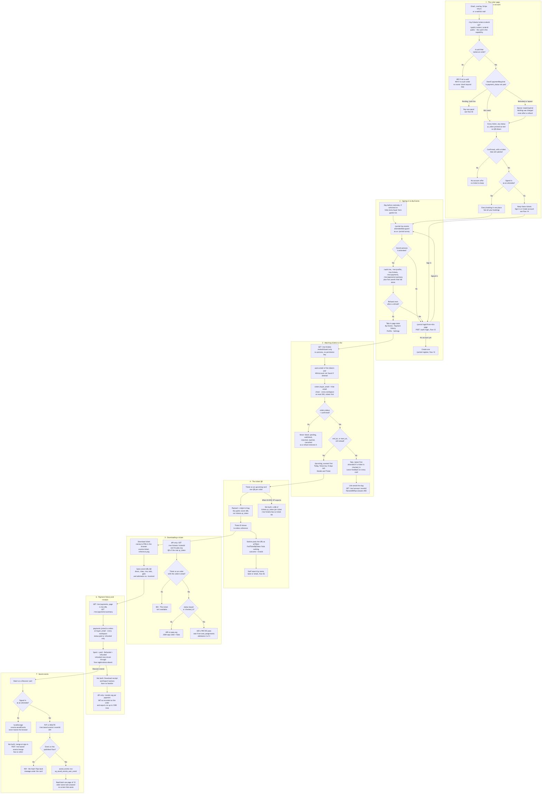

# My tickets and payments, after purchase

**Screens:** Guest order page, Portal sign-in, My Account (My Events, Payment history), Ticket QR modal, Portal Discover

What an attendee can see and keep after booking. It starts at the order page the confirmation email links to, `/my/tickets/orders/:orderId`, which needs no account. It runs through the attendee sign-in to `/portal/my-events`, where bookings from every organizer are gathered by email address, and ends with the ticket QR, the downloadable ticket, the payment history and the hearts on Discover. The booking itself is [Checkout and payment](02-checkout-and-payment.md) or [Free registration and confirmation](03-free-registration-and-confirmation.md). Creating the account offered at the foot of the order page is [Sign-up, confirmation and password reset](14-sign-up-confirm-and-reset-password.md), and what the door does with a code is [Check-in by QR and by hand](06-check-in.md). One fact runs through the whole flow: **no screen built today gives an attendee a code the check-in station can read.** The order page prints the real token as text, and My Events draws a real QR of the wrong thing (steps 1 and 4).

1. **The order page, without an account.** Several things link to `/my/tickets/orders/:orderId`: the confirmation email, the "You're registered!" overlay, the Stripe return URL (`ticketsUrlFor` in the payments service) and the waitlist emails. The route has no guard. Its loader calls `GET /public/orders/:orderId`, which is `@Public()` because registration never required an account and reading what you bought must not either; the order's uuid is the capability. `ParseUUIDPipe` answers 400 to anything that is not a uuid rather than searching for it, and a uuid that names no order gets a 404 "That order could not be found." There is no owner check beyond that: `findGuestOrder` reads the order by id with no tenant and no buyer, so whoever holds an existing order's uuid sees it. The page shows:
   - `orders.reference`, the event, "Booked by" `orders.buyer_name` and the placed date (`orders.created_at`, in Asia/Bangkok);
   - a state banner;
   - the lines from `order_items` with `ticket_types.name`;
   - a discount only when `discount_amount_satang > 0`, so a missing discount is absent rather than `฿0`;
   - "VAT included" from `vat_amount_satang`, and the total.

   An order that is still owed and has a live hold also carries the **Pay now** panel from [Checkout and payment](02-checkout-and-payment.md). Each ticket is a card showing `tickets.holder_name` (or the buyer's name), `ticket_label` (or "Admission") and `tickets.qr_token` **as text**. The component's comment says the app has no QR encoder, but it does: `qrcode-generator`, wrapped in `features/portal/lib/qr.ts` and used by PromptPay and the My Events modal. The station's manual search box invites a "ticket ID", but the API behind it matches only `tickets.holder_name`, `ticket_label` and the two email columns, never `qr_token`, so typing the 24-character code finds nobody and "Show the code below at the door" leaves staff with the name search in [Check-in](06-check-in.md) step 5.

   The page shows refunded orders incorrectly in two ways. First, the API returns every `tickets` row on the order whatever its `status`, and the page never reads that status, so a `refunded` or `void` ticket's code is printed like a live one. Second, **a refunded order is labelled "Expired"**. A refund sets `orders.status = 'cancelled'` and `payment_status = 'refunded'`, and the API sends `paymentRequired = true` because it computes that flag as `payment_status ≠ 'paid'`. The page therefore treats the order as owed and, because the order is not `pending`, as no longer payable. It then replaces the "Cancelled" banner with "Expired" and a notice that ends "Nothing was charged." No test catches it: the mapper's refunded fixture keeps `status = 'confirmed'` and `paymentRequired: false`, a combination the API never sends after a refund, and it asserts only the mapper's own state, while the swap to "Expired" happens in the page, which has no test.

   Apart from the Pay now panel and the account link below, the page writes nothing. Its last card, "Keep these tickets", first asks whether the booking's address already has an attendee account. If it has, the card offers only **Sign in**, which goes to `/portal/login?from=` this page so the attendee returns here rather than to My Events. If not, it offers **Create account** and "Not now — your ticket is already in your email". Create account asks for no password and creates nothing here: it has a one-time link emailed to the booking's address, and the account is made only from that link, so whoever made the booking cannot make it for somebody else's address (see [flow 14](14-sign-up-confirm-and-reset-password.md) step 4). Nothing in My Events links back to this page, so this is the only screen where an attendee ever sees a real `qr_token`.

2. **Signing in to My Events.** `/portal/my-events` needs an attendee account; the route manifest's comment calls it the one portal route that does, but `/portal/survey` is wrapped the same way ([Surveys, feedback and NPS](11-surveys-and-feedback.md)). Its loader is wrapped in `attendeeData`, which checks the persona label the browser stored at sign-in before it fetches anything. If the label is not `attendee`, the loader redirects to `/portal/login?from=<this page>`; it never sends the attendee to the organizer sign-in, which would ask for a workspace they do not have. A token the API still refuses after a refresh is redirected the same way. Signing in is `POST /auth/login` with no `orgSlug`, exactly as in [Sign-in, roles and permissions](12-sign-in-roles-and-permissions.md). Afterwards `safeRedirect` honours a same-site `?from=` and otherwise falls back to `/portal/my-events`. An attendee who is already signed in and presses **Sign in** on Discover is sent straight on by `guestOnly('attendee')`.

   Two entry points assume an account the person may not have:
   - `/portal/login` links only to Discover and to the attendee forgot-password form. **Not built: a sign-up link on the attendee sign-in**, which US-DISC-08 asks for.
   - eventa-worker's day-before reminder ([Automated messages](22-automated-messages.md)), in a workspace that has switched it on (it is off until then), goes to every confirmed order's `buyer_email`, guests included, and its link is `<PUBLIC_WEB_URL>/portal/my-events`. A guest is therefore sent to a sign-in they cannot pass instead of to their order page.

   The loader makes five reads the page cannot render without: `GET /auth/me`, `GET /me/profile`, `GET /me/tickets`, `GET /me/payments` and `GET /me/payments/summary`. If any of them fails, the page fails. Four more reads are optional and each degrades on its own: `/me/notification-preferences`, `/me/two-factor`, `/me/sessions` and `/me/account/deletion`. The four tabs (My Events, Payment history, Profile, Settings) are component state, not part of the URL, so a reload always opens My Events. Profile and Settings are covered in [Profile, preferences and deleting an account](16-profile-preferences-and-account-deletion.md) and [Account security](15-account-security.md).

   On the API, every `/me/tickets`, `/me/payments` and `/me/saved-events` route sits behind only the global `JwtAuthGuard`, with no permission key and no persona check. An organizer token for the same address would get the same answer; the attendee-only rule is enforced by the browser's guard, not the API. Sign-out is a real `POST /auth/logout` followed by clearing the stored session.

3. **Matching tickets to the account.** `GET /me/tickets` takes no id. The service reads the caller's `users.email` from the token's user (a deleted user gets a 404 "Account not found."). It then selects `orders` where `buyer_email` equals that address, `status = 'confirmed'` and `deleted_at` is null, joined to `events` and, through `order_items`, to `ticket_types.name`. **The query covers every workspace and has no `organization_id` in it**, because an attendee's bookings span every organizer and the account lives in the platform organization rather than in any of them. Both columns are `citext`, so `Anan@Example.com` typed at checkout matches `anan@example.com` on the account.

   The email address is the only link between orders and the account. No `orders` column points at the buyer's `users` row (`attendee_id` is the workspace's CRM record, not the account, and `created_by`, `decided_by` and `offered_by` name staff). This is safe only because an account cannot sign in until its confirmation email has been opened ([flow 14](14-sign-up-confirm-and-reset-password.md)), so whoever sees these orders has proved they own the address the buyer typed. A changed address takes over only once its confirmation link is opened. That link lands on `/confirm-email`, which does not exist in the web app ([flow 16](16-profile-preferences-and-account-deletion.md)), so in practice the match stays on the address the account was created with.

   Only `confirmed` orders are listed. An order awaiting payment or approval, on the waitlist, `rejected`, `expired` or `cancelled` never appears. A refund sets the order to `cancelled` ([Refund and cancellation](07-refund-and-cancellation.md)), so it removes the booking from My Events while its payment stays in the history. The query is capped at 200 orders, taken oldest `start_at` first, so for anyone past the cap it is the latest-starting events, the upcoming ones included, that are dropped.

   Each row is an order, not a ticket. `ticketCount` is `orders.seats`, which the card does not show, and `attended` is true when any of the order's `tickets` has `status = 'checked_in'`. Orders are split in two:
   - **Upcoming** holds orders whose event `end_at` (or `start_at` when there is no end) has not passed, soonest first, so an event stays upcoming while it is under way.
   - **Past** holds the rest, latest first.

   The countdown is the API's own phrase, "Today", "Tomorrow" or "N days left", counted in whole Bangkok calendar days and clamped at zero; it is null once the event is past. An upcoming card shows the cover, the countdown, the tier name (or "—" if the tier was deleted), the start time in the event's own `timezone`, the venue and city or "Online event", a lazily loaded Google Maps embed, **Details** to the public page `/e/:slug`, and **Ticket**. A past card is greyed out and shows "Attended" only when a ticket was scanned in. It offers **Leave feedback** (`/portal/survey?event=slug`) on every past card, whether or not the person came and whether or not a survey is open. The story asks for that link only while feedback is open. In the code the link does not reach a survey at all: it carries the event's slug, the survey page's loader passes that value to `GET /me/surveys/:eventId`, and that route's `ParseUUIDPipe` answers 400, so the page shows its error screen. The thank-you email's link does not hit this, because eventa-worker builds it with the event id ([Surveys, feedback and NPS](11-surveys-and-feedback.md)).

   These reads set no `app.current_org`. They return rows only because the development API connects as `eventa`, the owning superuser, which bypasses row-level security. Migration 0002 says staging and production should connect as `eventa_app`; under that role `orders`, `tickets`, `payments` and `users` would all return nothing here, and the same applies to the order page in step 1.

4. **The ticket QR, and what it actually encodes.** **Ticket** on an upcoming card opens a modal that is drawn entirely in the browser. `/me/tickets` returns no ticket ids and no tokens, so the page has nothing from the ticket itself to encode. The payload it passes to the encoder is `${window.location.origin}/e/${slug}`: **the public event page's URL, not `tickets.qr_token`**. The "Ticket ID" shown under it is `orders.reference`. There is one QR per order however many tickets the order holds, and every buyer of the same event gets the same QR.

   At the door, the station's `BarcodeDetector` reads that URL and posts it as `qrToken` to `POST /events/:eventId/check-ins/scan`. It passes the DTO (any string up to 256 characters), `findTicketByToken` finds no ticket, and the answer is `outcome = invalid`. "Show this code at check-in" therefore admits nobody, and staff fall back to searching by name, label or email ([Check-in](06-check-in.md) step 5). **Not built: a per-ticket QR of `tickets.qr_token` in My Events.**

   US-DISC-07 also expects a refunded or voided ticket to open as "no longer valid". The code does something different. A refunded order is dropped from the list entirely (step 3). When one ticket inside a confirmed order is voided or transferred, the order's card and QR stay unchanged, because the list reads ticket statuses only to set `attended`.

   Taken together with step 1, no built screen gives an attendee anything the door can scan:
   - the order page has the real code, but only as text;
   - My Events has a QR, but of the event URL;
   - the confirmation email deliberately carries no token ([flow 03](03-free-registration-and-confirmation.md) step 4);
   - the station reads only QR images.

5. **Downloading a ticket.** **Download ticket** in the modal paints a 1180×480 "concert stub" onto a canvas at twice that resolution and saves it as `eventa-ticket-<reference>.png`. Nothing is fetched and nothing is written. Its QR is the same event URL. The event name, date and venue are real. No holder name is printed at all: the account's name is passed in as `attendee`, but `buildFlyer` never draws it. Everything else US-DISC-07 lists is invented in the browser:
   - "doors open" is the start time minus 30 minutes;
   - the class is "VIP" when the tier name contains "vip" and "GA" otherwise, with a matching "vip experience" or "live concert" tagline;
   - row and seat read "GA" for any ticket that is not VIP;
   - the gate letter and "Admission no." are derived from a sum of the venue line's character codes. The code also reads a third dash-separated segment of the order reference, which an `ORD-XXXXXXXX` reference never has, so every ticket at the same venue prints the same gate and admission number.

   Nothing comes from `seat_assignments` or `tickets`. The title font, Titan One, is requested from Google Fonts as soon as My Events renders, because the modal is mounted with the page and injects the stylesheet on mount.

   The real pass exists on the API and nowhere else:
   - **API-only: `GET /me/tickets/:ticketId`** returns a `TicketPassDto` with `qrToken`, `status`, `valid` (true for `issued` and `checked_in`), `holderName` and `ticketLabel`. It also returns an `admissionNumber` such as "2 of 3" (the ticket's position among its order's tickets, ordered by id), and the seat from the live `seat_assignments` row (`released_at` null) joined to `seats`.
   - **API-only: `GET /me/tickets/:ticketId/pass.svg`** renders a 600×940 SVG attachment named `ticket-pass.svg`. It shows the event, the start in the event's timezone, the venue, the ticket label, the seat or "General admission", a QR of `tickets.qr_token` at error-correction level M, the order reference and the admission line.

   Ownership is checked by lookup: the ticket must belong to an order whose `buyer_email` is the caller's address. Someone else's ticket and a ticket that does not exist get the same 404 "This ticket isn't available.", and a non-uuid id gets a 400 from `ParseUUIDPipe`. For a ticket that is `void`, `refunded` or `transferred`, the SVG route answers 409 "This ticket is no longer valid and cannot be downloaded as a pass.", while the JSON route still answers with `valid = false`. No screen calls either route, and none could, since the list in step 3 carries no ticket ids. [Check-in](06-check-in.md) step 2 describes the same gap from the door's side.

6. **Payment history and receipts.** The second tab reads `GET /me/payments` and `GET /me/payments/summary`. The `page` and `limit` come from the URL: the page offers 10, 20, 30 or 50 and treats any other value as 10, while the API defaults to 20 and refuses more than 100 with a 400. The identity rule is the same as in step 3: `payments` joined to `orders` on `buyer_email`, across every workspace, newest `paid_at` first. **Only rows with `payments.status` `paid` or `refunded` are listed**; a `pending` or `failed` attempt never charged anyone and is not a transaction. A free registration creates no `payments` row and so never appears here at all; with no history, the tab hides its tiles and shows an empty state ("Tickets you pay for are listed here…").

   The three tiles are:
   - **Total spent**: the sum of `amount_satang` over `paid` rows.
   - **Transactions**: the count of both kinds.
   - **Refunded**: the sum over `refunded` rows.

   A settled refund moves the whole `payments` row to `refunded`, so refunded money drops out of "spent" because of how the rows are stored, not because anything is subtracted. The refunded row is struck through and given a red "Refunded" badge. Each row shows the event, `orders.reference`, the `paid_at` date in Asia/Bangkok, the API's formatted amount, and `payments.method` as stored (`Card`, `PromptPay`, `Bank transfer`, `Apple Pay` or `Google Pay`). No masked card number is shown, because `payments` has no column to hold one.

   **Not built: the Export button and each row's Download receipt button**, which render with no handler. The API has both endpoints:
   - **API-only: `GET /me/payments/:paymentId/receipt.svg`** is a VAT receipt. It names the organizer with `organizations.address` and `tax_id`, uses `orders.reference` as "Invoice no." (not an `invoices.number`), and shows the buyer and the date. Its VAT split reproduces `orders.vat_amount_satang` as recorded at purchase rather than recomputing it, and only the printed percentage comes from `organizations.vat_rate` (7% when unset). A refunded payment gets a red REFUNDED banner. A missing payment and another buyer's payment both get the same 404 "This receipt isn't available."
   - **API-only: `GET /me/payments/export.csv`** returns every transaction, up to 1,000 rows, as `date,reference,event,method,status,amount_baht,vat_baht`. Only the event name is quoted, against commas, quotes and newlines, and nothing guards a leading `=`, `+`, `-` or `@`, so an event name that starts with one of those opens in a spreadsheet as a formula.

   The only receipt an attendee actually receives is the one eventa-worker emails after a paid order, when the workspace has receipts switched on ([Checkout and payment](02-checkout-and-payment.md) step 5).

7. **Saved events.** The heart on a Discover card is the whole feature, and it works differently for guests and signed-in attendees.
   - **Without an attendee session**, the shortlist is kept in `localStorage` under `eventa.savedEvents`. It never leaves the browser, and a corrupt entry reads as nothing saved.
   - **With an attendee session**, the heart sends `PUT /me/saved-events/:eventId` or `DELETE /me/saved-events/:eventId`, and both answer 204. Saving twice is harmless because `uq_saved_events_user_event` allows one `saved_events` row per user and event, and unsaving something never saved does nothing. Before saving, the API checks the event against Discover's published floor (`visibility = 'public'`, `published_at` set, not deleted, `status` `planned`, `upcoming` or `live`), so a save can never become a handle on a private event. A failed check is a 404 "This event isn't available." The heart flips as soon as it is pressed; on a refusal it flips back and shows the API's sentence under the card.

   `saved_events` is keyed by `user_id`, with no `organization_id` and no row-level security, because one person's saves span every workspace. Reading the saves back is weaker than writing them. Discover's loader calls `GET /me/saved-events` with no query, and the API returns its default page of 12, newest `saved_at` first. Only the twelve most recent saves light up their heart, so an older save looks unsaved even though it is still stored. The list also drops events that have left the published floor but still counts them in its total. **No screen lists saved events**: My Account has no Saved tab, and the full cards the endpoint returns are reduced to ids for the hearts.

   **Not built: merging a guest's saves at sign-in.** `POST /me/saved-events/merge` exists: it takes up to 100 ids, removes duplicates, quietly drops unpublished events, and answers with a `merged` count. Two comments refer to it, but nothing calls it. As a result, the local list is ignored while the attendee is signed in and comes back after they sign out. Nothing in eventa-worker reads `saved_events`, so saving an event never triggers a reminder. Apart from signing in and out and the Pay now panel, which belong to flows 12 and 02, nothing in this flow writes to the database except `saved_events`, and nothing in it writes an `outbox_events` row.

```mermaid
flowchart TD
  subgraph ONE["1 · The order page, without an account"]
    A1["Email, overlay, Stripe return<br/>or a waitlist mail"] --> A2["/my/tickets/orders/orderId<br/>GET /public/orders/:orderId<br/>public · the uuid is the capability"]
    A2 --> A3{"A uuid that<br/>names an order?"}
    A3 -- "No" --> A4["400 if not a uuid<br/>404 if no such order<br/>no owner check beyond that"]
    A3 -- "Yes" --> A5{"Owed? paymentRequired<br/>is payment_status not paid"}
    A5 -- "Pending, hold live" --> A6["Pay now panel<br/>see flow 02"]
    A5 -- "Refunded or lapsed" --> A7["Banner reads Expired<br/>Nothing was charged<br/>even after a refund"]
    A5 -- "Not owed" --> A8["Every ticket, any status<br/>qr_token printed as text<br/>no QR drawn"]
    A7 --> A8
    A6 --> A9["Keep these tickets<br/>Sign in or Create account"]
    A8 --> A9
  end

  subgraph TWO["2 · Signing in to My Events"]
    B1["/portal/my-events<br/>attendeeData guard<br/>as on /portal/survey"] --> B2{"Stored persona<br/>is attendee?"}
    B2 -- "No" --> B3["/portal/login?from=this page<br/>POST /auth/login, flow 12"]
    B3 -- "No account yet" --> B4["Not built: a sign-up link<br/>on the attendee sign-in"]
    B3 -- "Signed in" --> B1
    B2 -- "Yes" --> B5["/auth/me, /me/profile, /me/tickets,<br/>/me/payments, /me/payments/summary<br/>plus four panels that fail alone"]
    B5 --> B6{"Refused even<br/>after a refresh?"}
    B6 -- "Yes" --> B3
    B6 -- "No" --> B7["Tabs in page state<br/>My Events · Payment history<br/>Profile · Settings"]
    B8["Day-before reminder, if switched on<br/>links every buyer here<br/>guests too"] --> B1
  end

  subgraph THREE["3 · Matching tickets to the account"]
    C1["GET /me/tickets<br/>JwtAuthGuard only<br/>no persona, no permission key"] --> C2["users.email of the token's user<br/>404 Account not found if deleted"]
    C2 --> C3["orders.buyer_email = that email<br/>citext · every workspace<br/>at most 200, oldest first"]
    C3 --> C4{"orders.status<br/>= confirmed?"}
    C4 -- "No" --> C5["Never listed: pending, waitlisted,<br/>rejected, expired, cancelled<br/>so a refund removes it"]
    C4 -- "Yes" --> C6{"end_at, or start_at,<br/>still ahead?"}
    C6 -- "Yes" --> C7["Upcoming, soonest first<br/>Today, Tomorrow, N days left<br/>Details and Ticket"]
    C6 -- "No" --> C8["Past, latest first<br/>Attended if a ticket is checked_in<br/>Leave feedback on every card"]
    C8 --> C9["Link sends the slug<br/>GET /me/surveys/:eventId<br/>ParseUUIDPipe answers 400"]
  end

  subgraph FOUR["4 · The ticket QR"]
    D1["Ticket on an upcoming card<br/>one QR per order"] --> D2["Payload = origin/e/slug<br/>the public event URL<br/>not tickets.qr_token"]
    D2 --> D3["Ticket ID shown<br/>is orders.reference"]
    D3 --> D4["Station posts the URL as qrToken<br/>findTicketByToken finds nothing<br/>outcome = invalid"]
    D4 --> D5["Staff search by name,<br/>label or email, flow 06"]
    D1 -- "What US-DISC-07 expects" --> D6["Not built: a QR of<br/>tickets.qr_token per ticket<br/>/me/tickets has no ticket ids"]
  end

  subgraph FIVE["5 · Downloading a ticket"]
    E1["Download ticket<br/>canvas to PNG in the browser<br/>eventa-ticket-reference.png"] --> E2["Same event-URL QR<br/>doors, class, row, seat, gate<br/>and admission no. invented"]
    E3["API-only: GET /me/tickets/:ticketId<br/>and its pass.svg<br/>QR of the real qr_token"] --> E4{"Ticket on an order<br/>with the caller's email?"}
    E4 -- "No" --> E5["404 · This ticket<br/>isn't available"]
    E4 -- "Yes" --> E6{"status issued<br/>or checked_in?"}
    E6 -- "No" --> E7["409 on pass.svg<br/>JSON says valid = false"]
    E6 -- "Yes" --> E8["600 x 940 SVG pass<br/>seat from seat_assignments<br/>Admission 2 of 3"]
  end

  subgraph SIX["6 · Payment history and receipts"]
    F1["GET /me/payments, page in the URL<br/>GET /me/payments/summary"] --> F2["payments joined to orders<br/>on buyer_email · every workspace<br/>status paid or refunded only"]
    F2 --> F3["Spent = paid · Refunded = refunded<br/>refunded rows struck through<br/>free registrations absent"]
    F3 --> F4["Not built: Download receipt<br/>and Export buttons<br/>have no handler"]
    F4 --> F5["API-only: receipt.svg per payment<br/>VAT as recorded on the order<br/>and export.csv up to 1000 rows"]
  end

  subgraph SEVEN["7 · Saved events"]
    G1["Heart on a Discover card"] --> G2{"Signed in<br/>as an attendee?"}
    G2 -- "No" --> G3["localStorage<br/>eventa.savedEvents<br/>never leaves the browser"]
    G3 --> G4["Not built: merge at sign-in<br/>POST /me/saved-events/merge<br/>has no caller"]
    G2 -- "Yes" --> G5["PUT or DELETE<br/>/me/saved-events/:eventId<br/>204"]
    G5 --> G6{"Event on the<br/>published floor?"}
    G6 -- "No" --> G7["404 · the heart flips back<br/>message under the card"]
    G6 -- "Yes" --> G8["saved_events row<br/>uq_saved_events_user_event"]
    G8 --> G9["Read back one page of 12<br/>older saves look unsaved<br/>no screen lists saves"]
  end

  A9 -- "Sign in" --> B3
  B7 --> C1
  C7 --> D1
  D3 --> E1
  E2 --> F1
  F3 -- "Discover events" --> G1
```

Mermaid source

[← All flows](README.md)
