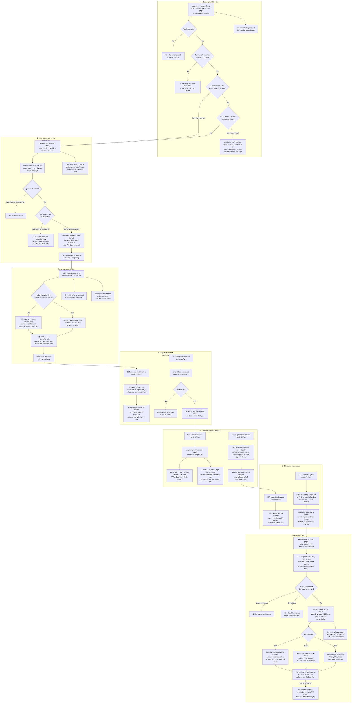

# Reports, filters and exports

**Screens:** Insights Overview, Income, Transactions, Payouts, Registrations, Attendance, Discounts, Event performance

How an organizer reads the workspace back to themselves and takes the numbers away. It starts in the console's **Insights** module — the Overview at `/admin/reports` and seven report pages that share one filter and one window — and ends with a CSV, Excel or PDF file saved by the browser. Everything here is read-only: no route in the `reports` module writes a row or an `outbox_events` row, and eventa-worker plays no part, so the figures are only as good as the flows that produce them — [Checkout and payment](02-checkout-and-payment.md) and [Refund and cancellation](07-refund-and-cancellation.md) for money, [Check-in by QR and by hand](06-check-in.md) for attendance, [Discount codes](19-discount-codes.md) for payback, and [Payouts and balances](09-payouts.md), which is why one of the eight is always empty. Which reports a member may open is decided by the keys in [Sign-in, roles and permissions](12-sign-in-roles-and-permissions.md).

1. **Opening Insights, and who may.** The Insights rail opens `/admin/reports`, and its panel groups the seven report pages as Financial (`/admin/reports-income`, `/admin/reports-transactions`, `/admin/reports-payouts`), Attendees (`/admin/reports-registrations`, `/admin/reports-attendance`), Marketing (`/admin/reports-discounts`) and Events (`/admin/reports-events`). Each loads through `pageData`, so an expired session goes to sign-in, and every `/reports/*` route sits behind `AdminGuard` — an attendee token is a 403 "Organizer console access requires an admin account." — and `PermissionsGuard`. The key follows the data, not the word "report": `regView` for the overview, event performance, registrations and attendance; `finView` for income, transactions, payouts and discounts. A member without `finView` is refused the four money reports with a 403 "Missing required permission: finView.", which the route's error screen shows as "You don't have access to this". **Not built: hiding a report a member cannot open** — `app/navigation.ts` lists all eight to everybody, where US-RPT-12 asks for the option to be hidden or disabled. Worse, Staff cannot open the two reports they are entitled to. The seven report loaders fetch the event picker's options with `GET /events` (the 100 most recent) in the same `Promise.all` as the report; that route needs `evCreate`, which the default Staff role (`regView`, `regCheckin`, `evProgramView`) does not hold, and the rejection fails the whole loader. So Staff get the forbidden screen on Registrations and Attendance although `/reports/registrations` and `/reports/attendance` would answer them, against US-RPT-08's "I can view it fully" — and on Event performance too, whose loader fetches the same options although its page shows no picker. Only the Overview, which has no picker, opens for Staff; Organizer and Admin hold every key involved.

2. **One filter, kept in the address bar.** Every report takes `ReportFilterQueryDto`: `from` and `to` as Bangkok calendar days `YYYY-MM-DD`, `range` (`7d`, `30d`, `90d`, `year`; default `year`), `eventId` (a uuid), `q` (trimmed, at most 120 characters), `page` (from 1) and `limit` (1–100, default 20); event performance alone adds `status` — `upcoming`, `live`, `completed` or `cancelled`. The global validation pipe whitelists and forbids anything else, so a malformed day, a bad uuid or an unknown parameter is a 400 before any report runs. The window is resolved once, by `resolveReportPeriod`, for all eight, because US-RPT-12 requires the reports to agree and two reports each deciding what "last 90 days" means would disagree at the boundary. Explicit days win over `range`; a half-open pair is a 422 "Dates must be calendar days, as YYYY-MM-DD" rather than a guess; an end two or more days before the start is a 422 "End date must be on or after the start date", though an end exactly one day before it is not refused — the exclusive end then equals the start — and comes back as an empty zero-day window; the window runs from Bangkok midnight on `from` to the midnight *after* `to`, end exclusive, so the last day is whole; and a span over `MAX_SPAN_DAYS` (731) is trimmed from the far end — somebody asking for four years of income wants the two recent ones — with `period.trimmed = true` echoed back. `year` is the trailing 365 days ending tonight, not the calendar year. Each report also gets the equal window immediately before, for its change chips, and a null on either side claims no comparison and renders "—". On screen the loader reads `page`, `limit` (10, 20, 30 or 50; default 10), `eventId`, `q`, `range`, `from` and `to` from the query string and nothing from component state, because the API filters and pages server-side and the URL is then the single source of truth. `ReportFilters` is a search box, debounced 300 ms and replacing history rather than adding an entry per keystroke, and an `EventPicker` whose "All events" drops `eventId`; any change drops `page`, a page past the end redirects to the last real one, and "Showing 1–10 of N" comes from the API's matched count rather than the rows. **Not built: a date control on the seven report pages.** `range`, `from` and `to` are honoured when typed into the address bar, but nothing on screen sets them or shows `period` and its `trimmed` flag, so in practice every report page runs on the trailing year — and the empty state's "Widen the date range" points at a control that does not exist. The Overview has only a 7 days / 30 days / 90 days / Year pill bar writing `?range=`, and sends that alone: its `eventId` and `q` are **API-only**, and its "View all" link to `/admin/reports-events` drops the range. Event performance has a search and a stage select but no event picker.

3. **The overview, with the money withheld.** `GET /reports/overview` carries money but is gated on `regView`, because the money is withheld *inside* the service: it reads the caller's keys with `PermissionsService.getFor` and decides on `finView` **before** fetching anything, so a reader who may not see the figures never has them read into the process to be hidden afterwards. Without `finView`, `revenueSatang`, `averageTicketSatang` and `refundRate` come back `null` together, and so does the trend, `revenue`: the tiles render "—", never `฿0` — "you may not see this" is a different fact from "it earned nothing" — and the chart panel says "Revenue is only shown to members with finance access." With it, five tiles each carry a change against the previous window, coloured by whether the move is good for that metric, so a falling refund rate is green. **Registrations** is confirmed seats — `sum(orders.seats)` where `status = 'confirmed'`, windowed on `orders.registered_at` — because counting cancelled orders would make the tile rise as people withdrew; **attendance rate** is `tickets` with `checked_in_at` over live tickets (`issued` or `checked_in`) at events whose `start_at` has passed; **revenue** is income's `net` (step 5) from the same SQL expression; **average ticket** is gross over paid seats and **refund rate** refunds over gross. The trend buckets Bangkok days by day up to 31 days, by week up to 120 and by month beyond, zero-filled from the window so a quiet day draws at ฿0 rather than a gap, though on screen a window whose net is not above ฿0 shows "No revenue in this period." in place of the chart; the ticket-type donut sums `order_items.quantity` of confirmed orders; Top events is a second call, `GET /reports/events` with the range and `limit=6`. **Not built: sales by channel** — no source, channel or UTM column exists, so the panel is absent rather than invented. **Event performance** (`/admin/reports-events`) withholds money the same way, row by row. The page of events is ranked first, by confirmed seats, driven from `events` with correlated subqueries so an event nobody registered for is still listed, last; only then, and only for a `finView` holder, is net revenue fetched for that page's events by id — all-time rather than windowed on `paid_at`, since this report windows on `events.start_at` and an event's revenue is its revenue. A missing entry is a real ฿0; a withheld one is "—". Drafts and soft-deleted events are left out, and the stage is derived from the clock — `cancelled` wins, then `upcoming` before `start_at`, `live` until `end_at` (a day after the start when there is none), else `completed` — because `events.status` is never advanced after publishing and would badge last year's conference "upcoming". Attendance is null while an event is `upcoming` or when it has no live tickets, and an event's name opens `/admin/event-detail`. US-RPT-12 lists event performance among the finance reports Staff should not see; the code serves it under `regView` with revenue masked instead, though the default Staff role never reaches the screen, whose loader fails on the picker fetch (step 1).

4. **Registrations and attendance.** Both need `regView`, both return one row per event, and both sum their totals over the whole filter rather than the page, so the tiles do not move as the reader pages. `GET /reports/registrations` counts **seats**, not orders, from `orders` (soft-deleted ones excluded), windowed on `orders.registered_at` because the report answers "what came in during this period", and splits them into `confirmed`, `pending`, `waitlisted`, `cancelled` and `rejected` plus a `total` of every state — `expired` included, the order eventa-worker's `order-expiry` job closes when its seat hold lapses unpaid, which has no column of its own; the search matches the event name, rows rank by total, and the chips read more-is-better except for cancelled and rejected. The screen's table has no Rejected column (the export carries one) and neither has an Expired column, so where an event has rejected or expired orders its columns do not add up to its total as US-RPT-08 expects, and the overview's Registrations tile — confirmed seats — matches this report's Confirmed tile, not the Total that US-RPT-12 compares it with. `GET /reports/attendance` reads the ticket read model rather than the `check_ins` log, so registered and arrived come from one scan of one table and cannot disagree: live `tickets` (`issued` or `checked_in`, not deleted), windowed on the **event's** `start_at`, because attendance for July means the events that ran in July and a window on the scan time would split one event across two reports. Each row carries registered, checked in (`checked_in_at` set) and on time (checked in at or before `events.start_at`); no-shows, attendance rate and on-time rate exist only once the event has started, and before that render "—", because nobody has failed to arrive yet. The overall rate counts started events only, while the Checked in tile counts every check-in in the window.

5. **Income and transactions.** Both need `finView`, and each reaches its data through a port Reports declares and the owning module implements — `IncomeReportAdapter` and `TransactionLedgerAdapter` in Payments — so a column changing in Payments cannot silently break a report, and the overview's revenue and the income report's net are one expression rather than two kept in step. `GET /reports/income` scans `payments` with `status = 'paid'`, windowed on `paid_at` and joined to `orders` and `events` (the search matches the event name), and per event returns **gross** `sum(amount_satang)`, **VAT** `sum(orders.vat_amount_satang)`, **refunds** — the `refunds.amount_satang` raised against each payment, summed per payment so a payment with two refunds is not counted twice — **fees** `sum(payments.fee_amount_satang)`, **net** = gross − VAT − refunds, and **settled** = net − fees, the figure to reconcile against the bank. Rows rank by net, and VAT's change carries no colour because it was never the organizer's to gain or lose. The screen shows Gross, Refunds, Fees and Net only — VAT and Settled reach the reader only in an export — so Net on screen does not equal Gross − Refunds − Fees as US-RPT-05 expects, and the overview's revenue is not the VAT-inclusive figure US-RPT-01 describes. The `status = 'paid'` scan has two further effects: a refund that **succeeds** flips its payment to `refunded` (see [Refund and cancellation](07-refund-and-cancellation.md)), which drops the whole payment from the scan, so its gross vanishes from every past window instead of a refund appearing and the Refunds column and the overview's refund rate only ever hold refunds still `pending` or `failed`; and because the refund sum has no `refunds.status` condition, a refund the provider refused still lowers net. `GET /reports/transactions` is a `UNION ALL` of two legs in one CTE shared by the page and the totals: every payment, dated `coalesce(paid_at, created_at)` with outcome `succeeded`, `refunded`, `pending` or `failed`; and every refund, dated `issued_at` with its own `status` and a reference derived as `<txn>-R1`, `-R2`, since `refunds` has no human one. Amounts stay positive with `kind` saying which way, and the screen adds the minus; the search matches `payer_name` or `txn`. The tiles are entries; Payments, every non-failed charge summed, pending and refunded included; refunds counted; and success rate, non-failed charges over all attempted, null when nothing was attempted. A reference links to `/admin/payments?q=<reference>`, where refunds are issued — the report never moves money.

6. **Discounts and payouts.** Both need `finView`. `GET /reports/discounts` is driven from `discount_codes` through Discounts' adapter, so a scheduled code nobody has used still has a row at zero. A code is listed when its `valid_from`/`valid_until` overlaps the window (no dates always overlaps), but its figures are **lifetime** — a March campaign has a March payback, and counting only the last 30 days would report every finished promotion as achieving nothing — which is also why the tiles carry no change chip. Redemptions, discount given (`sum(discount_redemptions.amount_satang)`) and orders influenced (`sum(orders.total_satang)`, after the discount) count confirmed orders only. Standing is derived from the clock — `disabled` wins, then `scheduled`, `expired`, else `active` — rather than read from `status`, which is settled only as a side effect of listing codes on another screen, and `revenue_attributed_satang` is deliberately not read because nothing writes it. An event filter keeps the all-events codes and narrows their figures to that event; the search matches the code; return is influenced over discount, null when nothing was given away. `GET /reports/payouts` reads `payouts` and `payout_items` through Payouts' adapter, mapping `paid` to Paid, `processing` to In transit and `scheduled` to Pending, and leaves `failed` out of rows and tiles alike — that belongs on Finance Payouts with its retry. A payout is dated `coalesce(completed_at, requested_at)`; the events it covers are gathered through `payout_items` → `payments` → `events`, so it matches a filter on any of them and still lists them all; `bank_account` is masked by `maskAccount`; and the search matches the reference or a covered event's name, never the bank account, which would let a search confirm digits the screen may not show. **Not built: recording a payout, so this report is empty in every workspace.** Nothing in eventa-api or eventa-worker inserts a `payouts` or `payout_items` row (see [Payouts and balances](09-payouts.md)), so the page always shows "No payouts in this period" — "No payouts for this selection" once filtered — with ฿0 tiles and "—" for the average.

```mermaid
flowchart TD
  subgraph OPEN["1 · Opening Insights, and who may"]
    A1["Insights in the console nav<br/>Overview and seven report pages<br/>listed to every member"] --> A2{"Admin persona?"}
    A2 -- "No" --> A3["403 · the console needs<br/>an admin account"]
    A2 -- "Yes" --> A4{"The report's own key?<br/>regView or finView"}
    A4 -- "No" --> A5["403 Missing required permission<br/>screen: You don't have access"]
    A4 -- "Yes" --> A6{"Loader fetches the<br/>event picker's options?"}
    A6 -- "Yes" --> A7{"GET /events answers?<br/>it needs evCreate"}
    A7 -- "No · default Staff" --> A8["Not built: Staff opening<br/>Registrations, Attendance or<br/>Event performance · the<br/>picker's 403 fails the page"]
    A1 --> A9["Not built: hiding a report<br/>the member cannot open"]
  end

  subgraph FILTER["2 · One filter, kept in the address bar"]
    B1["Loader reads the query string<br/>page · limit · eventId · q<br/>range · from · to"] --> B2["Search debounced 300 ms<br/>event picker · any change<br/>drops the page"]
    B2 --> B3{"Query well formed?"}
    B3 -- "Bad shape or unknown key" --> B4["400 Validation failed"]
    B3 -- "Yes" --> B5{"Days given make<br/>a real window?"}
    B5 -- "Half-open or backwards" --> B6["422 · Dates must be calendar days<br/>or End date must be on<br/>or after the start date"]
    B5 -- "Yes, or a named range" --> B7["resolveReportPeriod once for all<br/>Bangkok days · end exclusive<br/>over 731 days trimmed"]
    B7 --> B8["The previous equal window<br/>for every change chip"]
    B1 --> B9["Not built: a date control<br/>on the seven report pages<br/>they run on the trailing year"]
  end

  subgraph OVER["3 · The overview, with the money withheld"]
    C1["GET /reports/overview<br/>needs regView · range only"] --> C2{"Caller holds finView?<br/>checked before any fetch"}
    C2 -- "No" --> C3["Revenue, avg ticket, refund rate<br/>and the trend all null<br/>shown as a dash, never ฿0"]
    C2 -- "Yes" --> C4["Five tiles with change chips<br/>revenue = income net<br/>trend zero-filled"]
    C3 --> C5["Top events · GET /reports/events<br/>ranked by confirmed seats<br/>revenue masked per row"]
    C4 --> C5
    C5 --> C6["Stage from the clock<br/>not events.status"]
    C1 --> C7["Not built: sales by channel<br/>no channel column exists"]
    C1 --> C8["API-only: eventId and q<br/>on the overview<br/>no screen sends them"]
  end

  subgraph PEOPLE["4 · Registrations and attendance"]
    D1["GET /reports/registrations<br/>needs regView"] --> D2["Seats per order state<br/>windowed on registered_at<br/>totals over the whole filter"]
    D2 --> D3["No Rejected column on screen<br/>no Expired column anywhere<br/>columns can fall short of Total"]
    D4["GET /reports/attendance<br/>needs regView"] --> D5["Live tickets windowed<br/>on the event's start_at"]
    D5 --> D6{"Event started?"}
    D6 -- "No" --> D7["No-shows and rates null<br/>shown as a dash"]
    D6 -- "Yes" --> D8["No-shows and attendance rate<br/>on time = in by start_at"]
  end

  subgraph MONEY["5 · Income and transactions"]
    E1["GET /reports/income<br/>needs finView"] --> E2["payments with status = paid<br/>windowed on paid_at"]
    E2 --> E3["net = gross - VAT - refunds<br/>settled = net - fees<br/>VAT and settled only in exports"]
    E2 --> E4["A succeeded refund flips the payment<br/>to refunded and out of the scan<br/>a failed refund still lowers net"]
    E5["GET /reports/transactions<br/>needs finView"] --> E6["UNION ALL of payments and refunds<br/>refund reference txn-R1<br/>amounts positive, kind says which way"]
    E6 --> E7["Success rate = non-failed charges<br/>over all attempted<br/>null when none"]
  end

  subgraph PROMO["6 · Discounts and payouts"]
    F1["GET /reports/discounts<br/>needs finView"] --> F2["Codes whose validity overlaps<br/>figures over the code's lifetime<br/>confirmed orders only"]
    F3["GET /reports/payouts<br/>needs finView"] --> F4["paid, processing, scheduled<br/>as Paid, In transit, Pending<br/>failed left out · bank masked"]
    F4 --> F5["Not built: recording a payout<br/>so this report is always empty<br/>฿0 tiles, a dash for the average"]
  end

  subgraph EXPORT["7 · Exporting a report"]
    G1["Export menu on seven pages<br/>CSV · Excel · PDF<br/>none on the Overview"] --> G2["GET /reports/name.csv, .xlsx or .pdf<br/>the page's filter minus paging<br/>fetched with the bearer token"]
    G2 --> G3{"Known format and<br/>the report's own key?"}
    G3 -- "Unknown format" --> G4["404 No such export format"]
    G3 -- "Key missing" --> G5["403 · the API's message<br/>shown under the menu"]
    G3 -- "Yes" --> G6["The same view as the screen<br/>page 1, at most 5,000 rows<br/>plus filters and generatedAt"]
    G6 --> G7{"Which format?"}
    G7 -- "CSV" --> G8["BOM, Baht to 2 decimals, ISO days<br/>formula text neutralised<br/>no summary, no truncation note"]
    G7 -- "Excel" --> G9["Summary sheet and rows sheet<br/>numbers in a ฿ format<br/>frozen, filterable header"]
    G7 -- "PDF" --> G10["A4 landscape in Sarabun<br/>filters, tiles, table<br/>says when it was cut"]
    G8 --> G11["Not built: an export record<br/>no audit_events row<br/>regExport checked nowhere"]
    G9 --> G11
    G10 --> G11
    G6 --> G12["Not built: a large export<br/>prepared off the request<br/>with a time-limited link"]
    G11 -- "The same gap on" --> G13["Finance ledger CSVs<br/>payments, invoices, VAT periods<br/>finView · 409 when empty"]
  end

  A6 -- "No · the Overview" --> B1
  A7 -- "Yes" --> B1
  B8 --> C1
  C6 --> D1
  D8 --> E1
  E7 --> F1
  F5 --> G1
```

7. **Exporting a report.** Every report page except the Overview has an Export menu offering CSV, Excel and PDF; the kit's buttons beside the Overview's tabs were dropped, since an export belongs to a report rather than a dashboard. Choosing one fetches `GET /reports/<report>.<format>` through the API client rather than a link — the route needs the bearer token, and an aged token is refreshed and the request replayed — with the page's filter minus `page` and `limit`, and saves the blob as `eventa-<report>.<format>`; the trigger reads "Preparing…" and is disabled while it runs, and a refusal prints the API's own message under the menu. The format is the path's extension, `csv`, `xlsx` or `pdf`, so an unknown one is a 404 "No such export format." from `ExportFormatPipe` rather than a validation error, and each export route carries **the report's own key**, so Staff are refused the finance files exactly as they are the screens. `ReportExportService` loads the **same view** the JSON route returns with `page = 1` and `limit = EXPORT_LIMIT` (5,000), builds one typed table from it (`report-tables`) and renders that once per format, so the three files cannot disagree with each other or with the screen. It adds `generatedAt` and filter lines read off the *resolved* window rather than the request: Period (with "(trimmed to 731 days)" where it was), Event by name — looked up within this workspace, else "All events", or "Selected event" for an id it does not own — Search, and Stage on event performance. Withheld money stays withheld: a null revenue cell in the event performance file is an empty cell in CSV and Excel and "—" in the PDF. **CSV** is BOM-first so Thai opens correctly in Excel, Baht to two decimals, ISO days and instants, empty cells for nulls, and any text starting `=`, `+`, `-`, `@`, a tab or a carriage return prefixed with an apostrophe so a payer's name cannot run as a formula; it has no summary, timestamp or truncation note, because a line above the header would stop a spreadsheet reading it as a table. **Excel** has a Summary sheet — title, "Generated … (Asia/Bangkok)", filters, key figures, truncation note — and a rows sheet with a frozen, filterable header, money as numbers in a `฿` format and percentages as true percentages. **PDF** is A4 landscape in Sarabun so Thai renders, with masthead, filters line, tiles, table, "Eventa · Page x of y", "No rows match these filters." when empty and "Showing the first 5,000 of N matching rows." when cut. An empty filter produces a file, not an error. In practice the ceiling bites on the transaction ledger, since every other report is one row per event, code or payout, and a 5,000-row PDF costs about 0.36 s of synchronous layout with nothing limiting how many run at once. **Not built:** preparing a very large export off the request with a time-limited link (US-RPT-11); the same file for a quick double click (the button is only disabled while a request runs); and **any record of an export** — no report export writes an `audit_events` or `outbox_events` row, though US-RPT-12 and US-REG-10 both ask for one, and the `xport` audit type is written only by `GET /audit/export`. Nor does any route check `regExport`, so the registrations and attendance files go to anyone holding `regView`; they carry per-event counts rather than names, and the per-attendee export US-REG-10 describes does not exist. The finance ledgers export separately, CSV only and each behind `finView`: `GET /payments/export.csv` on Admin Payments and `GET /invoices/export.csv` on Invoices, each capped at 10,000 rows, and `GET /tax-periods/export.csv` for one year on Taxes. Unlike the reports they answer an empty set with a 409 — "There is nothing to export — no payments match these filters." — which is why Payments and Invoices hide the button on a first run, and they are not audited either.

Mermaid source

[← All flows](README.md)
