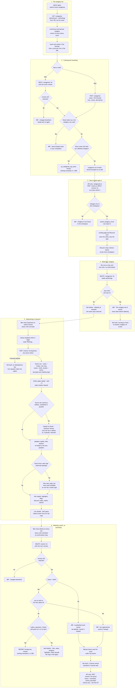

# Categories, duplicating and deleting events

**Screens:** Event categories, Events list, Create event wizard, Portal Discover

What an organizer does with events after creating them. The flow starts on `/admin/event-categories`, where a workspace keeps the categories its events are grouped under. It moves to the row menu on `/admin/events`, which can copy an event into a new draft or delete one. It ends in one of two places: the copy goes back into [Create and publish an event](13-create-and-publish-an-event.md) as an ordinary draft, or a delete is refused and the organizer is pointed at Cancel, which is covered in [Refund and cancellation](07-refund-and-cancellation.md). The organizer is the only persona here. An attendee sees a category only as a label and a filter chip on [Discover](01-discover-and-register.md).

1. **The category list.** The screen is reached from Events → Content → Categories. It loads `GET /categories`, and every route on that controller sits behind `AdminGuard` and `PermissionsGuard` with `setSettings`, including the reads. In `DEFAULT_ROLES` only the Admin role holds `setSettings`, so a default Organizer can create and publish events but cannot manage the categories they go into. The list is not paged. The loader asks for `limit=100` with `sort=name` and the search term `q` from the URL, cut to the DTO's 80 characters so a long pasted URL is not refused with a 400. The "Most events" and "Fewest events" orderings are applied in the browser. That is safe only because the whole set is in hand. The API's own `recent` sort is never asked for. Grid or list view, search and sort all live in the URL. Each card's `eventCount` is not stored anywhere. A single grouped query counts the `events` rows with that `category_id` and `deleted_at IS NULL`, so drafts, cancelled events and completed events all count. Icons and colours are cleaned up at the edge. A bare icon slug gets its `hgi-` prefix so it does not render as a blank box, and an unknown colour falls back to `brand`. A new workspace starts with no categories. Sign-up does not create any, and the only insert outside this screen is the development seed, which is the "seeded" in [entities.md](../entities.md).

2. **Creating and renaming.** The panel's preview of icon, colour and name is drawn in the browser only. Saving a new category is `POST /categories` with:
   - `name`: 1–40 characters, trimmed by both the screen and the service.
   - `icon`: any string of 1–60 characters. The screen offers its own `CATEGORY_ICONS` list.
   - `color`: one of the eight `category_color` values.
   - `description`: up to 200 characters. The screen sends `null` for a cleared one, because a missing key would mean "unchanged".

   Uniqueness is checked twice, and the two checks disagree. The service compares `lower(name)` against live categories only and refuses a match with a 409, "A category with this name already exists in your workspace." The database's `uq_categories_org_name` on `(organization_id, name)` is case-sensitive and has no `deleted_at` predicate, so a deleted category keeps its name. Re-creating a deleted category under exactly the same name passes the service check and is then refused by the index. Unlike the organization and attendee services, this module has no `isUniqueViolation` mapping, so the organizer gets a 500, "An unexpected error occurred." The same happens when two identical creates race. Renaming is `PATCH /categories/:id` with the `version` the card was loaded with. A mismatch is a 409, "This category changed elsewhere. Reload and try again." The `UPDATE` also matches on that version and bumps it, so a change that lands between the read and the write is refused the same way. A rename shows up everywhere at once because nothing copies the name. Events hold only `category_id`, and the landing page and Discover look `categories.name` up when they are read. No `audit_events` or `outbox_events` row is written anywhere in this step.

3. **How an event gets a category, and where it shows.** Assigning a category is **API-only: no screen calls it.** The wizard's `POST /events` sends only a name, a type, a start and a description. Neither the wizard nor the event detail page has a category field, and no file in eventa-web sends `categoryId`. The API accepts it on `POST /events` and on `PATCH /events/:id` (both `evCreate`), where `null` clears it. Either way the service checks that the category belongs to the caller's workspace and is not deleted, and answers 404 "Category N not found in this workspace." otherwise. This check is deliberate: a Postgres foreign-key check bypasses row-level security, so without it one workspace could point an event at another workspace's category. Once set, the category appears in three places:
   - The public page at `/e/<slug>` and each Discover card show `categoryName`, falling back to the event's `type` when there is none.
   - `GET /public/discover/categories` builds the filter chips from the distinct names of non-deleted categories on browsable events: public, published, in a live status and still ahead. It covers **every workspace**, so two organizers' "Conference" categories make one chip.
   - `?category=` matches on `search_norm(name)`, and the keyword search also matches category names (see [Discover and register](01-discover-and-register.md) step 1).

4. **Deleting a category.** The bin icon on a card submits `DELETE /categories/:id` on the first click. There is no confirmation dialog, although US-EVT-11 describes one ("when I confirm Delete"). If any event still uses the category, the service answers 409 with the live count: "This category has N events. Move them to another category before deleting." The screen shows that sentence in a banner. Because of step 3, the advice cannot be followed from the console. Moving an event to another category is not built in any screen, and a cancelled or completed event counts just as much as a live one. In practice, a category that any existing event uses, whatever that event's status, cannot be deleted from the console. An unused category is soft-deleted by stamping `deleted_at`. The row is never removed, so the `ON DELETE SET NULL` on `events.category_id` never fires, and the name stays reserved by the index described in step 2.

5. **Duplicating to relaunch.** The row menu on `/admin/events` offers **Duplicate** to anyone with `evCreate`. It posts `POST /events/:id/duplicate`. This route lives on its own controller, guarded by `PermissionsGuard` with `evCreate` and without the `AdminGuard` that `EventsController` puts on the main event routes, including delete and cancel. Any source status is accepted, so a cancelled or completed event can be relaunched. The copy is built in five stages, in dependency order, and they do not share a transaction:
   - **The event row.** `name` becomes "&lt;name&gt; (Copy)". The slug is derived from that new name (`gala-copy`, then `-2`…) and checked against every slug the workspace's events already hold. `status` is `draft`, `bucket` is `active`, `published_at` and `cancelled_at` are null, and `created_by` is the person who duplicated it. Carried over unchanged:
     - `type` and `category_id`.
     - `start_at`, `end_at` and `timezone`. This is the old date, so publishing a copy that is still dated in the past asks for `confirmPastStart` (see [13](13-create-and-publish-an-event.md) step 4).
     - The venue and online fields, `seating_mode` and `capacity`.
     - `waitlist_enabled` and `requires_approval`. These are settings, not queues, so the copy has the switches but nobody waiting.
     - `cover_image` (the same stored URL), `accent_color`, `organizer_name`, `contact_email`, `landing_template_id` and `description`.
     - `visibility`. The copy of a public event is a public draft, but it stays unreachable because the public page also needs a live status and `published_at`.

     Not carried over: `agenda_title`, `speakers_title`, `locale`, `event_highlights`, `event_faqs`, `discount_codes` and invitations.
   - **The ticket tiers.** Every live `ticket_types` row is copied with its name, `is_free`, `price_satang`, currency, admission type, `total`, per-order limits and icon. `sold` starts at its column default of 0, and `sales_start_at` and `sales_end_at` are cleared. **`status` is copied as it was stored**, not re-derived. A tier stored as `soldout`, `scheduled` or `paused` arrives that way on the copy with nothing sold and no sales window. Checkout refuses any tier that is not `onsale`, and the status is only recomputed when the organizer edits or resumes the tier. A `paused` copy stays paused through an edit, until Resume. A tier's `includes`, `is_recommended` and `badge` are not copied.
   - **Speakers, then sessions.** Live speakers are copied first, which yields a map from old speaker ids to new ones. Live sessions are copied next, and their speaker links are rebuilt through that map. Not every column comes across: a speaker's `bio`, `photo_url`, `website`, `social_links` and `rating`, and a session's `description`, are left behind.
   - **The seat map.** When the source has a seat map (reserved seating), a new `seat_maps` row is written with the same layout, and the seats are regenerated from it, every one `available`. The source's sold and held seats do not come across. Its rows carry **no ticket types**, even where the source's did (US-EVT-05), so the copy is not seat-typed: its tiers keep the `total`s copied from the source as ordinary quantities the organizer can edit, and publishing the copy is refused with "Give every seat row a ticket type before publishing." until Seating gives every row a type, which derives the totals from the rows again (see [13](13-create-and-publish-an-event.md) steps 2 and 4).

   Nothing hanging off the source's id is copied: no orders, tickets, payments, attendees or waitlist entries. No outbox row or audit row is written. A failure partway through leaves the stages that already ran in place, so the result is a partial draft, and the menu shows the error. Double-submit protection exists only in the browser. The button disables and reads "Working…" while its request is in flight, but the endpoint takes no idempotency key. Two separate requests, from two tabs or from a retry after a timeout, produce two copies (`-copy` and `-copy-2`); US-EVT-13 says only one should be created. On success the menu closes and the list's loader runs again, re-reading `GET /events` and `GET /events/summary`, so the Active badge counts the copy. The copy's **Edit** link opens `/admin/event-form?id=<copy>` and continues as flow 13.

6. **Deleting a draft, or cancelling.** **Delete** appears in the row menu of **every** event for anyone holding `evPublish`, whatever the event's status. It submits on the first click with no confirmation step, although US-EVT-08 says no deletion may happen without one. The request is `DELETE /events/:id` with the `version` the row was listed with, and the service checks in this order:
   1. The event must be in the caller's workspace, otherwise 404.
   2. The version must still match, otherwise 409 "This event changed elsewhere…".
   3. Anything that is not a `draft`, including a cancelled or completed event, gets 409 "A published event cannot be deleted. Cancel it instead to refund and notify attendees."
   4. A draft whose live tiers have `sum(ticket_types.sold) > 0` gets 409 "This event has registrations and can't be deleted. Cancel it instead to refund and notify attendees." A draft can hold sales because unpublishing keeps everything.

   If all four pass, the row is hard-deleted. That cascades to its tiers, seat map and seats, sessions and speakers, highlights, FAQs, discount codes, invitations, `saved_events` and `seat_holds`. `meetings` and `payouts` keep their rows with `event_id` set to null, and the slug can be used again. The `sold` check is narrower than the story's "no payment history". `sold` counts issued tickets, plus the places held for a registration awaiting approval. A refunded ticket comes off it, a rejected registration gives its places back, a waitlist entry or an order still waiting for its payment never added to it, and a retired (soft-deleted) tier is left out of the sum. A draft can therefore pass the check while `orders`, `payments`, `tickets`, `invoices`, `check_ins` or `scan_attempts` rows still point at it, or `order_items`, `seat_assignments` or `discount_redemptions` rows point at its tiers, seats or discount codes. At that point those `ON DELETE RESTRICT` foreign keys refuse the delete. This backstop is why payment history is never lost, but nothing translates the error, so the organizer gets a 500 instead of being pointed at Cancel. When the delete is refused, the console shows the API's sentence word for word under the button, and that is all it does. **There is no Cancel control anywhere in eventa-web.** `POST /events/:id/cancel` is **API-only**. It needs `evPublish` and a reason, sets `status = 'cancelled'` and `bucket = 'completed'`, and writes an `outbox_events` row with `routing_key = 'events.cancelled'`. eventa-worker's `EventCancelledHandler` then sends attendee notices and nothing else. The endpoint accepts a draft too, so a draft whose delete was refused for sales can still be cancelled through the API. The refusal's promise to "refund" goes beyond the code: cancelling queues no refund, voids no ticket and clears no waitlist (see [Refund and cancellation](07-refund-and-cancellation.md) steps 1–2). After a successful delete the list reloads, and if the deleted row was the only one on the last page, the loader redirects to the last page that still exists.

```mermaid
flowchart TD
  subgraph LIST["1 · The category list"]
    L1["Admin opens<br/>/admin/event-categories"] --> L2["GET /categories<br/>AdminGuard + setSettings<br/>limit 100, sort by name"]
    L2 --> L3["eventCount derived per category<br/>events of every status count"]
    L3 --> L4["Count sorts done in the browser<br/>view, q and sort live in the URL"]
  end

  subgraph EDIT["2 · Creating and renaming"]
    E1{"New or edit?"}
    E1 -- "New" --> E2["POST /categories<br/>name 1-40 trimmed<br/>icon, colour, description"]
    E1 -- "Edit" --> E3["PATCH /categories/:id<br/>with the card's version"]
    E3 --> E4{"version still<br/>matches?"}
    E4 -- "No" --> E5["409 · changed elsewhere<br/>reload and try again"]
    E4 -- "Yes" --> E6{"Name taken by a live<br/>category, any case?"}
    E2 --> E6
    E6 -- "Yes" --> E7["409 · name already exists<br/>in your workspace"]
    E6 -- "No" --> E8{"Exact name still held<br/>by a deleted category?"}
    E8 -- "Yes" --> E9["uq_categories_org_name refuses<br/>nothing translates it: a 500"]
    E8 -- "No" --> E10["categories row written<br/>version bumped on an edit"]
  end

  subgraph USE["3 · How an event gets a category"]
    U1["API-only: categoryId on<br/>POST /events or PATCH /events/:id<br/>no screen sends it"] --> U2{"Category live in<br/>this workspace?"}
    U2 -- "No" --> U3["404 · Category N not found<br/>in this workspace"]
    U2 -- "Yes" --> U4["events.category_id set<br/>null clears it"]
    U4 --> U5["Landing page and Discover card<br/>show the name, else the type"]
    U5 --> U6["Discover chips: distinct names<br/>across every workspace"]
  end

  subgraph CDEL["4 · Deleting a category"]
    C1["Bin icon on the card<br/>one click, no confirmation"] --> C2["DELETE /categories/:id<br/>needs setSettings"]
    C2 --> C3{"Any event<br/>still uses it?"}
    C3 -- "Yes" --> C4["409 · This category has N events<br/>move them before deleting"]
    C4 --> C5["Not built: moving an event<br/>to another category on screen"]
    C3 -- "No" --> C6["Soft delete · deleted_at stamped<br/>the name stays reserved"]
  end

  subgraph DUP["5 · Duplicating to relaunch"]
    D1["Row menu Duplicate on /admin/events<br/>shown with evCreate"] --> D2["Button disabled while in flight<br/>reads 'Working…'"]
    D2 --> D3["POST /events/:id/duplicate<br/>any source status"]
    D3 -- "A second request" --> D4["Not built: an idempotency key<br/>two requests make two copies"]
    D3 --> D5["events row · name + (Copy), new slug<br/>status = draft, bucket = active<br/>old dates and visibility kept"]
    D5 --> D6["ticket_types copied · sold = 0<br/>sales window cleared"]
    D6 --> D7{"Source tier stored as<br/>soldout, scheduled or paused?"}
    D7 -- "Yes" --> D8["Copied as stored · checkout refuses<br/>until the tier is edited<br/>or, if paused, resumed"]
    D7 -- "No" --> D9["speakers copied, then sessions<br/>re-linked to the new speakers"]
    D8 --> D9
    D9 --> D10{"Source has a seat map<br/>(reserved seating)?"}
    D10 -- "Yes" --> D11["New seat_maps row<br/>every seat available<br/>no row has a ticket type"]
    D10 -- "No" --> D12["Not copied: highlights, FAQs,<br/>discount codes, orders, waitlist"]
    D11 --> D12
    D12 --> D13["List reloads · Edit opens<br/>/admin/event-form for the copy"]
  end

  subgraph DEL["6 · Deleting a draft, or cancelling"]
    X1["Row menu Delete on every row<br/>shown with evPublish<br/>no confirmation step"] --> X2["DELETE /events/:id<br/>with the row's version"]
    X2 --> X3{"version still<br/>matches?"}
    X3 -- "No" --> X4["409 · changed elsewhere"]
    X3 -- "Yes" --> X5{"status = draft?"}
    X5 -- "No" --> X6["409 · A published event cannot<br/>be deleted. Cancel it instead"]
    X5 -- "Yes" --> X7{"sum of sold on<br/>live tiers above 0?"}
    X7 -- "Yes" --> X8["409 · has registrations<br/>cancel it instead"]
    X7 -- "No" --> X9{"orders, payments, tickets<br/>still point at it or its tiers?"}
    X9 -- "Yes" --> X10["RESTRICT foreign key refuses<br/>nothing translates it: a 500"]
    X9 -- "No" --> X11["Hard delete · tiers, seats, program,<br/>highlights, FAQs cascade<br/>the slug is free again"]
    X6 --> X12["Refusal shown word for word<br/>under the button"]
    X8 --> X12
    X12 --> X13["Not built: a Cancel control<br/>anywhere in eventa-web"]
    X13 --> X14["API-only: POST /events/:id/cancel<br/>status = cancelled, events.cancelled<br/>notices only · see flow 07"]
  end

  L4 --> E1
  E10 --> U1
  U6 --> C1
  C6 --> D1
  D13 --> X1
```

Mermaid source

[← All flows](README.md)
