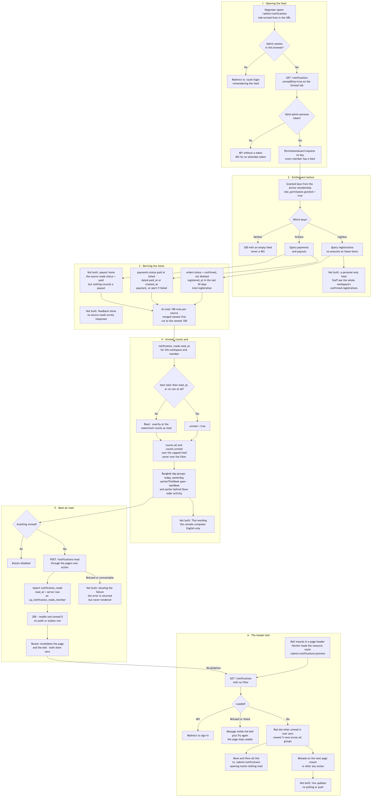
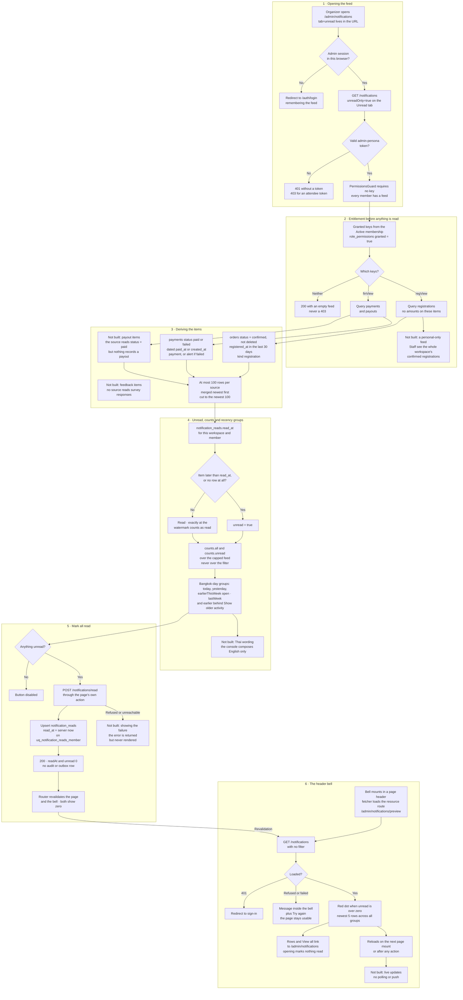

# Notifications: the feed and the bell

**Screens:** Admin Notifications, header notification bell

How an organizer finds out what has happened across the workspace without opening every module. It starts at the bell in the header of almost every admin page, or at `/admin/notifications` — where the Engagement module in the rail opens — and ends when **Mark all read** moves the member's own read watermark forward. That watermark is the only thing stored: every item is re-derived on each request from records other flows write — a confirmed registration from [Checkout and payment](02-checkout-and-payment.md), [Free registration](03-free-registration-and-confirmation.md), the [Waitlist](04-waitlist.md) or [Approval](05-approval.md), a settled or declined payment from [Checkout and payment](02-checkout-and-payment.md), and in principle a completed transfer from [Payouts and balances](09-payouts.md) — and which of those a member sees is decided by the permission keys from [Sign-in, roles and permissions](12-sign-in-roles-and-permissions.md). Only the organizer persona has a feed; an attendee never sees one.

1. **Opening the feed.** `/admin/notifications` is a live page whose loader runs behind `pageData`, so a browser not holding an `admin`-persona session is sent to `/auth/login?from=…` before anything is fetched. Its one control is the All / Unread tab, kept in the URL as `?tab=unread` — absent means All, and any other value falls back to All — so a reload or the back button lands on the same tab. The loader calls `GET /notifications`, adding `unreadOnly=true` on the Unread tab; the query DTO reads only the string `true` as true and anything else as false rather than a 400, because a filter is not worth failing a page load over. On the API the global `JwtAuthGuard` answers a missing or expired token with 401 "Authentication required", and `AdminGuard` refuses an attendee token with 403 "Organizer console access requires an admin account." `PermissionsGuard` sits on the controller too, but **no permission key is required**: every member of a workspace has a feed and only its contents differ, and a 403 would tell a member without access that there is something there to be refused — so they get a 200 with an empty feed instead. A load that fails for any other reason goes to the page's own error element, which renders inside the outlet so the rail stays usable.

2. **Entitlement before anything is read.** Before a single source is queried, `NotificationFeedService` reads the caller's granted keys with the same query `PermissionsGuard` uses — their `memberships` row with `status = 'Active'` joined to `role_permissions` where `granted = true`. `regView` unlocks registration items and `finView` unlocks payment, decline and payout items, and a source the reader may not see is **never queried** rather than queried and hidden, so an unentitled reader's rows never leave the database. With the default roles, Admin and Organizer see every kind, while Staff (`regView`, `regCheckin`, `evProgramView`) see registrations only — and a registration item carries no amount at all, because an order total is finance data and a `regView`-only reader is exactly who US-MSG-03 says must not see money. Each source is read through a port that Notifications declares and the owning module implements — RegistrationStats (the registration read model) for `orders`, Payments for `payments`, Payouts for `payouts` — each in its own tenant transaction that sets `app.current_org` for row-level security, so Notifications never reads another module's tables itself. **Where the story differs:** US-MSG-03 says a Staff member sees "only my own personal activity", but the code has no per-person filter — a Staff member with `regView` sees every confirmed registration in the workspace, across every event. Nor do the organizer's switches for `registration`, `payment`, `payout` and `alert` at `/admin/settings-notifications` filter this feed: nothing outside that screen's own `GET /me/notification-preferences` and `PATCH /me/notification-preferences/:category` reads `notification_preferences` — not the feed, and not eventa-worker (see [Profile, preferences and account deletion](16-profile-preferences-and-account-deletion.md)).

3. **Deriving the items.** There is no notifications table — the catalogued `notifications` entity was deliberately not built, nothing writes a notification when a registration or payment happens, no `outbox_events` routing key is involved and eventa-worker plays no part in the feed. Each request derives the items afresh over a rolling window of `FEED_WINDOW_DAYS = 30` (thirty 24-hour days back from the server clock, not calendar days), asking each entitled source for at most `FEED_LIMIT = 100` of its newest rows. **Registrations** are `orders` with `status = 'confirmed'` and `deleted_at` null, joined to `events` for the name and emitted as kind `registration` with `buyer_name`, `seats` and the id `order:<uuid>`; a `pending` checkout is left out because it may never finish and would un-happen when its hold expired. The item is dated by `registered_at`, **not** `confirmed_at`, so an order confirmed later — approved in [Approval](05-approval.md) or promoted from the [Waitlist](04-waitlist.md) — is dated when it was first placed: it can file into an older group, count as already read if the member marked read after it was placed, or be missing altogether if it was placed more than thirty days ago. **Payments** are `payments` with `status` in (`paid`, `failed`), dated `coalesce(paid_at, created_at)` — a settled payment happened when it settled, a declined one when it was attempted — and the window and the ordering both use that one expression, so a decline cannot sort into the wrong day. `paid` becomes kind `payment` and `failed` becomes `alert`, the only kind that asks the organizer to do something; both carry `payer_name` and `amount_satang`. `pending` is excluded, and a payment later refunded has `status = 'refunded'` and simply drops out — refunds themselves are never items (see [Refund and cancellation](07-refund-and-cancellation.md)). **Payouts** would be `payouts` with `status = 'paid'` and `completed_at` set, left-joined to `events` because one transfer can settle several, carrying no person and the payout's own `reference`; a failed payout is deliberately absent, because it is a standing problem with a Retry button on `/admin/payouts` rather than news that arrives once. **Not built: payout items in practice** — nothing in eventa-api or eventa-worker ever inserts a `payouts` row or sets one to `paid` (the only write is the retry, which sets `processing` or `failed`; see [Payouts and balances](09-payouts.md)), so this source always comes back empty. **Not built: feedback items** — the story asks to triage feedback in the feed and the page subtitle still promises it, but no source reads survey responses. The three lists are merged newest first and cut to the newest 100. Because every item is a live read of its own record, an order cancelled or deleted, or a payment refunded, takes its item with it: the feed can never outlive what it describes, and it needed no backfill on the day it shipped.

4. **Unread, counts and recency groups.** What is stored is one `notification_reads` row per (`organization_id`, `user_id`) — `uq_notification_reads_member` — holding `read_at`, and an absent row means nothing has been read, so a new member sees the whole window as unread without a row seeded at sign-up. An item is unread when its timestamp is strictly after `read_at`; one stamped at exactly the watermark counts as read, because otherwise marking read could leave the newest item unread and the count would never reach zero. `counts.all` and `counts.unread` are taken over the merged, capped list **before** the Unread filter is applied, so the All tab keeps its number while Unread is open — and both therefore top out at 100: in a workspace with more than a hundred items in thirty days, `counts.all` is the newest hundred, not "everything in the window" as the API's own field description says. The remaining items are bucketed by **Bangkok** calendar day (UTC+7): `today` and `yesterday` are tested first, so that on a Monday, Sunday reads as Yesterday rather than Last week, and Monday-start weeks then give `earlierThisWeek`, `lastWeek` and `earlier`. Empty buckets are omitted and the first three are flagged `recent`. The wire carries bucket keys rather than labels and facts rather than sentences — the kind, the names, `amountSatang` as integer satang or null, `seats`, `reference`, and `at` in ISO UTC — so the wording belongs to the console. It renders the three recent groups open and the other two behind **Show older activity** (local state, reset when the tab changes), writes each title and sentence ("Someone" where nobody is named, an amount formatted in baht only on screen) and a relative time whose day boundaries are Bangkok's — "Just now", "12 min ago", "3 hr ago", "Yesterday", "Jul 10". With nothing to show, the Unread tab says **You're all caught up** with a way back to All, and an empty All tab says **No activity yet** with a link to `/admin/events`. Rows are not links; nothing jumps to the event or the payment. **Not built: Thai wording** — the API sends facts precisely so the feed can be bilingual, but eventa-web has no translation layer and composes English only.

5. **Mark all read.** The **Mark all read** button is disabled while `counts.unread` is 0 and while a submission is in flight. It is a fetcher form posting to the page's own route action, which calls `POST /notifications/read` behind the same guards and, again, no permission key. The service takes the server's current instant and upserts `notification_reads` on `uq_notification_reads_member` — insert, or on conflict update `read_at` and `updated_at` — so two tabs marking read at once cannot collide on the key. The answer is a **200, not a 201**, because nothing was created — a property of the member moved — and it carries `readAt` and `unread: 0`. The watermark is the server's instant at the click, not the newest row on screen, so everything that happened before the click is read, including an item that arrived after the page loaded and was never shown. It is per member and per workspace: a colleague clearing their own feed clears nobody else's, and a member of two workspaces reads each one separately. Read is all-or-nothing up to an instant — there is no per-item read state and no mark-unread. The console discards the response body; React Router revalidates the page's loader and the bell after the action, so both counts come back from the API rather than being patched locally, which is what stops the badge and the list disagreeing — and because the watermark is stored, the count stays at zero after a reload, as the story requires. No `audit_events` or `outbox_events` row is written. **Not built: telling the member the mark failed** — a refused or unreachable `POST /notifications/read` comes back from the action as `{ ok: false, error }`, but the page never reads it, so the button simply re-enables and the counts stay as they were.

6. **The header bell.** `NotificationBell` is rendered by the shared `HeaderUser` pairing on most admin pages, the feed itself included, and directly on Event detail, the event form and the Events report. When it mounts, a fetcher loads `/admin/notifications/preview` — a resource route with a loader and no component, which only the bell requests and nothing navigates to — and its loader calls the same `GET /notifications` with no filter, so the bell and the page can never disagree about a count; the price is that every page mount reads the full feed, up to a hundred items from three sources, to show five. The bell keeps the API's `counts.unread` for the whole feed and the first `NOTIFICATION_PREVIEW_SIZE = 5` items flattened across every group, the older ones the page folds away included, because the bell answers "what happened lately". The trigger shows a red dot when anything is unread ("Notifications, N unread" to a screen reader) and the dropdown header shows the number; it reads "Loading notifications…" until the first answer and "No notifications yet." on an empty feed. Each row, and **View all notifications**, links to `/admin/notifications` rather than to the item, and opening the bell marks nothing read. It reloads when a page mounts — each admin page renders its own header, so moving between pages refreshes it — and whenever React Router revalidates after any action on the page, which is what clears it after Mark all read; it does **not** refresh when only the query string changes on the same page. **Not built: live updates** — there is no polling, websocket or push, so a registration landing while somebody sits on one screen shows on their next navigation or action. Failures stay inside the dropdown: the API's own sentence when it refused or could not be reached, and a fixed "We couldn't load your notifications." for anything else — a body that is not JSON, a bug in the mapping — with a **Try again** that re-runs only the bell's fetcher rather than revalidating the page under it. The reason is where React Router would send a throw: a fetcher's error goes to the page's boundary on the first load and to the **root** boundary on revalidation, because this resource route is never among the page's matches, and either would replace a working screen over a dropdown nobody opened. Only an ended session (401) is let through, so the loader's guard can still redirect to sign-in.

Mermaid source

[← All flows](README.md)
