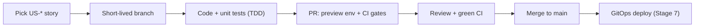

# Eventa — Development Guide

| | |
|---|---|
| **Author** | Tech Lead |
| **Version** | 1.0 · 2026-07-23 |
| **Audience** | Engineers building Eventa |
| **Grounded in** | [Software architecture](../04-architecture/software-architecture.md) · [Data model](../04-architecture/entities.md) · [Product backlog](../01-requirements-and-features/functional-requirements.md) · [CI/CD](../07-deployment/devops-ci-cd.md) |

The engineering handbook: how we turn the architecture and backlog into working, tested, shippable
code. It defines the repo layout, local setup, conventions, and the day-to-day workflow. It does **not**
restate the architecture (see the SAD) — it tells you how to build against it.

## 1. Tech stack (developer view)
| Area | Tech | Reference |
|---|---|---|
| Frontend | React 19 · TypeScript · Vite · Tailwind v4 (existing `../../eventa-web`, built from `../../eventa-ui-kit`) | [Design reference](../03-ux-ui-design/design-reference.md) |
| Backend | **NestJS** (TypeScript) — modular monolith; REST | [SAD §5–6](../04-architecture/software-architecture.md) |
| Data | PostgreSQL 15+ · **Drizzle ORM** (SQL-first, typed) · Redis | [entities.md](../04-architecture/entities.md) |
| Messaging | RabbitMQ (consumer + outbox relay) | [SAD §6.3, §7.2](../04-architecture/software-architecture.md) |
| Language baseline | TypeScript **strict**, ESLint + Prettier, end-to-end | §4 |

## 2. Repository structure (polyrepo)
Each deployable is its **own repository** — independent versioning, CI, and release. There is **no
shared contracts package**: the web↔api contract is the API's **OpenAPI** spec (web generates its
client from it); the api↔worker event contract is enforced by **runtime validation + Pact contract
tests**, each service owning its own event type.

| Repository | Deployable | Notes |
|---|---|---|
| **`eventa-web`** | web | React SPA + SSR (today's `../../eventa-web`) + generated API client |
| **`eventa-api`** | api | NestJS modular monolith; **owns DB schema & migrations**; emits `openapi.json`; writes the outbox but never publishes |
| **`eventa-worker`** | worker | NestJS RabbitMQ consumers — async side effects; plus scheduled domain jobs (ADR-14) |
| **`eventa-relay`** | relay | Outbox → RabbitMQ publisher. Own repo, single replica (no row lock yet) |
| **`eventa-infra`** | — | Terraform + Helm + Argo CD (Stage 7) |

**`eventa-api`** — domain (bounded-context) modules, each a vertical slice:
```
eventa-api/
├── src/
│   ├── main.ts                     # HTTP entrypoint (also the check-in pool image)
│   ├── db/                         # Drizzle: schema/ · migrations/ (SQL) · meta/
│   ├── modules/                     # FLAT siblings — never nest one inside another
│   │   ├── auth/  users/  auth-signup/  auth-password/  access/
│   │   ├── events/  event-categories/  event-program/  event-seating/
│   │   ├── event-sharing/  event-monitoring/  event-duplication/
│   │   ├── ticketing/
│   │   ├── registration/            # seat-hold money path
│   │   │   ├── registration.module.ts
│   │   │   ├── registration.service.ts
│   │   │   ├── registration.repository.ts
│   │   │   ├── dto/
│   │   │   └── events/order-confirmed.event.ts   # producer owns its payload
│   │   ├── registration-stats/      # read model behind EventStatsPort
│   │   └── platform/                # outbox, idempotency, audit, jobs
│   └── common/                      # guards/ decorators/ interceptors/ filters/
│                                    # http/ util/ tenancy — anything >1 module uses
├── test/contract/                   # Pact PROVIDER verification
└── openapi.json                     # generated → consumed by web
```

**`eventa-worker`** — the same domains, handler-shaped; channel providers injected:
```
eventa-worker/
├── src/
│   ├── main.ts                      # consumer bootstrap
│   ├── app.module.ts                # imports every module (app.module.spec.ts enforces it)
│   ├── modules/                     # flat; named after the api module they serve
│   │   ├── auth/  auth-signup/  auth-password/  auth-two-factor/  auth-booking-signup/
│   │   ├── access/  users/  account-deletion/  invitations/
│   │   ├── events/  event-program/  payments/  waitlist/
│   │   ├── registration/
│   │   │   ├── registration-confirmed.handler.ts
│   │   │   └── registration-confirmed.schema.ts   # zod: the shape it expects
│   │   ├── meetings/                # meeting.sync_requested → Google Calendar (ADR-15)
│   │   │   ├── meeting-sync-requested.handler.ts  # + .schema.ts
│   │   │   ├── meeting-calendar-sync.service.ts   # reconciles from the current row
│   │   │   ├── meeting-sync.lock.ts               # Redis lock per meeting
│   │   │   └── meetings.repository.ts  calendar-connections.repository.ts
│   │   └── order-expiry/  scheduled-announcements/  scheduled-messages/   # clock-driven (ADR-14)
│   ├── common/
│   │   ├── email/  sms/  calendar/  # channel providers, chosen by env and injected
│   │   ├── crypto/                  # SecretCipher: decrypts what eventa-api encrypted
│   │   └── db/  idempotency/  logging/  messaging/  time/
│   ├── rabbitmq/                    # consumer, retry ladder, dead-letter queue
│   └── db/schema/                   # typed mirrors of the api's tables (write mirrors under ADR-14/15)
└── test/                            # e2e specs
```

**`eventa-web`** — feature-based (unchanged), with a generated API client:
```
eventa-web/
└── src/
    ├── features/                    # events · ticketing · registration · portal · …
    ├── api/generated/               # typed client from eventa-api's openapi.json
    ├── components/ui/
    └── lib/
```

A NestJS **module = one responsibility**, and a bounded context (SAD §6.2) may be delivered by
**several prefix-grouped sibling modules** — `auth` + `auth-signup` + `auth-password` + `users` + `access`
together implement Accounts; `events` + the six `event-*` modules implement Create & Manage Events. Split
whenever describing a module needs the word "and". Modules are **flat** under `src/modules/` — never a
sub-feature folder nested inside another module — and depend on each other's **exported service
interface**, never on another module's tables *or repository*. Cross-cutting code (guards, decorators,
shared utils) lives in `src/common/`, never in a domain module. The **worker mirrors the api's module
names**, with channel clients injected from `common/email`, `common/sms` and `common/calendar` — never used as
the folder structure.

**Contract safety (no shared package):**
- **web ↔ api** → `eventa-api/openapi.json` → `eventa-web/src/api/generated/`, regenerated in CI.
- **api ↔ worker** → each owns its event type (`events/*.event.ts` in api, `*.schema.ts` in worker);
  the worker validates every message (tolerant reader) and **Pact** tests in both `test/contract/`
  folders fail CI on drift. Payloads carry a `version` field for breaking-change overlap.
- **Schema ownership:** `eventa-api` owns migrations. `eventa-worker` touches only agreed read-model tables plus the ADR-14 and ADR-15 exceptions; `eventa-relay` reads `outbox_events` and sets `published_at`, nothing else. Both keep typed mirrors that must track this repo's enums.

## 3. Local development setup
**Prerequisites:** Node LTS, pnpm, Docker. Clone each service repo you're working on.
1. **Shared infra** — in `eventa-infra` (or a dev compose), `docker compose up -d` → PostgreSQL, Redis, RabbitMQ.
2. In each repo: `pnpm install`; copy `.env.example` → `.env` (sandbox keys; never commit secrets — §12).
3. **`eventa-api`**: `pnpm migrate && pnpm seed` (api owns the schema), then `pnpm dev`.
4. **`eventa-relay`**: `pnpm dev`. **Required** — without it nothing leaves `outbox_events`, so no
   email is ever sent. The failure is silent: orders commit, rows accumulate unpublished, and the
   product looks healthy.
5. **`eventa-worker`**: `pnpm dev`.
6. **`eventa-web`**: `pnpm dev` (port 5180).
7. **Meetings and Google Calendar** (optional). With none of these variables set, both services resolve
   the calendar provider to `off`: Settings → Integrations reads "Not set up" and every meeting ends
   "not connected". The variables are catalogued in
   [devops-infrastructure §5](../07-deployment/devops-infrastructure.md#google-calendar-config); never
   add them to a committed `.env.example`.
   - **With the fake, no Google account:** start eventa-api and eventa-worker with
     `CALENDAR_PROVIDER=fake` and the **same** `SECRET_ENCRYPTION_KEY` — eventa-worker's `.env` has
     none and falls back to the dev default, so copy eventa-api's value across. Connect on Settings →
     Integrations: the fake goes straight back to the callback as `calendar@example.test`, Video
     meetings get `https://meet.google.com/…` links, and a title containing `[calendar-down]` acts out
     an outage. On a fresh exchange or queue, start the worker before the relay
     ([how the services connect](../04-architecture/how-services-connect.md)).
   - **With a real Google client:**
     1. In a Google Cloud project, enable the **Google Calendar API**.
     2. Configure the **OAuth consent screen** with the scopes `openid`, `email` and
        `https://www.googleapis.com/auth/calendar.events`, and add the Google accounts you will connect
        as **test users**.
     3. Create an **OAuth client** of type *Web application* with the authorized redirect URI
        `http://localhost:3000/api/v1/public/calendar-connection/google/callback`. Another environment
        registers `${PUBLIC_API_URL}/api/v1/public/calendar-connection/google/callback`, or sets
        `GOOGLE_CALENDAR_REDIRECT_URI`.
     4. Put `GOOGLE_CALENDAR_CLIENT_ID` and `GOOGLE_CALENDAR_CLIENT_SECRET` in **both**
        `eventa-api/.env` and `eventa-worker/.env`, and copy eventa-api's `SECRET_ENCRYPTION_KEY` into
        `eventa-worker/.env`. With both client variables set, the provider resolves to `google` without
        `CALENDAR_PROVIDER`.
     5. While the consent screen is in **Testing** status, Google expires refresh tokens after
        **7 days**; the card then reads "Reconnect needed" and an Admin reconnects. Publishing the app
        needs Google's verification, because `calendar.events` is a sensitive scope. The Google
        adapters are unproven against a real account until this has been run.

> The **front-end prototype runs today** against mock data; point it at the local API as endpoints
> land. Web regenerates its API client from `eventa-api`'s `openapi.json` in CI.

## 4. Coding standards & conventions

**Design principles (all backend code):**
- **Feature-first, not layer-first** — organize by feature (a module owns its
  controller/service/repository/dto/events), never by technical layer (`controllers/`, `services/`, …).
  One module = one responsibility; file names mirror class names (`event-categories.service.ts` →
  `EventCategoriesService`); related modules share a name prefix. See Appendix A.2 for the full layout.
- **SOLID, especially Single Responsibility & Dependency Inversion** — one reason to change per unit;
  depend on abstractions (service interfaces, repositories, injected providers), not concretions.
- **Thin controllers, orchestration-focused services, and repositories dedicated to data access.**
- **Separate domain/business logic from infrastructure** (database, email, external APIs, queues) — reach
  infrastructure only through injected ports.
- **Side effects via events & background jobs** — emit to the **outbox**; the worker performs
  email/SMS/projections, keeping core business workflows focused and easier to evolve.
- **Small functions (≤ 10 lines) with one level of abstraction each** — extract helpers rather than nesting.

**Baseline conventions:**
- **TypeScript strict** everywhere; no `any` without justification. ESLint + Prettier enforced in CI.
- **Frontend** — keep the existing **feature-based** structure and `components/ui` primitives; follow
  `../../eventa-web/CONVENTIONS.md`; Tailwind utilities, class-based light/dark.
- **Backend (NestJS)** — per module: `*.controller.ts` (HTTP), `*.service.ts` (rules), a data-access
  layer, `dto/` (request/response with validation), `events/` (published/consumed contracts). Use DI;
  keep controllers thin, rules in services.
- **No cross-module table access** — call the other module's service interface.
- **Money is integer satang**; format at the edge only. **Time** is stored UTC, displayed
  Asia/Bangkok. **All user-facing strings** are bilingual EN/TH.
- **Errors**: a standard error envelope (`code`, `message`, `details`); validation via DTOs; never leak internals.
- **Logging**: structured JSON with a correlation id (§13); never log secrets or PANs.

## 5. Building a feature (the playbook)
From a backlog story to shipped, every time:
1. **Pick a `US-*` story**; read its acceptance criteria (they become your tests) and the relevant SAD module.
2. **Model** — if new fields/tables are needed, add a migration (§6) consistent with [entities.md](../04-architecture/entities.md).
3. **DTOs + validation** for inputs/outputs.
4. **Service logic** in the owning module; **scope every query by `organization_id`** (multi-tenancy).
5. **Choose the consistency path (SAD §5):**
   - Money/inventory (checkout, seat holds, ticket issue) → **synchronous, in one DB transaction, idempotent** (accept an idempotency key). Never behind the queue.
   - Side effects (email/SMS, calendar, read-models, search) → write a row to the **`outbox`** in the *same* transaction; a consumer handles it. Never dual-write.
6. **Idempotency** on any money/inventory mutation and every consumer handler (dedupe on key/event id).
7. **Tests** — unit for rules/calculations (TDD), integration for the flow (§10).
8. **Expose** the REST endpoint (§7) and **integrate the frontend**.
9. **PR** with acceptance criteria verified in the preview env (§11).

## 6. Database & migrations
- **ORM: Drizzle** (SQL-first, fully typed) — chosen because the money path needs first-class row
  locking (`.for('update')` → `SELECT … FOR UPDATE`) and multi-tenant **RLS**
  (`SET LOCAL app.current_org` via a raw `sql` fragment), both of which Drizzle does cleanly while
  keeping inferred types. The schema of record is [entities.md](../04-architecture/entities.md)/[erd.md](../04-architecture/erd.md); `eventa-api` owns it.
- **Migration workflow** — the schema lives in TS (`src/db/schema`); `drizzle-kit` diffs it into **plain
  SQL** migration files (reviewed in the PR):
  - `pnpm drizzle-kit generate --name <change>` → emits `NNNN_<change>.sql` + a `meta/` snapshot.
  - `pnpm migrate` → applies pending migrations, each in its own transaction (tracked in drizzle's `__drizzle_migrations`). Not `drizzle-kit migrate`, which applies them all in one transaction and so cannot build a fresh database once a migration uses an enum value an earlier one added.
  - Non-diffable SQL (RLS **policies**, functions) goes in a **custom** migration:
    `drizzle-kit generate --custom --name enable_rls`, then hand-write `CREATE POLICY …`.
- **Expand/contract** for zero-downtime: add columns/tables (expand) → deploy code that writes both →
  backfill → switch reads → remove old (contract). Never edit a shipped migration — add a new one.
- **Row-level security**: policies in a migration + `SET LOCAL app.current_org` per transaction + a
  tenant-scoped data layer (defence-in-depth).
- **Seed data** for local/test: ≥2 tenants, events across states, ticket types, test cards, sandbox PromptPay.

## 7. API conventions
- **REST/JSON**, versioned `/api/v1`, authenticated by a **Bearer JWT** access token (short-lived;
  refresh via `POST /auth/refresh`, revocable through `auth_sessions`), tenant-scoped (SAD §6.4).
- **DTO validation** on every input; consistent pagination, filtering, sorting.
- **Response envelope — one shape for every endpoint.** HTTP status codes carry the result; the body
  holds business data only; validation errors are structured `{ field, message }`; pagination `meta` is
  always identical; internal errors / stack / SQL / secrets are **never** exposed. `403` for authz denial
  (server-side, not just hidden UI). The `correlationId` rides the `x-correlation-id` header, not the body;
  health probes are raw (opt out).

  ```jsonc
  // success
  { "success": true, "statusCode": 200, "message": "…", "data": { … }, "timestamp": "…" }
  // list + pagination (data is the array; meta is always this shape)
  { "success": true, "statusCode": 200, "message": "…", "data": [ … ],
    "meta": { "page": 1, "limit": 20, "total": 325, "totalPages": 17, "hasNext": true, "hasPrevious": false },
    "timestamp": "…" }
  // failure (validation 400 adds errors[])
  { "success": false, "statusCode": 400, "message": "Validation failed.",
    "errors": [ { "field": "email", "message": "Email is invalid." } ], "timestamp": "…" }
  ```
- **Auth** — passport-jwt: `JwtStrategy` verifies the Bearer access token statelessly; a global guard
  honours a `@Public` opt-out and stamps tenant context.
- **Webhooks** (Stripe/PromptPay) land on the API, are **signature-verified and idempotent** (dedupe via `webhook_events`).

## 8. Async & messaging in code
- **Publish** only through the outbox (§5); the relay delivers to RabbitMQ with publisher confirms.
- **Consume** with idempotent handlers; ack on success, nack→retry→DLQ on failure.
- **Event contracts** are owned per service (no shared package): the producer defines the payload; each consumer validates it (tolerant reader) and pins expectations with **Pact** tests; payloads carry a `version` for breaking-change overlap.
- **Scheduled jobs** (ADR-14) live in `eventa-worker` under their own module, driven by `@nestjs/schedule`'s
  `@Cron` — never a `setInterval` in the API, which would run in every replica. Reach for one only when the
  transition is something **no event can announce** (a deadline passing), not as a substitute for consuming
  one. Each must be **idempotent and cursor-free** — select by the data, so a replicated or overlapping run
  simply finds nothing — and must swallow its own errors, because an unhandled rejection in a scheduled
  callback kills the process. Keep the rule in a plain service the cron calls: unit-testable, and an
  operator can run it by hand. Writing an eventa-api aggregate from one is the ADR-14 exception and must be
  enumerated per-table in [`entities.md`](../04-architecture/entities.md) before you add it.
- **Writing back an external outcome** (ADR-15) is the other exception, and the same rule applies: enumerate
  it per table in [`entities.md`](../04-architecture/entities.md) first. The meetings handler writes Google
  Calendar's answer onto eventa-api's `meetings` row only `WHERE updated_at = <the value it read>` — zero rows
  means a newer save superseded it, which is an outcome, not an error — never sets `version` or
  `updated_at`, and writes `external_event_id` unconditionally because the API never does. It marks
  `calendar_connections` `expired` only while the row still holds the cipher it used. The schema files it
  writes through are **write** mirrors: an enum value added in eventa-api must be added there in the same
  change.

## 9. Testing during development
- **Unit-test the rules** (VAT, fees, capacity, discounts) TDD-style; **integration-test** flows against
  the docker-compose stack and provider sandboxes.
- Every `US-*` acceptance criterion has a test (see [Stage 6](../06-testing/test-cases.md)); coverage gate in CI.
- Run locally before pushing; CI re-runs everything (§11).

## 10. Git workflow & code review
- **Trunk-based**: short-lived branches off `main` (`feat/US-EVT-010-…`, `fix/…`), **conventional commits**.
- Open a **PR** → gets a preview env + full CI gates ([CI/CD](../07-deployment/devops-ci-cd.md)); at least one review.
- **Review checklist:** acceptance criteria met · tenant scoping · idempotency on money/inventory · tests · no secrets · errors handled · a11y/i18n where relevant.
- Merge only when **CI is green and reviewed**; `main` stays releasable.



## 11. Definition of Done (developer)
Acceptance criteria pass · code reviewed & merged · unit/integration tests green · meets applicable
NFRs · no known S1/S2 defects · PO-accepted in staging. (Matches the [project plan](../02-project-plan/project-plan.md) §9.)

## 12. Security & quality in code (shift-left)
- **Secrets** come from env/vault, **never committed**; `.env` is git-ignored (secret-scanning in CI).
- **Integration secrets.** `GOOGLE_CALENDAR_CLIENT_SECRET` and `SECRET_ENCRYPTION_KEY` (one value shared by
  eventa-api and eventa-worker) come from env/vault only. OAuth refresh tokens and PKCE verifiers are encrypted
  with `SecretCipher` before they reach the database and are never decrypted into a response. Never log a
  token, a cipher, the OAuth `code` or `state`, or a whole wrapped error — log `safeError(err)`; `sync_error`
  and error messages carry only fixed sentences, an HTTP status and a whitelisted OAuth error code.
- **Validate all input**; parameterized queries; enforce **authz server-side** on every mutating endpoint.
- **Never handle card/bank data** — Stripe hosted fields only (PCI SAQ-A). Handle personal data per **PDPA** (minimize, retain, delete).
- Keep dependencies current; CI runs SAST/SCA/secret/container scans ([DevSecOps](../08-maintenance/devops-observability-sre.md)).

## 13. Observability in code
- Emit **structured logs** with a **correlation id** propagated across HTTP requests **and** RabbitMQ messages.
- Instrument **OpenTelemetry spans** on requests, DB calls, and message handlers; expose Prometheus metrics.
- Surface domain signals the SRE doc consumes (checkout success, outbox lag, queue depth) — see [Stage 8](../08-maintenance/devops-observability-sre.md).

---

## Appendix A — Engineering standards (house rules)

The enforced standard for all backend code (`eventa-api` + `eventa-worker`); mirrored in each repo's
`CLAUDE.md`. Built for long-term maintainability — **priority order: Correctness → Maintainability →
Readability → Testability → Performance → Developer Experience.** Never sacrifice architecture for
short-term speed. Stack-adapted: **Drizzle ORM** + Postgres (not TypeORM), **RabbitMQ** for events/jobs,
**pino** logging, `ConfigService` (zod) for config, `DomainException`/`ErrorCode` for errors.

### A.1 SOLID
- **Single Responsibility** — one job per class: controller = HTTP; service = orchestration; repository =
  DB; mapper (`toXResponse`) = DTO conversion; DTO/validator = validation; guard/policy = authz + business
  rules; factory = construction; (worker) handler = decode/validate/delegate/ack. Never mix.
- **Dependency Inversion** — depend on interfaces / injection tokens, not concrete implementations, wherever
  a seam is valuable (repositories, providers, clock).
- **Open/Closed** — extend via Strategy / polymorphism instead of long `if/else`; don't modify working
  business logic when you can extend it.

### A.2 Architecture & structure
- **Feature-first** — organize by business feature (`src/modules/<name>/`), never by technical layer.
  **One module = one responsibility**; if describing it needs the word "and", it is two modules. Modules are
  **flat siblings** — never a sub-feature folder nested inside another module — and related ones share a
  **name prefix** (`auth`, `auth-signup`, `auth-password` · `events`, `event-categories`, `event-program`, …)
  so they sort together. **File names mirror the module name, class names mirror the file name**
  (`event-categories.service.ts` → `EventCategoriesService`); no `index.ts` barrels.
- **Thin controllers** — validate · authenticate · authorize · call service · return. No business logic.
- **Services orchestrate** — no SQL, HTTP, email, or storage code; delegate to dedicated services.
- **Repository pattern** — all DB access in repositories exposing **descriptive** methods (`findActive`,
  `findPending`, `findExpired`, `findValidSession`); no query builders in services.
- **DTOs everywhere** — never expose ORM row/schema types: Request DTO → domain → Response DTO.
- **Separation of concerns** — business logic must never directly depend on AWS / email / DB / external
  APIs; infrastructure lives in dedicated adapters/services.
- **Cross-cutting code lives in `src/common/`, never in a domain module** — a guard, decorator, pipe or
  helper used by more than one module belongs in `common/guards/`, `common/decorators/`, `common/util/` …
  so a controller never imports from an unrelated domain module just to annotate a route.
- **A module is a black box** — depend on another module's **exported service**, never on its repository,
  its tables or its internals. If a service needs another module's rows, call that module's service. Invert
  cross-context *reads* with a **consumer-owned port**: the consumer declares an abstract class in its own
  `ports/`, the owner implements it as an adapter and binds it
  (`{ provide: EventStatsPort, useClass: RegistrationStatsAdapter }`). Use `forwardRef` **only** for a
  genuine bidirectional dependency, never to paper over a bad boundary.
- Target module layout (DB schema is centralized in `src/db/schema`, Drizzle):
  ```
  src/modules/<name>/
    <name>.module.ts       # wiring only: imports, controllers, providers, exports
    <name>.controller.ts   # thin HTTP: validate · authorize · call service · return
    <name>.service.ts      # the rules (orchestration; no SQL, HTTP, email)
    <name>.repository.ts   # all DB access, descriptive method names
    <name>.mapper.ts       # row → response DTO, when non-trivial
    <name>.types.ts        # internal domain types (never API shapes)
    dto/   events/   ports/
    (as it grows: validators/ · policies/ · listeners/ · interfaces/ · use-cases/)
  ```
  A module may hold **extra, descriptively-named** services when they are facets of the same concern
  (`event-program/` has `sessions.service.ts` + `speakers.service.ts`; `events/` splits writes from reads
  as `events.service.ts` + `events-query.service.ts`). That is SRP at the class level inside one boundary —
  the alternative, a sibling module, would have to reach into this module's repository.
- **The e2e suite is what proves the DI graph resolves — a green `tsc` does not.** A module that injects
  another module's provider compiles fine and fails at boot.

### A.3 Domain & correctness
- **Business rules** belong in a Policy / Domain service / Validator — never scattered.
- **Custom, meaningful exceptions** — named, via `DomainException.notFound()/.forbidden()/.conflict()/
  .validation()` with a stable `ErrorCode`.
- **Enums over magic strings** (`pgEnum`, `ErrorCode`); **constants over magic numbers**.
- **No hard-coding** — never inline a literal that has a canonical home. Magic strings → enums; magic
  numbers / limits / timeouts → module-level `const`; env, hosts, ports, URLs, secrets, credentials,
  feature flags → `ConfigService` (zod `Env`), never `process.env` or a literal in app code; money & tax
  rates (VAT, service fee) and quotas → the org-settings row or a named constant. **Derive enumerations
  from their single source of truth** — Swagger `enum` and DTO validators from the Drizzle
  `pgEnum().enumValues`; the worker's routing keys and payload field names from the producer's event
  contract. A literal that repeats or carries domain meaning → name it once.
- **Transactions** for any operation affecting multiple tables (`withTenant` / `db.transaction`).
- **Domain events for side effects** — e.g. `OrderConfirmed`, `PaymentSucceeded`; the worker's listeners
  handle email / notification / ERP-sync / audit. Emit via the **transactional outbox** (never dual-write).
- **Background jobs** — move expensive work (email, PDF, S3, external APIs, report generation) to the queue
  (RabbitMQ → worker), off the request path.

### A.4 Cross-cutting
- **Configuration** — never read `process.env` directly; always `ConfigService` (zod-validated `Env`).
- **Logging** — never `console.log`; use the `Logger`. Include correlation/request id, user id, module,
  timing. **Never log passwords/tokens/PANs** (redact).
- **Dependency injection** — a class with more than ~6 injected deps is a smell; split responsibilities.
- **No circular dependencies** — extract shared logic into another service or publish an event.

### A.5 Methods, TypeScript, naming
- **Small methods** — house target **≤ 10 lines**, ~40 hard ceiling; extract private methods over giant
  functions; **one level of abstraction** per method.
- **TypeScript** — strict mode; `readonly` where possible; async/await; optional chaining; nullish
  coalescing. Avoid `any`, `@ts-ignore`, nested ternaries, deep nesting.
- **Naming** — explicit (`PurchaseRepository`, `PurchasePolicy`, `PurchaseValidator`, `PurchaseFactory`);
  avoid `Helper` / `Util` / `Manager` / `CommonService` / `GeneralService`.

### A.6 API, data, security
- **API** — RESTful naming; versioned (`/api/v1`); consistent response format; correct HTTP status codes.
- **Postgres/Drizzle** — explicit relations/FKs; **pagination** for list endpoints; indexes for searchable
  columns; transactions for multi-table writes. Never: N+1 queries, business logic in schema, exposing
  schema types.
- **Security** — validate + sanitize input; parameterized queries; enforce authorization server-side; never
  expose secrets; never log passwords/tokens.
- **Performance** — prefer pagination, batching, lazy loading, and caching only when justified; avoid
  premature optimization.

### A.7 Testing, docs & review
- **Testing** — unit + integration + e2e; new behaviour ships with tests (this codebase mandates TDD — §9).
- **Documentation** — clear public method names; concise comments on complex logic explaining **why**, not what.
- **Review checklist** — before finishing: SRP respected · SOLID followed · no duplicated code · no magic
  strings/numbers · DTOs used · validation added · logging where useful · exceptions meaningful · repository
  pattern respected · no business logic in controllers · tenant scoping + idempotency on money paths · tests
  updated if behaviour changed.

### A.8 When unsure
Prefer maintainability over clever code. **Ask before making architectural changes.** Don't refactor
unrelated code while implementing a feature.

---

_Living document — evolve it as the codebase and conventions mature._
